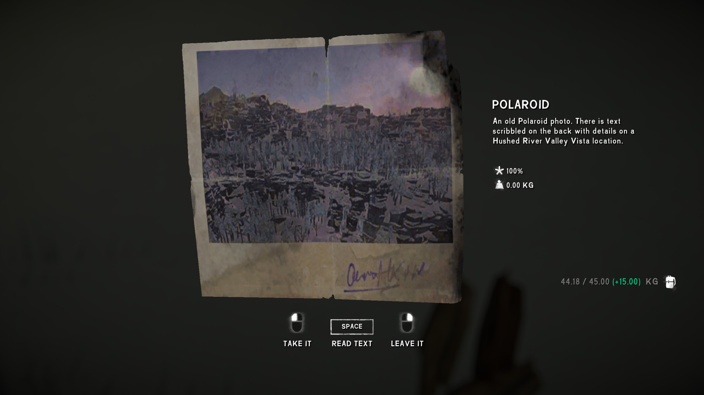
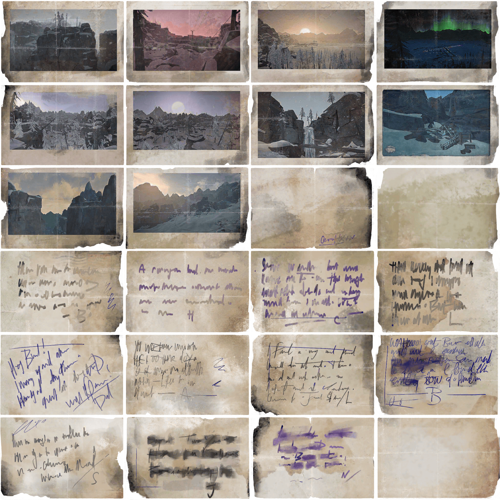
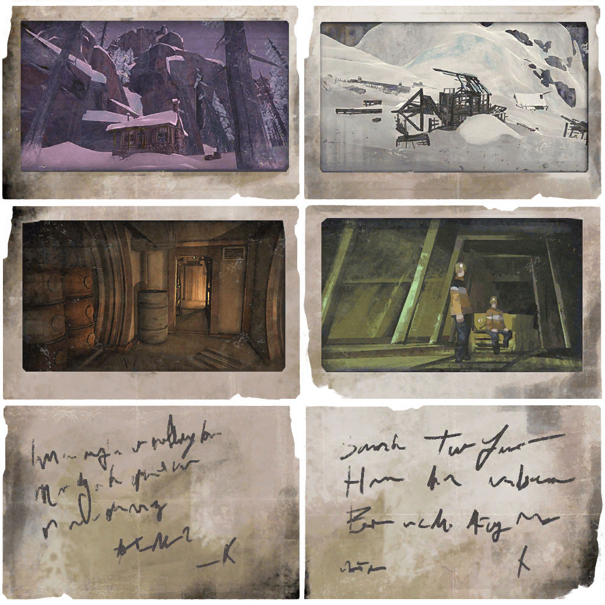

# Polaroids

**Categories:** Collectibles · **Source:** [Fandom](https://thelongdark.fandom.com/wiki/Polaroids)

**Contents**

- [Vista Polaroids](#vista-polaroids)
- [Tales Polaroids](#tales-polaroids)
- [Examine Text](#examine-text)
- [Gallery](#gallery)
- [References](#references)

 Polaroids are collectible items that were added in the [Fearless Navigator](https://hinterlandforums.com/forums/topic/36987-the-long-dark-updated-fearless-navigator-176/) update. They are polaroid photographs with an inscription on the back informing the player which region each Polaroid belongs to. They are most commonly found on bodies or in backpacks of past survivors.

Polaroids are purely used for surveying. After collecting a Polaroid, an icon will appear on the player's map to show where the Vista the Polaroid corresponds to is located. If the player stands at the Vista location shown in the Polaroid and surveys the location with [Charcoal](./Charcoal.md) (provided that the weather is clear), a large area of the [Map](./Map.md) will be revealed.

- Note that the only regions without Polaroids are [Broken Railroad](./Broken%20Railroad.md), [Desolation Point](./Desolation%20Point.md), [Transfer Pass](./Transfer%20Pass.md), and [Transition Regions](./Region.md#Transition_Zones), likely due to their small sizes. There are a total of 27 Polaroids:

- Vista Polaroid: Some regions (Some have 2 Polaroids, instead of 1).
- Tales Polaroids: Some are part of [Tales](./Tales.md) progression Collectibles.

## **Vista** **Polaroids**

There are currently a total of 21 Vista Polaroids. In many regions, the locations of where you find the vista polaroids are linked to which [Loot Table](./Loot%20Table.md) your game is on. So if you find a polaroid linked to Loot Table 4 (e.g. the polaroid at the end of [Secret Mountain Path](./Secret%20Mountain%20Path.md)), you will find polaroids in other regions in their Loot Table 4 spawn positions.

| Polaroid | Region | Locations | Vista |
| --- | --- | --- | --- |
| [Ico GearItem PostCard AC CentralSpire](../assets/Ico_GearItem_PostCard_AC_CentralSpire.png)[Ico GearItem PostCard AC TopShelf](../assets/Ico_GearItem_PostCard_AC_TopShelf.png) | Ash Canyon | \*_Loot Table 1_: In a Plastic Container south of [Miner's Folly](./Miner%27s%20Folly.md) and east of [Foreman's Retreat](./Foreman%27s%20Retreat.md), in an open ended cave with a pine bed.; - _Loot Table 1_: In Trunk at the southern edge of the map, right in the middle. To get there you need to jump down from the plateau on the way to the [Prepper Cache](./Prepper%20Cache.md).; - _Loot Table 2_: In a Plastic Container south of [Stone Shelf Cave](./Stone%20Shelf%20Cave.md), across a fallen tree bridge on the western side of the map.; - _Loot Table 2_: In a Plastic Container northwest of [Fire Overlook](./Fire%20Overlook.md), in the dead-end behind the birch saplings.; - _Loot Table 3_: West of Shattered Cove, after heading down a one-way drop, just before a log bridge a metal container containing a polaroid may spawn.; - _Loot Table 3_: In a Plastic Container north of Wolf's Jaw Overlook, where the path takes a sharp turn west, next to the wooden sign.; - _Loot Table 4_: In a Hidden Cache located next to the rope rock holding first of three ropes leading up to the Gold Mine, in the northwest part of the map.; - _Loot Table 4_: In a Metal Container where you head north along the mountain wall from the [Climber's Cave](./Climber%27s%20Cave.md) and hit a cliff. Under the cliff is the area where the Angler's Den is located. | [High Meadow](./High%20Meadow.md), [Wolf's Jaw Overlook](./Wolf%27s%20Jaw%20Overlook.md) |
| [Missing image: BR\_Polaroid2.png][Missing image: BR\_Polaroid\_1.png] | Blackrock | - Attached to the large sign just outside of the Blackrock Penitentiary entrance.; - Inside the [Whistling Perch](./Whistling%20Perch.md) hunter's blind | Ledge overlooking the ravine on the path to [Last Prospect Mine](./Last%20Prospect.md),; Pylon southeast of the [Prison](./Blackrock%20Prison.md) |
| [Ico GearItem PostCard BI EchoOne RadioTower resources.assets 381](../assets/Ico_GearItem_PostCard_BI_EchoOne_RadioTower-resources.assets-381.png) | Bleak Inlet | - _Loot Table 1_: In a green box hidden amongst scrub brushes surrounded by large rocks, east of the rope climb.; - _Loot Table 2_: In the southwestern Hunter's Blind, west of [Washed Out Trailers](./Washed%20Out%20Trailers.md).; - _Loot Table 3_: Plastic container, rear base of island with Fallen Lighthouse.; - _Loot Table 4_: At the end of the [Secret Mountain Path](./Secret%20Mountain%20Path.md). | [Echo One Radio Tower](./Echo%20One%20Radio%20Tower.md) |
| [Ico GearItem PostCard CR AbandonedLookout resources.assets 734](../assets/Ico_GearItem_PostCard_CR_AbandonedLookout-resources.assets-734.png) | Coastal Highway | - _Loot Table 1_: On a body next to a fallen tree north of [Fishing Camp](./Fishing%20Camp.md); - _Loot Table 2_: In a backpack near the cabin northwest of [The Tooth](./The%20Tooth.md); - _Loot Table 3_: In a backpack between [Misanthrope's Homestead](./Misanthrope%27s%20Homestead.md) and [Jackrabbit Island](./Jackrabbit%20Island.md); - _Loot Table 4_: In a backpack next to [The Tooth](./The%20Tooth.md) | [Abandoned Lookout](./Abandoned%20Lookout.md) |
| [Ico GearItem PostCard FM ShortwaveTower resources.assets 661](../assets/Ico_GearItem_PostCard_FM_ShortwaveTower-resources.assets-661.png)[Ico GearItem PostCard FM MuskegOverlook resources.assets 711](../assets/Ico_GearItem_PostCard_FM_MuskegOverlook-resources.assets-711.png) | Forlorn Muskeg | - _Loot Table 1_: On a dead body north of [Old Spence Family Homestead](./Old%20Spence%20Family%20Homestead.md), around the storage room with barrel; - _Loot Table 1_: In the shallow cave in [Marsh Ridge](./Marsh%20Ridge.md); - _Loot Table 2_: In the [Low Blind](./Low%20Blind.md), near where the [Abandoned Camp](./Abandoned%20Camp.md) sometimes spawns; - _Loot Table 2_: In a briefcase near the [Bunkhouses](./Bunkhouses.md); - _Loot Table 3_: At the [High Blind](./High%20Blind.md); - _Loot Table 3_: Plastic container up the hill south of and overlooking [Old Spence Family Homestead](./Old%20Spence%20Family%20Homestead.md) (down in a dip, difficult to see unless next to the rocks); - _Loot Table 4_: In Metal Container in a Cave west of [Old Spence Family Homestead](./Old%20Spence%20Family%20Homestead.md); - _Loot Table 4_: In a Bear Cave south of the [Broken Railroad](./Broken%20Railroad.md) entrance | [Shortwave Tower](./Shortwave%20Tower.md), [Muskeg Overlook](./Muskeg%20Overlook.md) |
| [Missing image: FA\_Polaroid.png][FA Polaroid2](../assets/FA_Polaroid2.png) | Forsaken Airfield | - On a table in [Island Cottage](./Island%20Cottage.md); - In a car's visor near [Junker's Paddock](./Junker%27s%20Paddock.md) | Cliffside south of [Field 31](./Field%2031.md),[Mindful Cabin](./Mindful%20Cabin.md) |
| [Ico GearItem PostCard RV Pensive resources.assets 766](../assets/Ico_GearItem_PostCard_RV_Pensive-resources.assets-766.png) | Hushed River Valley | - _Loot Table 1_: In a plastic container on a hill between the bear cave and ice cave in the northwest region of the map; - _Loot Table 2_: In a metal container near the [Landslide](./Landslide%20%28Hushed%20River%20Valley%29.md); - _Loot Table 3_: In a briefcase on ledge across a fallen tree in southeastern corner of the map, south of southern [Mysterious Signal Fire](./Mysterious%20Signal%20Fire.md); - _Loot Table 4_: In a plastic container on the [Valley View Point](./Valley%20View%20Point.md) hill | [Pensive Vista](./Pensive%20Vista.md) |
| [Ico GearItem PostCard MT RadioTower resources.assets 689](../assets/Ico_GearItem_PostCard_MT_RadioTower-resources.assets-689.png) | Mountain Town | - _Loot Table 1_: In the car across from the Bear cave east of the [Spruce Falls Bridge](./Spruce%20Falls%20Bridge.md); - _Loot Table 2_: Next to a backpack at [Rocky Refuge](./Rocky%20Refuge.md); - _Loot Table 3_: In a backpack next to a body, on a small hill about 100 meters north of the [Paradise Meadows Farm](./Paradise%20Meadows%20Farm.md); - _Loot Table 4_: In a briefcase by the cave below the [Crashed Plane](./Mackenzie%27s%20Crashed%20Plane.md) | [Radio Tower](./Radio%20Tower.md) |
| [Ico GearItem PostCard ML ForestryLookout resources.assets 941](../assets/Ico_GearItem_PostCard_ML_ForestryLookout-resources.assets-941.png)[Ico GearItem PostCard ML LakeOverlook resources.assets 905](../assets/Ico_GearItem_PostCard_ML_LakeOverlook-resources.assets-905.png) | Mystery Lake | - _Loot Table 1_: On the steps leading up to the [Destroyed Lookout](./Destroyed%20Lookout.md); - _Loot Table 1_: In a backpack in the bear's den on [Mystery Lake](./Mystery%20Lake%20%28disambiguation%29.md) north of the [Lone Lake Cabin](./Lone%20Lake%20Cabin.md); - _Loot Table 2_: In the cave at the plateau with [Lake Overlook](./Lake%20Overlook.md); - _Loot Table 2_: On a body Northwest of [Clearcut](./Clearcut.md); - _Loot Table 3_: On a body Northeast of [Logging Camp](./Logging%20Camp.md); - _Loot Table 3_: On a body north of the isolated cabin south of the [Clearcut](./Clearcut.md) and north of the [Unnamed Pond](./Unnamed%20Pond.md); - _Loot Table 4_: Under the door of the Isolated Cabin north of [Unnamed Pond](./Unnamed%20Pond.md); - _Loot Table 4_: In a backpack in the cave near the top of the Mystery Lake (Western Access) mountaineering rope | [Forestry Lookout](./Forestry%20Lookout.md), [Lake Overlook](./Lake%20Overlook.md) |
| [Ico GearItem PostCard PV SignalHill resources.assets 935](../assets/Ico_GearItem_PostCard_PV_SignalHill-resources.assets-935.png) | Pleasant Valley | - _Loot Table 1_: In a backpack surrounded by the large rocks near the [Pleasant Valley Farmstead](./Pleasant%20Valley%20Farmstead.md); - _Loot Table 2_: Under a chair in the front section of the plane at the [Crash Site](./Crash%20Site%20%28Pleasant%20Valley%29.md); - _Loot Table 3_: On a dead body east of [Three Strikes Farmstead](./Three%20Strikes%20Farmstead.md); - _Loot Table 4_: Next to a backpack In the [Burned Ridge Cave](./Burned%20Ridge%20Cave.md) | [Signal Hill](./Signal%20Hill.md) |
| [Ico GearItem PostCard MP BrokenRoad](../assets/Ico_GearItem_PostCard_MP_BrokenRoad.png)[Ico GearItem PostCard MP OgresTeardrop](../assets/Ico_GearItem_PostCard_MP_OgresTeardrop.png) | Sundered Pass | - On the bunk/shelf of [Final Refuge](./Final%20Refuge.md); - [Cabin (Sundered Pass)](./Cabin%20%28Sundered%20Pass%29.md) at Old Settlement, partially hidden beneath two paintings on the upstairs.; - [Cabin (Sundered Pass)](./Cabin%20%28Sundered%20Pass%29.md) at Old Settlement, leaning against a painting on a shelf downstairs.; - On a Frozen Corpse close to the ruined [Basement (Sundered Pass)](./Basement%20%28Sundered%20Pass%29.md) building at the Old Settlement | Cliff near [Prayerful Window](./Prayerful%20Window.md) overlooking the [Old Settlement](./Old%20Settlement.md),; Cliff overlooking [Perilous Crossing](./Perilous%20Crossing.md) and [Ogre's Teardrop](./Ogre%27s%20Teardrop.md) |
| [Ico GearItem PostCard TM AndresPeak resources.assets 946](../assets/Ico_GearItem_PostCard_TM_AndresPeak-resources.assets-946.png)[Ico GearItem PostCard TM TailSection resources.assets 553](../assets/Ico_GearItem_PostCard_TM_TailSection-resources.assets-553.png) | Timberwolf Mountain | - _Loot Table 1_: In a cave at the [Summit](./Summit.md), on a frozen corpse or in a plastic container.; - _Loot Table 1_: In a backpack on [Echo Peak West](./Echo%20Peak%20West.md); - _Loot Table 2_: On a corpse, South of [Eric's Falls](./Eric%27s%20Falls.md) and just North of the falls with no rope; - _Loot Table 2_: On a hill north of [Forest Cave](./Forest%20Cave%20%28Timberwolf%20Mountain%20location%29.md), east of the [Wing](./Wing.md) in a backpack; - _Loot Table 3_: In a cave on the eastern edge of the map, to the north across the fallen tree over the transition to [Ash Canyon](./Ash%20Canyon.md). Two spawns exist here, one in a briefcase, another in a backpack. (Both polaroids spawn here on this loot table.); - _Loot Table 4_: In a plastic container on [Andre's Peak](./Andre%27s%20Peak.md); - _Loot Table 4_: In a plastic container on [Echo Peak East](./Echo%20Peak%20East.md) | [Andre's Peak](./Andre%27s%20Peak.md), [Summit](./Summit.md) |
| [Ico GearItem PostCard MR Settlement](../assets/Ico_GearItem_PostCard_MR_Settlement.png)[Ico GearItem PostCard MR Window](../assets/Ico_GearItem_PostCard_MR_Window.png) | Zone of Contamination | - On the train station office corkboard in [Indolent Hoppers](./Indolent%20Hoppers.md); - On the dashboard of an [Haul Truck](./Haul%20Truck.md) parked in the mining pit. | Cliff near [Boss's Settlement](./Boss%27s%20Settlement.md), Cliff near [Welkin's Window](./Welkin%27s%20Window.md) |

## Tales Polaroids

The following items are photos found while progressing the [Tales](./Tales.md) in [Tales from the Far Territory](./Tales%20from%20the%20Far%20Territory.md). They do not give a Polaroid Vista but instead are a hint meant to lead the player to a location. They are stored in the Polaroids Collections menu when found.

| Photo | Name | Location | Leads to |
| --- | --- | --- | --- |
| [Faded Photograph icon](../assets/Faded_Photograph_icon.png) | [Faded Photograph](./Faded%20Photograph.md) | - Found inside [Security Chief's Log (illegible)](./Security%20Chief%27s%20Log%20%28illegible%29.md) | Leads to [Enduring Waterfall](./Enduring%20Waterfall.md) |
| [Foreman's Polaroid 1 icon](../assets/Foreman%27s_Polaroid_1_icon.png) | [Foreman's Polaroid 1](./Foreman%27s%20Polaroid%201.md) | - Found inside [Foreman's Technical Log 1](./Foreman%27s%20Technical%20Log%201.md) | Leads to [Last Lonely House](./Last%20Lonely%20House.md) |
| [Foreman's Polaroid 2 icon](../assets/Foreman%27s_Polaroid_2_icon.png) | [Foreman's Polaroid 2](./Foreman%27s%20Polaroid%202.md) | - Found inside [Foreman's Technical Log 2](./Foreman%27s%20Technical%20Log%202.md) | Leads to a ruined building housing [Basement (Sundered Pass)](./Basement%20%28Sundered%20Pass%29.md) |
| [Foreman's Polaroid 3 icon](../assets/Foreman%27s_Polaroid_3_icon.png) | [Foreman's Polaroid 3](./Foreman%27s%20Polaroid%203.md) | - Found inside [Foreman's Technical Log 3](./Foreman%27s%20Technical%20Log%203.md) | Leads to a closet in [Bunker Omega](./Bunker%20Omega.md) |
| [Foreman's Polaroid 4 icon](../assets/Foreman%27s_Polaroid_4_icon.png) | [Foreman's Polaroid 4](./Foreman%27s%20Polaroid%204.md) | - Found inside [Foreman's Technical Log 4](./Foreman%27s%20Technical%20Log%204.md) | Just a Collectible |
| [Foreman's Polaroid 5 icon](../assets/Foreman%27s_Polaroid_5_icon.png) | [Foreman's Polaroid 5](./Foreman%27s%20Polaroid%205.md) | - Found inside [Basement (Sundered Pass)](./Basement%20%28Sundered%20Pass%29.md) | Leads to the stairs near [Roamer's Cave](./Roamer%27s%20Cave.md) |

## Examine Text

| Photo | Item Name | Item Text | Examine Text |
| --- | --- | --- | --- |
| [Ico GearItem PostCard AC CentralSpire](../assets/Ico_GearItem_PostCard_AC_CentralSpire.png) | PostCard AC CentralSpire | An old Polaroid photo. There is text scribbled on the back with details of a Great Bear Island Vista location. | All the way up this high plateau. Only to spot a half dozen more more towers to climb! What a day! |
| [Ico GearItem PostCard AC TopShelf](../assets/Ico_GearItem_PostCard_AC_TopShelf.png) | PostCard AC TopShelf | An old Polaroid photo. There is text scribbled on the back with details of a Great Bear Island Vista location. | Can't believe I have to go BACK over that dang bridge. View was worth it! |
| [Missing image: BR\_Polaroid2.png]; _BR\_Polaroid2.png_ | PostCard BR Canyon | An old Polaroid photo. There is text scribbled on the back with details of a Blackrock Vista location. | Had a nice look at Mule Bridge and the falls, but from the other side. What a climb. |
| [Missing image: BR\_Polaroid\_1.png]; _BR\_Polaroid\_1.png_ | PostCard BR Prison | An old Polaroid photo. There is text scribbled on the back with details of a Blackrock Vista location. | Found a higher spot to get a shot of the prison for you. Tried to make it scenic. Are power lines scenic? |
| [Ico GearItem PostCard BI EchoOne RadioTower resources.assets 381](../assets/Ico_GearItem_PostCard_BI_EchoOne_RadioTower-resources.assets-381.png) | BI EchoOne RadioTower | An old Polaroid photo. There is text scribbled on the back with details of a Bleak Inlet Vista location. | Snapped a pic, thought you might like one. Hard to believe how long we stuck it out in that damn fish biz. I swear I can still smell it sometimes!; - J. |
| [Ico GearItem PostCard CR AbandonedLookout resources.assets 734](../assets/Ico_GearItem_PostCard_CR_AbandonedLookout-resources.assets-734.png) | PostCard CR AbandonedLookout | An old Polaroid photo. There is text scribbled on the back with details of a Great Bear Island Vista location. | WAAA-HOOOO |
| [Missing image: FA\_Polaroid.png]; _FA\_Polaroid.png_ | PostCard AF Plateau | An old Polaroid photo. There is text scribbled on the back with details of a Great Bear Island Vista location. | Bleak, desolate, sublime. A memory I [...smugged...] |
| [FA Polaroid2](../assets/FA_Polaroid2.png) | PostCard AF Cabin | An old Polaroid photo. There is text scribbled on the back with details of a Great Bear Island Vista location. | What a shot, can't believe we got up there! |
| [Ico GearItem PostCard FM ShortwaveTower resources.assets 661](../assets/Ico_GearItem_PostCard_FM_ShortwaveTower-resources.assets-661.png) | PostCard FM ShortwaveTower | An old Polaroid photo. There is text scribbled on the back with details of a Timberwolf Mountain Vista location. | These lousy towers keep me so busy that I snapped a pic just for you. This is what keeps me away from home all these weeks! But I'm almost done. - L. |
| [Ico GearItem PostCard FM MuskegOverlook resources.assets 711](../assets/Ico_GearItem_PostCard_FM_MuskegOverlook-resources.assets-711.png) | PostCard FM MuskegOverlook | An old Polaroid photo. There is text scribbled on the back with details of a Timberwolf Mountain Vista location. | Some wandering soul last winter took me to the strangest, most desolate part of Great Bear. Looking out over this broken marshland, I couldn't help but think of you. What a time we had! - C. |
| [Ico GearItem PostCard RV Pensive resources.assets 766](../assets/Ico_GearItem_PostCard_RV_Pensive-resources.assets-766.png) | PostCard RV Pensive | An old Polaroid photo. There is text scribbled on the back with details of a Hushed River Valley Vista location. | Look at this spot! Had to climb like hell to get all the way up there, but it was worth it. Even saw a rainbow. :); - N. |
| [Ico GearItem PostCard MT RadioTower resources.assets 689](../assets/Ico_GearItem_PostCard_MT_RadioTower-resources.assets-689.png) | PostCard MT RadioTower | An old Polaroid photo. There is text scribbled on the back with details of a Mountain Town Vista location. | Hey bud! I was up and about the other day finally. Got all the way up above Milton, near the tower up there. Leg's feeling great! - Dad |
| [Ico GearItem PostCard ML ForestryLookout resources.assets 941](../assets/Ico_GearItem_PostCard_ML_ForestryLookout-resources.assets-941.png) | PostCard ML ForestryLookout | An old Polaroid photo. There is text scribbled on the back with details of a Mystery Lake Vista location. | A ranger let me into this old Forestry Lookout near Mystery Lake. Didn't stay long. The wind sure howls up there at night! - H. |
| [Ico GearItem PostCard ML LakeOverlook resources.assets 905](../assets/Ico_GearItem_PostCard_ML_LakeOverlook-resources.assets-905.png) | PostCard ML LakeOverlook | An old Polaroid photo. There is text scribbled on the back with details of a Mystery Lake Vista location. | The view up here is amazing! You can see the entire Lake region almost. A tough climb up all those ropes, but so worth it. I'll show you the spot next time we are out here. - B. |
| [Ico GearItem PostCard PV SignalHill resources.assets 935](../assets/Ico_GearItem_PostCard_PV_SignalHill-resources.assets-935.png) | PostCard PV SignalHill | An old Polaroid photo. There is text scribbled on the back with details of a Pleasant Valley Vista location. | This is what I see every day at work! Weather service radio, with a touch of music when I get the chance. Who needs the Mainland?; - S. |
| [Ico GearItem PostCard MP BrokenRoad](../assets/Ico_GearItem_PostCard_MP_BrokenRoad.png) | PostCard MP BrokenRoad | An old Polaroid photo. There is text scribbled on the back with details of a Great Bear Island Vista location. | Incredible to see the high snowfield from up here -- and the avalanches! |
| [Ico GearItem PostCard MP OgresTeardrop](../assets/Ico_GearItem_PostCard_MP_OgresTeardrop.png) | PostCard MP OgresTeardrop | An old Polaroid photo. There is text scribbled on the back with details of a Great Bear Island Vista location. | Scouting a new approach to the Teardrop - - what a view! |
| [Ico GearItem PostCard TM AndresPeak resources.assets 946](../assets/Ico_GearItem_PostCard_TM_AndresPeak-resources.assets-946.png) | PostCard TM AndresPeak | An old Polaroid photo. There is text scribbled on the back with details of a Timberwolf Mountain Vista location. | I found a special place today. It's not the highest peak near Timberwolf, but it might have the sweetest view of Crystal Lake I've found up there. Just stunning. - L. |
| [Ico GearItem PostCard TM TailSection resources.assets 553](../assets/Ico_GearItem_PostCard_TM_TailSection-resources.assets-553.png) | PostCard TM TailSection | An old Polaroid photo. There is text scribbled on the back with details of a Timberwolf Mountain Vista location. | You wouldn't believe it if I told you where I've been today |
| [Ico GearItem PostCard MR Settlement](../assets/Ico_GearItem_PostCard_MR_Settlement.png) | PostCard MR Settlement | An old Polaroid photo. There is text scribbled on the back with details of a Great Bear Island Vista location. | Just past these old, rotting foundations up there, near the edge. One hell of a view. - H |
| [Ico GearItem PostCard MR Window](../assets/Ico_GearItem_PostCard_MR_Window.png) | PostCard MR Window | An old Polaroid photo. There is text scribbled on the back with details of a Great Bear Island Vista location. | Took a wrong turn after leaving the Airfield. Found myself a little spot little cave with a distant waterfall in sight. Peaceful. - S |

## Gallery

## References

- [Bashrobe. 2023. All Polaroid Locations - The Long Dark](https://www.youtube.com/watch?v=MT7tQx8doq8) (for loot table based locations)
