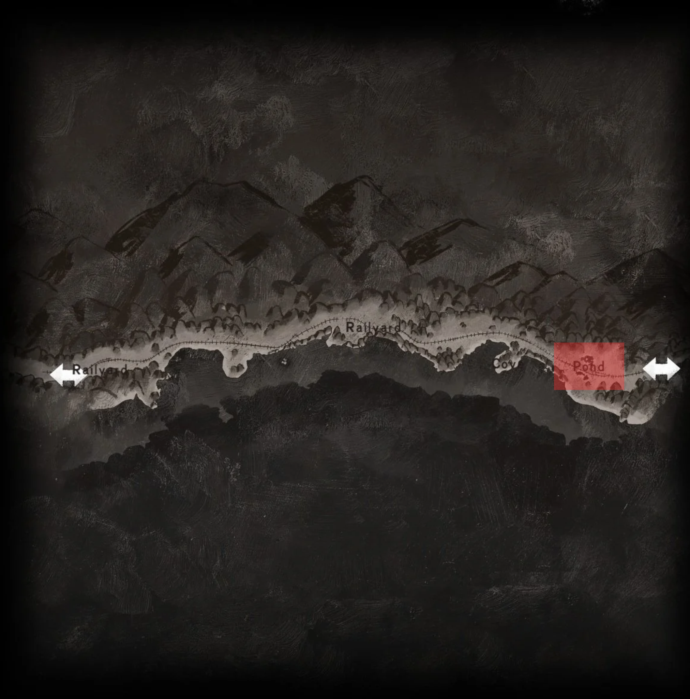

# Pond \(Track Section 3\)

**Categories:** DLC Content, Locations, Locations in Anna Island -- Track Section 3, Outdoor locations · **Source:** [Fandom](https://thelongdark.fandom.com/wiki/Pond_%28Track_Section_3%29)

| Column 1 | Column 2 | Column 3 |
| --- | --- | --- |

|  / _Pond\_(Track\_Section\_3).jpg_ |  |  |
| **Location** |  |  |
|  / _Pond\_Track\_3\_Location.png_ |  |  |
| Region | [Anna Island -- Track Section 3](./Anna%20Island%20--%20Track%20Section%203.md)\|- |  |
| Description | A small pond close to the rail line |  |
| **General** |  |  |
