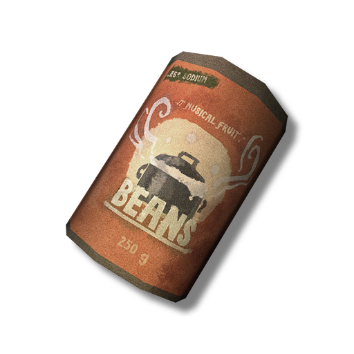
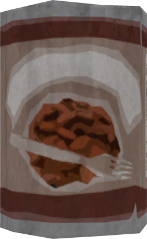

# Pork and Beans

**Contents**

- [Overview](#Overview)
- [Trivia](#Trivia)
- [Gallery](#Gallery)
- [Update history](#Update_history)

<table class="infobox">
<caption>Pork and Beans</caption>
<colgroup>
<col style="width: 33%" />
<col style="width: 33%" />
<col style="width: 33%" />
</colgroup>
<tbody>
<tr>
<td colspan="2">
[[File:

<table class="gallery">
<colgroup>
<col style="width: 50%" />
<col style="width: 50%" />
</colgroup>
<tbody>
<tr>
<th><figure>

<figcaption>Sealed</figcaption>
</figure></th>
<td><figure>

<figcaption>Opened</figcaption>
</figure></td>
</tr>
</tbody>
</table></td>
<td>
250px]]
</td>
</tr>
<tr>
<td>
Release
</td>
<td>
<a href="./The%20Long%20Dark%20%E2%80%94%20Changelog.md#0.117" class="wikilink" title="22 September 2014">22 September 2014</a>
</td>
<td></td>
</tr>
<tr>
<td>
Wintermute
</td>
<td>
No
</td>
<td></td>
</tr>
<tr>
<td colspan="2">
<strong>Properties</strong>
</td>
<td></td>
</tr>
<tr>
<td>
Item type
</td>
<td>
<a href="./Food%20And%20Drink.md" class="wikilink" title="Food And Drink">Food And Drink</a>|-
</td>
<td>
Equipable
</td>
</tr>
<tr>
<td>
Stackable
</td>
<td>
No
</td>
<td></td>
</tr>
<tr>
<td>
Examine
</td>
<td>
Beans in molasses, with bits of what looks like pork.
</td>
<td></td>
</tr>
<tr>
<td colspan="2">
<strong>Values</strong>
</td>
<td></td>
</tr>
<tr>
<td>
Calories
</td>
<td>
600 kcal
</td>
<td></td>
</tr>
<tr>
<td>
Hydration
</td>
<td>
-5%
</td>
<td></td>
</tr>
<tr>
<td>
<a href="./Scurvy.md" class="wikilink" title="Vitamin C">Vitamin C</a>
</td>
<td>
Minor (2%)
</td>
<td></td>
</tr>
<tr>
<td>
Weight
</td>
<td>
0.25 kg (0.55 lbs)
</td>
<td></td>
</tr>
<tr>
<td colspan="2">
<strong>Decay Rate</strong>
</td>
<td></td>
</tr>
<tr>
<td>
Inside
</td>
<td>
0.133% per day
</td>
<td></td>
</tr>
<tr>
<td>
Outside
</td>
<td>
0.667% per day
</td>
<td></td>
</tr>
<tr>
<td colspan="2">
<strong>Advanced data</strong>
</td>
<td></td>
</tr>
<tr>
<td>
Item key
</td>
<td>
GAMEPLAY_PorkandBeans
</td>
<td></td>
</tr>
</tbody>
</table>

**Pork and Beans** is a packaged <a href="./Food%20And%20Drink.md" class="wikilink" title="food">food</a> item in *The Long Dark*.

## Overview

Consuming Pork and Beans restores a moderate amount of calories and causes slight hydration loss. It may also be warmed by a <a href="./Fire.md" class="wikilink" title="Fire">Fire</a> to grant the benefit <a href="./Warming%20Up.md" class="wikilink" title="Warming Up">Warming Up</a>.

Like other canned foods, Pork and Beans may be opened with a <a href="./Can%20Opener.md" class="wikilink" title="Can Opener">Can Opener</a> or <a href="./Tools.md" class="wikilink" title="bladed tool">bladed tool</a>, or smashed open (with no tool) but spilling some of it's contents. If opened with a tool a <a href="./Recycled%20Can.md" class="wikilink" title="Recycled Can">Recycled Can</a> is received after consuming the contents.

Pork and Beans is relatively common inside homes: usually in cupboards or on shelves.

## Trivia

- Pork and Beans is packaged as the product "*Musical Fruit Beans"*, referencing a popular rhyme about flatulence. The can also promotes "reduced sodium", which would likely be less than ideal in a post-apocalyptic setting.
- A single <a href="./Can.md" class="wikilink" title="Can">Can</a> of Pork and Beans can be harvested for one <a href="./Recycled%20Can.md" class="wikilink" title="Recycled Can">Recycled Can</a> in <a href="./Episode%203%20-%20Crossroads%20Elegy.md" class="wikilink" title="Episode 3: Crossroads Elegy">Episode 3: Crossroads Elegy</a> in the <a href="./Misty%20Falls%20Cave.md" class="wikilink" title="Misty Falls Cave">Misty Falls Cave</a>. 4 more cans would eventually be added to Survival Mode.
- The ingredients on the back list: "Beans, Water, Sugar, Salt."

## Gallery

<table class="gallery">
<colgroup>
<col style="width: 100%" />
</colgroup>
<tbody>
<tr>
<td><figure>

<figcaption>old model</figcaption>
</figure></td>
</tr>
</tbody>
</table>

## Update history

- UPDATE **17 December 2014 (<a href="./The%20Long%20Dark%20%E2%80%94%20Early%20Access%20Changelog.md#0.181" class="wikilink" title="Update">Update</a>):**
  - Canned beans can now also be cooked and eaten hot

<!-- -->

- UPDATE **22 September 2014 (<a href="./The%20Long%20Dark%20%E2%80%94%20Early%20Access%20Changelog.md#0.117" class="wikilink" title="Update">Update</a>):**
  - Added to game.

**Lua execution error in Module:Navbox function navbox** <a href="fr:Porc_et_haricots" class="wikilink" title="fr:Porc et haricots">fr:Porc et haricots</a> <a href="ru:%D0%91%D0%B0%D0%BD%D0%BA%D0%B0_%D1%81%D0%B2%D0%B8%D0%BD%D0%B8%D0%BD%D1%8B_%D1%81_%D1%84%D0%B0%D1%81%D0%BE%D0%BB%D1%8C%D1%8E" class="wikilink" title="ru:Банка свинины с фасолью">ru:Банка свинины с фасолью</a>

