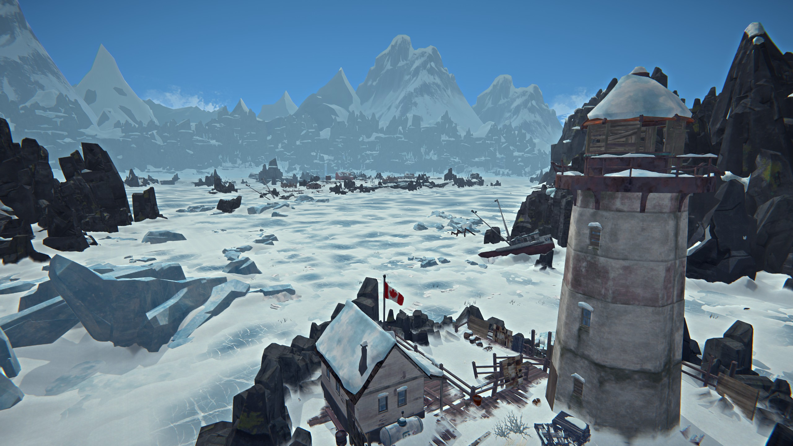
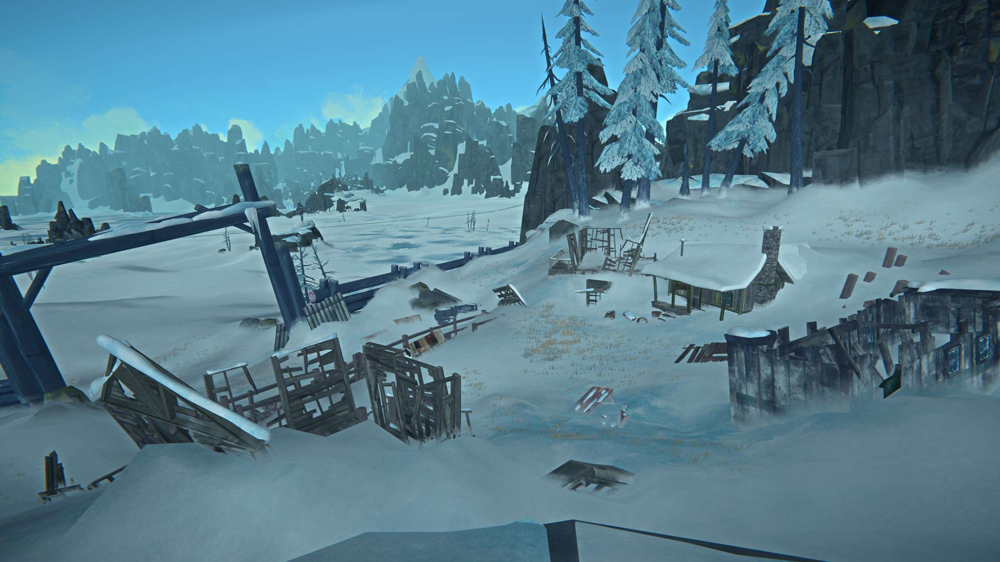
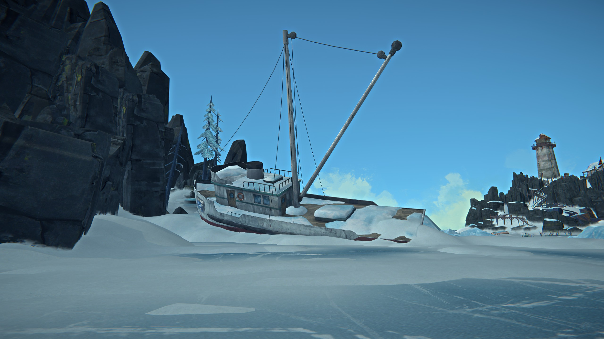
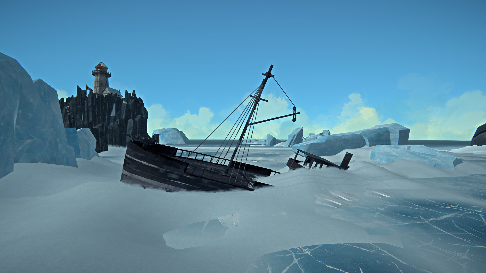
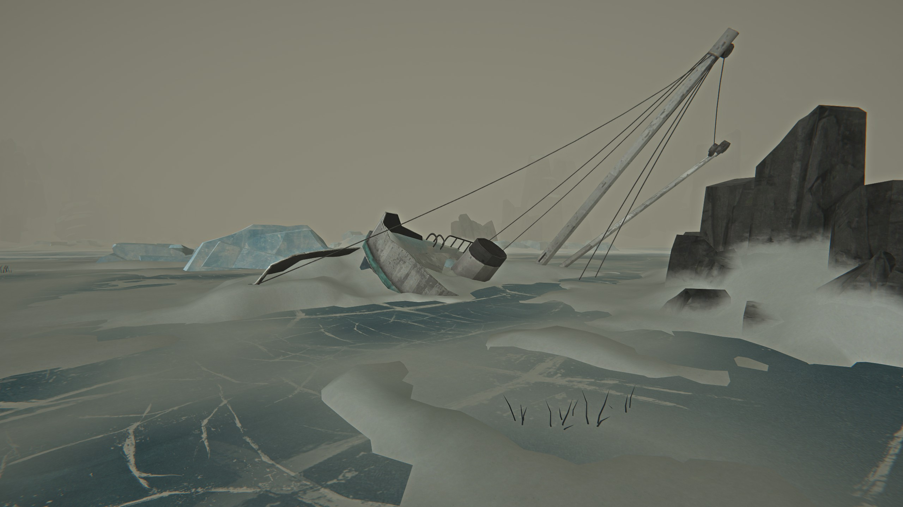
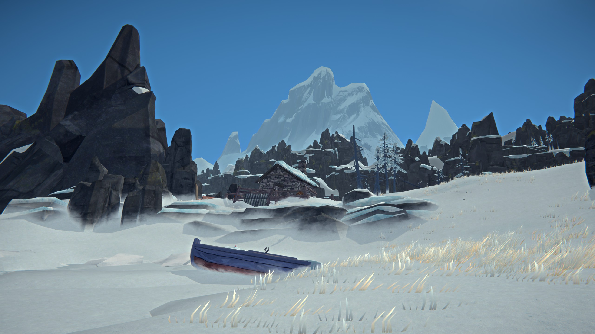

# Port Remnant

**Categories:** DLC Content · **Source:** [Fandom](https://thelongdark.fandom.com/wiki/Port_Remnant)

**Contents**

- [Overview](#overview)
- [Locations](#locations)
- [Wildlife management](#wildlife-management)
- [Survivability](#survivability)
- [Safe houses](#safe-houses)
- [Trivia](#trivia)
- [Gallery](#gallery)
- [Maps](#maps)
- [Locations](#locations-1)
- [Miscellaneous](#miscellaneous)

_Seal\_icon.png_

**DLC-Exclusive content.** / This content requires the [Iron Road](./Iron%20Road.md) addon to be installed before it can be seen or used in regular gameplay.

\|} / **Port Remnant** /  / _Port\_Remnant.jpg_ / **Location on [Cauldron Island](./Cauldron%20Island.md)** /  / _No\_picture.png_ /  / _Port\_Remnant\_Map.png_ / **Details** / **Description:** A century old abandoned shipping port that is the starting point of Cauldron Island. / **Connecting Regions:** [Anna Island -- Track Section 1](./Anna%20Island%20--%20Track%20Section%201.md) [Anna Island -- Track Section 5](./Anna%20Island%20--%20Track%20Section%205.md) / **Interloper Region Spawn:** No / **Date Added:** October 27 2026 / **Port Remnant** is a [Region](./Region.md) released for _[The Long Dark](./The%20Long%20Dark.md)_ and is the starting point of [Cauldron Island](./Cauldron%20Island.md) and the [_Iron Road_](./Iron%20Road.md) expansion. / ## Overview / Port Remnant is first accessed by taking the [Fulmar Autopilot Boat](./Fulmar%20Autopilot%20Boat.md) from [Desolation Point](./Desolation%20Point.md). From there, the player will arrive at Cauldron Island inside a cave underneath the Lighthouse. Climbing the stone stairs reveals a ruined Lighthouse and [Wax Cylinder 2](./Wax%20Cylinder%202.md) and [Map (Church)](./Map%20%28Church%29.md). The Cylinder has a key to the door, and the Map points to the path to take to the Church in the region. / The region itself is in a considerable state of disrepair. A century of time has rotted away most of the buildings in the region, many of which are barely standing. 3 ships can be found half sunken in the ice near the Lighthouse. What is presumably a whaling warehouse is found in the center of the map after traversing the frozen bay, with worker cabins found around the area. Southwest is a set of train track, train bridge, and a train terminal. A road leads up to a cliff to the Church in the south most part of the map (inaccessible due to a landslide), with more flat land and some ponds below the southern cliffs. / Several of the jagged mountainous areas can be explored near the bay, leading to hidden plant supplies and unique vantage points. Bizarrely, there are 3 Whale Bone Shrines in a few places in the region whose nature is currently not understood. / Taking the tracks to the east will take the player to [Anna Island -- Track Section 5](./Anna%20Island%20--%20Track%20Section%205.md), while the tracks to the west lead to [Anna Island -- Track Section 1](./Anna%20Island%20--%20Track%20Section%201.md) (though the path is blocked by a metal gate). / The area can be returned later to with the [Prototype Train](./Prototype%20Train.md), which can be used to open the inaccessible [Obstructed Transit](./Obstructed%20Transit.md) and destroy the gate to Track Section 1. This is the only region on Anna Island not to feature an [Oil Tank](./Oil%20Tank.md) or [Water Tower](./Water%20Tower.md) (aside from [Anna Island -- Track Section 6](./Anna%20Island%20--%20Track%20Section%206.md)). / ## Locations / There are 16 named locations within Port Remnant, including:{\| class="" style="background-color:transparent; color:inherit; width:100%;"

_Port\_Remnant.jpg_

**Location on [Cauldron Island](./Cauldron%20Island.md)**

_No\_picture.png_

_Port\_Remnant\_Map.png_

**Details**

**Description:** A century old abandoned shipping port that is the starting point of Cauldron Island.

**Connecting Regions:** [Anna Island -- Track Section 1](./Anna%20Island%20--%20Track%20Section%201.md) [Anna Island -- Track Section 5](./Anna%20Island%20--%20Track%20Section%205.md)

**Interloper Region Spawn:** No

**Date Added:** October 27 2026

**- [Broken Shoreline](./Broken%20Shoreline.md) / - [Desecrated Church](./Desecrated%20Church.md) / - [Departure's Memory](./Departure%27s%20Memory.md) / - [Forgotten Trestle](./Forgotten%20Trestle.md) / - [Fallow Field](./Fallow%20Field.md) / - [Last Quarrel](./Last%20Quarrel.md) / - [Looted Grotto](./Looted%20Grotto.md):** - [Obstructed Transit](./Obstructed%20Transit.md) / - [Sheltered Access](./Sheltered%20Access.md) / - [Whale Bone Shrine](./Whale%20Bone%20Shrine.md) (3 of these) / - To Anna Island Track Section 1 (Region Transition to [Anna Island -- Track Section 1](./Anna%20Island%20--%20Track%20Section%201.md)) / - To Anna Island Track Section 5 (Region Transition to [Anna Island -- Track Section 5](./Anna%20Island%20--%20Track%20Section%205.md))

There are also a several indoor locations that are tracked in the [Journal](./Journal.md).

- [Lighthouse](./Lighthouse%20%28Port%20Remnant%29.md)
- [Lighthouse Keeper's Cabin](./Lighthouse%20Keeper%27s%20Cabin.md)
- [Looted Grotto](./Looted%20Grotto.md) (1 accessible cabin)
- 3 Cabins on the road west of Departure's Memory (1 accessible)
- 1 Cabin to the south east of Departure's Memory (similar to [Mountaineer's Huts](./Mountaineer%27s%20Hut.md))
- A Cave system that takes you to the upper southern cliff to the Desecrated Church.

- 

## Wildlife management

- [Wolves](./Wolf.md) can be found throughout the region, mainly to the south near the tracks. Some can be found east of the lighthouse.
- [Rabbit](./Rabbit.md) can be found to the south
- [Deer](./Deer.md) can be found on the south cliffs near the church

## Survivability

## Safe houses

Key shelters in Port Remnant include:

- [Lighthouse Keeper's Cabin](./Lighthouse%20Keeper%27s%20Cabin.md)

## Trivia

- 4 sunken ships can be found in the region. 1 of them looks to be a similar ship as [The Riken](./The%20Riken.md), while 2 others looks like The Harbinger from [Last Resort Cannery](./Last%20Resort%20Cannery.md). The rusted skeleton of a 4th ship can also be found.
- This is the only region on Anna Island with a Work Bench, found at Departure's Memory.
- There were formerly 2 cabins south of Departure's memory, but 1 was removed after an update.
- The Whale Bone Shrines were originally quite large, but were scaled down in size after an update.

## Gallery

### Maps

### Locations

_Lighthouse Keeper's Cabin_

_Departure's Memory_

_Looted Grotto_

_Desecrated Church_

_Obstructed Transit_

_Broken Shoreline_

_Forgotten Trestle_

_Last Quarrel_

_Fallow Field_

### Miscellaneous

_Port Remnant concept art_

_A beached Whaling ship that looks like [The Riken](./The%20Riken.md)_

_A sunken ship that looks like The Harbinger from [Last Resort Cannery](./Last%20Resort%20Cannery.md)_

_The single cabin near Forgotten Trestle_

_ditto, formally 2 at one point_
