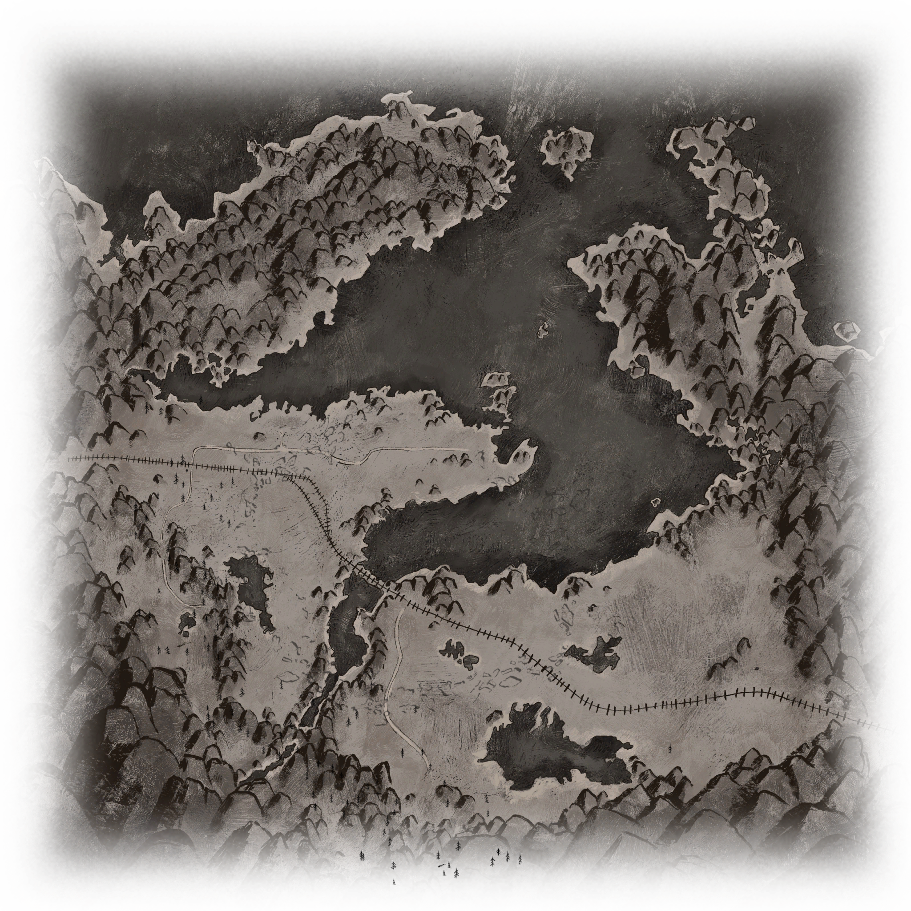
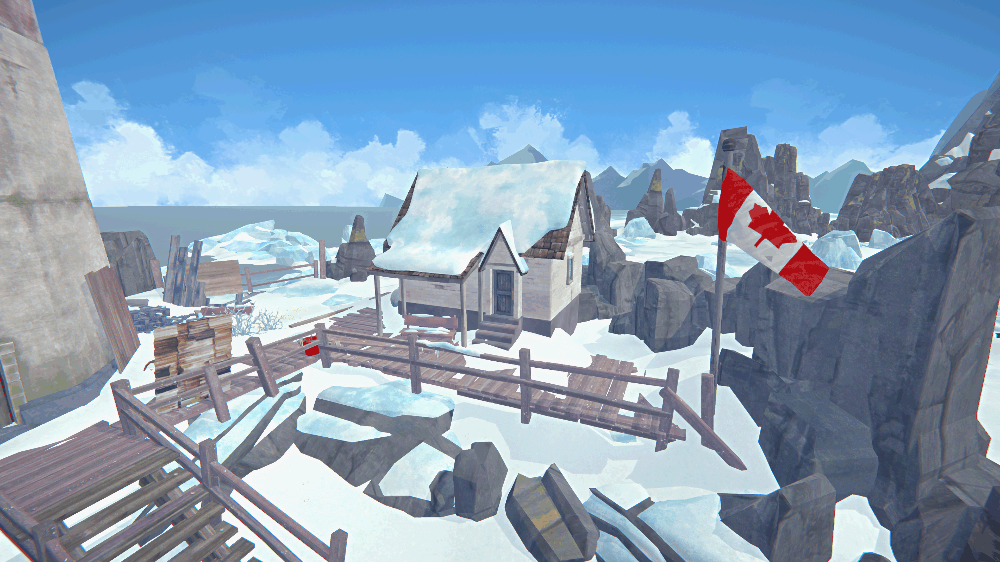

# Port Remnant

**Contents**

- [Overview](#Overview)
- [Locations](#Locations)
- [Wildlife management](#Wildlife_management)
- [Survivability](#Survivability)
- [Safe houses](#Safe_houses)
- [Trivia](#Trivia)
- [Gallery](#Gallery)
- [Maps](#Maps)
- [Locations](#Locations_2)
- [Miscellaneous](#Miscellaneous)

<table>
<colgroup>
<col style="width: 33%" />
<col style="width: 33%" />
<col style="width: 33%" />
</colgroup>
<tbody>
<tr>
<td width="40px"><figure>

<figcaption>Seal_icon.png</figcaption>
</figure></td>
<td>
<strong>DLC-Exclusive content.</strong> 

This content requires the <a href="./Iron%20Road.md" class="wikilink" title="Iron Road">Iron Road</a> addon to be installed before it can be seen or used in regular gameplay.

</td>
<td>
|}

<table class="infobox">
<caption>Port Remnant</caption>
<colgroup>
<col style="width: 50%" />
<col style="width: 50%" />
</colgroup>
<tbody>
<tr>
<td colspan="2"><figure>
[Missing image: Port_Remnant.jpg]
<figcaption>Port_Remnant.jpg</figcaption>
</figure></td>
</tr>
<tr>
<td colspan="2" class="section">
<strong>Location on <a href="./Cauldron%20Island.md" class="wikilink" title="Cauldron Island">Cauldron Island</a></strong>
</td>
</tr>
<tr>
<td colspan="2"><figure>

<figcaption>No_picture.png</figcaption>
</figure></td>
</tr>
<tr>
<td colspan="2"><figure>

<figcaption>Port_Remnant_Map.png</figcaption>
</figure></td>
</tr>
<tr>
<td colspan="2" class="section">
<strong>Details</strong>
</td>
</tr>
<tr>
<td>
Description
</td>
<td>
A century old abandoned shipping port that is the starting point of Cauldron Island.
</td>
</tr>
<tr>
<td>
Connecting Regions
</td>
<td>
<a href="./Anna%20Island%20--%20Track%20Section%201.md" class="wikilink" title="Anna Island -- Track Section 1">Anna Island -- Track Section 1</a> <a href="./Anna%20Island%20--%20Track%20Section%205.md" class="wikilink" title="Anna Island -- Track Section 5">Anna Island -- Track Section 5</a>
</td>
</tr>
<tr>
<td>
Interloper Region Spawn
</td>
<td>
No
</td>
</tr>
<tr>
<td>
Date Added
</td>
<td>
October 27 2026
</td>
</tr>
</tbody>
</table>

<strong>Port Remnant</strong> is a <a href="./Region.md" class="wikilink" title="Region">Region</a> released for <em><a href="./The%20Long%20Dark.md" class="wikilink" title="The Long Dark">The Long Dark</a></em> and is the starting point of <a href="./Cauldron%20Island.md" class="wikilink" title="Cauldron Island">Cauldron Island</a> and the <a href="./Iron%20Road.md" class="wikilink" title="Iron Road"><em>Iron Road</em></a> expansion.

<h2 id="Overview">Overview</h2>

Port Remnant is first accessed by taking the <a href="./Fulmar%20Autopilot%20Boat.md" class="wikilink" title="Fulmar Autopilot Boat">Fulmar Autopilot Boat</a> from <a href="./Desolation%20Point.md" class="wikilink" title="Desolation Point">Desolation Point</a>. From there, the player will arrive at Cauldron Island inside a cave underneath the Lighthouse. Climbing the stone stairs reveals a ruined Lighthouse and <a href="./Wax%20Cylinder%202.md" class="wikilink" title="Wax Cylinder 2">Wax Cylinder 2</a> and <a href="./Map%20%28Church%29.md" class="wikilink" title="Map (Church)">Map (Church)</a>. The Cylinder has a key to the door, and the Map points to the path to take to the Church in the region.

The region itself is in a considerable state of disrepair. A century of time has rotted away most of the buildings in the region, many of which are barely standing. 3 ships can be found half sunken in the ice near the Lighthouse. What is presumably a whaling warehouse is found in the center of the map after traversing the frozen bay, with worker cabins found around the area. Southwest is a set of train track, train bridge, and a train terminal. A road leads up to a cliff to the Church in the south most part of the map (inaccessible due to a landslide), with more flat land and some ponds below the southern cliffs.

Several of the jagged mountainous areas can be explored near the bay, leading to hidden plant supplies and unique vantage points. Bizarrely, there are 3 Whale Bone Shrines in a few places in the region whose nature is currently not understood.

Taking the tracks to the east will take the player to <a href="./Anna%20Island%20--%20Track%20Section%205.md" class="wikilink" title="Anna Island -- Track Section 5">Anna Island -- Track Section 5</a>, while the tracks to the west lead to <a href="./Anna%20Island%20--%20Track%20Section%201.md" class="wikilink" title="Anna Island -- Track Section 1">Anna Island -- Track Section 1</a> (though the path is blocked by a metal gate).

The area can be returned later to with the <a href="./Prototype%20Train.md" class="wikilink" title="Prototype Train">Prototype Train</a>, which can be used to open the inaccessible <a href="./Obstructed%20Transit.md" class="wikilink" title="Obstructed Transit">Obstructed Transit</a> and destroy the gate to Track Section 1. This is the only region on Anna Island not to feature an <a href="./Oil%20Tank.md" class="wikilink" title="Oil Tank">Oil Tank</a> or <a href="./Water%20Tower.md" class="wikilink" title="Water Tower">Water Tower</a> (aside from <a href="./Anna%20Island%20--%20Track%20Section%206.md" class="wikilink" title="Anna Island -- Track Section 6">Anna Island -- Track Section 6</a>).

<h2 id="Locations">Locations</h2>

There are 16 named locations within Port Remnant, including:{| class="" style="background-color:transparent; color:inherit; width:100%;"
</td>
</tr>
<tr>
<td><ul>
<li><a href="./Broken%20Shoreline.md" class="wikilink" title="Broken Shoreline">Broken Shoreline</a></li>
<li><a href="./Desecrated%20Church.md" class="wikilink" title="Desecrated Church">Desecrated Church</a></li>
<li><a href="./Departure%27s%20Memory.md" class="wikilink" title="Departure&#39;s Memory">Departure's Memory</a></li>
<li><a href="./Forgotten%20Trestle.md" class="wikilink" title="Forgotten Trestle">Forgotten Trestle</a></li>
<li><a href="./Fallow%20Field.md" class="wikilink" title="Fallow Field">Fallow Field</a></li>
<li><a href="./Last%20Quarrel.md" class="wikilink" title="Last Quarrel">Last Quarrel</a></li>
<li><a href="./Looted%20Grotto.md" class="wikilink" title="Looted Grotto">Looted Grotto</a></li>
</ul></td>
<td data-valign="top" style="width: 50%"><ul>
<li><a href="./Obstructed%20Transit.md" class="wikilink" title="Obstructed Transit">Obstructed Transit</a></li>
<li><a href="./Sheltered%20Access.md" class="wikilink" title="Sheltered Access">Sheltered Access</a></li>
<li><a href="./Whale%20Bone%20Shrine.md" class="wikilink" title="Whale Bone Shrine">Whale Bone Shrine</a> (3 of these)</li>
<li>To Anna Island Track Section 1 (Region Transition to <a href="./Anna%20Island%20--%20Track%20Section%201.md" class="wikilink" title="Anna Island -- Track Section 1">Anna Island -- Track Section 1</a>)</li>
<li>To Anna Island Track Section 5 (Region Transition to <a href="./Anna%20Island%20--%20Track%20Section%205.md" class="wikilink" title="Anna Island -- Track Section 5">Anna Island -- Track Section 5</a>)</li>
</ul></td>
<td></td>
</tr>
</tbody>
</table>

There are also a several indoor locations that are tracked in the <a href="./Journal.md" class="wikilink" title="Journal">Journal</a>.

- <a href="./Lighthouse%20%28Port%20Remnant%29.md" class="wikilink" title="Lighthouse">Lighthouse</a>
- <a href="./Lighthouse%20Keeper%27s%20Cabin.md" class="wikilink" title="Lighthouse Keeper&#39;s Cabin">Lighthouse Keeper's Cabin</a>
- <a href="./Looted%20Grotto.md" class="wikilink" title="Looted Grotto">Looted Grotto</a> (1 accessible cabin)
- 3 Cabins on the road west of Departure's Memory (1 accessible)
- 1 Cabin to the south east of Departure's Memory (similar to <a href="./Mountaineer%27s%20Hut.md" class="wikilink" title="Mountaineer&#39;s Huts">Mountaineer's Huts</a>)
- A Cave system that takes you to the upper southern cliff to the Desecrated Church.

<!-- -->

- 

## Wildlife management

- <a href="./Wolf.md" class="wikilink" title="Wolves">Wolves</a> can be found throughout the region, mainly to the south near the tracks. Some can be found east of the lighthouse.
- <a href="./Rabbit.md" class="wikilink" title="Rabbit">Rabbit</a> can be found to the south
- <a href="./Deer.md" class="wikilink" title="Deer">Deer</a> can be found on the south cliffs near the church

## Survivability

## Safe houses

Key shelters in Port Remnant include:

- <a href="./Lighthouse%20Keeper%27s%20Cabin.md" class="wikilink" title="Lighthouse Keeper&#39;s Cabin">Lighthouse Keeper's Cabin</a>

## Trivia

- 4 sunken ships can be found in the region. 1 of them looks to be a similar ship as <a href="./The%20Riken.md" class="wikilink" title="The Riken">The Riken</a>, while 2 others looks like The Harbinger from <a href="./Last%20Resort%20Cannery.md" class="wikilink" title="Last Resort Cannery">Last Resort Cannery</a>. The rusted skeleton of a 4th ship can also be found.
- This is the only region on Anna Island with a Work Bench, found at Departure's Memory.
- There were formerly 2 cabins south of Departure's memory, but 1 was removed after an update.
- The Whale Bone Shrines were originally quite large, but were scaled down in size after an update.

## Gallery

### Maps

### Locations

<table class="gallery">
<colgroup>
<col style="width: 25%" />
<col style="width: 25%" />
<col style="width: 25%" />
<col style="width: 25%" />
</colgroup>
<tbody>
<tr>
<td><figure>

<figcaption>Lighthouse Keeper's Cabin</figcaption>
</figure></td>
<td><figure>
[Missing image: Departure's_Memory.jpg]
<figcaption>Departure's Memory</figcaption>
</figure></td>
<td><figure>
[Missing image: Looted_Grotto.jpg]
<figcaption>Looted Grotto</figcaption>
</figure></td>
<td><figure>
[Missing image: Desecrated_Church.jpg]
<figcaption>Desecrated Church</figcaption>
</figure></td>
</tr>
<tr>
<td><figure>
[Missing image: Obstructed_Transit.jpg]
<figcaption>Obstructed Transit</figcaption>
</figure></td>
<td><figure>
[Missing image: Broken_Shoreline.jpg]
<figcaption>Broken Shoreline</figcaption>
</figure></td>
<td><figure>
[Missing image: Forgotten_Trestle.jpg]
<figcaption>Forgotten Trestle</figcaption>
</figure></td>
<td><figure>
[Missing image: Last_Quarrel.jpg]
<figcaption>Last Quarrel</figcaption>
</figure></td>
</tr>
<tr>
<td><figure>
[Missing image: Fallow_Field.jpg]
<figcaption>Fallow Field</figcaption>
</figure></td>
<td></td>
<td></td>
<td></td>
</tr>
</tbody>
</table>

### Miscellaneous

<table class="gallery">
<colgroup>
<col style="width: 25%" />
<col style="width: 25%" />
<col style="width: 25%" />
<col style="width: 25%" />
</colgroup>
<tbody>
<tr>
<td><figure>
[Missing image: Tld-august-dev-diary-site-support-img-1.jpg]
<figcaption>Port Remnant concept art</figcaption>
</figure></td>
<td><figure>
[Missing image: Port_Remnant_whaling_ship.jpg]
<figcaption>A beached Whaling ship that looks like <a href="./The%20Riken.md" class="wikilink" title="The Riken">The Riken</a></figcaption>
</figure></td>
<td><figure>
[Missing image: Port_Remnant_Cannery_Ship.jpg]
<figcaption>A sunken ship that looks like The Harbinger from <a href="./Last%20Resort%20Cannery.md" class="wikilink" title="Last Resort Cannery">Last Resort Cannery</a></figcaption>
</figure></td>
<td><figure>
[Missing image: Port_Remnant_Cabin.jpg]
<figcaption>The single cabin near Forgotten Trestle</figcaption>
</figure></td>
</tr>
<tr>
<td><figure>
[Missing image: Port_Remnant_Cabin_(removed).jpg]
<figcaption>ditto, formally 2 at one point</figcaption>
</figure></td>
<td></td>
<td></td>
<td></td>
</tr>
</tbody>
</table>

**Lua execution error in Module:Navbox function navbox** **Lua execution error in Module:Navbox function navbox**

<a href="ru:%D0%9F%D0%BE%D1%80%D1%82_%D0%91%D1%8B%D0%BB%D0%BE%D0%B9" class="wikilink" title="ru:Порт Былой">ru:Порт Былой</a>

