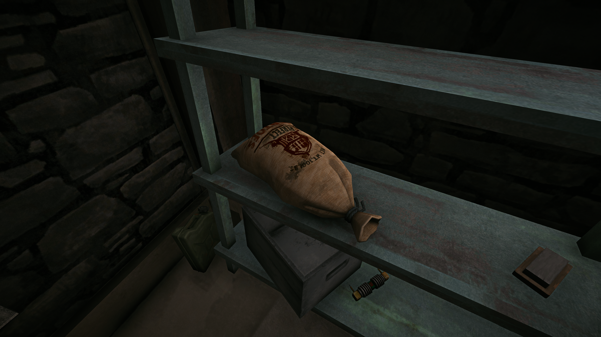

# Potato

**Categories:** DLC Content, Food And Drink, Pages with update history · **Source:** [Fandom](https://thelongdark.fandom.com/wiki/Potato)

**Contents**

- [Overview](#overview)
- [Usage](#usage)
- [Products](#products)
- [Locations](#locations)
- [Mystery Lake (region)](#mystery-lake-region)
- [Coastal Highway](#coastal-highway)
- [Pleasant Valley](#pleasant-valley)
- [Broken Railroad](#broken-railroad)
- [Mountain Town](#mountain-town)
- [Ash Canyon](#ash-canyon)
- [Forsaken Airfield](#forsaken-airfield)
- [Zone of Contamination](#zone-of-contamination)
- [Gallery](#gallery)
- [Update history](#update-history)

**DLC-Exclusive content.**

This content requires the [Tales from the Far Territory](./Tales%20from%20the%20Far%20Territory.md) addon to be installed before it can be seen or used in regular gameplay.

**Potato**

[Potato icon](../assets/Potato_icon.png)

**Release:** [21 June 2023](./The%20Long%20Dark%20%E2%80%94%20Changelog.md#2.17)

**Wintermute:** No

**Renewable:** Yes ([Trader](./Trader.md))

**Properties**

**Item type:** [Food And Drink](./Food%20And%20Drink.md)

**Stackable:** No

**Examine:** Highly nutritious, but only edible when cooked.

**Values**

**Weight:** 0.20 kg (0.44 lbs)

**Potato** is a raw [food](./Food%20And%20Drink.md) item in _[The Long Dark](./The%20Long%20Dark.md)_, found inside [Vegetable Rack](./Vegetable%20Rack.md), [Potato Sacks](./Potato%20Sack.md) or indoors.

## Overview

Potatoes are vegetables with a long shelf-life. They cannot be eaten raw but may be cooked or used to craft stews. They are found indoors 4-8 at a time inside a Potato Sack or Vegetable Drawers, loose indoors (usually on the floor), or inside crates.

Potatoes are a non-renewable resource unless the [Trader](./Trader.md) is enabled, where there is a chance for them to appear.

Potatoes spoil at the same rate no matter whether stored inside, outside, container or not.

## Usage

Raw potatoes are inedible and must be placed upon a cooking slot of a lit [Fire](./Fire.md) for 60 minutes to create a [Cooked Potato](./Cooked%20Potato.md). Collecting a finished one improves your [Cooking Skill](./Skills.md#Cooking) and increases its condition by 50%.

**Raw** potatoes are necessary for the creation of various stew Recipes.

## Products

| Item | Skills | Materials |
| --- | --- | --- |
| [Coastal Fishcakes](./Coastal%20Fishcakes.md) | None | - 0.50 Kg × [Rainbow Trout (Raw)](./Rainbow%20Trout%20%28Raw%29.md) - 2 × [Potato](./Potato.md) - 0.15 L × [Water (Potable)](./Water%20%28Potable%29.md) - 0.05 L × [Cooking Oil](./Cooking%20Oil.md) - 0.01 kg × [Salt](./Salt.md) |
| [Cooked Potato](./Cooked%20Potato.md) | None | - 1 × [Potato](./Potato.md) |
| [Dockworker's Pie](./Dockworker%27s%20Pie.md) | None | - 2 × [Potato](./Potato.md) - 0.50 kg × [Coho Salmon (Raw)](./Coho%20Salmon%20%28Raw%29.md) - 0.50 kg × [Rockfish (Raw)](./Rockfish%20%28Raw%29.md) - 0.10 L × [Water (Potable)](./Water%20%28Potable%29.md) - 0.05 L × [Cooking Oil](./Cooking%20Oil.md) - 0.01 kg × [Salt](./Salt.md) |
| [Last Resort Soup](./Last%20Resort%20Soup.md) | None | - 2 × [Potato](./Potato.md) - 0.40 L × [Broth](./Broth.md) - 0.01 kg × [Salt](./Salt.md) |
| [Ranger Stew](./Ranger%20Stew.md) | None | - 0.50 kg × [Venison (Raw)](./Venison%20%28Raw%29.md) - 0.50 kg × [Rabbit (Raw)](./Rabbit%20%28Raw%29.md) - 1 × [Potato](./Potato.md) - 0.20 kg × [Carrot](./Carrot.md) - 0.40 L × [Broth](./Broth.md) - 0.05 kg × [Old Mill Flour](./Old%20Mill%20Flour.md) |
| [Thomson Family Stew](./Thomson%20Family%20Stew.md) | None | - 0.30 kg × [Canned Corn](./Canned%20Corn.md) - 0.40 kg × [Carrot](./Carrot.md) - 2 × [Potato](./Potato.md) - 2 × [Reishi Mushroom](./Reishi%20Mushroom.md) - 0.40 L × [Broth](./Broth.md) - 0.05 kg × [Old Mill Flour](./Old%20Mill%20Flour.md) |

## Locations

Potatoes are found in many locations across almost all regions.

### [Mystery Lake (region)](./Mystery%20Lake%20%28region%29.md)

- A potato sack lies under the stairs at the [Camp Office](./Camp%20Office.md).
- Miscellaneous potatoes can be found stashed underneath counters and tables.

### [Coastal Highway](./Coastal%20Highway.md)

- On dishware in the kitchens of various [Coastal House](./Coastal%20House.md) structures that can be found surrounding the shoreline of the region.

### [Pleasant Valley](./Pleasant%20Valley.md)

- From both a potato sack \*and\* a [Vegetable Rack](./Vegetable%20Rack.md) in the basement of the [Pleasant Valley Farmstead](./Pleasant%20Valley%20Farmstead.md).
- The back room of the [Rural Store](./Rural%20Store.md) in [Thomson's Crossing](./Thomson%27s%20Crossing.md).

### [Broken Railroad](./Broken%20Railroad.md)

- From the [Vegetable Rack](./Vegetable%20Rack.md) found in the basement of the [Hunting Lodge](./Hunting%20Lodge.md), sitting right near the [Firewood Bin](./Firewood%20Bin.md) at the stairwell landing.

### [Mountain Town](./Mountain%20Town.md)

- Some of the randomly destroyed houses in [Milton](./Milton.md) contain potato sacks, if any of said houses are still standing.
- Two under the table inside the [Milton House (Grey Mother's)](./Milton%20House%20%28Grey%20Mother%27s%29.md) kitchen.
- From the [Vegetable Rack](./Vegetable%20Rack.md) found at [Paradise Meadows Farm](./Paradise%20Meadows%20Farm.md), next to the outdoor barn's workbench.

### [Ash Canyon](./Ash%20Canyon.md)

- Two in a crate, and with one lying behind a chair, over at the [Foreman's Retreat](./Foreman%27s%20Retreat.md).

### [Forsaken Airfield](./Forsaken%20Airfield.md)

- A potato sack can be found inside the [Hangar Basement](./Hangar%20Basement.md) of the [Field 31](./Field%2031.md) airfield complex's [Main Hangar](./Main%20Hangar.md), under one of the shelves.

### [Zone of Contamination](./Zone%20of%20Contamination.md)

- From a [Vegetable Rack](./Vegetable%20Rack.md) discoverable in the [Idle Camp](./Idle%20Camp.md)'s Mess Hall, beside the kitchen.

## Gallery

## Update history

- UPDATE **21 June 2023 ([Update](./The%20Long%20Dark%20%E2%80%94%20Changelog.md#2.17)):**
  - Added to game.
