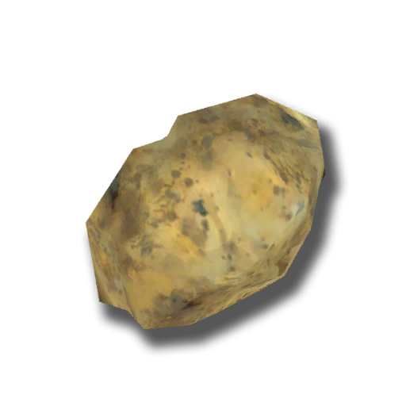
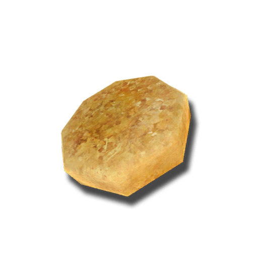

# Potato

**Categories:** DLC Content, Food And Drink, Pages with update history · **Source:** [Fandom](https://thelongdark.fandom.com/wiki/Potato)

**Contents**

- [Overview](#overview)
- [Usage](#usage)
- [Products](#products)
- [Locations](#locations)
- [Mystery Lake (region)](#mystery-lake-region)
- [Coastal Highway](#coastal-highway)
- [Pleasant Valley](#pleasant-valley)
- [Broken Railroad](#broken-railroad)
- [Mountain Town](#mountain-town)
- [Ash Canyon](#ash-canyon)
- [Forsaken Airfield](#forsaken-airfield)
- [Zone of Contamination](#zone-of-contamination)
- [Gallery](#gallery)
- [Update history](#update-history)

_Ptarmigan\_icon.png_

**DLC-Exclusive content.** / This content requires the [Tales from the Far Territory](./Tales%20from%20the%20Far%20Territory.md) addon to be installed before it can be seen or used in regular gameplay.

_Potato\_icon.png_

**Release:** [21 June 2023](./The%20Long%20Dark%20%E2%80%94%20Changelog.md#2.17)

**Wintermute:** No

**Renewable:** Yes ([Trader](./Trader.md))

**Properties**

**Item type:** [Food And Drink](./Food%20And%20Drink.md)

**Stackable:** No

**Examine:** Highly nutritious, but only edible when cooked.

**Values**

**Weight:** 0.20 kg (0.44 lbs)

Item

Skills

Materials

 [Coastal Fishcakes](./Coastal%20Fishcakes.md)

None

- 0.50 Kg × [Rainbow Trout (Raw)](./Rainbow%20Trout%20%28Raw%29.md) / - 2 × [Potato](./Potato.md) / - 0.15 L × [Water (Potable)](./Water%20%28Potable%29.md) / - 0.05 L × [Cooking Oil](./Cooking%20Oil.md) / - 0.01 kg × [Salt](./Salt.md)

 [Cooked Potato](./Cooked%20Potato.md)

None

- 1 × [Potato](./Potato.md)

 [Dockworker's Pie](./Dockworker%27s%20Pie.md)

None

- 2 × [Potato](./Potato.md) / - 0.50 kg × [Coho Salmon (Raw)](./Coho%20Salmon%20%28Raw%29.md) / - 0.50 kg × [Rockfish (Raw)](./Rockfish%20%28Raw%29.md) / - 0.10 L × [Water (Potable)](./Water%20%28Potable%29.md) / - 0.05 L × [Cooking Oil](./Cooking%20Oil.md) / - 0.01 kg × [Salt](./Salt.md)

 [Last Resort Soup](./Last%20Resort%20Soup.md)

None

- 2 × [Potato](./Potato.md) / - 0.40 L × [Broth](./Broth.md) / - 0.01 kg × [Salt](./Salt.md)

 [Ranger Stew](./Ranger%20Stew.md)

None

- 0.50 kg × [Venison (Raw)](./Venison%20%28Raw%29.md) / - 0.50 kg × [Rabbit (Raw)](./Rabbit%20%28Raw%29.md) / - 1 × [Potato](./Potato.md) / - 0.20 kg × [Carrot](./Carrot.md) / - 0.40 L × [Broth](./Broth.md) / - 0.05 kg × [Old Mill Flour](./Old%20Mill%20Flour.md)

 [Thomson Family Stew](./Thomson%20Family%20Stew.md)

None

- 0.30 kg × [Canned Corn](./Canned%20Corn.md) / - 0.40 kg × [Carrot](./Carrot.md) / - 2 × [Potato](./Potato.md) / - 2 × [Reishi Mushroom](./Reishi%20Mushroom.md) / - 0.40 L × [Broth](./Broth.md) / - 0.05 kg × [Old Mill Flour](./Old%20Mill%20Flour.md)

_Vegetable cart._

_Potato sack._
