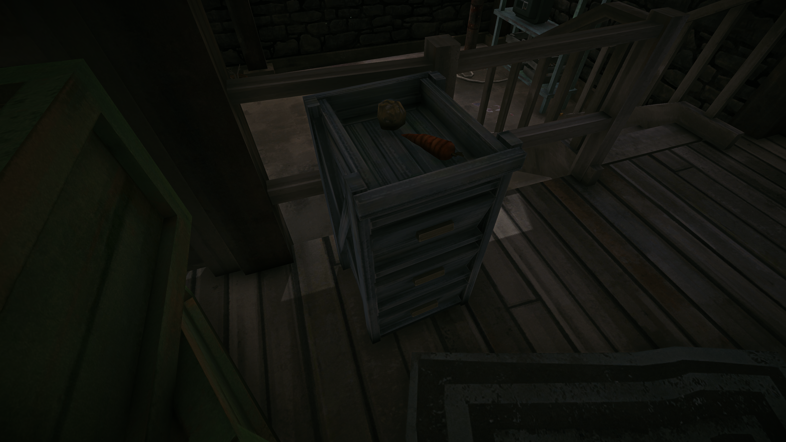

# Potato

**Categories:** DLC Content, Food And Drink, Pages with update history · **Source:** [Fandom](https://thelongdark.fandom.com/wiki/Potato)

**Contents**

- [Overview](#overview)
- [Usage](#usage)
- [Products](#products)
- [Locations](#locations)
- [Mystery Lake (region)](#mystery-lake-region)
- [Coastal Highway](#coastal-highway)
- [Pleasant Valley](#pleasant-valley)
- [Broken Railroad](#broken-railroad)
- [Mountain Town](#mountain-town)
- [Ash Canyon](#ash-canyon)
- [Forsaken Airfield](#forsaken-airfield)
- [Zone of Contamination](#zone-of-contamination)
- [Gallery](#gallery)
- [Update history](#update-history)

_Ptarmigan\_icon.png_

**DLC-Exclusive content.** / This content requires the [Tales from the Far Territory](./Tales%20from%20the%20Far%20Territory.md) addon to be installed before it can be seen or used in regular gameplay.

_Potato\_icon.png_

**Release:** [21 June 2023](./The%20Long%20Dark%20%E2%80%94%20Changelog.md#2.17)

**Wintermute:** No

**Renewable:** Yes ([Trader](./Trader.md))

**Properties**

**Item type:** [Food And Drink](./Food%20And%20Drink.md)\|-

**Stackable:** No

**Examine:** Highly nutritious, but only edible when cooked.

**Values**

**Weight:** 0.20 kg (0.44 lbs)

_Vegetable cart._

_Potato sack._
