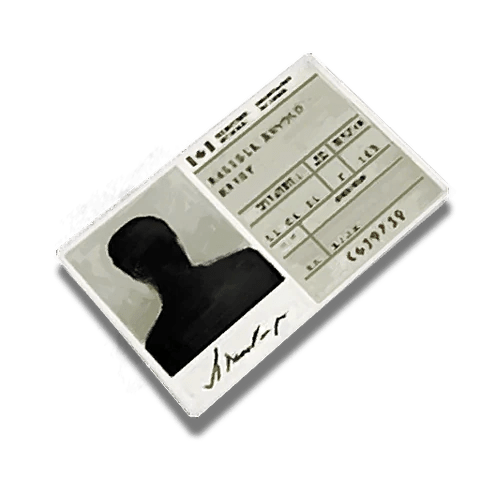

# Power Company ID

**Categories:** Collectibles, Pages with update history · **Source:** [Fandom](https://thelongdark.fandom.com/wiki/Power_Company_ID)

**Power Company ID**

**Release:** [6 October 2021](./The%20Long%20Dark%20%E2%80%94%20Changelog.md#1.95)

**Wintermute:** [Episode 4](./Episode%204%20-%20Fury%2C%20Then%20Silence.md) - [Lost Power Workers](./Lost%20Power%20Workers.md)

**Properties**

**Item type:** [Collectibles](./Collectibles.md)

**Stackable:** No

**Examine:** An old ID badge, Scuffed and faded.

**Values**

**Weight:** 0.00 kg (0 lbs)

**Actions**

**Backpack:** Examine

**On ground:** Take It, Read Text, Leave It

**Power Company ID** are 2 different [Collectibles](./Collectibles.md) found in [Episode 4](./Episode%204%20-%20Fury%2C%20Then%20Silence.md) of the [Wintermute](./Wintermute.md) story as part of the [Lost Power Workers](./Lost%20Power%20Workers.md) side mission.

## Transcript

The dead female corpse in a trailer on the road to the [Power Plant](./Power%20Plant.md) reads:

Linda Burnley, Journeyman Electrician

The ID found in a [Backpack](./Backpack.md) near the dead corpse in the ravine reads:

Samual Franks, Journeyman Electrician

## Update history

- UPDATE **6 October 2021 ([Update](./The%20Long%20Dark%20%E2%80%94%20Changelog.md#1.95)):**
  - Added to game.
