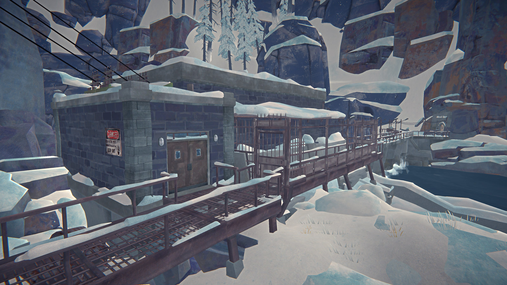
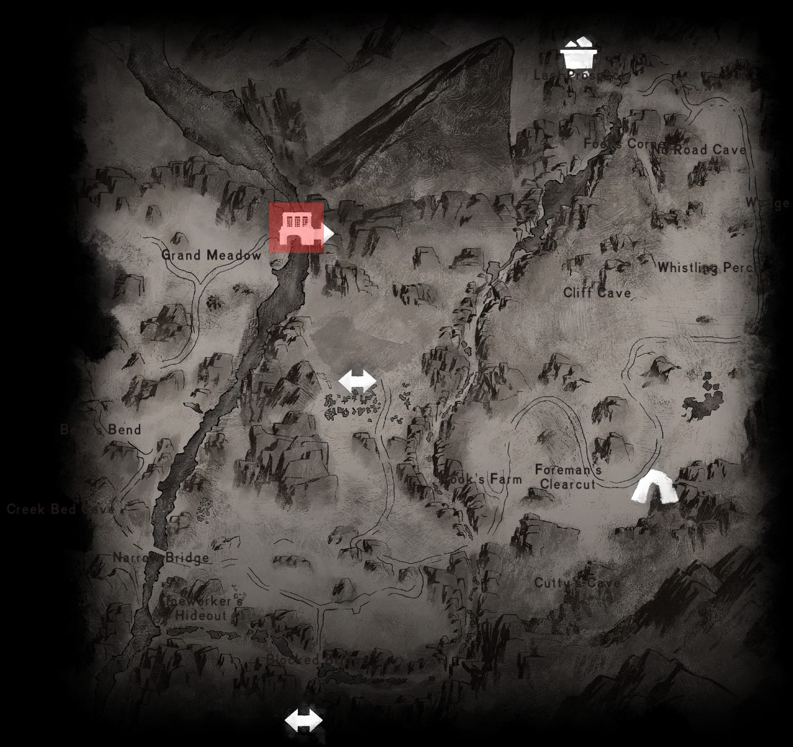
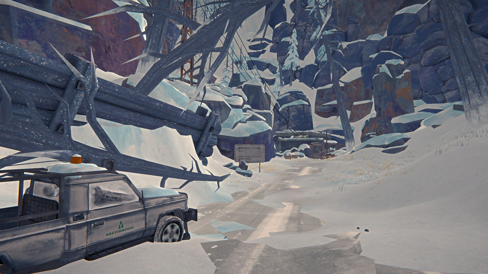
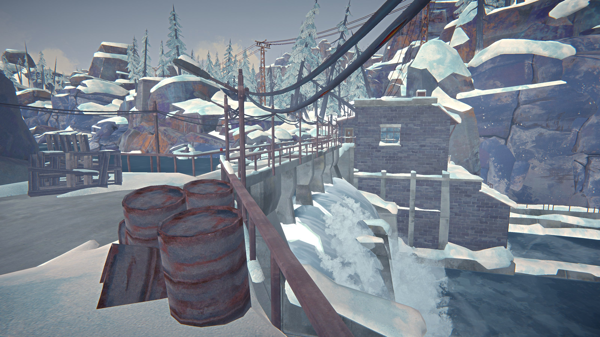
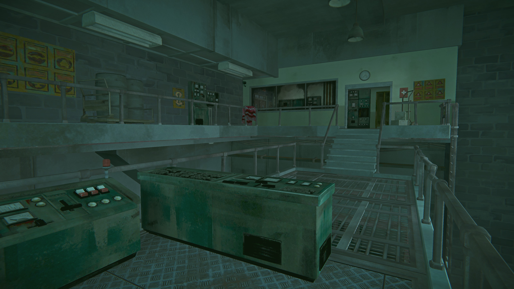

# Power Plant

**Categories:** Blackrock, Indoor locations, Industrial locations, Locations, Locations in Blackrock · **Source:** [Fandom](https://thelongdark.fandom.com/wiki/Power_Plant)

**Contents**

- [History](#history)
- [Gallery](#gallery)
- [See also](#see-also)
- [References](#references)

**Power Plant**

**Location**

Region

**Location:** Northwest of Blackrock Prison, on a river

**General**

**Type:** Industrial

**Missions:** [The Power Plant](./The%20Power%20Plant.md) [Donner](./Donner.md)

**Spoiler Warning:****This page may contain spoilers from the [story](./Wintermute.md) of The Long Dark.**

 **Power Plant** is a small hydro-electric facility located in [Blackrock](./Blackrock.md) on a river to the northwest of [Blackrock Prison](./Blackrock%20Prison.md). The prison can be reached through the [Steam Tunnels](./Steam%20Tunnels.md). There is a road that leads past the nearby [Grand Meadow](./Grand%20Meadow.md) to [Narrow Bridge](./Narrow%20Bridge.md), but it is blocked by a landslide at [Bear's Bend](./Bear%27s%20Bend.md).

## History

- A sign at the entrance suggests the plant was built in 1976 by a company called Blackrock Mountain Power.
- At the time of release in survival mode, there was a bug that could cause players to unexpectedly die from drowning while standing on land below the catwalk outside the building.[¹](#fn1)
- The catwalk outside the building was a late addition in development, meant to ensure that non-player characters would have a way of entering through the main doors when coming from the prison.[²](#fn2)

## Gallery

## See also

- [Carter Hydro Dam](./Carter%20Hydro%20Dam.md), a larger hydro-electric power plant in the [Mystery Lake](./Mystery%20Lake%20%28disambiguation%29.md) region

## References

## Notes

---

1. [https://hinterlandforums.com/forums/topic/41415-known-issues-updated-march-7-2022/](https://hinterlandforums.com/forums/topic/41415-known-issues-updated-march-7-2022/)[↩︎](#fnref1)
2. [https://twitter.com/RaphLife/status/1505355247815823365](https://twitter.com/RaphLife/status/1505355247815823365)[↩︎](#fnref2)
