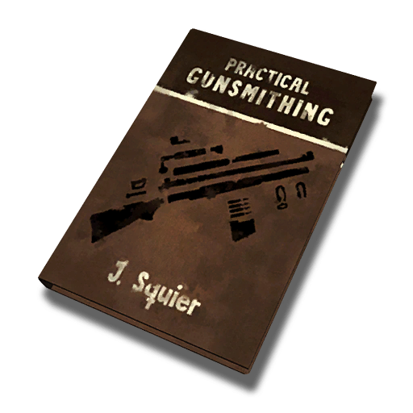

# Practical Gunsmithing

**Contents**

- [Research](#Research)
- [Fire Starting](#Fire_Starting)
- [Location](#Location)
- [Blackrock Mountain](#Blackrock_Mountain)
- [Broken Railroad](#Broken_Railroad)
- [Coastal Highway](#Coastal_Highway)
- [Forlorn Muskeg](#Forlorn_Muskeg)
- [Forsaken Airfield](#Forsaken_Airfield)
- [Mystery Lake](#Mystery_Lake)
- [Pleasant Valley](#Pleasant_Valley)
- [Trivia](#Trivia)
- [Update history](#Update_history)

<table class="infobox">
<caption>Practical Gunsmithing</caption>
<colgroup>
<col style="width: 50%" />
<col style="width: 50%" />
</colgroup>
<tbody>
<tr>
<td colspan="2"><figure>

<figcaption>Practical_Gunsmithing_icon.png</figcaption>
</figure></td>
</tr>
<tr>
<td>
Release
</td>
<td>
<a href="./The%20Long%20Dark%20%E2%80%94%20Changelog.md#1.64" class="wikilink" title="10 December 2019">10 December 2019</a>
</td>
</tr>
<tr>
<td>
Wintermute
</td>
<td>
No
</td>
</tr>
<tr>
<td colspan="2" class="section">
<strong>Properties</strong>
</td>
</tr>
<tr>
<td>
Item type
</td>
<td>
<a href="./Fire%20Starting.md" class="wikilink" title="Fire Starting">Fire Starting</a><a href="./Tools.md" class="wikilink" title="Tools">Tools</a>|-
</td>
</tr>
<tr>
<td>
Stackable
</td>
<td>
No
</td>
</tr>
<tr>
<td>
Examine
</td>
<td>
A do-it-yourself guide to gunsmithing techniques, intended for hunters but loved by the security-minded. Researching this will improve your Gunsmithing Skill.
</td>
</tr>
<tr>
<td colspan="2" class="section">
<strong>Values</strong>
</td>
</tr>
<tr>
<td>
Weight
</td>
<td>
0.50 kg (1.1 lbs)
</td>
</tr>
<tr>
<td colspan="2" class="section">
<strong>Actions</strong>
</td>
</tr>
<tr>
<td>
Backpack
</td>
<td>
Research, Drop
</td>
</tr>
</tbody>
</table>

**Practical Gunsmithing** is a <a href="./Research%20Book.md" class="wikilink" title="Research Book">Research Book</a> used to improve the <a href="./Gunsmithing.md" class="wikilink" title="Gunsmithing">Gunsmithing</a> skill. It can also be used as Fuel when starting a <a href="./Fire.md" class="wikilink" title="Fire">Fire</a>.

## Research

*Practical Gunsmithing* can be researched for 5 hours that can be broken into multiple 1-hour minimum research sessions. 10 <a href="./Gunsmithing.md#Skill_levels" class="wikilink" title="Gunsmithing skill points">Gunsmithing skill points</a> are awarded on completing the research. By selecting the Settled Mind <a href="./Feats.md" class="wikilink" title="Feat">Feat</a>, research time will be reduced by 20%, putting it at 4 hours.

Research can only be performed under the following conditions:

- There is light present to read
- <a href="./Warmth.md" class="wikilink" title="Warmth">Warmth</a>, <a href="./Fatigue.md" class="wikilink" title="Fatigue">Fatigue</a>, <a href="./Thirst.md" class="wikilink" title="Thirst">Thirst</a>, and <a href="./Hunger.md" class="wikilink" title="Hunger">Hunger</a> exceed 0%
- No negative <a href="./Afflictions.md" class="wikilink" title="Afflictions">Afflictions</a>

If the player's fatigue, thirst or hunger meters go down to zero or if the environment becomes dark during a research session, the session will be terminated instantly. The hour of research that was in progress will not be completed and any time that had already been spent will be wasted. For a multiple-hour research session, only the incomplete hour will be lost, all the previous hours will still count towards completion of the book.

## Fire Starting

<table class="infobox">
<caption>Practical Gunsmithing</caption>
<thead>
<tr>
<th>
Type
</th>
<th>
Fuel
</th>
</tr>
</thead>
<tbody>
<tr>
<th colspan="2" class="section">
<strong>Statistics</strong>
</th>
</tr>
&#10;<tr>
<th>
Duration
</th>
<td>
 18 minutes
</td>
</tr>
<tr>
<th>
Start Chance
</th>
<td>
 +35%
</td>
</tr>
<tr>
<th>
Heat
</th>
<td>
 +2°C (+3.6°F)
</td>
</tr>
<tr>
<th>
Burn Density
</th>
<td>
0.6 hr/kg (0.27 hr/lb)
</td>
</tr>
</tbody>
</table>

## Location

#### Blackrock Mountain

- Inside the <a href="./Power%20Plant.md" class="wikilink" title="Power Plant">Power Plant</a> on the lower deck overlooking the water

#### Broken Railroad

- Inside the truck on the path leading to the <a href="./Maintenance%20Yard.md" class="wikilink" title="Maintenance Yard">Maintenance Yard</a>

#### Coastal Highway

- <a href="./Quonset%20Garage.md" class="wikilink" title="Quonset Garage">Quonset Garage</a>

#### Forlorn Muskeg

- <a href="./Forge.md" class="wikilink" title="Forge">Forge</a> at <a href="./Old%20Spence%20Family%20Homestead.md" class="wikilink" title="Old Spence Family Homestead">Old Spence Family Homestead</a>

#### Forsaken Airfield

- Inside a container in the <a href="./Main%20Hangar.md" class="wikilink" title="Main Hangar">Main Hangar</a>

#### Mystery Lake

- <a href="./Fishing%20Hut.md" class="wikilink" title="Fishing Hut">Fishing Hut</a> closest to the tiny island in the middle of the lake

#### Pleasant Valley

- In the car at <a href="./End%20of%20the%20Road.md" class="wikilink" title="End of the Road">End of the Road</a>
- Near a corpse at the small barn to the side right of the road, between <a href="./Heartbreak%20Bridge.md" class="wikilink" title="Heartbreak Bridge">Heartbreak Bridge</a> and <a href="./Lower%20Falls.md" class="wikilink" title="Lower Falls">Lower Falls</a>. It's the barn with three rosehip bushes around, where you can find the prisoner's corpse in <a href="./Wintermute.md" class="wikilink" title="Wintermute">Wintermute</a> <a href="./Episode%203%20-%20Crossroads%20Elegy.md" class="wikilink" title="Episode 3">Episode 3</a>

## Trivia

- Attempting to burn a copy of *Practical Gunsmithing* when it has not been fully read will give a confirmation warning before it can be burned.
- Once a copy of *Practical Gunsmithing* (or any research book) is fully researched, it will no longer appear in the Tools section of the Backpack.

## Update history

- UPDATE **10 December 2019 (<a href="./The%20Long%20Dark%20%E2%80%94%20Changelog.md#1.64" class="wikilink" title="Update">Update</a>):**
  - Added to game.

**Lua execution error in Module:Navbox function navbox** **Lua execution error in Module:Navbox function navbox**

