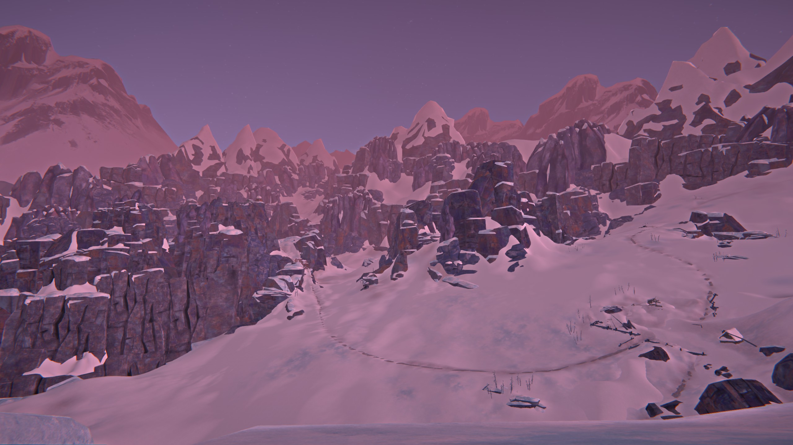
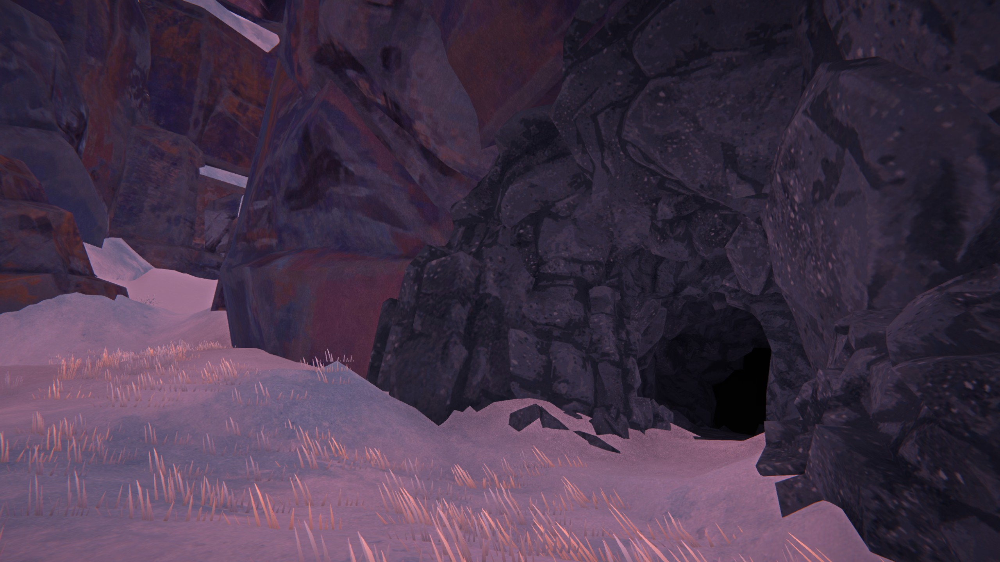

# Prayerful Window

**Prayerful Window**

| Property | Details |
| --- | --- |
|  |  / *Prayerful\_Window.jpg* |
| **Location** |  |
|  |  / *Prayerful\_Window\_Location.png* |
| Region | [Sundered Pass](./Sundered%20Pass.md)\|- |
| **General** |  |
|  | Provides some shelter\|} **Prayerful Window** is a location in [Sundered Pass](./Sundered%20Pass.md). It is located on the cliffside southwest of the [Old Settlement](./Old%20Settlement.md), and can be reached by traveling through the cave system through [Cascading Gap](./Cascading%20Gap.md) or [Idle Hideout](./Idle%20Hideout.md), or a large cavern east of the mountain road near [Lotte's Rest](./Lotte%27s%20Rest.md). / ## Overview / Aside from the Cave itself, there is a [Polaroid](./Polaroids.md) vista that can be surveyed nearby, with a path leading south through a cave system back to the mountain road. There are no other notable features of this area. *The cave entrance* **Lua execution error in Module:Navbox function navbox** |
