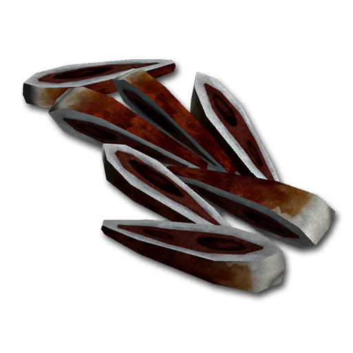
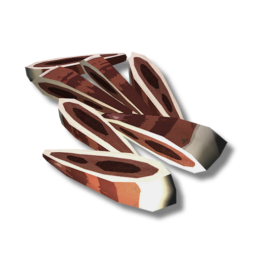
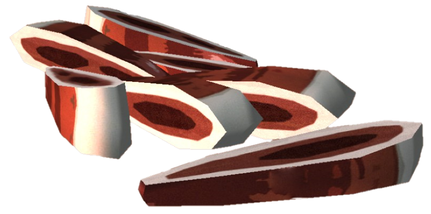

# Prepared Reishi Mushrooms

**Contents**

- [Overview](#Overview)
- [Recipe](#Recipe)
- [Products](#Products)
- [Tips](#Tips)
- [Gallery](#Gallery)
- [Update history](#Update_history)

<table class="infobox">
<caption>Prepared Reishi Mushrooms</caption>
<colgroup>
<col style="width: 50%" />
<col style="width: 50%" />
</colgroup>
<tbody>
<tr>
<td colspan="2"><figure>

<figcaption>Prepared_Reishi_Mushrooms_icon.png</figcaption>
</figure></td>
</tr>
<tr>
<td>
Release
</td>
<td>
<a href="./The%20Long%20Dark%20%E2%80%94%20Early%20Access%20Changelog.md#1.00" class="wikilink" title="1 August 2017">1 August 2017</a>
</td>
</tr>
<tr>
<td>
Wintermute
</td>
<td>
No
</td>
</tr>
<tr>
<td>
Renewable
</td>
<td>
No
</td>
</tr>
<tr>
<td colspan="2" class="section">
<strong>Properties</strong>
</td>
</tr>
<tr>
<td>
Item type
</td>
<td>
<a href="./First%20Aid.md" class="wikilink" title="First Aid">First Aid</a>|-
</td>
</tr>
<tr>
<td>
Stackable
</td>
<td>
Yes
</td>
</tr>
<tr>
<td>
Examine
</td>
<td>
Reishi mushrooms that are ready to be boiled to make a natural drink with healing properties.
</td>
</tr>
<tr>
<td colspan="2" class="section">
<strong>Values</strong>
</td>
</tr>
<tr>
<td>
Weight
</td>
<td>
0.05 kg (0.11 lbs)
</td>
</tr>
<tr>
<td colspan="2" class="section">
<strong>Actions</strong>
</td>
</tr>
<tr>
<td>
Backpack
</td>
<td>
Examine
</td>
</tr>
<tr>
<td>
On ground
</td>
<td>
Take It, Leave It
</td>
</tr>
</tbody>
</table>

**Prepared Reishi Mushrooms** are a natural medical item used to treat <a href="./Afflictions.md" class="wikilink" title="Afflictions">Afflictions</a> in *The Long Dark*.

## Overview

Prepared Reishi Mushrooms are crafted from 2 <a href="./Reishi%20Mushroom.md" class="wikilink" title="Reishi Mushrooms">Reishi Mushrooms</a> and take 15 minutes (in-game) to create; Reishi Tea requires 1 Prepared Reishi Mushrooms, 0.25L of <a href="./Water%20%28Potable%29.md" class="wikilink" title="Potable Water">Potable Water</a> and 10 minutes at a lit <a href="./Fire.md" class="wikilink" title="Fire">Fire</a>.

Reishi Tea functions similar to <a href="./Antibiotics.md" class="wikilink" title="Antibiotics">Antibiotics</a> for treating Afflictions, however consuming prepared Reishi Tea (even without treating an Affliction) restores 100 Calories, 30% Hydration and potentially granting the benefit "<a href="./Warming%20Up.md" class="wikilink" title="Warming Up">Warming Up</a>".

Reishi Mushrooms can be found in the wilderness growing on the trunks or stumps of dead trees, typically in clusters of 1-3 units. They cannot be directly consumed and must first be crafted into <a href="./Prepared%20Reishi%20Mushrooms.md" class="wikilink" title="Prepared Reishi Mushrooms">Prepared Reishi Mushrooms</a> and then cooked into <a href="./Reishi%20Tea.md" class="wikilink" title="Reishi Tea">Reishi Tea</a>.

Prepared Reishi Mushrooms have half the weight of their raw form, and no form of Reishi Mushroom <a href="./Decay.md" class="wikilink" title="decays">decays</a>.

## Recipe

<table class="infobox">
<caption>Prepared Reishi Mushrooms</caption>
<tbody>
<tr>
<td colspan="2">
-
</td>
</tr>
<tr>
<td colspan="2">
-
</td>
</tr>
<tr>
<td colspan="2">
15 minutes
</td>
</tr>
<tr>
<td colspan="2" class="section">
<strong>Requirements</strong>
</td>
</tr>
<tr>
<td>
Facility
</td>
<td>
[[File:Anywhere icon.png
</td>
</tr>
<tr>
<td colspan="2" class="section">
<strong>Materials</strong>
</td>
</tr>
<tr>
<td colspan="2" class="section">
<strong>Template:iconlink plain</strong>
</td>
</tr>
<tr>
<td>
Item
</td>
<td>
<a href="./Reishi%20Mushroom.md" class="wikilink" title="Reishi Mushroom">Reishi Mushroom</a>
</td>
</tr>
<tr>
<td>
Quantity
</td>
<td>
2
</td>
</tr>
</tbody>
</table>

## Products

## Tips

- Reishi Mushrooms are found sporadically in all regions on the trunks of dead pine trees.
- Reishi Mushrooms (and thus Reishi Tea) are finite in all regions and do not regrow, but are renewable via <a href="./Beachcombing.md" class="wikilink" title="Beachcombing">Beachcombing</a>.
- Antibiotics are not a renewable resource and cannot be crafted; however <a href="./Reishi%20Tea.md" class="wikilink" title="Reishi Tea">Reishi Tea</a> is functionally similar to Antibiotics, but is made from natural materials found abundantly in the wilds.

## Gallery

<table class="gallery">
<colgroup>
<col style="width: 50%" />
<col style="width: 50%" />
</colgroup>
<tbody>
<tr>
<td><figure>

<figcaption>The old icon for prepared mushrooms</figcaption>
</figure></td>
<td><figure>

<figcaption>ditto, 3D model</figcaption>
</figure></td>
</tr>
</tbody>
</table>

## Update history

- UPDATE **1 August 2017 (<a href="./The%20Long%20Dark%20%E2%80%94%20Changelog.md#1.00" class="wikilink" title="Update">Update</a>):**
  - Added to game.

**Lua execution error in Module:Navbox function navbox** <a href="ru:%D0%9F%D1%80%D0%B8%D0%B3%D0%BE%D1%82%D0%BE%D0%B2%D0%BB%D0%B5%D0%BD%D0%BD%D1%8B%D0%B5_%D0%B3%D1%80%D0%B8%D0%B1%D1%8B_%D0%A0%D0%B5%D0%B9%D1%88%D0%B8" class="wikilink" title="ru:Приготовленные грибы Рейши">ru:Приготовленные грибы Рейши</a>

