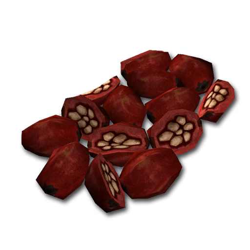
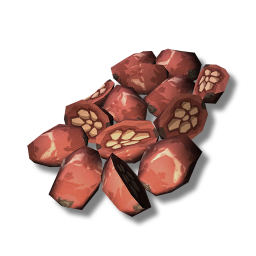

# Prepared Rose Hips

**Contents**

- [Overview](#Overview)
- [Recipe](#Recipe)
- [Products](#Products)
- [Tips](#Tips)
- [History](#History)
- [Trivia](#Trivia)
- [Gallery](#Gallery)

<table class="infobox">
<caption>Prepared Rose Hips</caption>
<colgroup>
<col style="width: 50%" />
<col style="width: 50%" />
</colgroup>
<tbody>
<tr>
<td colspan="2"><figure>

<figcaption>Prepared_Rose_Hips_icon.png</figcaption>
</figure></td>
</tr>
<tr>
<td colspan="2" class="section">
<strong>General</strong>
</td>
</tr>
<tr>
<td>
Item Type
</td>
<td></td>
</tr>
<tr>
<td>
Wintermute
</td>
<td>
No
</td>
</tr>
<tr>
<td colspan="2" class="section">
<strong>Statistics</strong>
</td>
</tr>
<tr>
<td>
Weight
</td>
<td>
0.05 kg(0.11 lbs)
</td>
</tr>
</tbody>
</table>

<table>
<colgroup>
<col style="width: 33%" />
<col style="width: 33%" />
<col style="width: 33%" />
</colgroup>
<tbody>
<tr>
<td style="vertical-align: top; font-size: 3em; color: #5d5980; padding-right: 10px">
“
</td>
<td>
Rose hips that are ready to be boiled to make a healing natural tea.

&#10;

In-game description

</td>
<td style="vertical-align: bottom; font-size: 3em; color: #5d5980; padding-left: 10px">
”
</td>
</tr>
</tbody>
</table>

**Prepared Rose Hips** are a natural medical and food item used to treat <a href="./Afflictions.md" class="wikilink" title="Afflictions">Afflictions</a> in *The Long Dark*.

## Overview

Prepared Rose Hips are crafted from 24 <a href="./Rose%20Hip.md" class="wikilink" title="Rose Hips">Rose Hips</a> and takes 15 minutes (in-game) to prepare. Rose Hips can can be found in the wilderness growing on Rose Bushes, typically in clusters of 1-4 units, a single Rose Bush yields 8 Rose Hips when Harvested. Rose Hips can be found rarely inside of containers. They cannot be directly consumed and must first be crafted into Prepared Rose Hips and then cooked into <a href="./Rose%20Hip%20Tea.md" class="wikilink" title="Rose Hip Tea">Rose Hip Tea</a>.

Rose Hip Tea functions similar to <a href="./Painkillers.md" class="wikilink" title="Painkillers">Painkillers</a> for treating Afflictions, and is cooked from one Prepared Rose Hips (24 Rose Hips) and 0.25 liters of <a href="./Water%20%28Potable%29.md" class="wikilink" title="Water (Potable)">Water (Potable)</a> at a lit <a href="./Fire.md" class="wikilink" title="Fire">Fire</a>. Consuming prepared Rose Hip Tea (even without treating an Affliction) restores 100 Calories, 30% Hydration and potentially grants the benefit "<a href="./Warming%20Up.md" class="wikilink" title="Warming Up">Warming Up</a>." Cooking Rose Hip Tea increases <a href="./Skills.md" class="wikilink" title="Cooking Skill">Cooking Skill</a>.

Prepared Rose Hips have about 1/5 the weight of their raw form, and do not <a href="./Decay.md" class="wikilink" title="Decay">Decay</a>.

## Recipe

<table class="infobox">
<caption>Prepared Rose Hips</caption>
<tbody>
<tr>
<td colspan="2">
-
</td>
</tr>
<tr>
<td colspan="2">
-
</td>
</tr>
<tr>
<td colspan="2">
15 minutes
</td>
</tr>
<tr>
<td colspan="2" class="section">
<strong>Requirements</strong>
</td>
</tr>
<tr>
<td>
Facility
</td>
<td>
[[File:Anywhere icon.png
</td>
</tr>
<tr>
<td colspan="2" class="section">
<strong>Materials</strong>
</td>
</tr>
<tr>
<td colspan="2" class="section">
<strong>Template:iconlink plain</strong>
</td>
</tr>
<tr>
<td>
Item
</td>
<td>
<a href="./Rose%20Hip.md" class="wikilink" title="Rose Hip">Rose Hip</a>
</td>
</tr>
<tr>
<td>
Quantity
</td>
<td>
24
</td>
</tr>
</tbody>
</table>

## Products

## Tips

- Harvesting 3 Rose Bushes (at 8 Rose Hips each) is required to craft 1 unit of Prepared Rose Hips/Rose Hip Tea.
- Rose Hips are found sporadically in all regions growing on Rose Bushes, particular in mountainous areas near ledges or cliffs. They frequently are near entrances to <a href="./Cave%20%28disambiguation%29.md" class="wikilink" title="Caves">Caves</a>, Rose Climbs, deployment points for <a href="./Mountaineering%20Rope.md" class="wikilink" title="Mountaineering Ropes">Mountaineering Ropes</a>, and secret locations.
- Teas may be heated/reheated to grant the Warming Up Benefit by placing them on a fire's cooking spot, or nearby a lit fire.
- Broken Ribs are permanent if left untreated, though Pain and Burns will dissipate naturally with time (4-30 hours).
- Pain has minimal effect on gameplay (aside from blurry vision) with it's only limitation being an inability to read <a href="./Research%20Book.md" class="wikilink" title="Research Books">Research Books</a> while afflicted, and subsides automatically with time. This generally makes treating Pain a wasteful decision, to carry Painkillers consume them instead of reserving their use to treat Broken Ribs or Burns.
- Painkillers cannot be crafted and Rose Hips do not regrow; however Painkillers are renewable via <a href="./Beachcombing.md" class="wikilink" title="Beachcombing">Beachcombing</a>.
- Prepared Rose Hips weigh 0.05 kg, or 1/5 of what 24 Rose Hips (their crafting materials) weigh.
- Teas are more weight efficient than Water for the Hydration they grant. (0.1kg of a tea grants 30% Hydration, equivalent to 0.25kg of water).
- Teas never decay once cooked.
- The condition of Painkillers decays slowly over time (based on <a href="./Survival%20Mode.md" class="wikilink" title="Survival Mode">Survival Mode</a>). Upon reaching 0% Condition, they become unusable and will disappear if inside of a container, but all forms of Rose Hips do not decay.

## History

- Rose Hips and other harvestable plants and remedies were introduced on 7 February 2015 in <a href="./The%20Long%20Dark%20%E2%80%94%20Changelog.md#0.192" class="wikilink" title="update 0.192">update 0.192</a>.
- As of the 1.0 <a href="./Wintermute.md" class="wikilink" title="Wintermute">Wintermute</a> update (August 1, 2017) Rose Hips must be prepared before cooking them.

## Trivia

- Rose Hips (also known as Rosehip, Rosehep or Rosehaw) are a [real world plant](https://en.wikipedia.org/wiki/Rose_hip) and accessory fruit to Rose Bushes, similar to their in-game representation including their use as a painkiller.
- Real-World Rose Hips have a history as a [poverty food](https://en.wikipedia.org/wiki/Famine_food), particularly with Native American peoples during survival situations or times of hardship, as well as for ornamental purposes.
- In The Long Dark, Painkillers and Tea must be applied directly to treat a specific injury (similar to a Bandage), unlike real-world orally-taken drugs which become generally distribute through the body.

## Gallery

<table class="gallery">
<colgroup>
<col style="width: 100%" />
</colgroup>
<tbody>
<tr>
<td><figure>

<figcaption>The old Prepared Rose Hips model</figcaption>
</figure></td>
</tr>
</tbody>
</table>

**Lua execution error in Module:Navbox function navbox**

