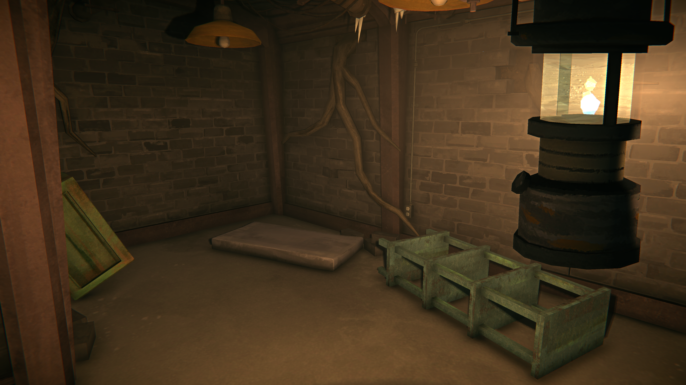
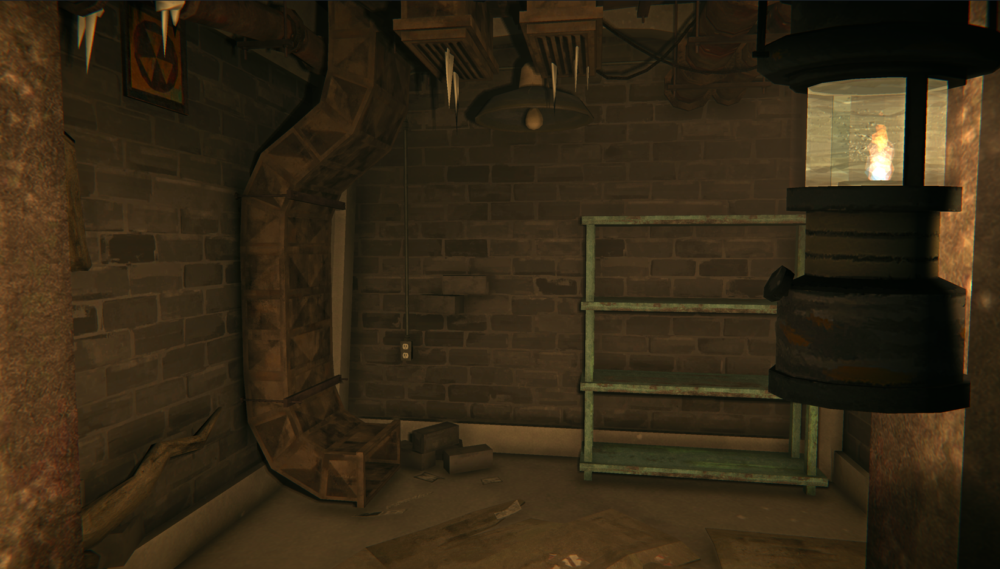
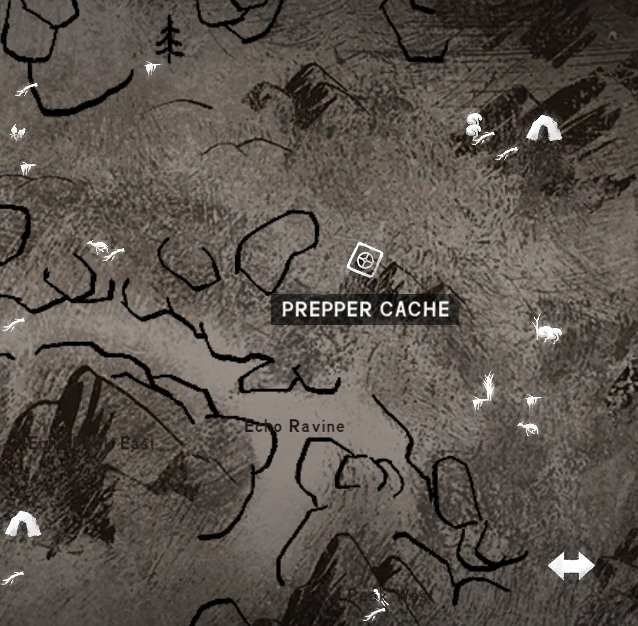
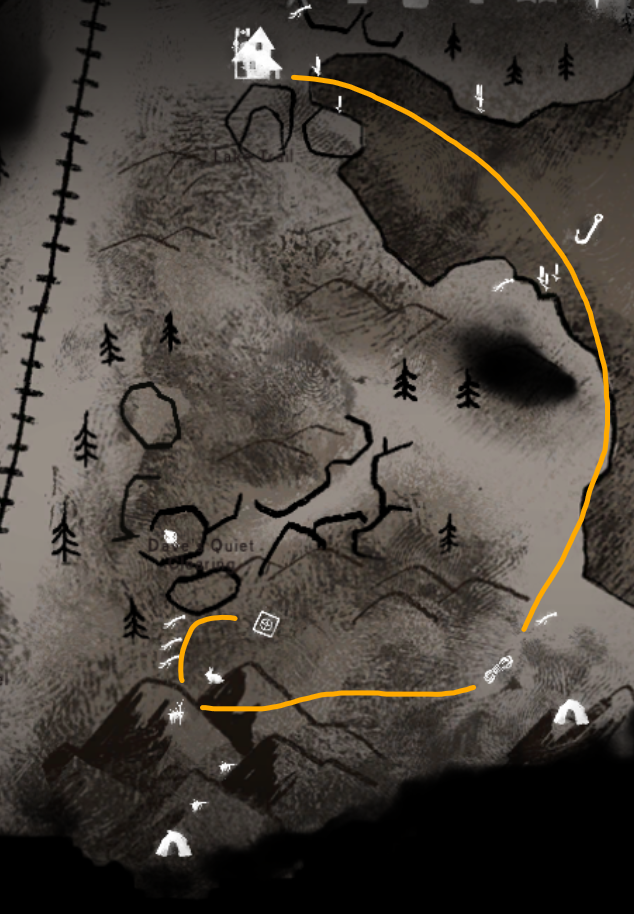
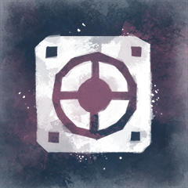

# Prepper Cache

**Contents**

- [Overview](#Overview)
- [Bunker Types](#Bunker_Types)
- [Stockpile](#Stockpile)
- [Abandoned version (Interloper/Misery)](#Abandoned_version_%28Interloper%2FMisery%29)
- [Hunting](#Hunting)
- [Abandoned version (Interloper/Misery)](#Abandoned_version_%28Interloper%2FMisery%29_2)
- [Conspiracy](#Conspiracy)
- [Conspiracy (Type 1)](#Conspiracy_%28Type_1%29)
- [Conspiracy (Type 2)](#Conspiracy_%28Type_2%29)
- [Abandoned version (Interloper/Misery)](#Abandoned_version_%28Interloper%2FMisery%29_3)
- [Abandoned Caches](#Abandoned_Caches)
- [Tom Joplin's Cache](#Tom_Joplin%27s_Cache)
- [Cache Locations](#Cache_Locations)
- [Ash Canyon](#Ash_Canyon)
- [Blackrock](#Blackrock)
- [Bleak Inlet](#Bleak_Inlet)
- [Forlorn Muskeg](#Forlorn_Muskeg)
- [Hushed River Valley](#Hushed_River_Valley)
- [Mountain Town](#Mountain_Town)
- [Mystery Lake](#Mystery_Lake)
- [Pleasant Valley](#Pleasant_Valley)
- [Timberwolf Mountain](#Timberwolf_Mountain)
- [Gallery](#Gallery)
- [Outdated Gallery](#Outdated_Gallery)
- [Trivia](#Trivia)
- [Achievements](#Achievements)
- [References](#References)
- [External links](#External_links)

<table class="infobox">
<caption>Prepper Cache</caption>
<colgroup>
<col style="width: 33%" />
<col style="width: 33%" />
<col style="width: 33%" />
</colgroup>
<tbody>
<tr>
<td colspan="2">
[[File:

<table class="gallery">
<colgroup>
<col style="width: 50%" />
<col style="width: 50%" />
</colgroup>
<tbody>
<tr>
<th><figure>
[Missing image: Prepper_Cache.jpg]
<figcaption>Exterior</figcaption>
</figure></th>
<td><figure>

<figcaption>Interior</figcaption>
</figure></td>
</tr>
</tbody>
</table></td>
<td>
250px]]
</td>
</tr>
<tr>
<td colspan="2">
<strong>Location</strong>
</td>
<td></td>
</tr>
<tr>
<td>
Location
</td>
<td>
Spread across 9 different regions throughout Great Bear Island.
</td>
<td></td>
</tr>
<tr>
<td>
Description
</td>
<td>
A reinforced underground shelter.
</td>
<td></td>
</tr>
<tr>
<td colspan="2">
<strong>General</strong>
</td>
<td></td>
</tr>
<tr>
<td><figure>

<figcaption>bed_icon.png</figcaption>
</figure></td>
<td>
Has a bed
</td>
<td></td>
</tr>
<tr>
<td></td>
<td>
Has an interior|}

<em>Not to be confused with <strong><a href="./Prepper%27s%20Abandoned%20Cache.md" class="wikilink" title="Prepper&#39;s Abandoned Cache">Prepper's Abandoned Cache</a> or one of 4 <a href="./Signal%20Void.md" class="wikilink" title="Signal Void">Signal Void</a> bunkers.</strong></em>

<table>
<colgroup>
<col style="width: 33%" />
<col style="width: 33%" />
<col style="width: 33%" />
</colgroup>
<tbody>
<tr>
<td style="vertical-align: top; font-size: 3em; color: #5d5980; padding-right: 10px">
“
</td>
<td>
Find my brother. Wyatt. He hasn't checked in since it all went dark. He runs with this group of preppers. Bad guys, his crew, but they look up to him. There were always three that followed Wyatt around. Stockpiles, hunters, conspiracy nuts. Maybe you know the type? Hehe.

&#10;

Sutherland the <a href="./Trader.md" class="wikilink" title="Trader">Trader</a>

</td>
<td style="vertical-align: bottom; font-size: 3em; color: #5d5980; padding-left: 10px">
”
</td>
</tr>
</tbody>
</table>

A <strong>Prepper Cache,</strong> also known by their nickname of <strong>"Bunker"</strong>, is a reinforced underground shelter with a stockpile of supplies. The contents of these 9 Caches is randomly selected during world generation across 9 regions in Lower Great Bear. They are the centerpiece of <a href="./Sutherland%27s%20Tale.md" class="wikilink" title="Sutherland&#39;s Tale">Sutherland's Tale</a>.

<h2 id="Overview">Overview</h2>

The entrance to a Prepper Cache is a man-sized hatch above-ground which leads into the bunker below; they are typically found in high altitude or difficult-to-reach areas, and may be partially concealed.

There are 9 Cache locations in select regions. Each Prepper Cache's location is a fixed spawn location, but the contents inside the Cache are always randomized. In terms of loot, there are 4 types of Prepper's Cache, three of which will be stocked with materials, while the remaining 6 will be abandoned and empty. The three types of loot stock are the Stockpile (kitchen) Cache, the Hunting Cache, and the Conspiracy Cache.

<u><strong>NOTE</strong></u>: Prepper Caches spawn in Interloper and Misery, but the Stockpile, Hunting, and Conspiracy Caches will have loot quantities on par with the Abandoned Prepper Cache Type<a href="#fn1" class="footnote-ref" id="fnref1" role="doc-noteref">1</a>. Interloper and Misery players will need to identify these caches to undertake <a href="./Sutherland%27s%20Tale.md" class="wikilink" title="Sutherland&#39;s Tale">Sutherland's Tale</a>. They can be identified based on the layout of the interior<a href="#fn2" class="footnote-ref" id="fnref2" role="doc-noteref">2</a>.

The interiors of these caches are small, indoors, and contain 1-2 rooms with metal shelves, crates, and a bed. There are seven distinct layouts of these caches.

Prepper Caches do not spawn in some <a href="./Challenge.md" class="wikilink" title="Challenge">Challenge</a> game modes and only appear in Lower Great Bear.

<h2 id="Bunker_Types">Bunker Types</h2>
<h3 id="Stockpile">Stockpile</h3>
<table>
<colgroup>
<col style="width: 33%" />
<col style="width: 33%" />
<col style="width: 33%" />
</colgroup>
<tbody>
<tr>
<td style="vertical-align: top; font-size: 3em; color: #5d5980; padding-right: 10px">
“
</td>
<td>
One of the guys had half-a-brain, unlike the other two who were caught up in mounting heads on the wall or scribbling crazy theories. I'd start with him, the half-a-brain survivalist.

&#10;

Sutherland the <a href="./Trader.md" class="wikilink" title="Trader">Trader</a>

</td>
<td style="vertical-align: bottom; font-size: 3em; color: #5d5980; padding-left: 10px">
”
</td>
</tr>
</tbody>
</table>
<table class="gallery">
<colgroup>
<col style="width: 50%" />
<col style="width: 50%" />
</colgroup>
<tbody>
<tr>
<th><figure>
[Missing image: Prepper_Cache_Kitchen_2.jpg]
<figcaption>Prepper_Cache_Kitchen_2.jpg</figcaption>
</figure></th>
<td><figure>
[Missing image: Prepper_Cache_Kitchen.jpg]
<figcaption>Prepper_Cache_Kitchen.jpg</figcaption>
</figure></td>
</tr>
</tbody>
</table>

Contains one room with kitchen furniture and another room with a desk and bed stocked with general supplies from all categories: fire starting, first aid, clothing, food and drink, tools, materials and the unique <a href="./Prepper%27s%20Pie.md" class="wikilink" title="Prepper&#39;s Pie">Prepper's Pie</a> <a href="./Recipe%20Cards.md" class="wikilink" title="Recipe Card">Recipe Card</a>.

Type 1 bunker (Kitchen) loot:

<ul>
<li><a href="./Prepper%27s%20Pie.md" class="wikilink" title="Prepper&#39;s Pie">Prepper's Pie</a> <a href="./Recipe%20Cards.md" class="wikilink" title="Recipe Card">Recipe Card</a> (will appear in Interloper/Misery)</li>
<li><a href="./Distress%20Pistol.md" class="wikilink" title="Distress Pistol">Distress Pistol</a> and 8 <a href="./Flare%20Shell.md" class="wikilink" title="Flare Shell">Flare Shell</a></li>
<li><a href="./Expedition%20Parka.md" class="wikilink" title="Expedition Parka">Expedition Parka</a> or <a href="./Mariner%27s%20Pea%20Coat.md" class="wikilink" title="Mariner&#39;s Pea Coat">Mariner's Pea Coat</a></li>
<li><a href="./Insulated%20Boots.md" class="wikilink" title="Insulated Boots">Insulated Boots</a> or <a href="./Mukluks.md" class="wikilink" title="Mukluks">Mukluks</a></li>
<li>2x <a href="./Emergency%20Stim.md" class="wikilink" title="Emergency Stim">Emergency Stim</a></li>
<li>A <a href="./Research%20Book.md" class="wikilink" title="Research Book">Research Book</a>, possibly Wilderness Survival (cooking)</li>
<li>5x <a href="./Military-Grade%20MRE.md" class="wikilink" title="MRE">MRE</a> (8750 kcal)</li>
<li>2x <a href="./Tin%20of%20Coffee.md" class="wikilink" title="Tin of Coffee">Tin of Coffee</a></li>
<li>Tools such as: <a href="./Hatchet.md" class="wikilink" title="Hatchet">Hatchet</a>, <a href="./Simple%20Tools.md" class="wikilink" title="Simple Tools">Simple Tools</a>, <a href="./Prybar.md" class="wikilink" title="Prybar">Prybar</a>, <a href="./Improvised%20Knife.md" class="wikilink" title="Improvised Knife">Improvised Knife</a>, <a href="./Flashlight.md" class="wikilink" title="Flashlight">Flashlight</a>, <a href="./Cooking%20Pot.md" class="wikilink" title="Cooking Pot">Cooking Pot</a>, <a href="./Recycled%20Can.md" class="wikilink" title="Recycled Can">Recycled Can</a></li>
<li>Several <a href="./Flare.md" class="wikilink" title="flares">flares</a> with possible <a href="./Marine%20Flare.md" class="wikilink" title="Marine Flares">Marine Flares</a></li>
<li>There is a <a href="./Suitcase.md" class="wikilink" title="Suitcase">Suitcase</a> under the bed full of miscellaneous clothing.</li>
<li>Large amount of sewing materials (<a href="./Cured%20Leather.md" class="wikilink" title="Leather">Leather</a>, <a href="./Cloth.md" class="wikilink" title="Cloth">Cloth</a>, <a href="./Sewing%20Kit.md" class="wikilink" title="Sewing Kits">Sewing Kits</a>)</li>
<li>Miscellaneous First Aid supplies such as bottles of <a href="./Antiseptic.md" class="wikilink" title="Antiseptic">Antiseptic</a>, <a href="./Bandage.md" class="wikilink" title="Bandages">Bandages</a> and <a href="./Antibiotics.md" class="wikilink" title="Antibiotics">Antibiotics</a></li>
<li>A tank of water under the sink with more in bottles (4L at least)</li>
<li>A <a href="./Firestriker.md" class="wikilink" title="Firestriker">Firestriker</a>, 3x <a href="./Accelerant.md" class="wikilink" title="Accelerant">Accelerant</a> and some fire making supplies as well as a <a href="./Jerry%20Can.md" class="wikilink" title="Jerry Can">Jerry Can</a></li>
<li>10 hours worth of fuel in <a href="./Firelog.md" class="wikilink" title="Firelogs">Firelogs</a></li>
<li>5500 kcal of various food</li>
</ul>
<h4 id="Abandoned_version_(Interloper/Misery)">Abandoned version (Interloper/Misery)</h4>

On Interloper and Misery levels, this cache has sparse loot and almost no furniture. Players undertaking <a href="./Sutherland%27s%20Tale.md" class="wikilink" title="Sutherland&#39;s Tale">Sutherland's Tale</a> will need to identify this bunker for Special Request 1.

This cache can be identified by the presence of the Prepper's Pie Recipe Card. It is also the only bunker which contains a corpse<a href="#fn3" class="footnote-ref" id="fnref3" role="doc-noteref">3</a>. Its layout has a small vestibule which opens into a rectangular room containing the corpse and a bed.

<table class="gallery">
<colgroup>
<col style="width: 100%" />
</colgroup>
<tbody>
<tr>
<td><figure>

<figcaption>Abandoned_Mission_Cache_1.png</figcaption>
</figure></td>
</tr>
</tbody>
</table>

Only <em>after</em> accepting Special Request 1 will a <a href="./Loose%20Bricks%20Stash.md" class="wikilink" title="Loose Bricks Stash">Loose Bricks Stash</a> appear for the player. It will spawn on the wall beside the corpse<a href="#fn4" class="footnote-ref" id="fnref4" role="doc-noteref">4</a>.

<h3 id="Hunting">Hunting</h3>
<table>
<colgroup>
<col style="width: 33%" />
<col style="width: 33%" />
<col style="width: 33%" />
</colgroup>
<tbody>
<tr>
<td style="vertical-align: top; font-size: 3em; color: #5d5980; padding-right: 10px">
“
</td>
<td>
If I were you I'd try the trophy hunter next. Wyatt always kept some of his guns with him.

&#10;

Sutherland the <a href="./Trader.md" class="wikilink" title="Trader">Trader</a>

</td>
<td style="vertical-align: bottom; font-size: 3em; color: #5d5980; padding-left: 10px">
”
</td>
</tr>
</tbody>
</table>
<table class="gallery">
<colgroup>
<col style="width: 25%" />
<col style="width: 25%" />
<col style="width: 25%" />
<col style="width: 25%" />
</colgroup>
<tbody>
<tr>
<td><figure>
[Missing image: Prepper's_Cache_Hunter.jpg]
<figcaption>Prepper's_Cache_Hunter.jpg</figcaption>
</figure></td>
<td><figure>
[Missing image: Prepper's_Cache_Hunter_2.jpg]
<figcaption>Prepper's_Cache_Hunter_2.jpg</figcaption>
</figure></td>
<td><figure>
[Missing image: Prepper's_Cache_Hunter_3.jpg]
<figcaption>Prepper's_Cache_Hunter_3.jpg</figcaption>
</figure></td>
<td><figure>
[Missing image: Hunter'sRevolverBench.jpg]
<figcaption>Hunter'sRevolverBench.jpg</figcaption>
</figure></td>
</tr>
</tbody>
</table>

Two rooms, the biggest one with antler decorations and different animal skulls, cured furs, a lot of storage space, a Bed, and a Work Bench. You may find plenty of animal skins, crow feathers, cured guts and hunting gear like a <a href="./Survival%20Bow.md" class="wikilink" title="Survival Bow">Survival Bow</a> and arrows, a <a href="./Hunting%20Rifle.md" class="wikilink" title="Hunting Rifle">Hunting Rifle</a> or <a href="./Revolver.md" class="wikilink" title="Revolver">Revolver</a>, <a href="./Snare.md" class="wikilink" title="Snares">Snares</a>, and various tools. This is the only location in the game where the <a href="./Hunter%27s%20Revolver.md" class="wikilink" title="Hunter&#39;s Revolver">Hunter's Revolver</a> can be found.

Type 2 bunker (Hunter) loot:

<ul>
<li><a href="./Hunter%27s%20Revolver.md" class="wikilink" title="Hunter&#39;s Revolver">Hunter's Revolver</a></li>
<li>Several Hides/Pelts (Deer, Rabbit, and Wolf)</li>
<li><a href="./Cured%20Gut.md" class="wikilink" title="Cured Gut">Cured Gut</a></li>
<li><a href="./Snare.md" class="wikilink" title="Snares">Snares</a></li>
<li>If you open the vent in the first room, 2x <a href="./Emergency%20Stim.md" class="wikilink" title="Stims">Stims</a></li>
<li>Several canisters of <a href="./Lantern%20Fuel.md" class="wikilink" title="Lantern Fuel">Lantern Fuel</a></li>
<li>Copious amounts of Canned food and <a href="./Soda%20%28disambiguation%29.md" class="wikilink" title="sodas">sodas</a></li>
<li><a href="./Fisherman%27s%20Sweater.md" class="wikilink" title="Fisherman&#39;s Sweater">Fisherman's Sweater</a> or <a href="./Cowichan%20Sweater.md" class="wikilink" title="Cowichan Sweater">Cowichan Sweater</a> on the bed</li>
<li><a href="./Hacksaw.md" class="wikilink" title="Hacksaw">Hacksaw</a> and other <a href="./Tools.md" class="wikilink" title="Tools">Tools</a> on the pegboard behind the workbench</li>
<li><a href="./Quality%20Tools.md" class="wikilink" title="Quality Tools">Quality Tools</a></li>
<li><a href="./Camera.md" class="wikilink" title="FastFilms">FastFilms</a></li>
</ul>
<h4 id="Abandoned_version_(Interloper/Misery)_2">Abandoned version (Interloper/Misery)</h4>

For Interloper and Misery players, this cache can be identified by its L-shaped layout<a href="#fn5" class="footnote-ref" id="fnref5" role="doc-noteref">5</a> and the green crate that is unique to this cache. Identifying this cache is needed to complete Special Request 2.

<table class="gallery">
<colgroup>
<col style="width: 100%" />
</colgroup>
<tbody>
<tr>
<td><figure>

<figcaption>Abandoned_Mission_Cache_2.png</figcaption>
</figure></td>
</tr>
</tbody>
</table>

As with the other special requests, it is only <em>after</em> accepting Special Request 2 that a <a href="./Loose%20Bricks%20Stash.md" class="wikilink" title="Loose Bricks Stash">Loose Bricks Stash</a> will become available in this cache. It will spawn on the far wall<a href="#fn6" class="footnote-ref" id="fnref6" role="doc-noteref">6</a>.

<h3 id="Conspiracy">Conspiracy</h3>
<h4 id="Conspiracy_(Type_1)">Conspiracy (Type 1)</h4>
<table>
<colgroup>
<col style="width: 33%" />
<col style="width: 33%" />
<col style="width: 33%" />
</colgroup>
<tbody>
<tr>
<td style="vertical-align: top; font-size: 3em; color: #5d5980; padding-right: 10px">
“
</td>
<td>
Now there's one more bunker to check. The conspiracy nut. I'm not sure why Wyatt kept him around, but he did.

&#10;

Sutherland the <a href="./Trader.md" class="wikilink" title="Trader">Trader</a>

</td>
<td style="vertical-align: bottom; font-size: 3em; color: #5d5980; padding-left: 10px">
”
</td>
</tr>
</tbody>
</table>
<table class="gallery">
<colgroup>
<col style="width: 25%" />
<col style="width: 25%" />
<col style="width: 25%" />
<col style="width: 25%" />
</colgroup>
<tbody>
<tr>
<td><figure>
[Missing image: Prepper_Cache_Conspiracy.jpg]
<figcaption>Prepper_Cache_Conspiracy.jpg</figcaption>
</figure></td>
<td><figure>
[Missing image: Prepper_Cache_Conspiracy_2.jpg]
<figcaption>Prepper_Cache_Conspiracy_2.jpg</figcaption>
</figure></td>
<td><figure>
[Missing image: Prepper's_Cache_Conspiracy_3.jpg]
<figcaption>Prepper's_Cache_Conspiracy_3.jpg</figcaption>
</figure></td>
<td><figure>
[Missing image: Prepper_Cache_Conspiracy_4.jpg]
<figcaption>Prepper_Cache_Conspiracy_4.jpg</figcaption>
</figure></td>
</tr>
</tbody>
</table>

A cache filled with papers lined across every available wall surface. A <a href="./Gold%20Nugget.md" class="wikilink" title="Gold Nugget">Gold Nugget</a> is guaranteed to spawn in the <a href="./Grate.md" class="wikilink" title="Grate">Grate</a>.

Type 3 bunker (Conspiracy Type 1) loot:

<ul>
<li>2 double <a href="./Locker.md" class="wikilink" title="Lockers">Lockers</a>, Forest Talker <a href="./Backpack.md" class="wikilink" title="Backpack">Backpack</a>, 2 <a href="./File%20Cabinet.md" class="wikilink" title="File Cabinet">File Cabinet</a></li>
<li>1 mattress <a href="./Bed.md" class="wikilink" title="Bed">Bed</a></li>
<li><a href="./Advanced%20Guns%20Guns%20Guns!.md" class="wikilink" title="Advanced Guns Guns Guns!">Advanced Guns Guns Guns!</a> and a single <a href="./Book.md" class="wikilink" title="Book">Book</a></li>
<li>1 <a href="./Wool%20Longjohns.md" class="wikilink" title="Wool Longjohns">Wool Longjohns</a>, <a href="./Balaclava.md" class="wikilink" title="Balaclava">Balaclava</a>, <a href="./Combat%20Boots.md" class="wikilink" title="Combat Boots">Combat Boots</a>, <a href="./Old%20Fashioned%20Parka.md" class="wikilink" title="Old Fashioned Parka">Old Fashioned Parka</a>, <a href="./Wool%20Socks.md" class="wikilink" title="Wool Socks">Wool Socks</a></li>
<li>4 <a href="./Ketchup%20Chips.md" class="wikilink" title="Ketchup Chips">Ketchup Chips</a>, 4 <a href="./Go!%20Energy%20Drink.md" class="wikilink" title="Go! Energy Drink">Go! Energy Drink</a>, 3 of <a href="./Airline%20Food%20-%20Vegetarian.md" class="wikilink" title="Airline Food - Vegetarian">Airline Food - Vegetarian</a>, 3 <a href="./Airline%20Food%20-%20Chicken.md" class="wikilink" title="Airline Food - Chicken">Airline Food - Chicken</a>, 3 <a href="./Salty%20Crackers.md" class="wikilink" title="Salty Crackers">Salty Crackers</a>, 2 L <a href="./Water%20%28Potable%29.md" class="wikilink" title="Water (Potable)">Water (Potable)</a>, <a href="./Energy%20Bar.md" class="wikilink" title="Energy Bar">Energy Bar</a></li>
<li><a href="./Hunting%20Rifle.md" class="wikilink" title="Hunting Rifle">Hunting Rifle</a> and 20 <a href="./Rifle%20Ammunition.md" class="wikilink" title="Rifle Ammunition">Rifle Ammunition</a>, 10 <a href="./Revolver%20Ammunition.md" class="wikilink" title="Revolver Ammunition">Revolver Ammunition</a></li>
<li><a href="./Heavy%20Hammer.md" class="wikilink" title="Heavy Hammer">Heavy Hammer</a>, <a href="./Dusting%20Sulfur.md" class="wikilink" title="Dusting Sulfur">Dusting Sulfur</a>, 2 <a href="./Stump%20Remover.md" class="wikilink" title="Stump Remover">Stump Remover</a>, <a href="./Can%20of%20Gunpowder.md" class="wikilink" title="Can of Gunpowder">Can of Gunpowder</a>, <a href="./Firearm%20Cleaning%20Kit.md" class="wikilink" title="Firearm Cleaning Kit">Firearm Cleaning Kit</a>, <a href="./Marine%20Flare.md" class="wikilink" title="Marine Flare">Marine Flare</a>, <a href="./Spray%20Paint.md" class="wikilink" title="Spray Paint">Spray Paint</a>, <a href="./Jerry%20Can.md" class="wikilink" title="Jerry Can">Jerry Can</a>, 2 <a href="./Recycled%20Can.md" class="wikilink" title="Recycled Can">Recycled Can</a></li>
<li><a href="./Gold%20Nugget.md" class="wikilink" title="Gold Nugget">Gold Nugget</a> and 2 <a href="./Cash.md" class="wikilink" title="Cash">Cash</a> in a <a href="./Grate.md" class="wikilink" title="Grate">Grate</a></li>
<li><a href="./First%20Aid%20Kit.md" class="wikilink" title="First Aid Kit">First Aid Kit</a> with <a href="./Antibiotics.md" class="wikilink" title="Antibiotics">Antibiotics</a>, <a href="./Painkillers.md" class="wikilink" title="Painkillers">Painkillers</a>, <a href="./Emergency%20Stim.md" class="wikilink" title="Emergency Stim">Emergency Stim</a></li>
</ul>
<h4 id="Conspiracy_(Type_2)">Conspiracy (Type 2)</h4>

This cache is 1 room only and has a different layout and slightly different loot than the previous version.

<table class="gallery">
<colgroup>
<col style="width: 50%" />
<col style="width: 50%" />
</colgroup>
<tbody>
<tr>
<th><figure>
[Missing image: Survival_Stash_Bunker.jpg]
<figcaption>Survival_Stash_Bunker.jpg</figcaption>
</figure></th>
<td><figure>
[Missing image: Survival_Stash_Bunker_2.jpg]
<figcaption>Survival_Stash_Bunker_2.jpg</figcaption>
</figure></td>
</tr>
</tbody>
</table>

With lots of guns, ammunition, arrows, bows, food, tools, and overall large amounts of survival supplies stored here. A <a href="./Safe.md" class="wikilink" title="Safe">Safe</a> is always hidden behind some crates and metal shelves near the entrance ladder and has a chance to contain a single <a href="./Gold%20Nugget.md" class="wikilink" title="Gold Nugget">Gold Nugget</a>.

Type 3 bunker (Conspiracy Type 2) loot:

<ul>
<li>Loose clothing: <a href="./Wool%20Longjohns.md" class="wikilink" title="Wool Longjohns">Wool Longjohns</a>, <a href="./Wool%20Socks.md" class="wikilink" title="Wool Socks">Wool Socks</a>, <a href="./Balaclava.md" class="wikilink" title="Balaclava">Balaclava</a>, <a href="./Combat%20Boots.md" class="wikilink" title="Combat Boots">Combat Boots</a>, <a href="./Old%20Fashioned%20Parka.md" class="wikilink" title="Old Fashioned Parka">Old Fashioned Parka</a></li>
<li><a href="./First%20Aid%20Kit.md" class="wikilink" title="First Aid Kit">First Aid Kit</a> containing medical supplies, sometimes <a href="./Energy%20Bar.md" class="wikilink" title="Energy Bar">Energy Bar</a></li>
<li>Loose food such as: 3x <a href="./Go!%20Energy%20Drink.md" class="wikilink" title="Go! Energy Drink">Go! Energy Drink</a>, <a href="./Beef%20Jerky.md" class="wikilink" title="Beef Jerky">Beef Jerky</a>, <a href="./Ketchup%20Chips.md" class="wikilink" title="Ketchup Chips">Ketchup Chips</a>, <a href="./Water%20%28Potable%29.md" class="wikilink" title="Water (Potable)">Water (Potable)</a>, <a href="./Airline%20Food%20-%20Chicken.md" class="wikilink" title="Airline Food - Chicken">Airline Food - Chicken</a>, <a href="./Airline%20Food%20-%20Vegetarian.md" class="wikilink" title="Airline Food - Vegetarian">Airline Food - Vegetarian</a>, <a href="./Energy%20Bar.md" class="wikilink" title="Energy Bar">Energy Bar</a></li>
<li>Loose tools such as: <a href="./Flashlight.md" class="wikilink" title="Flashlight">Flashlight</a>, <a href="./Heavy%20Hammer.md" class="wikilink" title="Heavy Hammer">Heavy Hammer</a>, 2x <a href="./Spray%20Paint.md" class="wikilink" title="Spray Paint">Spray Paint</a>, <a href="./Jerry%20Can.md" class="wikilink" title="Jerry Can">Jerry Can</a>, <a href="./Can%20of%20Gunpowder.md" class="wikilink" title="Can of Gunpowder">Can of Gunpowder</a>, 2x <a href="./Recycled%20Can.md" class="wikilink" title="Recycled Can">Recycled Can</a></li>
<li><a href="./Revolver.md" class="wikilink" title="Revolver">Revolver</a> and <a href="./Revolver%20Ammunition.md" class="wikilink" title="Revolver Ammunition">Revolver Ammunition</a> (in <a href="./Grate.md" class="wikilink" title="vent">vent</a>)</li>
<li><a href="./Hunting%20Rifle.md" class="wikilink" title="Hunting Rifle">Hunting Rifle</a>, <a href="./Firearm%20Cleaning%20Kit.md" class="wikilink" title="Firearm Cleaning Kit">Firearm Cleaning Kit</a>, and <a href="./Rifle%20Ammunition.md" class="wikilink" title="Rifle Ammunition">Rifle Ammunition</a> (loose cartridges) OR <a href="./Survival%20Bow.md" class="wikilink" title="Survival Bow">Survival Bow</a> and <a href="./Simple%20Arrow.md" class="wikilink" title="Simple Arrow">Simple Arrow</a></li>
<li>Loose Revolver and Rifle Ammunition all over</li>
<li><a href="./Stump%20Remover.md" class="wikilink" title="Stump Remover">Stump Remover</a> and <a href="./Dusting%20Sulfur.md" class="wikilink" title="Dusting Sulfur">Dusting Sulfur</a></li>
<li>5x <a href="./Book.md" class="wikilink" title="Book">Book</a>, <a href="./Wood%20Matches.md" class="wikilink" title="Wood Matches">Wood Matches</a>, and <a href="./Research%20Book.md" class="wikilink" title="Advanced Guns! Guns! Guns!">Advanced Guns! Guns! Guns!</a> on table</li>
<li>Forest Talker <a href="./Backpack.md" class="wikilink" title="Backpack">Backpack</a> containing <a href="./Granola%20Bar.md" class="wikilink" title="Granola Bar">Granola Bar</a> and <a href="./Metal%20Container.md" class="wikilink" title="Metal Container">Metal Container</a> containing 5x Airline Food</li>
<li>Several environmental items that can be broken down such as: <a href="./Metal%20Shelf.md" class="wikilink" title="Metal Shelf">Metal Shelf</a>, <a href="./Crate.md" class="wikilink" title="Crate">Crate</a>, <a href="./Table.md" class="wikilink" title="Table">Table</a>, <a href="./Cloth%20%28Object%29.md" class="wikilink" title="Cloth (Object)">Cloth (Object)</a>, <a href="./Cardboard%20Box.md" class="wikilink" title="Cardboard Box">Cardboard Box</a>, <a href="./Metal%20Lamp.md" class="wikilink" title="Metal Lamp">Metal Lamp</a>, <a href="./Chair.md" class="wikilink" title="Chair">Chair</a></li>
<li>A <a href="./Safe.md" class="wikilink" title="Safe">Safe</a> hidden behind a Crate and Metal Shelf left of the entrance ladder, with possible contents of a <a href="./Flare%20Shell.md" class="wikilink" title="Flare Shell">Flare Shell</a>, <a href="./Cash.md" class="wikilink" title="Cash">Cash</a>, <a href="./Expedition%20Parka.md" class="wikilink" title="Expedition Parka">Expedition Parka</a>, <a href="./Mukluks.md" class="wikilink" title="Mukluks">Mukluks</a>, or <a href="./Rifle%20Ammunition.md" class="wikilink" title="Rifle Ammunition">Rifle Ammunition</a>. <a href="./Cash.md" class="wikilink" title="Cash">Cash</a> and a <a href="./Gold%20Nugget.md" class="wikilink" title="Gold Nugget">Gold Nugget</a> also has a chance to spawn inside (though this is not guaranteed unlike the previous Conspiracy Bunker type).</li>
</ul>
<h4 id="Abandoned_version_(Interloper/Misery)_3">Abandoned version (Interloper/Misery)</h4>

For Interloper and Misery players, the Conspiracy Cache can be identified for having a red-painted corridor<a href="#fn7" class="footnote-ref" id="fnref7" role="doc-noteref">7</a> and a radiation sign on the wall. Identifying this cache is necessary to complete Special Request 3 as part of <a href="./Sutherland%27s%20Tale.md" class="wikilink" title="Sutherland&#39;s Tale">Sutherland's Tale</a>.

<table class="gallery">
<colgroup>
<col style="width: 50%" />
<col style="width: 50%" />
</colgroup>
<tbody>
<tr>
<th><figure>

<figcaption>Abandoned_Mission_Cache_3_(red_corridor).png</figcaption>
</figure></th>
<td><figure>

<figcaption>Abandoned_Mission_Cache_3.png</figcaption>
</figure></td>
</tr>
</tbody>
</table>

As with the other special requests, it is only <em>after</em> accepting Special Request 3 that a <a href="./Loose%20Bricks%20Stash.md" class="wikilink" title="Loose Bricks Stash">Loose Bricks Stash</a> will become available in this cache. It will spawn at the far wall, to the left<a href="#fn8" class="footnote-ref" id="fnref8" role="doc-noteref">8</a>.

<h3 id="Abandoned_Caches">Abandoned Caches</h3>

On <a href="./Pilgrim.md" class="wikilink" title="Pilgrim">Pilgrim</a>, <a href="./Voyageur.md" class="wikilink" title="Voyageur">Voyageur</a>, <a href="./Stalker.md" class="wikilink" title="Stalker">Stalker</a>, or all custom difficulties, 6 of the 9 bunkers will be basically empty. These are entirely abandoned, having very little if anything inside of them aside from bare concrete flooring, but always contain a Bed and provide solid shelter, despite being vacant, however.

On <a href="./Interloper.md" class="wikilink" title="Interloper">Interloper</a> or <a href="./Misery.md" class="wikilink" title="Misery">Misery</a>, <strong>ALL 9</strong> Prepper Caches will have loot quantities that are Abandoned. The Stockpile (kitchen), Hunting, and Conspiracy bunkers will still spawn, and can be recognized by their layouts, but will have loot similar to Abandoned caches<a href="#fn9" class="footnote-ref" id="fnref9" role="doc-noteref">9</a>.

Type 5 bunker (abandoned) loot:

<ul>
<li>Matches</li>
<li>Candy Bar</li>
<li><a href="./Cloth.md" class="wikilink" title="Cloth">Cloth</a></li>
<li><a href="./Cloth%20%28Object%29.md" class="wikilink" title="Cloth (Object)">Cloth (Object)</a></li>
<li>few clothes (usually <a href="./Sports%20Socks.md" class="wikilink" title="Sports Socks">Sports Socks</a> near the bed)</li>
<li><a href="./Cardboard%20Box.md" class="wikilink" title="Cardboard Boxes">Cardboard Boxes</a></li>
<li><a href="./Corpse.md" class="wikilink" title="Corpse">Corpse</a></li>
<li>All Caches spawn with Abandoned quantities of loot on Interloper and Misery. The Stockpile (kitchen) bunker will contain the <a href="./Prepper%27s%20Pie.md" class="wikilink" title="Prepper&#39;s Pie">Prepper's Pie</a> Recipe Card.</li>
</ul>
<h3 id="Tom_Joplin&#39;s_Cache">Tom Joplin's Cache</h3>
<table>
<colgroup>
<col style="width: 33%" />
<col style="width: 33%" />
<col style="width: 33%" />
</colgroup>
<tbody>
<tr>
<td style="vertical-align: top; font-size: 3em; color: #5d5980; padding-right: 10px">
“
</td>
<td>
There's one more bunker you can check. One of old man Joplin's in Pleasant Valley. On the way to Timberwolf. He wasn't in their crew, but Wyatt set up his prepper caches.

&#10;

Sutherland the <a href="./Trader.md" class="wikilink" title="Trader">Trader</a>

</td>
<td style="vertical-align: bottom; font-size: 3em; color: #5d5980; padding-left: 10px">
”
</td>
</tr>
</tbody>
</table>

A special 10th Prepper's Cache called <a href="./Prepper%27s%20Abandoned%20Cache.md" class="wikilink" title="Prepper&#39;s Abandoned Cache">Prepper's Abandoned Cache</a> appears in <a href="./Pleasant%20Valley.md" class="wikilink" title="Pleasant Valley">Pleasant Valley</a>. This is a second cache in the region is not part of the 9 Prepper Caches, as the inside is always static across all Experiences.

It is however related to every Cache when following <a href="./Sutherland%27s%20Tale.md" class="wikilink" title="Sutherland&#39;s Tale">Sutherland's Tale</a>. This same bunker is also the starting point of the <a href="./Joplin%27s%20Bunker%20Raid.md" class="wikilink" title="Joplin&#39;s Bunker Raid">Joplin's Bunker Raid</a> side mission in <a href="./Episode%203%20-%20Crossroads%20Elegy.md" class="wikilink" title="Episode 3: Crossroads Elegy">Episode 3: Crossroads Elegy</a>.

<h2 id="Cache_Locations">Cache Locations</h2>
<h4 id="Ash_Canyon"><a href="./Ash%20Canyon.md" class="wikilink" title="Ash Canyon">Ash Canyon</a></h4>
<ul>
<li>Starting from the Region Connection cave, head east until passing through a narrow valley near a pond, a fallen tree above leads to the Prepper Cache. Head north and walk over the nearby ravine and through a rock tunnel until reaching the rope climb (alternatively, continue south and crouch through a narrow rock cave to the rope bridge), then walk up a hill and back over the ravine to the fallen tree.</li>
</ul>
<h4 id="Blackrock"><a href="./Blackrock.md" class="wikilink" title="Blackrock">Blackrock</a></h4>
<ul>
<li>Just a bit East of <a href="./Mule%20Bridge.md" class="wikilink" title="Mule Bridge">Mule Bridge</a> on an outcrop behind some <a href="./Scrub%20Brush.md" class="wikilink" title="Scrub Brush">Scrub Brush</a>. Sometimes need a <a href="./Hatchet.md" class="wikilink" title="Hatchet">Hatchet</a> to clear the brush.</li>
</ul>
<h4 id="Bleak_Inlet"><a href="./Bleak%20Inlet.md" class="wikilink" title="Bleak Inlet">Bleak Inlet</a></h4>
<ul>
<li>On a hill between the ravine transition point entering the region and the cave to the east. <a href="./Pensive%20Lookout.md" class="wikilink" title="Pensive Lookout">Pensive Lookout</a> is close by as a landmark.</li>
</ul>
<h4 id="Forlorn_Muskeg"><a href="./Forlorn%20Muskeg.md" class="wikilink" title="Forlorn Muskeg">Forlorn Muskeg</a></h4>
<ul>
<li>On the ridge behind/above <a href="./Old%20Spence%20Family%20Homestead.md" class="wikilink" title="Old Spence Family Homestead">Old Spence Family Homestead</a>.</li>
</ul>
<h4 id="Hushed_River_Valley"><a href="./Hushed%20River%20Valley.md" class="wikilink" title="Hushed River Valley">Hushed River Valley</a></h4>
<ul>
<li>On the plateau west of <a href="./Lonely%20Cave.md" class="wikilink" title="Lonely Cave">Lonely Cave</a>, near the <a href="./Plane%20Crashes.md" class="wikilink" title="Plane Crash">Plane Crash</a>. <em>For players who do not own <a href="./Tales%20from%20the%20Far%20Territory.md" class="wikilink" title="Tales from the Far Territory">Tales from the Far Territory</a>, this is the only location where a <a href="./Work%20Bench.md" class="wikilink" title="work bench">work bench</a> may be found/built in the region.</em></li>
</ul>
<h4 id="Mountain_Town"><a href="./Mountain%20Town.md" class="wikilink" title="Mountain Town">Mountain Town</a></h4>
<ul>
<li>Walk on <a href="./Spruce%20Falls%20Bridge.md" class="wikilink" title="Spruce Falls Bridge">Spruce Falls Bridge</a> and take the path to the right after the very last car on the road. Follow the path to the <a href="./Cave%20%28Mountain%20Town%20location%29.md" class="wikilink" title="Cave">Cave</a> and go through it. The prepper cache is on the other side of the cave, on the one-way shortcut to the <a href="./Mackenzie%27s%20Crashed%20Plane.md" class="wikilink" title="Crashed Plane">Crashed Plane</a>.</li>
</ul>
<h4 id="Mystery_Lake"><a href="./Mystery%20Lake%20%28region%29.md" class="wikilink" title="Mystery Lake">Mystery Lake</a></h4>
<ul>
<li>On the higher ground south-east of <a href="./Dave%27s%20Quiet%20Clearing.md" class="wikilink" title="Dave&#39;s Quiet Clearing">Dave's Quiet Clearing</a>. Mainly accessible via rope-climb near <a href="./Mystery%20Lake%20%28Western%20Access%29.md" class="wikilink" title="Mystery Lake (Western Access)">Mystery Lake (Western Access)</a>, although it is possible to instead walk east along the ridge line by the climbing rope, and switch back west when the incline is walkable. You can also walk up the ridge line next to Dave's Quiet Clearing near the fallen tree on the hill.</li>
</ul>
<h4 id="Pleasant_Valley"><a href="./Pleasant%20Valley.md" class="wikilink" title="Pleasant Valley">Pleasant Valley</a></h4>
<ul>
<li>On a hill behind the rocks Northwest (behind the tail) of the <a href="./Crash%20Site%20%28Pleasant%20Valley%29.md" class="wikilink" title="Crash Site">Crash Site</a>, across from the local bear cave.</li>
<li>A second Cache is found near the log at the rope climbing section to Timberwolf Mountain. This is the <a href="./Prepper%27s%20Abandoned%20Cache.md" class="wikilink" title="Prepper&#39;s Abandoned Cache">Prepper's Abandoned Cache</a>. Its contents are always static, and is not one of the 9 randomly generated caches.</li>
</ul>
<h4 id="Timberwolf_Mountain"><a href="./Timberwolf%20Mountain.md" class="wikilink" title="Timberwolf Mountain">Timberwolf Mountain</a></h4>
<ul>
<li>On a hill across the ravine from <a href="./Echo%20Peak%20West.md" class="wikilink" title="Echo Peak West">Echo Peak West</a>, right of the Rope Climbing section from the eastern <a href="./Engine%20%28East%29.md" class="wikilink" title="Engine">Engine</a>.</li>
</ul>
<h2 id="Gallery">Gallery</h2>
<table class="gallery">
<colgroup>
<col style="width: 33%" />
<col style="width: 33%" />
<col style="width: 33%" />
</colgroup>
<tbody>
<tr>
<td><figure>

<figcaption>Timberwolf Mountain's prepper cache location</figcaption>
</figure></td>
<td><figure>

<figcaption>Mystery Lake's prepper cache location</figcaption>
</figure></td>
<td><figure>
[Missing image: AshCanyonPrepperCache.jpg]
<figcaption>Ash Canyon's prepper cache location</figcaption>
</figure></td>
</tr>
</tbody>
</table>
<h2 id="Outdated_Gallery">Outdated Gallery</h2>
<table class="gallery">
<colgroup>
<col style="width: 25%" />
<col style="width: 25%" />
<col style="width: 25%" />
<col style="width: 25%" />
</colgroup>
<tbody>
<tr>
<td><figure>
[Missing image: Prepper_cache_clothes_in_ML.jpg]
<figcaption>Prepper Cache (clothes) near Train Loading Area in Mystery Lake</figcaption>
</figure></td>
<td><figure>
[Missing image: Expedition_Parka_in_Prepper_Cache_(clothes).jpg]
<figcaption>Very good supplies can be found inside a Prepper Cache</figcaption>
</figure></td>
<td><figure>
[Missing image: 305620_screenshots_20180708200046_1.jpg]
<figcaption>A prepper cache containing mainly food.</figcaption>
</figure></td>
<td><figure>
[Missing image: Cache_Firewood1.jpg]
<figcaption>Cache_Firewood1</figcaption>
</figure></td>
</tr>
<tr>
<td><figure>
[Missing image: Cache_Firewood2.jpg]
<figcaption>Cache_Firewood2</figcaption>
</figure></td>
<td><figure>
[Missing image: Cache_Firewood3.jpg]
<figcaption>Cache_Firewood3</figcaption>
</figure></td>
<td><figure>
[Missing image: Cache_Food1.jpg]
<figcaption>Cache_Food1</figcaption>
</figure></td>
<td><figure>
[Missing image: Cache_Food2.jpg]
<figcaption>Cache_Food2</figcaption>
</figure></td>
</tr>
<tr>
<td><figure>
[Missing image: Cache_Med1.jpg]
<figcaption>Cache_Med1</figcaption>
</figure></td>
<td><figure>
[Missing image: Cache_Med2.jpg]
<figcaption>Cache_Med2</figcaption>
</figure></td>
<td><figure>
[Missing image: Cache_Med3.jpg]
<figcaption>Cache_Med3</figcaption>
</figure></td>
<td><figure>
[Missing image: Cache_Hunting1.jpg]
<figcaption>Cache_Weapon1</figcaption>
</figure></td>
</tr>
<tr>
<td><figure>
[Missing image: Cache_Hunting2.jpg]
<figcaption>Cache_Weapon2</figcaption>
</figure></td>
<td><figure>
[Missing image: Cache_Hunting3.jpg]
<figcaption>Cache_Weapon3</figcaption>
</figure></td>
<td><figure>
[Missing image: Cache_Tool1.jpg]
<figcaption>Cache_Tool1</figcaption>
</figure></td>
<td><figure>
[Missing image: Cache_Tool2.jpg]
<figcaption>Cache_Tool2</figcaption>
</figure></td>
</tr>
<tr>
<td><figure>
[Missing image: Cache_Tool3.jpg]
<figcaption>Cache_Tool3</figcaption>
</figure></td>
<td><figure>
[Missing image: Cache_Clothes1.jpg]
<figcaption>Cache_Clothes1</figcaption>
</figure></td>
<td><figure>
[Missing image: Cache_Clothes2.jpg]
<figcaption>Cache_Clothes2</figcaption>
</figure></td>
<td><figure>
[Missing image: Cache_Clothes3.jpg]
<figcaption>Cache_Clothes3</figcaption>
</figure></td>
</tr>
</tbody>
</table>
<h2 id="Trivia">Trivia</h2>
<ul>
<li>Most caches in <em>The Long Dark</em> are marked with <a href="https://en.wikipedia.org/wiki/Fallout_shelter">fallout shelter</a> signs, signifying their original purpose was to protect the local population in the event of a nuclear attack.</li>
<li>The <a href="./Grate.md" class="wikilink" title="Grate">Grate</a> inside some bunkers may be opened, potentially yielding hidden loot.</li>
<li>Wyatt, <a href="./Trader.md" class="wikilink" title="Sutherland&#39;s">Sutherland's</a> brother, was responsible for creating these caches with 3 other people in his crew, along with <a href="./Joplin%27s%20Bunker%20Raid.md" class="wikilink" title="Joplin&#39;s Bunkers">Joplin's Bunkers</a>. He may have also been responsible for creating <a href="./Hank%27s%20Hatch.md" class="wikilink" title="Hank&#39;s Hatch">Hank's Hatch</a> and the <a href="./Aurora%20Hatch.md" class="wikilink" title="Aurora Hatch">Aurora Hatch</a>.</li>
</ul>
<h2 id="Achievements">Achievements</h2>

 <a href="./Down%20Below.md" class="wikilink" title="Down Below">Down Below</a>

<h2 id="References">References</h2>
<h2 id="External_links">External links</h2>
<ul>
<li><a href="Wikipedia:Survivalism" class="wikilink" title="Wikipedia - Survivalism">Wikipedia - Survivalism</a></li>
<li><a href="http://steamcommunity.com/sharedfiles/filedetails/?id=329661571">Steam - The Long Dark Topo Maps w/Bunker locations</a></li>
<li><a href="https://en.wikipedia.org/wiki/Fallout_shelter">Wikipedia - Fallout Shelter</a></li>
</ul>

<a href="ru:%D0%97%D0%B0%D0%BF%D0%B0%D1%81_%D0%B4%D0%BB%D1%8F_%D0%B2%D1%8B%D0%B6%D0%B8%D0%B2%D0%B0%D0%BD%D0%B8%D1%8F" class="wikilink" title="ru:Запас для выживания">ru:Запас для выживания</a> <a href="es:Bunkers" class="wikilink" title="es:Bunkers">es:Bunkers</a>
</td>
<td></td>
</tr>
</tbody>
</table>
<section id="footnotes" class="footnotes footnotes-end-of-document" role="doc-endnotes">

<ol>
<li id="fn1"><a href="http://steamcommunity.com/app/305620/discussions/0/343788552537593627/#c217691032448284194">Hinterland Forums - Bunkers (Preppers Caches) on Interloper?</a><a href="#fnref1" class="footnote-back" role="doc-backlink">↩︎</a></li>
<li id="fn2">Bashrobe, 2025. Trader Guide - The Long Dark. <a href="https://youtu.be/J7b_xItDkdg?si=MOU_hzZ7JtnMMEtu&amp;t=631">https://youtu.be/J7b_xItDkdg?si=MOU_hzZ7JtnMMEtu&amp;t=631</a><a href="#fnref2" class="footnote-back" role="doc-backlink">↩︎</a></li>
<li id="fn3"></li>
<li id="fn4"></li>
<li id="fn5"></li>
<li id="fn6"></li>
<li id="fn7"></li>
<li id="fn8"></li>
<li id="fn9"></li>
</ol>
</section>

## Notes

