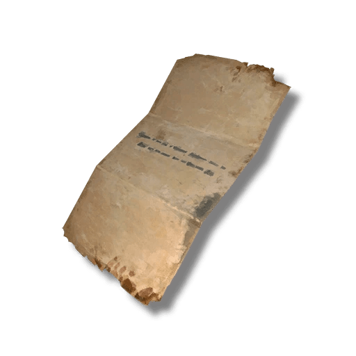

# Prepper Hatch Location

**Categories:** Collectibles, Pages with update history · **Source:** [Fandom](https://thelongdark.fandom.com/wiki/Prepper_Hatch_Location)

**Prepper Hatch Location**

_Prepper\_Hatch\_Location\_icon.png_

**Release:** [6 October 2021](./The%20Long%20Dark%20%E2%80%94%20Changelog.md#1.95)

**Wintermute:** [Episode 4](./Episode%204%20-%20Fury%2C%20Then%20Silence.md) - [Blackrock Rumours](./Blackrock%20Rumours.md)

**Properties**

**Item type:** [Collectibles](./Collectibles.md)\|-

**Stackable:** No

**Examine:** A handwritten note detailing the location of a prepper hatch.

**Values**

**Weight:** 0.00 kg (0 lbs)

**Actions**

**Backpack:** Examine

**On ground:** Take It, Read Text, Leave It

**Prepper Hatch Location** is a [Collectible](./Collectibles.md) found in [Episode 4](./Episode%204%20-%20Fury%2C%20Then%20Silence.md) of the [Wintermute](./Wintermute.md) story as part of the [Blackrock Rumours](./Blackrock%20Rumours.md) side mission. It is found in a supply cache behind [Bricklayer's Retreat](./Bricklayer%27s%20Retreat.md).

## Transcript

_The following text is transcribed from **Prepper Hatch Location**_

**If you're reading this you've gone and found my cache behind the old Bricklayer place.

I've reopened my old bunker. Things are getting bad round here.

Head north from Foreman's Clearcut, go beyond the road and then up a small rise into the rocks. Follow the meadow grass and you should be just fine. We should be able to wait this thing out there.**

## Update history

- UPDATE **6 October 2021 ([Update](./The%20Long%20Dark%20%E2%80%94%20Changelog.md#1.95)):**
  - Added to game.
