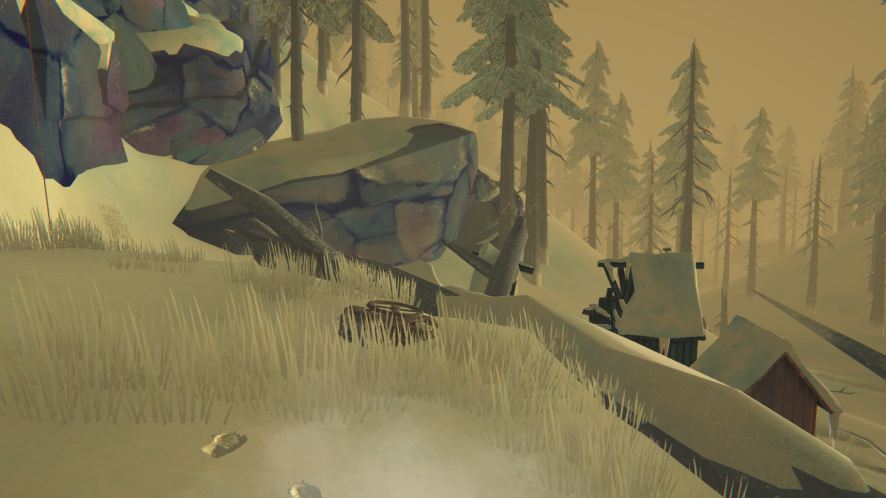

# Prepper's Abandoned Cache

**Contents**

- [Overview](#Overview)
- [Wintermute](#Wintermute)
- [Survival Mode](#Survival_Mode)
- [Gallery](#Gallery)
- [Trivia](#Trivia)

<table class="infobox">
<caption>Prepper's Abandoned Cache</caption>
<colgroup>
<col style="width: 50%" />
<col style="width: 50%" />
</colgroup>
<tbody>
<tr>
<td colspan="2"><figure>
[Missing image: preppers_abandoned_cache3.jpg]
<figcaption>preppers_abandoned_cache3.jpg</figcaption>
</figure></td>
</tr>
<tr>
<td colspan="2" class="section">
<strong>Location</strong>
</td>
</tr>
<tr>
<td colspan="2"><figure>
[Missing image: Prepper's_Abandoned_Cache_Location.png]
<figcaption>Prepper's_Abandoned_Cache_Location.png</figcaption>
</figure></td>
</tr>
<tr>
<td>
Region
</td>
<td>
<a href="./Pleasant%20Valley.md" class="wikilink" title="Pleasant Valley">Pleasant Valley</a>|-
</td>
</tr>
<tr>
<td>
Type
</td>
<td>
Industrial|-
</td>
</tr>
<tr>
<td><figure>

<figcaption>bed_icon.png</figcaption>
</figure></td>
<td>
Has a bed
</td>
</tr>
<tr>
<td><figure>

<figcaption>workbench_icon_green.png</figcaption>
</figure></td>
<td>
Has a workbench|-
</td>
</tr>
</tbody>
</table>

**Prepper's Abandoned Cache**is a location in <a href="./Pleasant%20Valley.md" class="wikilink" title="Pleasant Valley">Pleasant Valley</a>.

## Overview

The Prepper's Abandoned Cache is an underground bunker found in north-eastern Pleasant Valley, near a ruined building and an outhouse, not far from the <a href="./Rope%20Climbing.md" class="wikilink" title="Rope Climbing">Rope Climbing</a> section leading to <a href="./Timberwolf%20Mountain.md" class="wikilink" title="Timberwolf Mountain">Timberwolf Mountain</a>. The hatch entrance itself is behind a fallen tree behind the outhouse.

It is an indoor location which contains a <a href="./Bed.md" class="wikilink" title="Bed">Bed</a>, <a href="./Work%20Bench.md" class="wikilink" title="Work Bench">Work Bench</a>, and assorted supplies in lockers or on metal shelves. It was created by Wyatt, <a href="./Trader.md" class="wikilink" title="Sutherland&#39;s">Sutherland's</a> brother, long ago before it was abandoned.

## Wintermute

The cache originally belonged to Tom Joplin, and is the starting point of <a href="./Joplin%27s%20Bunker%20Raid.md" class="wikilink" title="Joplin&#39;s Bunker Raid">Joplin's Bunker Raid</a> in <a href="./Episode%203%20-%20Crossroads%20Elegy.md" class="wikilink" title="Episode 3: Crossroads Elegy">Episode 3: Crossroads Elegy</a>. It can be accessed as early as the mission <a href="./Coming%20Storm.md" class="wikilink" title="Coming Storm">Coming Storm</a>, otherwise the entrance will be completely covered up with snow.

2 more of Joplin's caches are found in the episode, but neither caches appear in Survival Mode. <a href="./Forest%20Talkers.md" class="wikilink" title="Forest Talkers">Forest Talkers</a> found the first of his caches, but failed to find the rest.

## Survival Mode

While similar in appearance to normal <a href="./Prepper%20Cache.md" class="wikilink" title="Prepper Caches">Prepper Caches</a>, the contents of the of the Prepper's Abandoned Cache is static, and will always spawn with the same internal layout. A <a href="./Revolver.md" class="wikilink" title="Revolver">Revolver</a> may spawn behind the ladder, hidden behind the <a href="./Crate.md" class="wikilink" title="Crates">Crates</a>.

A hidden room containing <a href="./A%20Skeleton%20And%20Note.md" class="wikilink" title="A Skeleton And Note">A Skeleton And Note</a> can be unlocked as part of <a href="./Sutherland%27s%20Tale.md" class="wikilink" title="Sutherland&#39;s Tale">Sutherland's Tale</a>. The Prepper's Abandoned Cache will become **<u>permanently inaccessible</u>** after returning <a href="./Wyatt%27s%20Skeleton.md" class="wikilink" title="Wyatt&#39;s Skeleton">Wyatt's Skeleton</a> to it and blowing up the bunker hatch after progressing through the Tale enough.

## Gallery

<table class="gallery">
<colgroup>
<col style="width: 25%" />
<col style="width: 25%" />
<col style="width: 25%" />
<col style="width: 25%" />
</colgroup>
<tbody>
<tr>
<td><figure>
[Missing image: Preppers_abandoned_cache.jpg]
<figcaption>The exit to the surface</figcaption>
</figure></td>
<td><figure>
[Missing image: Preppers_abandoned_cache2.jpg]
<figcaption>A bed and workbench</figcaption>
</figure></td>
<td><figure>

<figcaption>View of entrance with relation to other nearby landmarks</figcaption>
</figure></td>
<td><figure>
[Missing image: RopeClimb-1.jpg]
<figcaption>The Rope Climb to TWM, the cache is right above the ruined houses</figcaption>
</figure></td>
</tr>
<tr>
<td><figure>
[Missing image: PrepperCache-1.jpg]
<figcaption>Interior during Aurora</figcaption>
</figure></td>
<td><figure>
[Missing image: Prepper_Cache_Destroyed_2.jpg]
<figcaption>The Survivor waking up after destroying the Prepper's Abandoned Cache in Survival Mode</figcaption>
</figure></td>
<td><figure>
[Missing image: Prepper_Cache_Destroyed.jpg]
<figcaption>The destroyed Cache in Survival Mode</figcaption>
</figure></td>
<td><figure>
[Missing image: Prepper's_Abandoned_Cache_hidden_room.jpg]
<figcaption>The hidden room opened up</figcaption>
</figure></td>
</tr>
<tr>
<td><figure>
[Missing image: Prepper's_Abandoned_Cache_hidden_room_2.jpg]
<figcaption>The hidden wall in Survival Mode</figcaption>
</figure></td>
<td></td>
<td></td>
<td></td>
</tr>
</tbody>
</table>

## Trivia

- Most caches in *The Long Dark* are marked with [fallout shelter](https://en.wikipedia.org/wiki/Fallout_shelter) signs, signifying their original purpose was to protect the local population in the event of a nuclear attack.
  - This is confirmed in Sutherland's Tale, as Wyatt created these caches in case of a Nuclear conflict.
- The vent <a href="./Grate.md" class="wikilink" title="Grate">Grate</a> inside bunkers may be opened, potentially yielding hidden loot.

**Lua execution error in Module:Navbox function navbox**

<a href="es:B%C3%BAnker_abandonado" class="wikilink" title="es:Búnker abandonado">es:Búnker abandonado</a> <a href="ru:%D0%97%D0%B0%D0%B1%D1%8B%D1%82%D1%8B%D0%B9_%D0%B7%D0%B0%D0%BF%D0%B0%D1%81_%D0%B4%D0%BB%D1%8F_%D0%B2%D1%8B%D0%B6%D0%B8%D0%B2%D0%B0%D0%BD%D0%B8%D1%8F" class="wikilink" title="ru:Забытый запас для выживания">ru:Забытый запас для выживания</a>

