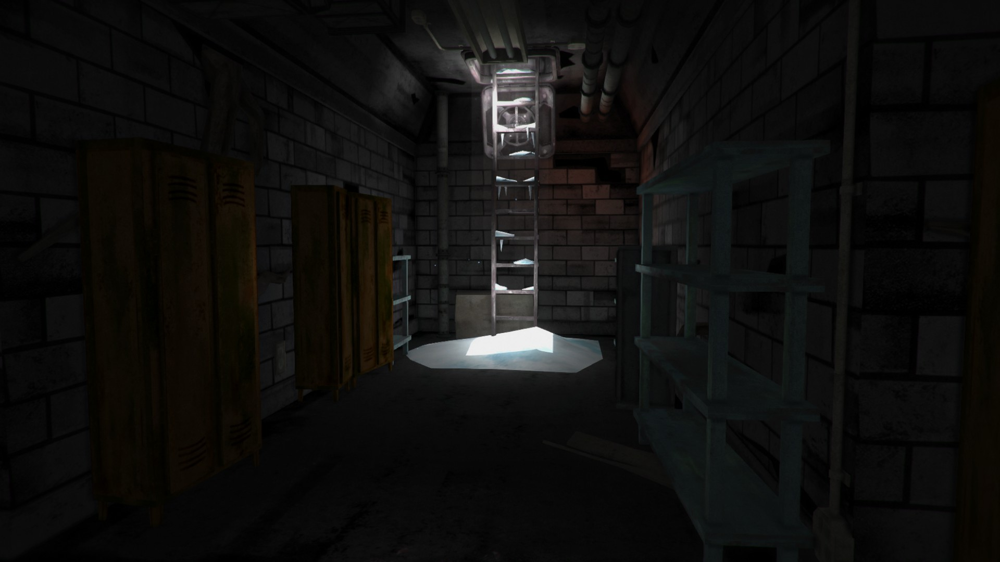
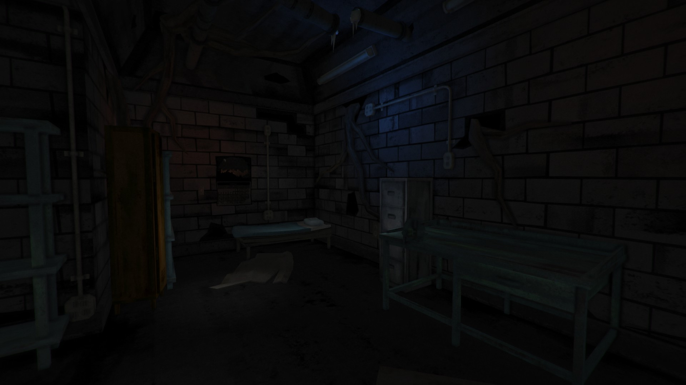
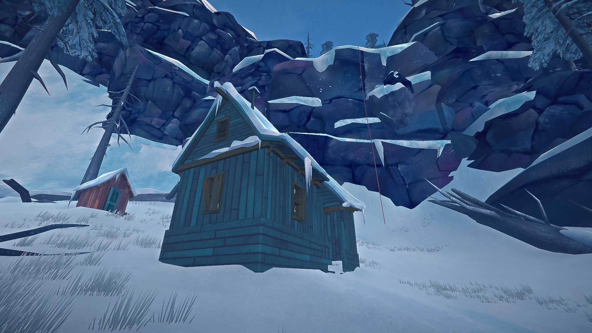
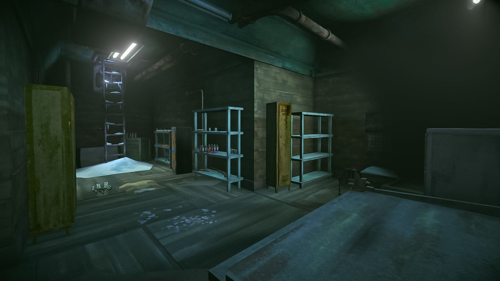
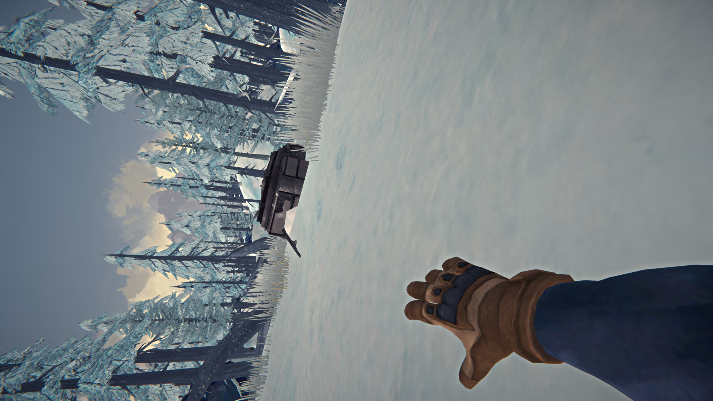
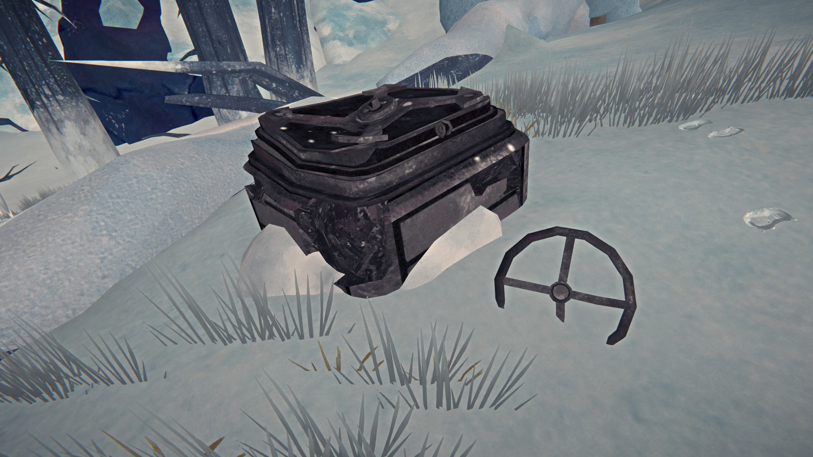

# Prepper's Abandoned Cache

**Categories:** Indoor locations, Industrial locations, Locations, Locations in Pleasant Valley, Locations with a workbench · **Source:** [Fandom](https://thelongdark.fandom.com/wiki/Prepper's_Abandoned_Cache)

**Contents**

- [Overview](#overview)
- [Wintermute](#wintermute)
- [Survival Mode](#survival-mode)
- [Gallery](#gallery)
- [Trivia](#trivia)

**Prepper's Abandoned Cache**

| Property | Details |
| --- | --- |
|  | [Preppers abandoned cache3](../assets/Preppers_abandoned_cache3.jpg) |
| **Location** |  |
|  | [Prepper's Abandoned Cache Location](../assets/Prepper%27s_Abandoned_Cache_Location.png) |
| Region | [Pleasant Valley](./Pleasant%20Valley.md) |
| **General** |  |
| Type | Industrial |
| Firebox |  |
| [Bed icon](../assets/Bed_icon.png) | Has a bed |
| [Workbench icon green](../assets/Workbench_icon_green.png) | Has a workbench |
|  | Has an interior |

_Not to be confused with **[Prepper Cache](./Prepper%20Cache.md)**._
> **There's one more bunker you can check. One of old man Joplin's in Pleasant Valley. On the way to Timberwolf. He wasn't in their crew, but Wyatt set up his prepper caches.**
>
>
> — Sutherland the [Trader](./Trader.md)

**Prepper's Abandoned Cache**is a location in [Pleasant Valley](./Pleasant%20Valley.md).

## Overview

The Prepper's Abandoned Cache is an underground bunker found in north-eastern Pleasant Valley, near a ruined building and an outhouse, not far from the [Rope Climbing](./Rope%20Climbing.md) section leading to [Timberwolf Mountain](./Timberwolf%20Mountain.md). The hatch entrance itself is behind a fallen tree behind the outhouse.

It is an indoor location which contains a [Bed](./Bed.md), [Work Bench](./Work%20Bench.md), and assorted supplies in lockers or on metal shelves. It was created by Wyatt, [Sutherland's](./Trader.md) brother, long ago before it was abandoned.

## Wintermute

The cache originally belonged to Tom Joplin, and is the starting point of [Joplin's Bunker Raid](./Joplin%27s%20Bunker%20Raid.md) in [Episode 3: Crossroads Elegy](./Episode%203%20-%20Crossroads%20Elegy.md). It can be accessed as early as the mission [Coming Storm](./Coming%20Storm.md), otherwise the entrance will be completely covered up with snow.

2 more of Joplin's caches are found in the episode, but neither caches appear in Survival Mode. [Forest Talkers](./Forest%20Talkers.md) found the first of his caches, but failed to find the rest.

## Survival Mode

While similar in appearance to normal [Prepper Caches](./Prepper%20Cache.md), the contents of the of the Prepper's Abandoned Cache is static, and will always spawn with the same internal layout. A [Revolver](./Revolver.md) may spawn behind the ladder, hidden behind the [Crates](./Crate.md).

A hidden room containing [A Skeleton And Note](./A%20Skeleton%20And%20Note.md) can be unlocked as part of [Sutherland's Tale](./Sutherland%27s%20Tale.md). The Prepper's Abandoned Cache will become **_permanently inaccessible_** after returning [Wyatt's Skeleton](./Wyatt%27s%20Skeleton.md) to it and blowing up the bunker hatch after progressing through the Tale enough.

## Gallery

## Trivia

- Most caches in _The Long Dark_ are marked with [fallout shelter](https://en.wikipedia.org/wiki/Fallout_shelter) signs, signifying their original purpose was to protect the local population in the event of a nuclear attack.
  - This is confirmed in Sutherland's Tale, as Wyatt created these caches in case of a Nuclear conflict.
- The vent [Grate](./Grate.md) inside bunkers may be opened, potentially yielding hidden loot.

[es:Búnker abandonado](https://es.wikipedia.org/wiki/B%C3%BAnker_abandonado) [ru:Забытый запас для выживания](https://ru.wikipedia.org/wiki/%D0%97%D0%B0%D0%B1%D1%8B%D1%82%D1%8B%D0%B9_%D0%B7%D0%B0%D0%BF%D0%B0%D1%81_%D0%B4%D0%BB%D1%8F_%D0%B2%D1%8B%D0%B6%D0%B8%D0%B2%D0%B0%D0%BD%D0%B8%D1%8F)
