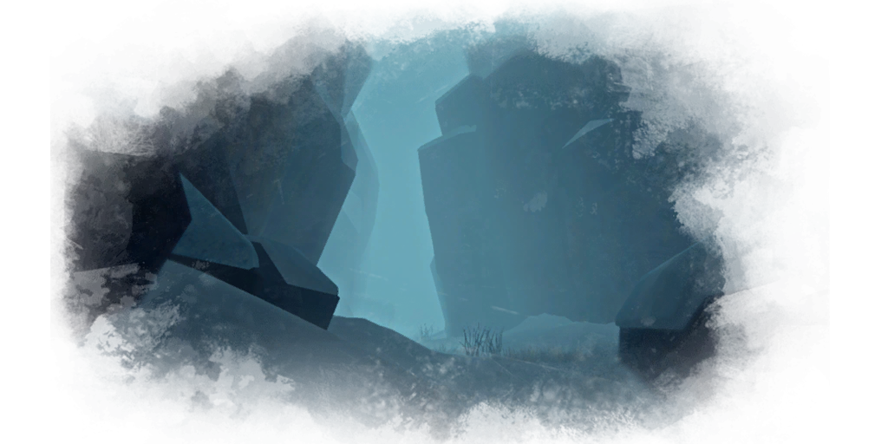

# Prologue/Transcript

<table class="infobox">
<caption>Prologue/Transcript</caption>
<colgroup>
<col style="width: 50%" />
<col style="width: 50%" />
</colgroup>
<tbody>
<tr>
<td colspan="2"><figure>

<figcaption>Prologue.png</figcaption>
</figure></td>
</tr>
<tr>
<td>
Episode
</td>
<td></td>
</tr>
<tr>
<td colspan="2" class="section">
<strong>Missions</strong>
</td>
</tr>
<tr>
<td>
Previous
</td>
<td>
<a href="./Aftermath%20%E2%80%94%20Transcript.md" class="wikilink" title="Aftermath/Transcript">Aftermath/Transcript</a>
</td>
</tr>
<tr>
<td>
Current
</td>
<td>
Prologue/Transcript
</td>
</tr>
<tr>
<td>
Next
</td>
<td>
<a href="./Blackrock%20Blues%20%E2%80%94%20Transcript.md" class="wikilink" title="Blackrock Blues/Transcript">Blackrock Blues/Transcript</a>
</td>
</tr>
<tr>
<td>
Region
</td>
<td>
<a href="./Keeper%27s%20Pass%20North.md" class="wikilink" title="Keeper&#39;s Pass North">Keeper's Pass North</a>
</td>
</tr>
<tr>
<td>
Characters
</td>
<td>
<a href="./Will%20Mackenzie.md" class="wikilink" title="Will Mackenzie">Will Mackenzie</a> <a href="./Mathis.md" class="wikilink" title="Mathis">Mathis</a> 
<a href="./Vachon.md" class="wikilink" title="Vachon">Vachon</a> 
<a href="./Heller.md" class="wikilink" title="Heller">Heller</a> 
<a href="./Jeremiah.md" class="wikilink" title="Jeremiah">Jeremiah</a> (Opening cutscene) 
<a href="./Hobbs.md" class="wikilink" title="Hobbs">Hobbs</a> (Opening cutscene) 
<a href="./Characters.md#Radio_Voice_Man" class="wikilink" title="Radio Voice Man">Radio Voice Man</a> (Opening cutscene)
</td>
</tr>
</tbody>
</table>

This is the mission transcript for the opening <a href="./Prologue.md" class="wikilink" title="Prologue">Prologue</a> of <a href="./Episode%204%20-%20Fury%2C%20Then%20Silence.md" class="wikilink" title="Episode 4: Fury, Then Silence">Episode 4: Fury, Then Silence</a>.

## Recap

*A story recap begins as the opening cutscene*

*A shot of the <a href="./Crashed%20Prison%20Transport%20Bus.md" class="wikilink" title="Crashed Prison Transport Bus">Crashed Prison Transport Bus</a> in <a href="./Milton.md" class="wikilink" title="Milton">Milton</a> appears*

PREVIOUSLY ON THE LONG DARK

<a href="./Hobbs.md" class="wikilink" title="Hobbs">Hobbs</a>: "You think they put me on that bus for my good behaviour?"

*The scene shifts to a dying Hobbs on the couch in the <a href="./Paradise%20Meadows%20Farm.md" class="wikilink" title="Paradise Meadows Farm">Paradise Meadows Farm</a> farmhouse*

Hobbs: "That's the bus to Blackrock."

<a href="./Will%20Mackenzie.md" class="wikilink" title="Mackenzie">Mackenzie</a>: "Black rock?"

Hobbs: "Yeah, you know. Blackrock Federal Pen. Ha ha."

*Scene shifts to a <a href="./Dead%20Prison%20Guard.md" class="wikilink" title="Dead Prison Guard">Dead Prison Guard</a> from <a href="./Episode%203%20-%20Crossroads%20Elegy.md" class="wikilink" title="Episode 3: Crossroads Elegy">Episode 3: Crossroads Elegy</a>*

Hobbs: "Where they put the worst of the bad people..."

*Scene shifts to a dead <a href="./Convicts.md" class="wikilink" title="Convict">Convict</a> in a shed*

Hobbs: "People too bad for the Mainland."

*Scene shifts to Mackenzie turning on the radio in <a href="./Trapper%27s%20Homestead.md" class="wikilink" title="Trapper&#39;s Homestead">Trapper's Homestead</a> in <a href="./Episode%202%20-%20Luminance%20Fugue.md" class="wikilink" title="Episode 2: Luminance Fugue">Episode 2: Luminance Fugue</a>*

Mackenzie: "Hello? Is this the radio station at <a href="./Perseverance%20Mills.md" class="wikilink" title="Perseverance Mills">Perseverance Mills</a>? Is there a doctor with you?"

*Scene shifts to the broken <a href="./Shortwave%20Tower%20West.md" class="wikilink" title="Shortwave Tower West">Shortwave Tower West</a> at night during a full moon*

<a href="./Characters.md#Radio_Voice_Man" class="wikilink" title="Radio Voice Man">Radio Voice Man</a>: "We need a doctor...or...medical assistance. Anything"

<a href="./Jeremiah.md" class="wikilink" title="Jeremiah">Jeremiah</a>: "You need to take my message. You need to deliver it for me. It's important. Ask for "<a href="./Atwood.md" class="wikilink" title="Atwood">Atwood</a>."

Mackenzie: "Atwood. Got it. What's the message?"

Jeremiah: " "Wintermute." "

*Scene changes to the <a href="./Carter%20Hydro%20Dam.md" class="wikilink" title="Carter Hydro Dam">Carter Hydro Dam</a> Staging Area at night during the aurora*

Jeremiah: "Just that. Atwood will know what it means."

*Scene changes to Mackenzie waking up, after being tied up in the Dam*

Mackenzie: "Ah...ah..."

<a href="./Mathis.md" class="wikilink" title="Mathis">Mathis</a>: "What's in the case?"

Mackenzie: "I have no idea."

Mathis: "Should I show you what happened to the last person who tried to lie to me? She didn't look so pretty after I was done."

Mackenzie: "She?"

Mathis: "Don't worry, pilot. You'll be with her soon."

*The man strikes Mackenzie with the back of the axe, and the scene ends.*

## Prologue

*The sound of a wolf howl echoes across a black screen before the sounds of footsteps join in.*

<a href="./Vachon.md" class="wikilink" title="Vachon">Vachon</a>: "Why do we have to carry this sack of shit? He's heavy as hell."

*Mackenzie opens his eyes. The sky is moving, as if he is on his back being carried*

<a href="./Heller.md" class="wikilink" title="Heller">Heller</a>: "Shut the fuck up. Mathis says carry the asshole, we carry him."

*Mackenzie closes his eyes again, with more wolves howling in the background. The sound of crows circling overhead can also be heard*

Vachon: "They're getting closer. You hear about what happened to Leclerc?"

*A <a href="./Crow.md" class="wikilink" title="Crow">Crow</a> begins circling overhead*

EPISODE FOUR

Heller: "Don't believe everything you hear, dumbass."

Vachon: "Arrow in the chest, man. The chest. No wolves be doing that."

Heller: "Really. Wolves don't use bows. You figure that all out by yourself?"

Vachon: "Piss off. Something is hunting us out here and it ain't just wolves."

*Mackenzie raises his hands, only to see them bound. He struggles to break free*

Heller: "Mathis'll figure it out."

Vachon: "What the hell we even doing out here."

Heller: "Remember the plan. First we get <a href="./Donner.md" class="wikilink" title="Donner">Donner</a> out..."

Vachon: "Donner. That crazy fucker...this is bullshi..."

Heller: "Shh...he's coming back here."

*Mackenzie looks up to see Heller's back and mutters*

<a href="./Will%20Mackenzie.md" class="wikilink" title="Will Mackenzie">Will Mackenzie</a>: "Wa...water."

Vachon: "Hey...hey Mathis."

*Mackenzie looks forward and sees Vachon, carrying him*

Vachon: "He's finally awake."

*Mackenzie is put down on the snow, and Mathis walks over. A sign near him reads "FEDERAL PENITENTIARY/*PÉNITÉNCIÈR FÉDÉRAL. No Trespassing/Passagé Interdit"

Mathis: "Well well...he lives."

Mackenzie: "No thanks to you."

Mathis: "Turns out you have a damn hard head, pilot."

Mackenzie: "I told you I was stubborn. The...w...woman?"

*Mathis thinks for a moment*

Mathis: "Oh, you mean the one you asked about in the dam?"

Mackenzie: "Yeah."

Mathis: "She's still there. Won't be going anywhere soon."

*Mathis gives a devilish grin*

Mackenzie: "You bastard."

Mathis: "Relax, Mackenzie. She had nothing to do with you."

Mackenzie: "How do you..."

Mathis: "Just some...old lady lost in the woods. Wandered into the dam when I was there. She saw me and wouldn't stop screaming so...I shut her up."

*Mathis gives another devilish grin*

Mackenzie: "Monster."

Mathis: "Ha, ha. Oh, you have no idea. Why you so worried about her?"

Mackenzie: "I...it doesn't matter."

Mathis: "Could it have anything to do with this?"

*Mathis produces <a href="./Astrid%27s%20Hardcase.md" class="wikilink" title="Astrid&#39;s Hardcase">Astrid's Hardcase</a>*

Mackenzie: "I told you, I don't know what that is."

Mathis: "Well...it's ok, pilot. We'll find a way to open it, very soon. And then we'll both know what's inside."

*Mathis gets up and Mackenzie closes his eyes*

Mathis: "Hey uh, Mackenzie?"

*Mackenzie opens his eyes to see Mathis in his face*

Mackenzie: "...Y...yeah?"

*Mathis smiles like he is almost unable to contain his laughter*

Mathis: "You look like shit."

*Mathis gets up and Mackenzie closes his eyes again*

Vachon: "Shit, Mathis...how long we have to carry this heavy bastard for?"

Heller: "Shut up, man."

Mathis: "That heavy bastard may be our ticket off this rock. So carry him. And like the man says -- shut the fuck up."

*A <a href="./Timberwolf.md" class="wikilink" title="Timberwolf">Timberwolf</a> pack begins howling in the distance, likely lead to the 4 by the circling crow, hurried footsteps ring out*

Vachon: "They found us!"

*Mackenzie opens his eyes*

Heller: "AAARGH..."

*A Timberwolf nips at Vachon's hand and he lets go of the stretcher carrying Mackenzie before grabbing it again. Then the Timberwolf bites his back and Vachon lets go of the stretcher, sending Mackenzie tumbling through the snow, falling off just as the stretcher goes over a cliff*

Vachon: "HELLER!! Get it off me!!'

Heller: "Damn it...I need a weapon."

Mathis: "COME AND GET SOME YOU FUCKERS!!!!!"

*Mackenzie turns around to see Mathis kick a Timberwolf and it flinches with a yelp. Vachon is overwhelmed in a <a href="./Struggle.md" class="wikilink" title="Struggle">Struggle</a> with a Timberwolf, while Heller stands around panicking without a weapon. Mackenzie then turns his attention back to the cliff*

Mackenzie: "Got to move."

*Mackenzie throws himself off the cliff, sliding down the snowy slope until the screen turns black as he goes flying and hits the bottom of the ravine. He awakes shortly afterwards and looks back up to see Vachon and Heller*

Heller: "Where's the pilot???"

*Mackenzie turns his focus to a path ahead of him in the ravine*

Mackenzie: "Can't let them find me." *He looks at the bindings on his wrists* "need my hands free."

## Escape the Convicts.

*The player has control at this point and Mackenzie starts walking.*

Mathis: "Where'd he go?"

*If the player waits around, they can hear the trio struggling to find Mackenzie after they fended off the Timberwolf attack, with random lines playing. The voice lines switch between Mathis, Vachon, and Heller depend on how much progress they make through the ravine*

- Mathis: "I don't see him."
- Mathis: "Where'd he go?"
- Mathis: "Are those his footprints?"
- Mathis: "I hear wolves everywhere."

<!-- -->

- Heller: "Where'd he go?"
- Heller: "Gotta find this jackass..."
- Heller: "I don't see him."
- Heller: "No way we find this guy now."
- Heller: "What was that?"
- Heller: "How far could he get?"
- Heller: "Keep up."
- Heller: "Mathis is pissed..."
- Heller: "Move your ass."
- Heller: "Freezing my ass off."
- Heller: "Gotta be around here somewhere."
- Heller: "Where the hell is this guy?"
- Heller: "You hear yourself?"

<!-- -->

- Vachon: "Gonna lose a toe out here."
- Vachon: "Don't see him yet."
- Vachon: "Hands going numb."
- Vachon: "Slow down."
- Vachon: "We had to go north."
- Vachon: "Gotta keep looking."
- Vachon: "No way we find this guy now."
- Vachon: "We lose him for good?"
- Vachon: "We have to find this guy?"
- Vachon: "First we carry this guy, now this."
- Vachon: "Can't see anything out here."
- Vachon: "What was that?"
- Vachon: "Which direction?"
- Vachon: "See anything?"
- Vachon: "Wolves out there?"

*After proceeding down the ravine far enough*

Mathis: "Move your ass. Gotta be around here somewhere."

*After proceeding far enough away, Mackenzie begins finding a rocky tunnel in the ravine*

Mackenzie: "Have to stay out of sight."

*Mackenzie begins inside the tunnel*

Vachon: "Where did he go?"

Mathis: "You'd better get him or there'll be hell to pay..."

*At this point, the voices go silent, until Mackenzie finds a rocky slit in the wall and hears a voice*

Heller: "Any sign of him?"

*Mackenzie panics and dives down to below the rocky opening*

Vachon: "No. Nothing. But those fucking wolves..."

*Mackenzie peers up and sees Vachon and Heller jump down, both oblivious to his presence*

Vachon: "I need a smoke."

*Vachon lights up a ciggerete with his lighter*

Heller: "Nevermind the wolves, we gotta find him fast."

Vachon: "What the hell. Let him run. He won't get far with those wolves hunting him."

*Mackenzie rubs his bound hands to warm them*

Heller: "Look, you dumbass. Mathis says the pilot's our ticket off this damn island. Don't you want to get back to the Mainland?"

Vachon: "But Heller. The arrow in the chest, man."

Heller: "Let's go find this guy, before Mathis loses his temper again. You know what he's like when he's angry."

Vachon: "Let's go. Between Mathis and the wolves...I have a bad feeling about this place."

*Vachon throws his ciggerete in the snow. It sizzles out and falls near Mackenzie, then the duo walk away without seeing him*

Mackenzie: "Better keep going."

*Mackenzie keeps going, until he finds <a href="./Forester%27s%20Hermitage.md" class="wikilink" title="Forester&#39;s Hermitage">Forester's Hermitage</a> and a rusty two man saw stuck in a tree stump*

Mackenzie: "Rusty saw blade. Might be sharp enough to cut this rope."

*If the player tries to use the <a href="./Rock%20Climb.md" class="wikilink" title="Rock Climb">Rock Climb</a> across the pond before cutting your bindings, Mackenzie will say*

Mackenzie: "I need to get my hands free."

*If the player idles:*

Mackenzie: "I need something to cut this rope."

*Mackenzie cuts himself free and removes the bindings. Then climbs out of the ravine. Just as he climbs to the top, Mathis appears waiting for him, striking Mackeznie on the head with the Hardcase before he can react. Mathis stands grinning*

Mathis: "Looks like I finally found a use for your metal case."

*Mathis holds the Hardcase up before leaning closer*

Mathis: "We have unfinished business, pilot. Stick around."

*Mackenzie blacks out*

The story continues in <a href="./Blackrock%20Blues%20%E2%80%94%20Transcript.md" class="wikilink" title="Blackrock Blues/Transcript">Blackrock Blues/Transcript</a>.

**Lua execution error in Module:Navbox function navbox**

