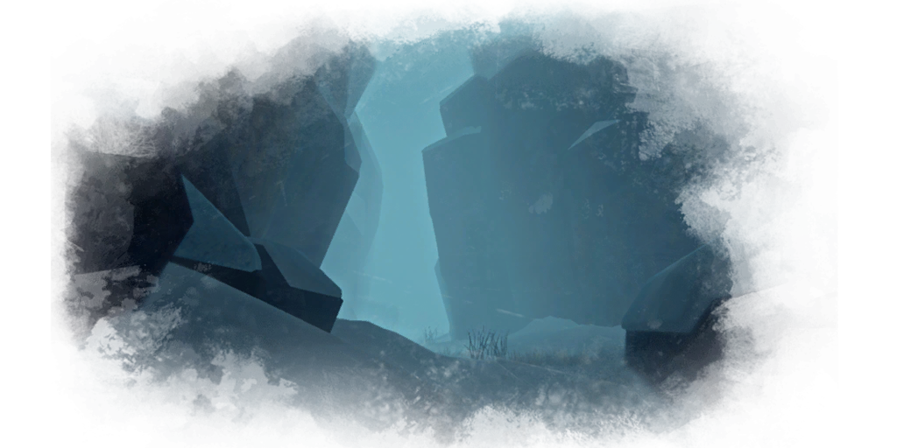

# Prologue

<table class="infobox">
<caption>Prologue</caption>
<colgroup>
<col style="width: 50%" />
<col style="width: 50%" />
</colgroup>
<tbody>
<tr>
<td colspan="2"><figure>

<figcaption>Prologue.png</figcaption>
</figure></td>
</tr>
<tr>
<td>
Episode
</td>
<td></td>
</tr>
<tr>
<td colspan="2" class="section">
<strong>Missions</strong>
</td>
</tr>
<tr>
<td>
Previous
</td>
<td>
<a href="./Aftermath.md" class="wikilink" title="Aftermath">Aftermath</a>
</td>
</tr>
<tr>
<td>
Current
</td>
<td>
Prologue
</td>
</tr>
<tr>
<td>
Next
</td>
<td>
<a href="./Blackrock%20Blues.md" class="wikilink" title="Blackrock Blues">Blackrock Blues</a>
</td>
</tr>
<tr>
<td>
Region
</td>
<td>
<a href="./Keeper%27s%20Pass%20North.md" class="wikilink" title="Keeper&#39;s Pass North">Keeper's Pass North</a>
</td>
</tr>
<tr>
<td>
Characters
</td>
<td>
<a href="./Will%20Mackenzie.md" class="wikilink" title="Will Mackenzie">Will Mackenzie</a> <a href="./Mathis.md" class="wikilink" title="Mathis">Mathis</a> 
<a href="./Vachon.md" class="wikilink" title="Vachon">Vachon</a> 
<a href="./Heller.md" class="wikilink" title="Heller">Heller</a> 
<a href="./Jeremiah.md" class="wikilink" title="Jeremiah">Jeremiah</a> (Opening cutscene) 
<a href="./Hobbs.md" class="wikilink" title="Hobbs">Hobbs</a> (Opening cutscene) 
<a href="./Characters.md#Radio_Voice_Man" class="wikilink" title="Radio Voice Man">Radio Voice Man</a> (Opening cutscene)
</td>
</tr>
</tbody>
</table>

<table>
<colgroup>
<col style="width: 33%" />
<col style="width: 33%" />
<col style="width: 33%" />
</colgroup>
<tbody>
<tr>
<td style="vertical-align: top; font-size: 3em; color: #5d5980; padding-right: 10px">
“
</td>
<td>
Mackenzie seizes his chance to escape Mathis.

&#10;

In-game description

</td>
<td style="vertical-align: bottom; font-size: 3em; color: #5d5980; padding-left: 10px">
”
</td>
</tr>
</tbody>
</table>

**Prologue** is the first mission in <a href="./Episode%204%20-%20Fury%2C%20Then%20Silence.md" class="wikilink" title="Episode 4">Episode 4</a> of <a href="./Wintermute.md" class="wikilink" title="Wintermute">Wintermute</a>. In this mission, <a href="./Will%20Mackenzie.md" class="wikilink" title="Will Mackenzie">Will Mackenzie</a> attempts to escape from <a href="./Mathis.md" class="wikilink" title="Mathis">Mathis</a> before arriving at <a href="./Blackrock%20Prison.md" class="wikilink" title="Blackrock Federal Penitentiary">Blackrock Federal Penitentiary</a>.

This mission is highly linear, with Mackenzie escaping from Mathis, <a href="./Vachon.md" class="wikilink" title="Vachon">Vachon</a>, and <a href="./Heller.md" class="wikilink" title="Heller">Heller</a> after a <a href="./Timberwolf.md" class="wikilink" title="Timberwolf">Timberwolf</a> attack, before falling in a ravine and then being recaptured.

## Objectives

- Escape the Convicts.

## Walkthrough

After a lengthy cutscene, Makenzie will fall into a ravine and wake up with the <a href="./Broken%20Ribs.md" class="wikilink" title="Broken Ribs">Broken Ribs</a> affliction. Thankfully, the affliction does not affect the player very much, and will be healed when the next mission starts. Simply walk forward through the ravine until making it to <a href="./Forester%27s%20Hermitage.md" class="wikilink" title="Forester&#39;s Hermitage">Forester's Hermitage</a> with a large hand saw in a stump. The inside of the ruined house only contains a <a href="./Letter.md" class="wikilink" title="Letter">Letter</a>, so cut yourself free and then climb the nearby <a href="./Rock%20Climb.md" class="wikilink" title="Rock Climb">Rock Climb</a> walls across the pond until another cutscene begins. Any loot acquired during this mission will carry over to the next, but will mostly be irrelevant to acquire, so it is best to simply run through the area without scavenging anything and enjoy the story.

## Trivia

The option to Pass Time is not present in this mission. The time of day will also permanently stay at high noon (12:00 PM). **Lua execution error in Module:Navbox function navboxLua execution error in Module:Navbox function navbox**

