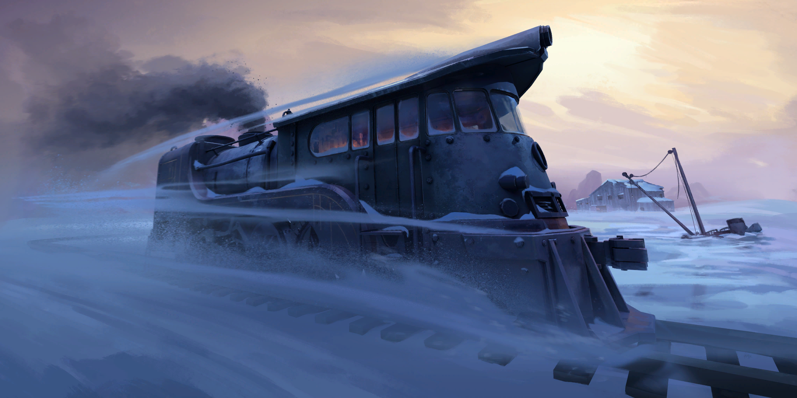
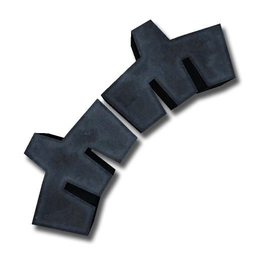
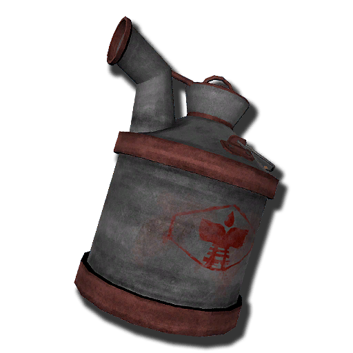
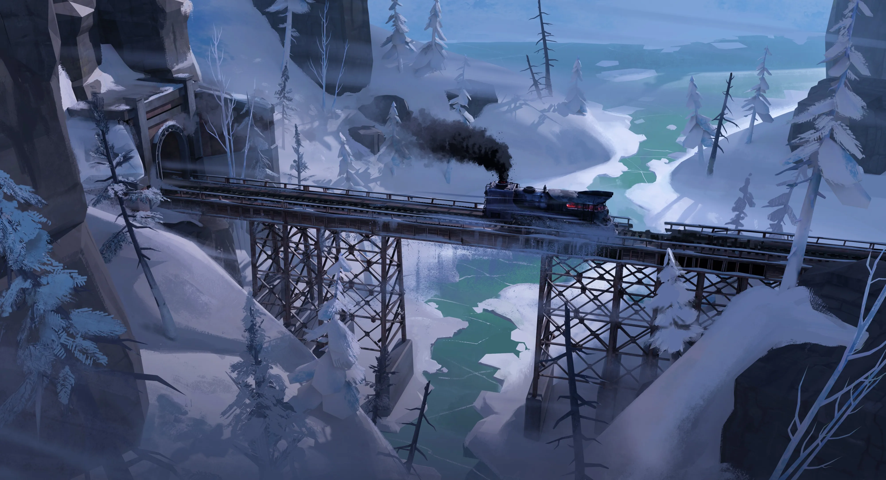
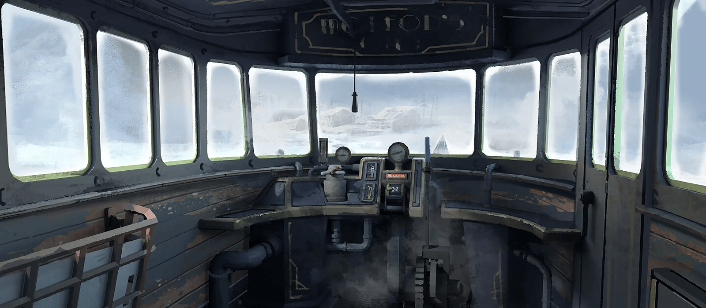

# Prototype Train

**Contents**

- [Overview](#Overview)
- [Basic Train Features](#Basic_Train_Features)
- [Main Control Panel](#Main_Control_Panel)
- [Miscellaneous Features](#Miscellaneous_Features)
- [Train Upgrades](#Train_Upgrades)
- [Mechanics](#Mechanics)
- [Train Operation](#Train_Operation)
- [Fuel Storage and Resupplying](#Fuel_Storage_and_Resupplying)
- [Repairing and Refueling](#Repairing_and_Refueling)
- [Traveling and Track Hazards](#Traveling_and_Track_Hazards)
- [Trivia](#Trivia)
- [Gallery](#Gallery)
- [Game History](#Game_History)
- [References](#References)

**Stub:***This article is a stub. You can help by \[//dummy.host/index.php?title=Prototype+Train&action=edit expanding it\].*

<table>
<colgroup>
<col style="width: 33%" />
<col style="width: 33%" />
<col style="width: 33%" />
</colgroup>
<tbody>
<tr>
<td width="40px"><figure>

<figcaption>Seal_icon.png</figcaption>
</figure></td>
<td>
<strong>DLC-Exclusive content.</strong> 

This content requires the <a href="./Iron%20Road.md" class="wikilink" title="Iron Road">Iron Road</a> addon to be installed before it can be seen or used in regular gameplay.

</td>
<td>
|} 

The <strong>Prototype Train</strong> is a <a href="./Vehicle.md" class="wikilink" title="Vehicle">Vehicle</a> in <a href="./The%20Long%20Dark.md" class="wikilink" title="The Long Dark"><em>The Long Dark</em></a>. It is part of the <a href="./Iron%20Road.md" class="wikilink" title="Iron Road"><em>Iron Road</em></a> expansion for <a href="./Survival%20Mode.md" class="wikilink" title="Survival Mode">Survival Mode</a> and is found exclusively on <a href="./Cauldron%20Island.md" class="wikilink" title="Cauldron Island">Cauldron Island</a>.

<h2 id="Overview">Overview</h2>

An iron fortress on wheels, the Prototype Train is a large steam locomotive and the main method of traversing <a href="./Cauldron%20Island.md" class="wikilink" title="Cauldron Island">Cauldron Island</a>. Described by its creator Hamish McLeod as "an angel rendered in the finest steel<a href="#fn1" class="footnote-ref" id="fnref1" role="doc-noteref">1</a>", the train was at one point a state of the art vehicle and despite just being a prototype was the most advanced steam engine ever built.

Most of the Prototype Train's mechanics are borrowed from the <a href="./Steam%20Train.md" class="wikilink" title="Steam Train">Steam Train</a> from <a href="./Episode%205%20-%20The%20Light%20At%20The%20End%20Of%20All%20Things.md" class="wikilink" title="Episode 5: The Light At The End Of All Things">Episode 5: The Light At The End Of All Things</a>, though the concept is slightly expanded on. This train does not run on Coal or Firewood, instead being powered by an exotic fuel type: Whale Oil.

Part train, part mobile shelter, part mobile base, the train is designed to be your companion while traversing Cauldron Island. The player will need to take care of the train as they travel, as it will become their most important lifeline that will ensure their survival and open up the secrets of the caldera.

<h2 id="Basic_Train_Features">Basic Train Features</h2>

The train has various components that can be interacted with. The outside of the train contains:

<ul>
<li>Boiler Tank for storing <a href="./Water%20%28Potable%29.md" class="wikilink" title="Potable Water">Potable Water</a>/<a href="./Water%20%28Unsafe%29.md" class="wikilink" title="Dirty Water">Dirty Water</a> (both sides of the rear, Blue cap).</li>
<li>Fuel Tank for storing <a href="./Whale%20Oil%20Can.md" class="wikilink" title="Whale Oil">Whale Oil</a> (both sides of the rear, Red cap).</li>
<li>3 Train Wheels and 2 Break Shoes (per side middle of train).</li>
<li>Cowcatcher on the front.</li>
<li>Slide door that allows entry to the cabin on the front right side (<a href="./Train%20Key.md" class="wikilink" title="Train Key">Train Key</a> needed first).</li>
</ul>

The inside of the train contains:

<ul>
<li>The main control panel.</li>
<li>A cot for sleeping or passing time (+6 Warmth).</li>
<li>A <a href="./Cupboard.md" class="wikilink" title="Cupboard">Cupboard</a> that can store 45.00 kg of gear.</li>
<li>The main Engine used to ignite the Boiler, and a single Cooking slot below it.</li>
<li>The player can also lean outside of the windows in 2 spots (above the cupboard widow and the slide doors window).</li>
</ul>
<h3 id="Main_Control_Panel">Main Control Panel</h3>

[Missing image: Prototype_Train_Main_Control_Diagram.png] The main controls The main control panel consists of:

<ul>
<li><strong>Brake Lever</strong> - The brake stops the train by activating the Brake Shoes. Comes with a panel on the dashboard displaying the train's brake state.
<ul>
<li>Turning the Engine off or leaving the train while the gear is in Neutral will automatically enable the brake.</li>
<li>Using the brake will wear out the Brake Shoes when used. Using the Neutral Gear and coming to a stop will avoid wearing the Brake Shoes down.</li>
</ul></li>
<li><strong>Gear Shift Lever</strong> - This lever changes the speed of the train itself once the Brake Lever is disengaged.
<ul>
<li>The 4 gears are:
<ul>
<li>R (reverse speed slow)</li>
<li>N (neutral)</li>
<li>1 (forward speed slow)</li>
<li>2 (forward speed fast)</li>
</ul></li>
</ul></li>
<li><strong>PSI Gauge</strong> - Determines how many Parts per Square Inch the train currently has.
<ul>
<li>This gauge determines how much steam pressure the train has built up. As long as there is enough Water and Whale Oil when the Engine is on, PSI will continue to build up. Unlike the <a href="./Steam%20Train.md" class="wikilink" title="Steam Train">Steam Train</a> that regularly needs Coal fed into its boiler to increase depleted PSI, the Prototype Train automatically refills PSI over time due to its vastly increased Whale Oil fuel storage.</li>
<li>Using the Gear Shift Lever to change the train speed to 2 speed will rapidly cause PSI to drop. Once PSI is low enough, the Gear will automatically return to 1 speed and slowly refill. Stopping the train or switching to Neutral will cause PSI to increase faster.</li>
</ul></li>
<li><strong>Speed Gauge</strong> - Shows how fast the train is moving (in MPH).</li>
<li><strong>Fuel Gauge</strong> - This is the yellow oil droplet gauge, and shows how much whale oil fuel is in the fuel tank for the train.</li>
<li><strong>Water Gauge</strong> - This is the blue waves gauge, and shows how much water is in the boiler for the train to build PSI.</li>
<li><strong>Horn</strong> - A lever that sounds a steam whistle. Higher stored PSI levels produce a louder whistle. Does not scare off wildlife.</li>
</ul>
<h3 id="Miscellaneous_Features">Miscellaneous Features</h3>

A few other features to consider regarding the train include:

<ul>
<li>The inside of the train cabin does not allow for items to be dropped, meaning that all items must be stored in the Cupboard, carried in your inventory, or dropped outside.
<ul>
<li>The <a href="./McLeod%20Ultra-Efficiency%20Whale%20Oil%20Heater.md" class="wikilink" title="McLeod Ultra-Efficiency Whale Oil Heater">McLeod Ultra-Efficiency Whale Oil Heater</a> cannot be used inside the cabin to further warm it up.</li>
</ul></li>
<li>While the train is moving, you cannot sleep, wait, craft, mend, or repair.
<ul>
<li>The player can <a href="./Charcoal.md" class="wikilink" title="survey">survey</a> while inside the train, but this will only uncover around a 200° circle in the current area of the map. This is because the back of the train blocks the remaining area the Survivor can see as they survey.</li>
</ul></li>
<li>Weapons can be drawn, but cannot be aimed or fired (even when leaning out of the window).</li>
<li><a href="./Safehouse%20Customization.md" class="wikilink" title="Safehouse Customization">Safehouse Customization</a> does not work inside the train.</li>
<li>The train's Engine will provide a warmth bonus when activated, though the cabin is not insulated to extreme temperature drops from the outside weather (blizzards). Taking warm clothing is advised.
<ul>
<li>Looking outside of the windows does not change the player's <a href="./Warmth.md" class="wikilink" title="Warmth">Warmth</a> to the outside world temperature. Stepping outside will.</li>
</ul></li>
<li>Despite having a forward mounted light on the front of the train, it will not power on when the <a href="./Aurora.md" class="wikilink" title="Aurora">Aurora</a> is out.</li>
<li>Wildlife show very little reaction to the train as it passes by, and will only notice the player if the train stops and they lean out of the window. Wildlife cannot be run over by the train, and are instead pushed out of the way.</li>
</ul>
<h3 id="Train_Upgrades">Train Upgrades</h3>

Train upgrades are an upcoming feature that will allow you to upgrade various parts of the train, including personalization of the cabin.

<h2 id="Mechanics">Mechanics</h2>
<h3 id="Train_Operation">Train Operation</h3>

The basic operation for the train is as follows:

<ul>
<li>Igniting the Engine will cause PSI to slowly rise in the Boiler (this produces a rattling sound in the Boiler). This will begin consuming both stored Whale Oil and Water. Igniting the Engine will not consume <a href="./Fire%20Starting.md" class="wikilink" title="Fire Starting">Fire Starting</a> materials. A small light will also turn on and light up the Main Control panel to help you see better at night.</li>
<li>Disengaging the Brake Lever will set the Train to Neutral, and then changing the Gear Shift lever will move the train.
<ul>
<li>LMB moves the Gear Shift forward, while RMB reverses. The Train cannot be reversed until it comes to a complete stop, and vice versa for forwarding.</li>
<li>The player can lean out of the window/door to see behind them when reversing.</li>
<li>Traveling on Gear 2 will rapidly consume PSI. Once it reaches zero, Gear automatically shifts back to 1 and PSI builds up again.</li>
</ul></li>
</ul>

Other information to consider:

<ul>
<li>The train cannot be derailed or destroyed, but its components can become damaged over time (see repair section).</li>
<li>The train doors cannot be exited while the vehicle in motion. The train must be fully stopped before the option to leave appears.</li>
<li>Turning the Engine off does not automatically stop the train. Instead, built up PSI will continue to persist in the train for several hours until it is used to move to the train or gradually dissipates (stored PSI will be gone when the Boiler rattling sound stops).</li>
<li>Fuel storage can be viewed at the Main Control panel or in the Train Status section of the <a href="./Survival%20Menu.md" class="wikilink" title="Survival Menu">Survival Menu</a>.</li>
<li>Ramming into any hard object that instantly stops the train (Aurora gate, some flatbed cars, buffer stops), will set the gear to Neutral but does not damage the train.</li>
</ul>
<h3 id="Fuel_Storage_and_Resupplying">Fuel Storage and Resupplying</h3>
<table class="gallery">
<colgroup>
<col style="width: 50%" />
<col style="width: 50%" />
</colgroup>
<tbody>
<tr>
<td><figure>
[Missing image: Whale_Oil_Refueling.jpg]
<figcaption>Whale Oil Refueling Tank</figcaption>
</figure></td>
<td><figure>
[Missing image: Water_Tower_Refueling.jpg]
<figcaption>Water Refueling Tower</figcaption>
</figure></td>
</tr>
</tbody>
</table>

The Prototype Train uses Whale Oil as a fuel source and Water that is heated up into steam to build PSI. Both fuel types will gradually deplete over time, and the train must be refueled to continue operating it. Scattered across Cauldron Island are Railyards that can contain either a <a href="./Water%20Tower.md" class="wikilink" title="Water Tower">Water Tower</a> or <a href="./Oil%20Tank.md" class="wikilink" title="Oil Tank">Oil Tank</a>. Sometimes only one type is found at a Railyard, but occasionally both are nearby.

The back side of the train must be parked very close to the Water Tower or Oil Tank in order to gain the option to transfer fuel/water into the train. A small but helpful detail is the fact that just below each sign is a small panel that flips from red to green when the train is parked correctly for refueling. The storage supply inside these towers/tanks is unlimited; if the player leaves the area, these containers will refill themselves to their maximum levels, ensuring that the player never runs out of resources to power the train.

<ul>
<li>Both the Tower and Tank have a stored supply of 5000.00 L that can be transferred into the Train.</li>
<li>By default, the highest amount of fuel/water that can be transferred into the train is always 20.00 L, with each increment adding another 20.00 L.
<ul>
<li>If the train is not able to be parked next to the tower/tank, the player can manually place water/fuel into their Backpack at 5.00 L per interaction (costs 1 minute each time).</li>
<li>Water Towers will only ever produce Dirty Water.</li>
<li>It can be handy to place water/fuel into the backpack and then transfer it to the Train's Cupboard. Dirty Water can be boiled while driving and Whale Oil Cans can be used in emergencies.</li>
</ul></li>
</ul>
<table>
<thead>
<tr>
<th>
Fuel Type
</th>
<th>
Max Storage
</th>
<th>
Burn Rate (Per H)
</th>
<th>
Refueling time (Min)
</th>
<th>
Refueling time (Max)
</th>
</tr>
</thead>
<tbody>
<tr>
<td>
Water
</td>
<td>
600.00 L (20 H)
</td>
<td>
30.00 L
</td>
<td>
<a href="./Water%20Tower.md" class="wikilink" title="Water Tower">Water Tower</a> (20.00 L in 5 minutes)
</td>
<td>
<a href="./Water%20Tower.md" class="wikilink" title="Water Tower">Water Tower</a> (2 Hrs and 5 Min to fully refuel)
</td>
</tr>
<tr>
<td>
Whale Oil
</td>
<td>
500.00 L (17 H)
</td>
<td>
30.00 L
</td>
<td>
<a href="./Oil%20Tank.md" class="wikilink" title="Oil Tank">Oil Tank</a> (20.00 L in 5 minutes)
</td>
<td>
<a href="./Oil%20Tank.md" class="wikilink" title="Oil Tank">Oil Tank</a> (2 Hrs and 30 Min to fully refuel)
</td>
</tr>
</tbody>
</table>
<h3 id="Repairing_and_Refueling">Repairing and Refueling</h3>
<figure>
[Missing image: Train_Status_Survival_Menu.jpg]
<figcaption>Train_Status_Survival_Menu.jpg</figcaption>
</figure>

As the player rides around, parts of the train will begin to wear down. All metallic parts require the <a href="./Heavy%20Hammer.md" class="wikilink" title="Heavy Hammer">Heavy Hammer</a> to fix. Successful Repairs raise the <a href="./Repair.md" class="wikilink" title="Repair">Repair</a> skill by 1 point, and always repair 20%-25% condition upon success (regardless of skill level). Train components' status can always be viewed either in person or in the Train Status section of the <a href="./Survival%20Menu.md" class="wikilink" title="Survival Menu">Survival Menu</a> (this menu does not update in real time, and must be refreshed when damage is taken).

Repairing can take considerable time (up to several hours at a time), so finding a Repair Depot and repairing inside can often be the safest way to fix any damage to the train. Repairing the Train can be dangerous when done outside, as cold night temperatures, blizzards, and hostile wildlife can damage the player. Using the <a href="./McLeod%20Ultra-Efficiency%20Whale%20Oil%20Heater.md" class="wikilink" title="McLeod Ultra-Efficiency Whale Oil Heater">McLeod Ultra-Efficiency Whale Oil Heater</a> can provide a good heat source should you find the need to work on the Train outside.

<ul>
<li>Train part integrity will be listed white at 100-75%, yellow at 75-50%, red at 50-0% in the Train Status menu. Train parts at 0% will be labeled ruined when observed on the train, but can be repaired unlike ruined gear items.</li>
<li>All Scrap Metal repairs give 20% repair times (25% when starting from ruined) and require the <a href="./Heavy%20Hammer.md" class="wikilink" title="Heavy Hammer">Heavy Hammer</a> and 2 <a href="./Scrap%20Metal.md" class="wikilink" title="Scrap Metal">Scrap Metal</a> with each repair session.
<ul>
<li>The only exception are the Brake Shoes, which will always repair up to 100% from whatever Condition they are currently in (starting at ruined they can take 1 hour 30 minutes to repair).</li>
</ul></li>
<li>The Engine/Boiler is your highest priority. At around 50%, there is a chance that switching to Gear 2 will cause the Engine to explode explode inside the cabin, removing all stored PSI, disallowing the Engine to be ignited and moved, and giving the player <a href="./Burns.md" class="wikilink" title="Burns">Burns</a>.
<ul>
<li>The second highest priority should always be refueling the water and fuel tanks.</li>
<li>Repairing the Cowcatcher should be your third priority, as a low condition Cowcatcher can damage the Boiler when ramming hard track hazards.</li>
<li>The Wheels and Brake Shoes are of least concern generally, but should still be tended to.</li>
</ul></li>
</ul>
<table style="width:100%;">
<colgroup>
<col style="width: 16%" />
<col style="width: 16%" />
<col style="width: 16%" />
<col style="width: 16%" />
<col style="width: 16%" />
<col style="width: 16%" />
</colgroup>
<thead>
<tr>
<th>
Train Part
</th>
<th>
Cause of Wear
</th>
<th>
Breakdown Consequences
</th>
<th>
Condition Penalty
</th>
<th>
Repair Costs
</th>
<th>
Repair Times
</th>
</tr>
</thead>
<tbody>
<tr>
<td>
Cowcatcher
</td>
<td>
Running into hard track obstacles
</td>
<td>
Cannot ram train track obstacles? (untested) Boiler is damaged when ramming objects when Cowcatcher is 50% or lower
</td>
<td>
N/A
</td>
<td>
2 x  <a href="./Scrap%20Metal.md" class="wikilink" title="Scrap Metal">Scrap Metal</a>  <a href="./Heavy%20Hammer.md" class="wikilink" title="Heavy Hammer">Heavy Hammer</a>
</td>
<td>
1 Hour (20%) 1 Hour (25% when starting from ruined)
</td>
</tr>
<tr>
<td>
Boiler
</td>
<td>
Shifting to 2 speed while PSI over-pressured (chance to drain condition 1% every 3.5 seconds. At 50% or lower, chance to instantly explode boiler.) Ramming hard track hazards with a low condition Cowcatcher
</td>
<td>
Boiler explodes inside the cabin, causing <a href="./Burns.md" class="wikilink" title="Burns">Burns</a>. Boiler condition set to 0%, train immediately loses all stored PSI, Engine cannot be started. Cannot move until Boiler is repaired.
</td>
<td>
N/A
</td>
<td>
2 x <a href="./Scrap%20Metal.md" class="wikilink" title="Scrap Metal">Scrap Metal</a>  <a href="./Heavy%20Hammer.md" class="wikilink" title="Heavy Hammer">Heavy Hammer</a>
</td>
<td>
1 Hour (20%) 1 Hour (25% when starting from ruined)
</td>
</tr>
<tr>
<td>
Wheels
</td>
<td>
Riding over <a href="./Damaged%20Track.md" class="wikilink" title="Damaged Track">Damaged Track</a> at high speed Riding over Electrified Track
</td>
<td>
Wheels do not grip to tracks properly. Acceleration penalty and increased whale oil burn rate penalty applied.
</td>
<td><ul>
<li>75-100% (0% acceleration penalty, +0% whale oil burn rate)</li>
<li>50-75% (-10% acceleration penalty, +10% whale oil burn rate)</li>
<li>1-50% (-25% acceleration penalty, +15% whale oil burn rate)</li>
<li>0% (-50% acceleration penalty, +25% whale oil burn rate)</li>
</ul></td>
<td>
2 x <a href="./Scrap%20Metal.md" class="wikilink" title="Scrap Metal">Scrap Metal</a>  <a href="./Heavy%20Hammer.md" class="wikilink" title="Heavy Hammer">Heavy Hammer</a>
</td>
<td>
1.5 Hours (20%) 1.5 Hours (25% when starting from ruined)
</td>
</tr>
<tr>
<td>
Brake Shoes
</td>
<td>
Brake application
</td>
<td>
Cannot brake properly.
</td>
<td>
Takes longer to slow down (possibly bugged, braking does not change even at 0%)
</td>
<td>
1 x <a href="./Brake%20Shoe.md" class="wikilink" title="Brake Shoe">Brake Shoe</a>  <a href="./Heavy%20Hammer.md" class="wikilink" title="Heavy Hammer">Heavy Hammer</a>
</td>
<td>
1.5 Hours (100% when starting from ruined)
</td>
</tr>
<tr>
<td>
Water Tank
</td>
<td>
Normal use
</td>
<td>
Cannot build up PSI to move train Engine automatically turns off Boiler and cannot be ignited
</td>
<td>
N/A
</td>
<td>
Add <a href="./Water%20%28Potable%29.md" class="wikilink" title="Water (Potable)">Water (Potable)</a>/ <a href="./Water%20%28Unsafe%29.md" class="wikilink" title="Water (Unsafe)">Water (Unsafe)</a> (<a href="./Water%20Tower.md" class="wikilink" title="Water Tower">Water Tower</a> refuel station or by hand)
</td>
<td>
5 minutes per 20.00 L
</td>
</tr>
<tr>
<td>
Fuel Tank
</td>
<td>
Normal use
</td>
<td>
Cannot ignite Boiler
</td>
<td>
N/A
</td>
<td>
Add  <a href="./Whale%20Oil%20Can.md" class="wikilink" title="Whale Oil Can">Whale Oil Can</a> (<a href="./Oil%20Tank.md" class="wikilink" title="Oil Tank">Oil Tank</a> refuel station or by hand)
</td>
<td>
5 minutes per 20.00 L
</td>
</tr>
</tbody>
</table>
<h3 id="Traveling_and_Track_Hazards">Traveling and Track Hazards</h3>
<table class="gallery">
<colgroup>
<col style="width: 25%" />
<col style="width: 25%" />
<col style="width: 25%" />
<col style="width: 25%" />
</colgroup>
<tbody>
<tr>
<td><figure>
[Missing image: Train_Hazard_Gates.jpg]
<figcaption>Chained Metal Gates</figcaption>
</figure></td>
<td><figure>
[Missing image: Train_Hazard_Gate_2.jpg]
<figcaption>Chained Metal Gate (alternate model)</figcaption>
</figure></td>
<td><figure>
[Missing image: Train_Hazard_Trees.jpg]
<figcaption>Fallen Trees</figcaption>
</figure></td>
<td><figure>
[Missing image: Train_Hazard_Car.jpg]
<figcaption>Flatbed Cars can sometimes be rammed and freely moved</figcaption>
</figure></td>
</tr>
<tr>
<td><figure>
[Missing image: Train_Hazard_Snow_Drift.jpg]
<figcaption>Deep Snow Drift</figcaption>
</figure></td>
<td><figure>
[Missing image: Damaged_Tracks.jpg]
<figcaption>Damaged Tracks</figcaption>
</figure></td>
<td></td>
<td></td>
</tr>
</tbody>
</table>

Sometimes objects and hazards litter the abandoned railways of Cauldron Island. A list of Track Hazards that include:

<ul>
<li>Ramming <strong>Deep Snow Drifts</strong> will never cause damage to the train, but does result in speed loss.</li>
<li><strong>Fallen trees</strong> cause -2% condition loss to Cowcatcher and speed loss.</li>
<li>Ramming <strong>Chain Metal Fences</strong> will cause -2% condition loss to Cowcatcher and speed loss.
<ul>
<li>Each previously mentioned hazard requires the train to be set to Gear 2. Gear 1 and Reverse will result in the train stopping dead in its tracks and will not destroy the obstacle.</li>
</ul></li>
<li><strong><a href="./Damaged%20Track.md" class="wikilink" title="Damaged Tracks">Damaged Tracks</a></strong> are sections of train tracks that are highly damaged. They appear as warped, rusted, and chipped train track, with damaged cross ties. Driving over them can damage the train Wheels.
<ul>
<li>Full reverse or full acceleration at speed 1 will cause an intense amount of screeching and train bobbling, resulting in condition damage to the wheels. The louder the screeching of metal becomes, the more damage is being done to the Wheels.</li>
<li>Faster train movement will cause exponentially increased levels of damage to the wheels, up to 28% condition loss or more on one section of damaged track.</li>
<li>The track section can be repaired if you have a <a href="./Heavy%20Hammer.md" class="wikilink" title="Heavy Hammer">Heavy Hammer</a>, and do not require Scrap Metal. Each repair section takes 2 hours and repairs the tracks completely.
<ul>
<li>Alternatively, you can avoid repairing the tracks and damaging the train by alternating between speed settings 1 and Neutral to slowly move the train. This will prevent any damage to the Wheels when passing through this hazard.</li>
<li>Sometimes a parallel track can be found that prevents contact with these rails to begin with. Spending some time to use them can help preserve your train's condition in the long run.</li>
</ul></li>
</ul></li>
<li><strong>Electrified Tracks</strong> during the Aurora will (data needed).</li>
<li><strong>Aurora Gates</strong> are another type of obstacle that can be encountered. These gates have a booth nearby that must be entered when the <a href="./Aurora.md" class="wikilink" title="Aurora">Aurora</a> is out and the lever inside manually turned in order to open the gates. Most Aurora Gates are found at the ends of each island throughout Cauldron Island.</li>
</ul>

List of obstacles that do not damage the train:

<ul>
<li>Ramming Flatbed cars (these will keep moving until they collide with another flatbed car or buffer stop, where they stop moving).</li>
<li>Ramming Buffer Stops at the end of any track.</li>
<li>Ramming the Aurora Gates.</li>
</ul>

Driving into a <a href="./Repair%20Depot.md" class="wikilink" title="Repair Depot&#39;s">Repair Depot's</a> doors will never damage the train even at full speed, but will instead transfer you inside the building.

<h2 id="Trivia">Trivia</h2>
<ul>
<li>Much like the <a href="./Steam%20Train.md" class="wikilink" title="Steam Train">Steam Train</a>, the Prototype Train cannot be derailed (though it can sometimes appear to be off of the tracks when parked), cannot run over and kill wildlife (they are pushed out of the way), and the main boiler tank cannot be over-pressured until it explodes. Various parts of the Prototype Train can break down however.</li>
<li>The Prototype Train does not contain electronic lights of any kind, save for a single lamp that lights up the control panel when the engine is powered. This makes the Steam Train slightly more unique, having a single front mounted light that turns on during the Aurora.
<ul>
<li>There is also a bell atop the train that does not function.</li>
</ul></li>
<li>The locomotive is a <a href="w:4-6-4" class="wikilink" title="4-6-4T">4-6-4T</a> cab-forward steam locomotive.
<ul>
<li>Cab-forward locomotives were used on the Southern Pacific railroad in the US, to keep smoke away from the cab while operating in tunnels and snow sheds.</li>
</ul></li>
</ul>
<h2 id="Gallery">Gallery</h2>
<table class="gallery">
<colgroup>
<col style="width: 25%" />
<col style="width: 25%" />
<col style="width: 25%" />
<col style="width: 25%" />
</colgroup>
<tbody>
<tr>
<td><figure>

<figcaption>Concept art of the train</figcaption>
</figure></td>
<td><figure>

<figcaption>ditto</figcaption>
</figure></td>
<td><figure>

<figcaption>ditto, inside cabin</figcaption>
</figure></td>
<td><figure>
[Missing image: Prototype_Train.jpg]
<figcaption>The train when found</figcaption>
</figure></td>
</tr>
<tr>
<td><figure>
[Missing image: Train_Whistle.jpg]
<figcaption>The train's whistle</figcaption>
</figure></td>
<td><figure>
[Missing image: Prototype_Train_Interior.jpg]
<figcaption>Interior of the train</figcaption>
</figure></td>
<td><figure>
[Missing image: Iron_Train.jpg]
<figcaption>Iron_Train.jpg</figcaption>
</figure></td>
<td><figure>
[Missing image: Iron_Train_2.jpg]
<figcaption>Iron_Train_2.jpg</figcaption>
</figure></td>
</tr>
</tbody>
</table>
<h2 id="Game_History">Game History</h2>

<strong>Template:update history</strong>

<h2 id="References">References</h2>

&lt;div class="references-small" ;"&gt;

<strong>Lua execution error in Module:Navbox function navbox</strong> <a href="ru:%D0%9F%D1%80%D0%BE%D1%82%D0%BE%D1%82%D0%B8%D0%BF_%D0%BF%D0%BE%D0%B5%D0%B7%D0%B4%D0%B0" class="wikilink" title="ru:Прототип поезда">ru:Прототип поезда</a>
</td>
</tr>
</tbody>
</table>
<section id="footnotes" class="footnotes footnotes-end-of-document" role="doc-endnotes">

<ol>
<li id="fn1">
My great-grandfather's greatest invention. This is the Prototype.

In his journal he described it as, "an angel rendered in the finest steel". - <a href="./Wax%20Cylinder%207.md" class="wikilink" title="Wax Cylinder 7">Wax Cylinder 7</a><a href="#fnref1" class="footnote-back" role="doc-backlink">↩︎</a>
</li>
</ol>
</section>

## Notes

