# Prototype Train

**Categories:** Article stubs, DLC Content, Interactable Objects · **Source:** [Fandom](https://thelongdark.fandom.com/wiki/Prototype_Train)

**Contents**

- [Overview](#overview)
- [Basic Train Features](#basic-train-features)
- [Main Control Panel](#main-control-panel)
- [Miscellaneous Features](#miscellaneous-features)
- [Train Upgrades](#train-upgrades)
- [Mechanics](#mechanics)
- [Train Operation](#train-operation)
- [Fuel Storage and Resupplying](#fuel-storage-and-resupplying)
- [Repairing and Refueling](#repairing-and-refueling)
- [Traveling and Track Hazards](#traveling-and-track-hazards)
- [Trivia](#trivia)
- [Gallery](#gallery)
- [Game History](#game-history)
- [References](#references)

**Stub:****This article is a stub. You can help by \[//dummy.host/index.php?title=Prototype+Train&amp;action=edit expanding it\].**

_Seal\_icon.png_

**DLC-Exclusive content.** / This content requires the [Iron Road](./Iron%20Road.md) addon to be installed before it can be seen or used in regular gameplay.

_Whale Oil Refueling Tank_

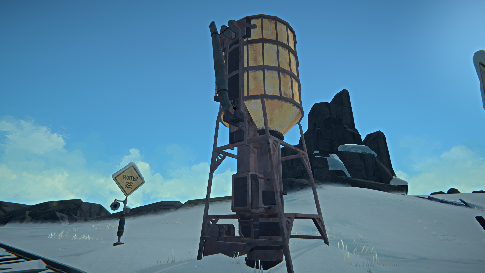

_Water Refueling Tower_

Fuel Type

Max Storage

Burn Rate (Per H)

Refueling time (Min)

Refueling time (Max)

Water

600.00 L (20 H)

30.00 L

[Water Tower](./Water%20Tower.md) (20.00 L in 5 minutes)

[Water Tower](./Water%20Tower.md) (2 Hrs and 5 Min to fully refuel)

Whale Oil

500.00 L (17 H)

30.00 L

[Oil Tank](./Oil%20Tank.md) (20.00 L in 5 minutes)

[Oil Tank](./Oil%20Tank.md) (2 Hrs and 30 Min to fully refuel)

Train Part

Cause of Wear

Breakdown Consequences

Condition Penalty

Repair Costs

Repair Times

Cowcatcher

Running into hard track obstacles

Cannot ram train track obstacles? (untested) Boiler is damaged when ramming objects when Cowcatcher is 50% or lower

N/A

2 x  [Scrap Metal](./Scrap%20Metal.md)  [Heavy Hammer](./Heavy%20Hammer.md)

1 Hour (20%) 1 Hour (25% when starting from ruined)

Boiler

Shifting to 2 speed while PSI over-pressured (chance to drain condition 1% every 3.5 seconds. At 50% or lower, chance to instantly explode boiler.) Ramming hard track hazards with a low condition Cowcatcher

Boiler explodes inside the cabin, causing [Burns](./Burns.md). Boiler condition set to 0%, train immediately loses all stored PSI, Engine cannot be started. Cannot move until Boiler is repaired.

N/A

2 x [Scrap Metal](./Scrap%20Metal.md)  [Heavy Hammer](./Heavy%20Hammer.md)

1 Hour (20%) 1 Hour (25% when starting from ruined)

Wheels

Riding over [Damaged Track](./Damaged%20Track.md) at high speed Riding over Electrified Track

Wheels do not grip to tracks properly. Acceleration penalty and increased whale oil burn rate penalty applied.

- 75-100% (0% acceleration penalty, +0% whale oil burn rate) / - 50-75% (-10% acceleration penalty, +10% whale oil burn rate) / - 1-50% (-25% acceleration penalty, +15% whale oil burn rate) / - 0% (-50% acceleration penalty, +25% whale oil burn rate)

2 x [Scrap Metal](./Scrap%20Metal.md)  [Heavy Hammer](./Heavy%20Hammer.md)

1.5 Hours (20%) 1.5 Hours (25% when starting from ruined)

Brake Shoes

Brake application

Cannot brake properly.

Takes longer to slow down (possibly bugged, braking does not change even at 0%)

1 x [Brake Shoe](./Brake%20Shoe.md)  [Heavy Hammer](./Heavy%20Hammer.md)

1.5 Hours (100% when starting from ruined)

Water Tank

Normal use

Cannot build up PSI to move train Engine automatically turns off Boiler and cannot be ignited

N/A

Add [Water (Potable)](./Water%20%28Potable%29.md)/ [Water (Unsafe)](./Water%20%28Unsafe%29.md) ([Water Tower](./Water%20Tower.md) refuel station or by hand)

5 minutes per 20.00 L

Fuel Tank

Normal use

Cannot ignite Boiler

N/A

Add  [Whale Oil Can](./Whale%20Oil%20Can.md) ([Oil Tank](./Oil%20Tank.md) refuel station or by hand)

5 minutes per 20.00 L

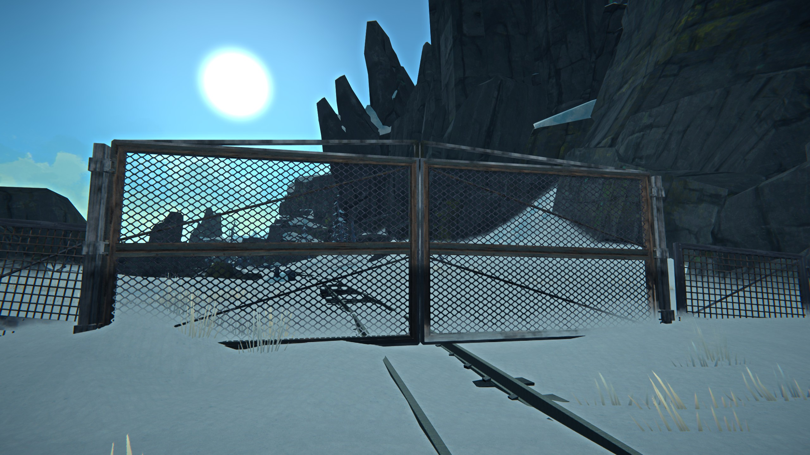

_Chained Metal Gates_

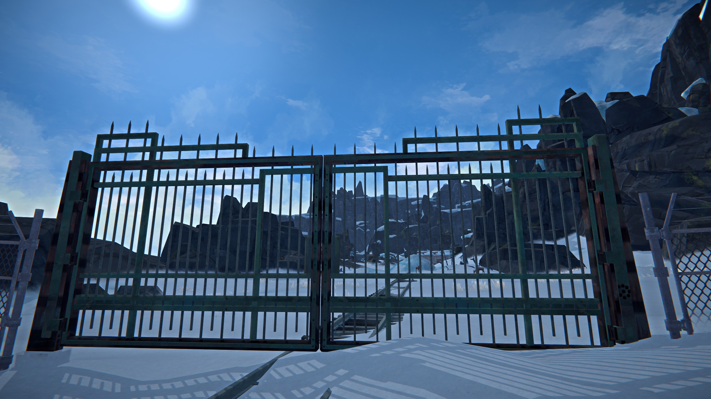

_Chained Metal Gate (alternate model)_

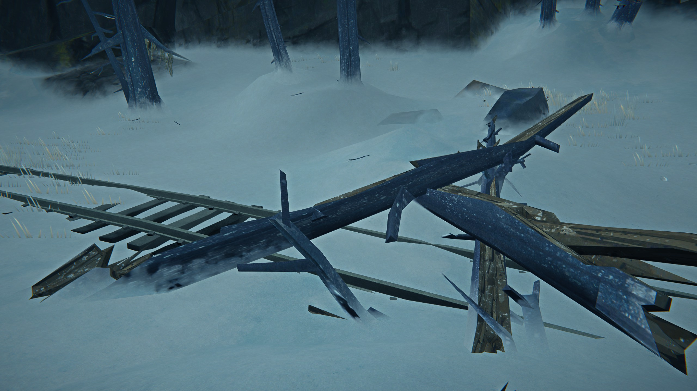

_Fallen Trees_

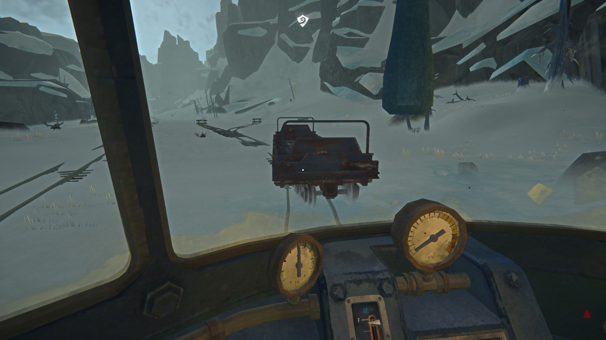

_Flatbed Cars can sometimes be rammed and freely moved_

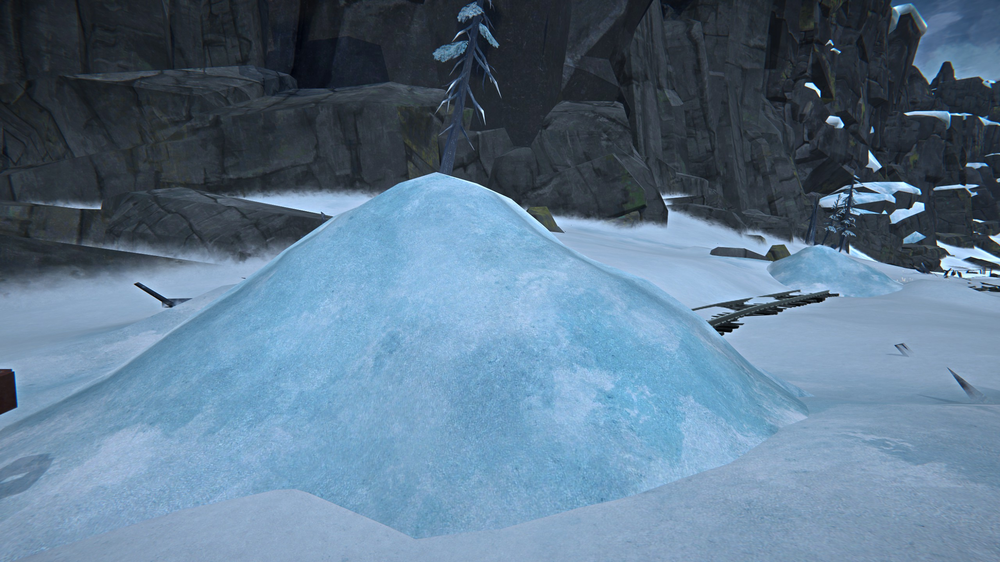

_Deep Snow Drift_

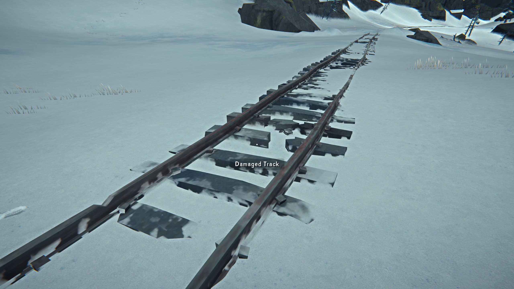

_Damaged Tracks_

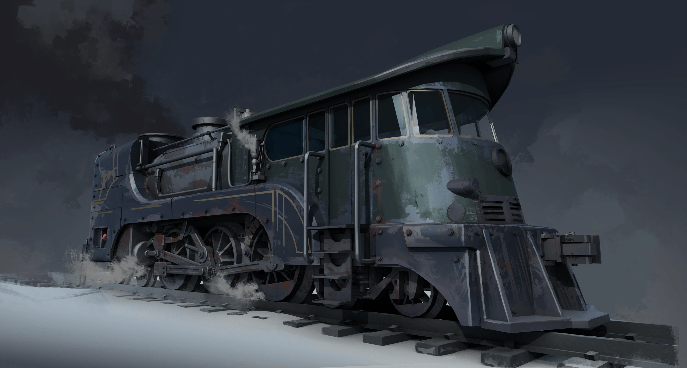

_Concept art of the train_

_ditto_

_ditto, inside cabin_

_The train when found_

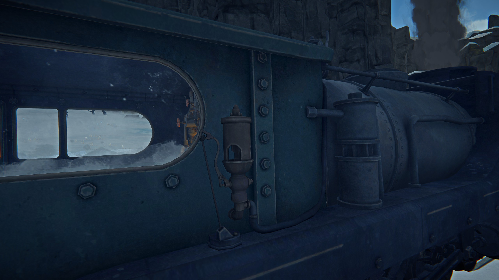

_The train's whistle_

_Interior of the train_

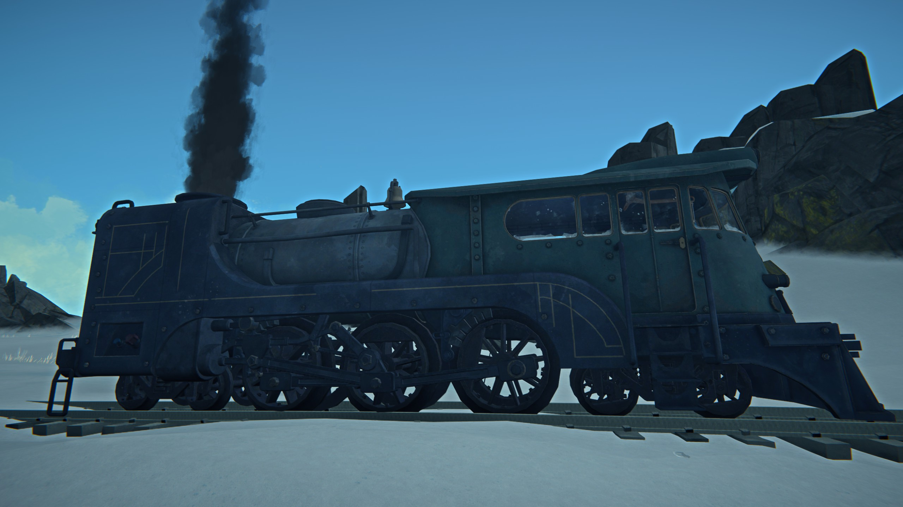

_Iron\_Train.jpg_

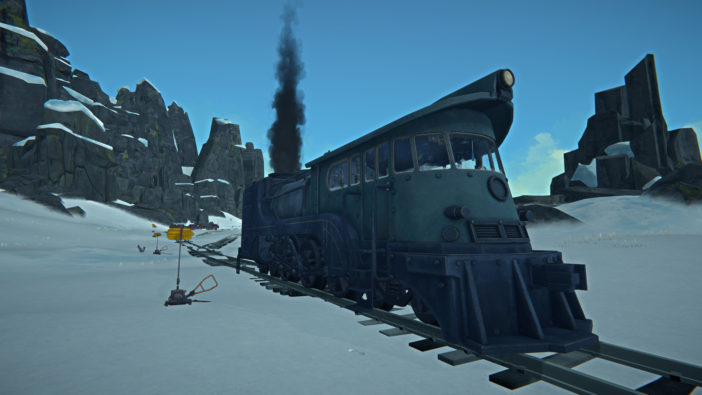

_Iron\_Train\_2.jpg_

## Notes

---

1. My great-grandfather's greatest invention. This is the Prototype. In his journal he described it as, "an angel rendered in the finest steel". - [Wax Cylinder 7](./Wax%20Cylinder%207.md)[↩︎](#fnref1)
