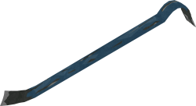

# Prybar

**Contents**

- [Overview](#Overview)
- [Uses of a Prybar](#Uses_of_a_Prybar)
- [Locations](#Locations)
- [Gallery](#Gallery)

<table class="infobox">
<caption>Prybar</caption>
<colgroup>
<col style="width: 50%" />
<col style="width: 50%" />
</colgroup>
<tbody>
<tr>
<td colspan="2"><figure>

<figcaption>Prybar_icon.png</figcaption>
</figure></td>
</tr>
<tr>
<td colspan="2" class="section">
<strong>General</strong>
</td>
</tr>
<tr>
<td>
Item Type
</td>
<td>
Tool|-
</td>
</tr>
<tr>
<td colspan="2" class="section">
<strong>Statistics</strong>
</td>
</tr>
<tr>
<td>
Weight
</td>
<td>
1.00 kg(2.2 lbs)
</td>
</tr>
<tr>
<td>
Harvest
</td>
<td>
2 × <a href="./Scrap%20Metal.md" class="wikilink" title="Scrap Metal">Scrap Metal</a> 30 minutes
</td>
</tr>
<tr>
<td>
Repair
</td>
<td>
Cannot Repair
</td>
</tr>
</tbody>
</table>

<table>
<colgroup>
<col style="width: 33%" />
<col style="width: 33%" />
<col style="width: 33%" />
</colgroup>
<tbody>
<tr>
<td style="vertical-align: top; font-size: 3em; color: #5d5980; padding-right: 10px">
“
</td>
<td>
A beat up prybar. Useful for opening locked containers.

&#10;

In-game description

</td>
<td style="vertical-align: bottom; font-size: 3em; color: #5d5980; padding-left: 10px">
”
</td>
</tr>
</tbody>
</table>

**Prybar** is a tool in *The Long Dark* for opening some locked objects, breaking holes in the ice for fishing, and self-defense against wolves.

## Overview

**Prybar** is a Tool used to open locked containers, such as lockers and <a href="./Car.md" class="wikilink" title="Car">Car</a> trunks (they cannot be used to open <a href="./Cargo%20Container.md" class="wikilink" title="Cargo Container">Cargo Containers</a>). It is additionally used to break the ice on ice-fishing holes, and as a weapon during <a href="./Struggle.md" class="wikilink" title="Struggle">Struggles</a>. They cannot be repaired but can be harvested for some <a href="./Scrap%20Metal.md" class="wikilink" title="Scrap Metal">Scrap Metal</a>. Prybars are fairly common and can be found in almost any condition. It's one of the most important early game gear allowing you to open locked containers which sometimes have better gear.

Prybar are not repairable or craftable.

## Uses of a Prybar

- Open locked <a href="./Locker.md" class="wikilink" title="Lockers">Lockers</a> and locked <a href="./Car%20Trunk.md" class="wikilink" title="Car Trunks">Car Trunks</a> of <a href="./Vehicle.md" class="wikilink" title="Cars">Cars</a>
- 4 Locked Doors on the Island can only be opened with a Prybar
  - Front and Back door of the <a href="./Orca%20Gas%20Station.md" class="wikilink" title="Orca Gas Station">Orca Gas Station</a> in <a href="./Mountain%20Town.md" class="wikilink" title="Mountain Town">Mountain Town</a>
  - The tunnel door at <a href="./Surfeit%20Trestle.md" class="wikilink" title="Surfeit Trestle">Surfeit Trestle</a> in <a href="./Far%20Range%20Branch%20Line.md" class="wikilink" title="Far Range Branch Line">Far Range Branch Line</a>
  - Front door to the <a href="./Headframe%20Building.md" class="wikilink" title="Headframe Building">Headframe Building</a> in <a href="./Zone%20of%20Contamination.md" class="wikilink" title="Zone of Contamination">Zone of Contamination</a>
- Open or maintain holes in the ice for <a href="./Ice%20Fishing.md" class="wikilink" title="Ice Fishing">Ice Fishing</a> (bladed tools break ice faster, but take more condition loss).
- Self Defense during a <a href="./Struggle.md" class="wikilink" title="Wolf Struggle">Wolf Struggle</a>.
- The elevator doors during the mission <a href="./Renewed%20Hope.md" class="wikilink" title="Renewed Hope">Renewed Hope</a> in <a href="./Episode%202%20-%20Luminance%20Fugue.md" class="wikilink" title="Episode 2: Luminance Fugue">Episode 2: Luminance Fugue</a> need a Prybar to open.

When carried and selected for self-defense at the start of a Wolf Struggle, Prybar deal low damage with a low chance per-hit to cause the wolf to flee. Prybar are almost as effective at filling the Struggle Meter as the <a href="./Hunting%20Knife.md" class="wikilink" title="Hunting Knife">Hunting Knife</a>, and slightly more effective than the <a href="./Improvised%20Knife.md" class="wikilink" title="Improvised Knife">Improvised Knife</a>. Prybar take low damage from being used in a struggle. For more information on Struggles, see: <a href="./Struggle.md" class="wikilink" title="Wildlife Struggles">Wildlife Struggles</a>.

## Locations

Prybar are most commonly found in industrial locations, <a href="./Fishing%20Hut.md" class="wikilink" title="fishing hut">fishing huts</a>, <a href="./Langston%20Mine.md" class="wikilink" title="mines">mines</a>, <a href="./Car.md" class="wikilink" title="vehicles">vehicles</a> or near <a href="./Frozen%20Corpse.md" class="wikilink" title="frozen corpse">frozen corpses</a>. They may be found within frequently tool chests or lockers.

**Mountain Town**

- Inside the <a href="./Milton%20Credit%20Union.md" class="wikilink" title="Milton Credit Union">Milton Credit Union</a>, next to a corpse and a backpack.
- Inside the shed at the <a href="./Paradise%20Meadows%20Farm.md" class="wikilink" title="Paradise Meadows Farm">Paradise Meadows Farm</a>, which is also one of the potential spawns for the key to the farmhouse.
- In the back of a pickup truck at <a href="./Paradise%20Meadows%20Farm.md" class="wikilink" title="Paradise Meadows Farm">Paradise Meadows Farm</a>.
- In a truck at the entrance to <a href="./Milton%20Park.md" class="wikilink" title="Milton Park">Milton Park</a>.
- Under the potbelly stove in the Milton Park office.
- Next to a corpse near <a href="./Orca%20Gas%20Station.md" class="wikilink" title="Orca Gas Station">Orca Gas Station</a>.
- On the floor of <a href="./St.%20Christopher%27s%20Church.md" class="wikilink" title="St. Christopher&#39;s Church">St. Christopher's Church</a>, to the right of the broken piano.

## Gallery

<table class="gallery">
<colgroup>
<col style="width: 100%" />
</colgroup>
<tbody>
<tr>
<td><figure>

<figcaption>Old model.</figcaption>
</figure></td>
</tr>
</tbody>
</table>

**Lua execution error in Module:Navbox function navbox**

<a href="ru:%D0%93%D0%B2%D0%BE%D0%B7%D0%B4%D0%BE%D0%B4%D1%91%D1%80" class="wikilink" title="ru:Гвоздодёр">ru:Гвоздодёр</a>

