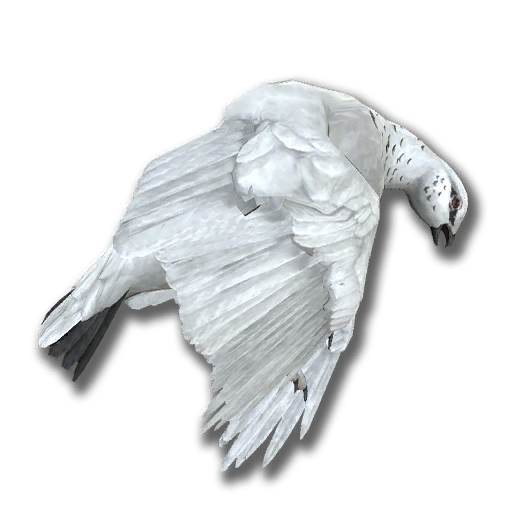

# Ptarmigan Carcass

**Categories:** DLC Content, Food And Drink, Pages with update history · **Source:** [Fandom](https://thelongdark.fandom.com/wiki/Ptarmigan_Carcass)

_Ptarmigan\_icon.png_

**DLC-Exclusive content.** / This content requires the [Tales from the Far Territory](./Tales%20from%20the%20Far%20Territory.md) addon to be installed before it can be seen or used in regular gameplay.

_Ptarmigan\_Carcass\_icon.png_

**Release:** [21 June 2023](./The%20Long%20Dark%20%E2%80%94%20Changelog.md#2.17)

**Wintermute:** No

**Properties**

**Item type:** [Food And Drink](./Food%20And%20Drink.md)

**Stackable:** No

**Examine:** Unharvested Ptarmigan carcass. Harvest it for usable Meat or Down feathers.

**Values**

**Weight:** 3.00 kg (6.6 lbs)

**Decay Rate**

**Inside:** 10.0% per day

**Outside:** 10.0% per day

**Advanced data**

**Item key:** GAMEPLAY\_PtarmiganCarcass

Item

Quanity

Rarity

_Ptarmigan\_(Raw)\_icon.png_

[Ptarmigan (Raw)](./Ptarmigan%20%28Raw%29.md)

0.8-1.5 Kg (1.8-3.3 lbs)

Always

_Ptarmigan\_Down\_icon.png_

[Ptarmigan Down](./Ptarmigan%20Down.md)

4 Bundles

Always
