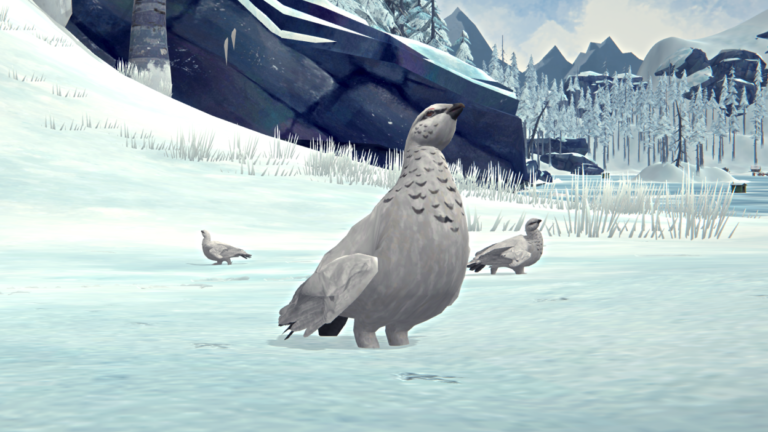
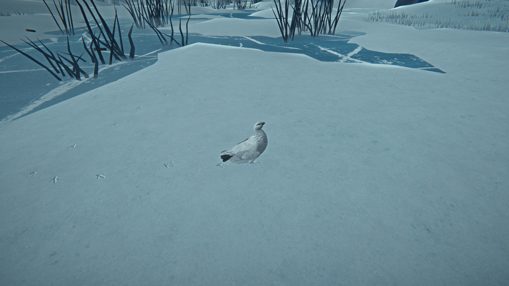
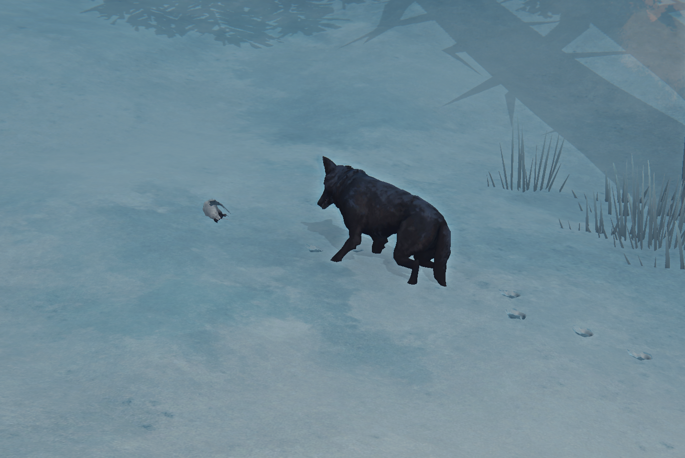

# Ptarmigan

**Categories:** DLC Content, Wildlife · **Source:** [Fandom](https://thelongdark.fandom.com/wiki/Ptarmigan)

**Contents**

- [Overview](#overview)
- [Drops](#drops)
- [Behaviour](#behaviour)
- [Ptarmigan Nests](#ptarmigan-nests)
- [Hunting](#hunting)
- [Wildlife Interactions](#wildlife-interactions)
- [Spawn Locations](#spawn-locations)
- [Ash Canyon](#ash-canyon)
- [Blackrock](#blackrock)
- [Broken Railroad](#broken-railroad)
- [Forlorn Muskeg](#forlorn-muskeg)
- [Forsaken Airfield](#forsaken-airfield)
- [Hushed River Valley](#hushed-river-valley)
- [Mountain Town](#mountain-town)
- [Mystery Lake](#mystery-lake)
- [Pleasant Valley](#pleasant-valley)
- [Timberwolf Mountain](#timberwolf-mountain)
- [Transfer Pass](#transfer-pass)
- [Zone of Contamination](#zone-of-contamination)
- [Trivia](#trivia)
- [Gallery](#gallery)

**Ptarmigan**

[Ptarmigan](../assets/Ptarmigan.png)

**Basic Information**

**Release:** [21 June 2023](./The%20Long%20Dark%20%E2%80%94%20Changelog.md#2.17)

**Role:** Prey

**Physical Information**

**Color:** White

**Size:** Small

**Eyes:** Black

[Ptarmigan icon](../assets/Ptarmigan_icon.png)

**DLC-Exclusive content.** This content requires the [Tales from the Far Territory](./Tales%20from%20the%20Far%20Territory.md) addon to be installed before it can be seen or used in regular gameplay.

“

**A small winter bird that gathers in flocks. Can be a source of food, and its Feathers become a useful crafting material.** Official Hinterland Description

”

**Ptarmigan** are an avian species of prey wildlife found on [Great Bear Island](./Great%20Bear%20Island.md). They were introduced in the Part 3: Frontier Comforts update of the [Tales from the Far Territory](./Tales%20from%20the%20Far%20Territory.md), and can only be encountered by players who have bought the expansion pass.

<!-- #Overview -->
​

<!-- #overview -->
## Overview

Ptarmigans are small white birds that typically gather in flocks of up to 4-6 members depending on game difficulty, and are a source of both food and down feathers. They are half the size of a Rabbit, and with their snowy white plumage, they are harder to see from a distance. This requires the player to be extra perceptive when attempting to locate a flock as they can usually be found from listening for the loud cooing/clucking sounds they make, rather than line of sight.

Each region contains only a handful of specific areas populated with Ptarmigans, making them an uncommon hunting target. They prefer high altitude locations, and don't appear in the lower altitude coastal regions.

<!-- #Drops -->
​

<!-- #drops -->
## Drops

When killed, a [Ptarmigan Carcass](./Ptarmigan%20Carcass.md) can be butchered on the spot or carried whole, similar to a [Rabbit Carcass](./Rabbit%20Carcass.md). A whole bird weighs only slightly more than its meat and down feathers and harvesting is a time consuming process (30 minutes for each bundle). Unlike other animals, Ptarmigans are unique in that they do not drop Hides or Intestines.

|  | Item | Quanity | Rarity |
| --- | --- | --- | --- |
| [Ptarmigan (Raw) icon](../assets/Ptarmigan_%28Raw%29_icon.png) | [Ptarmigan (Raw)](./Ptarmigan%20%28Raw%29.md) | 0.8-1.5 Kg (1.8-3.3 lbs) | Always |
| [Ptarmigan Down icon](../assets/Ptarmigan_Down_icon.png) | [Ptarmigan Down](./Ptarmigan%20Down.md) | 4 Bundles | Always |

Ptarmigan meat is a necessary ingredient in making all stews, as it is the only reliable way of obtaining [Broth](./Broth.md).

Down Feathers are used as a crafting ingredient in improving a [Bedroll](./Bedroll.md) into an [Improvised Down Bedroll](./Improvised%20Down%20Bedroll.md) or the creation of the [Improvised Insulation](./Improvised%20Insulation.md) accessory.

<!-- #Behaviour -->
​

<!-- #behaviour -->
## Behaviour

Ptarmigans behave similar to [Rabbits](./Rabbit.md); slowly wandering around their nests (instead of Rabbit Groves) in small flocks, and they are able to be stunned with a thrown [Stone](./Stone.md). Unlike Rabbits which appear across Great Bear Island, Ptarmigans are only present in non-coastal regions and usually nest at high ground areas. If disturbed they will fly away and not return to the nest area for a time (1-4 days).

- Ptarmigans are generally docile: walking, cooing and pecking around their nesting grounds; they may be heard nearby from their distinctive call.
- If the survivor or a predator alerts them, individual Ptarmigans will run a short distance before taking flight. Once in flight it is still possible to hit a ptarmigan with weapons, though extremely difficult.
- It is possible to shoot a fleeing or even flying Ptarmigans, though difficult. [Revolver](./Revolver.md) shots can be helpful at shooting flying Ptarmigan due to their fast fire rate.
- It is possible (but reckless) to hunt entire Ptarmigan flocks with a well placed [Noisemaker](./Noisemaker.md) if they are bunched together enough, though this tactic is not generally recommended.
- Throwing (RMB) a lit Torch or Flare near Ptarmigans causes the flock to flee. Placing the lit item on the ground will not startle the birds.
- Ptarmigans will ignore a lit [Campfire](./Campfire.md). However they will keep a distance of roughly 2 meters form it.

<!-- #ptarmigan_nests -->
​

<!-- #Ptarmigan_Nests -->
​

<!-- #Ptarmigan_nests -->
​

<!-- #ptarmigan-nests -->
### Ptarmigan Nests

Ptarmigan Nests are locations that Ptarmigans will always loiter around. They are similar to Rabbit Groves, appearing on the [Map](./Map.md) with a special nest icon after the area is surveyed with [Charcoal](./Charcoal.md). Ptarmigan Nests always spawn 4-6 Ptarmigan at a time, and are found at high altitudes within regions.

**Ptarmigan and their Nests do not spawn in coastal regions** (I.E. [Desolation Point](./Desolation%20Point.md), [Crumbling Highway](./Crumbling%20Highway.md), [Coastal Highway](./Coastal%20Highway.md), and [Bleak Inlet](./Bleak%20Inlet.md)).

<!-- #Hunting -->
​

<!-- #hunting -->
### Hunting

- A crouched survivor may approach very close to Ptarmigans, within ~10 meters before they flee.
- Thrown [Torches](./Torch.md) (RMB) will startle ptarmigans. If carrying a lit torch while hunting Ptarmigans, extinguish it or "Drop" it from the Inventory menu instead of throwing.
- Similar to [Rabbits](./Rabbit.md), a thrown [Stones](./Stone.md) will temporarily stun a Ptarmigan if it hits, allowing one from a flock to be caught and "Killed" or "Released". This will alert the remaining flock to flee, as will missed stones.
- Ptarmigan are instantly killed from any type of arrow, notably crafted [Fire Hardened Arrows](./Fire%20Hardened%20Arrow.md). Killing ptarmigans with arrows will not disturb the flock, allowing multiple birds to be hunted quickly.
- Firearms kill Ptarmigans, but their report will startle the flock.

<!-- #wildlife_interactions -->
​

<!-- #Wildlife_Interactions -->
​

<!-- #Wildlife_interactions -->
​

<!-- #wildlife-interactions -->
## Wildlife Interactions

- Ptarmigan stay close to their flock of 4-6, but will individually flee if startled.
- [Wolves](./Wolf.md) as well as [Timberwolves](./Timberwolf.md) and [Poisoned Wolves](./Poisoned%20Wolf.md) will hunt nearby Ptarmigan. Fleeing wolves will also scare ptarmigans.
- [Bear](./Bear.md), [Moose](./Moose.md) and [Cougar](./Cougar.md) will cause Ptarmigans to flee, but will not hunt them.
- [Deer](./Deer.md) will ignore Ptarmigan, and vice versa.
- [Rabbit](./Rabbit.md) will ignore a Ptarmigan, and mostly vice versa: startled Rabbits will also startle Ptarmigans.
- [The Darkwalker](./Escape%20the%20Darkwalker.md) will startle Ptarmigan, and [Toxic Fog](./Toxic%20Fog.md) will instantly kill them.
- The Survivor: Ptarmigan will be startled if they detect the survivor (~30m standing, ~10m crouched). They also flee from firearms reports, firearms impacts, thrown items (stones, torches, flares).
- If a Ptarmigan is stunned by a thrown [Stone](./Stone.md), it can be quickly picked up and killed or released. If released, The Survivor will pat the confused Ptarmigan and placing them ground, causing them to flee a moment later.

<!-- #ash_canyon -->
​

<!-- #Ash_Canyon -->
​

<!-- #Ash_canyon -->
​

<!-- #ash-canyon -->
### [Ash Canyon](./Ash%20Canyon.md)

- A flock right under the three root climbing sections with the rose hip trees leading to the bridge going over [Shattered Cove](./Shattered%20Cove.md).
- A flock near the creek flowing from [Gold Mine](./Gold%20Mine.md)/[Mining Camp](./Mining%20Camp.md). It replaces the previous [Rabbit Grove](./Rabbit%20Grove.md).
- A flock at [Homesteader's Respite](./Homesteader%27s%20Respite.md).
- A flock (of 2?) near the bottom most rope climb up to [High Meadow](./High%20Meadow.md).
- A flock between [Foreman's Retreat](./Foreman%27s%20Retreat.md) and the open cave with the bed.
- A flock in front of [Climber's Cave](./Climber%27s%20Cave.md).

<!-- #Blackrock -->
​

<!-- #blackrock -->
### [Blackrock](./Blackrock.md)

- Between the rope climb at [Cutty's Cave](./Cutty%27s%20Cave.md) and the [Foreman's Clearcut](./Foreman%27s%20Clearcut.md) trailer, there are two rock formations shown on the charcoal map. The first one can have a backpack and has [Reishi Mushroom](./Reishi%20Mushroom.md). Exactly in between those two rock formations is where the flock spawns.
- A flock right next to [Whistling Perch](./Whistling%20Perch.md), practically running around the 5 [Birch Saplings](./Green%20Birch%20Sapling.md) there.
- A flock at the top of the rope climb next to [Forager's Remnant](./Forager%27s%20Remnant.md), where cat tails and a maple sapling grow.
- At the second transmitting tower facing the [Prison](./Blackrock%20Prison.md), on the ledge overlooking the road leading out of the prison
- Just east of [Bricklayer's Retreat](./Bricklayer%27s%20Retreat.md), on the hill near the [Timberwolf](./Timberwolf.md) spawn and the [Birch sapling](./Green%20Birch%20Sapling.md) spawn.

<!-- #broken_railroad -->
​

<!-- #Broken_Railroad -->
​

<!-- #Broken_railroad -->
​

<!-- #broken-railroad -->
### [Broken Railroad](./Broken%20Railroad.md)

- Flock right in front of [Rickety Foot Bridge](./Rickety%20Foot%20Bridge.md) (Birch Sapling side).
- Plateau above the [Maintenance Yard](./Maintenance%20Yard.md) (next to Maple Saplings).
- A flock right of the top of the rope climb next to the [Hunting Lodge](./Hunting%20Lodge.md).

<!-- #forlorn_muskeg -->
​

<!-- #Forlorn_Muskeg -->
​

<!-- #Forlorn_muskeg -->
​

<!-- #forlorn-muskeg -->
### [Forlorn Muskeg](./Forlorn%20Muskeg.md)

- A flock can be seen at the [Muskeg Overlook](./Muskeg%20Overlook.md) plateau, where the eastern radio tower stands.
- A flock can be seen at the plateau south of the tunnel to [Broken Railroad](./Broken%20Railroad.md).
- A flock can be seen at the top of Marsh Ridge, in the path to the right of the cave that leads to the waterfall.

<!-- #forsaken_airfield -->
​

<!-- #Forsaken_Airfield -->
​

<!-- #Forsaken_airfield -->
​

<!-- #forsaken-airfield -->
### [Forsaken Airfield](./Forsaken%20Airfield.md)

- A flock nests at a small pond within the rocky one way paths leading from beneath the rope climb near [Justy's Hovel](./Justy%27s%20Hovel.md) to the regions exit.
- They are sometimes found in a clearing north of the [Island Cottage](./Island%20Cottage.md), on [Drift Island](./Drift%20Island.md).
- A flock can be seen at the frozen pond near [Mindful Cabin.](./Mindful%20Cabin.md)

<!-- #hushed_river_valley -->
​

<!-- #Hushed_River_Valley -->
​

<!-- #Hushed_river_valley -->
​

<!-- #hushed-river-valley -->
### [Hushed River Valley](./Hushed%20River%20Valley.md)

- A Flock near a rock Arch, south (straight on the crossing) from the [Many Falls Vista](./Many%20Falls%20Vista.md) climbing site.
- A Flock near the western most cave at the same plateau as [Hushed River](./Hushed%20River.md), reached for example by following the map edge from [Offset Falls](./Offset%20Falls.md) or from the middle entrance to the "North Ice cave".
- A Flock at [Peak Cave](./Peak%20Cave.md).
- A flock near [Pensive Vista](./Pensive%20Vista.md).
- A flock at [Monolith Lake](./Monolith%20Lake.md).
- A Flock may spawn south-east of the cave near the [Rock Cache Memento,](https://thelongdark.fandom.com/wiki/Mementos#Hushed_River_Valley) south of Many Falls Vista.
- A Flock may spawn just outside the ice cave which runs along the river south of [Mammoth Falls.](./Mammoth%20Falls.md)

<!-- #mountain_town -->
​

<!-- #Mountain_Town -->
​

<!-- #Mountain_town -->
​

<!-- #mountain-town -->
### [Mountain Town](./Mountain%20Town.md)

- A flock typically scavenges around the [Picnic Area](./Picnic%20Area.md).
- A flock can be found down the slope next to the bear cave past [Spruce Falls Bridge](./Spruce%20Falls%20Bridge.md).
- A flock can be found near the blue Trailer near the cave to [Hushed River Valley](./Hushed%20River%20Valley.md).
- A flock can be found uphill of [Paradise Meadows Farm](./Paradise%20Meadows%20Farm.md).

<!-- #mystery_lake -->
​

<!-- #Mystery_Lake -->
​

<!-- #Mystery_lake -->
​

<!-- #mystery-lake -->
### [Mystery Lake](./Mystery%20Lake%20%28region%29.md)

- A flock near [Camp Office](./Camp%20Office.md) near the rocks across from the front door.
- A flock may appear at [Lake Overlook](./Lake%20Overlook.md).
- A flock can be seen near the potential [Prepper Cache](./Prepper%20Cache.md) above [Dave's Quiet Clearing](./Dave%27s%20Quiet%20Clearing.md).
- A flock can be sighted at the top of the path leading to the Abandoned Lookout &amp; the [Forestry Lookout](./Forestry%20Lookout.md).
- A flock can also be located at the [Destroyed Lookout](./Destroyed%20Lookout.md).

<!-- #pleasant_valley -->
​

<!-- #Pleasant_Valley -->
​

<!-- #Pleasant_valley -->
​

<!-- #pleasant-valley -->
### [Pleasant Valley](./Pleasant%20Valley.md)

- A flock can be found in the area of [Signal Hill](./Signal%20Hill.md) near Maple Sapling on the right side.
- A flock may spawn at the top of the lower rope climb to the east of [Signal Hill](./Signal%20Hill.md)
- A flock near the bridge between the [Point of Disagreement](./Point%20of%20Disagreement.md) and [Derelict Cabins](./Derelict%20Cabins.md), on the left side if going uphill.
- A flock near the hunter's blind near the [Crash Site](./Crash%20Site%20%28Pleasant%20Valley%29.md) of the jet airliner.
- A flock can spawn on a hill a short distance northeast of [Three Strikes Farmstead](./Three%20Strikes%20Farmstead.md)

<!-- #timberwolf_mountain -->
​

<!-- #Timberwolf_Mountain -->
​

<!-- #Timberwolf_mountain -->
​

<!-- #timberwolf-mountain -->
### [Timberwolf Mountain](./Timberwolf%20Mountain.md)

- A flock scavenges between the rope climb from [Crystal Lake](./Crystal%20Lake.md) and "Cave C"/[Engine](./Engine%20%28East%29.md) on the narrowed ledge near a corpse and/or deer corpse shot with a broken [Arrow](./Simple%20Arrow.md). You would take this route if traveling to [Blackrock](./Blackrock.md) region.
- A flock can spawn at Andre's Peak
- A flock directly in front of an unnamed cave on the right(east) side of the map. Reached when going towards the [Ash Canyon](./Ash%20Canyon.md) transition cave after crossing the "Fallen Tree bridge" bridge over [Echo Ravine](./Echo%20Ravine.md).
- A flock near the [Tail Section](./Tail%20Section.md) in the [Summit](./Summit.md).
- A flock iin front of the cave on the [Summit](./Summit.md).

<!-- #transfer_pass -->
​

<!-- #Transfer_Pass -->
​

<!-- #Transfer_pass -->
​

<!-- #transfer-pass -->
### [Transfer Pass](./Transfer%20Pass.md)

- East of [Vacant Depot](./Vacant%20Depot.md), on the edge of the frozen water, before the path going towards [Conductor's Dropoff](./Conductor%27s%20Dropoff.md).
- On a ridge south west of [Loitering Marsh](./Loitering%20Marsh.md), right on the edge of the marsh.
- Due west of [Vacant Depot](./Vacant%20Depot.md), near the far western edge of the map.

<!-- #zone_of_contamination -->
​

<!-- #Zone_of_Contamination -->
​

<!-- #Zone_of_contamination -->
​

<!-- #Zone_Of_Contamination -->
​

<!-- #zone-of-contamination -->
### [Zone of Contamination](./Zone%20of%20Contamination.md)

- At [Boss's Settlement](./Boss%27s%20Settlement.md), between the two main destroyed cabins
- Along a one-way passage leading from the [Miner's Footpath](./Miner%27s%20Footpath.md) through the northwestern mountains to the [Indolent Hoppers](./Indolent%20Hoppers.md)

<!-- #Trivia -->
​

<!-- #trivia -->
## Trivia

- Ptarmigan appears to be based on the winter plumage of the [Willow Ptarmigan](https://en.wikipedia.org/wiki/Willow_ptarmigan) (**_Lagopus lagopus_**), a species of Galliformes identifiable by its red crest above the eye and changing feather colors that match the seasons.
- The correct plural pronounciation of Ptarmigan is either Ptarmigan or Ptarmigans (similar to Fish or Fishes).
- Ptarmigan are also the Nunavut’s official bird, one of symbol for the territorial heritage of north-east Canada. ([official source here](https://www.canada.ca/en/canadian-heritage/services/provincial-territorial-symbols-canada/nunavut.html))

<!-- #Gallery -->
​

<!-- #gallery -->
## Gallery

