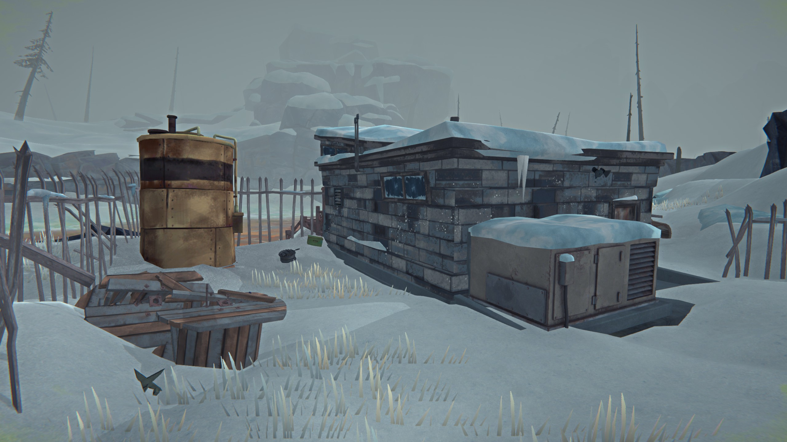
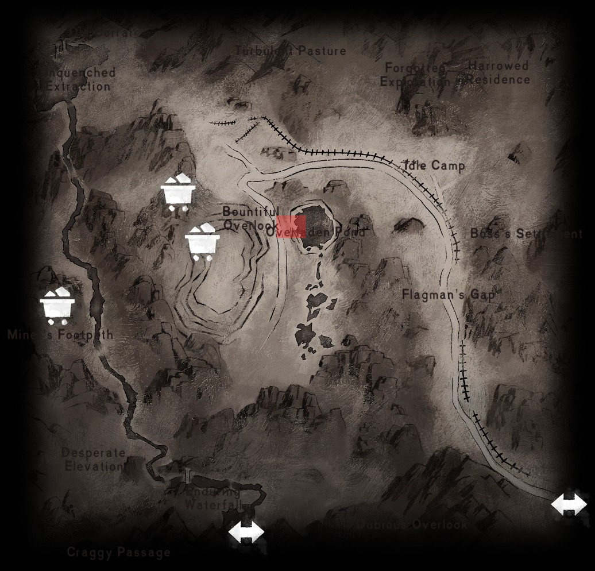

# Pump House

**Pump House**

| Property | Details |
| --- | --- |
|  |  / *Pump\_House.jpg* |
| **Location** |  |
|  |  / *Pump\_House\_Location.png* |
| Region | [Zone of Contamination](./Zone%20of%20Contamination.md)\|- |
| **General** |  |
|  | Has an interior\|} / The **Pump House** is a building that once served to use water from [Unquenched Extraction](./Unquenched%20Extraction.md) to pump out toxic gas and liquid from deep inside the [Langston Mine](./Langston%20Mine.md) to create the nearby [Overladen Pond](./Overladen%20Pond.md), but now lies abandoned. Simply walking around the premises will risk [Chemical Poisoning](./Chemical%20Poisoning.md), but the inside is safe from the nearby toxins. Some [Water (Potable)](./Water%20%28Potable%29.md) and several [Crates](./Crate.md) can be found inside, as well as a hidden [Note](./Notes.md) under the shelves. Outside, a [Rim Grill](./Rim%20Grill.md) and a possible [Backpack](./Backpack.md) can be found. / \|  / *The Pump House and Overladen Pond as viewed from a nearby cliff* \|  / *The nearby sign leading to the Pump House* \| / \| --- \| --- \| / **Lua execution error in Module:Navbox function navbox** / [ru:Насосное отделение](ru:%D0%9D%D0%B0%D1%81%D0%BE%D1%81%D0%BD%D0%BE%D0%B5_%D0%BE%D1%82%D0%B4%D0%B5%D0%BB%D0%B5%D0%BD%D0%B8%D0%B5) |
|  / *The Pump House and Overladen Pond as viewed from a nearby cliff* |  / *The nearby sign leading to the Pump House* |
