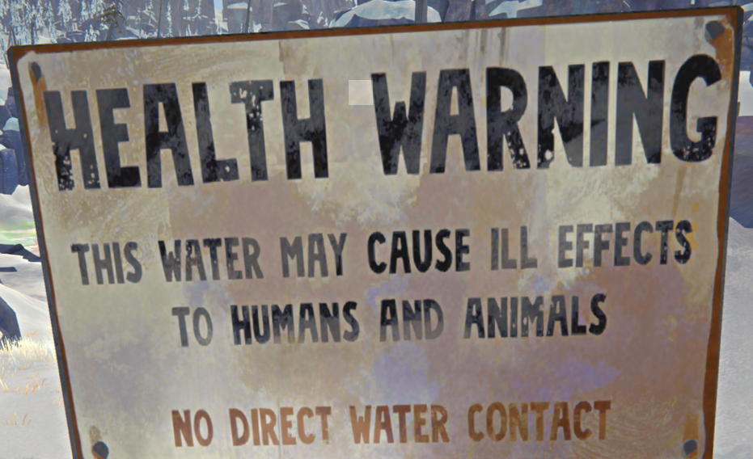

# Pump House

<table class="infobox">
<caption>Pump House</caption>
<colgroup>
<col style="width: 50%" />
<col style="width: 50%" />
</colgroup>
<tbody>
<tr>
<td colspan="2"><figure>
[Missing image: Pump_House.jpg]
<figcaption>Pump_House.jpg</figcaption>
</figure></td>
</tr>
<tr>
<td colspan="2" class="section">
<strong>Location</strong>
</td>
</tr>
<tr>
<td colspan="2"><figure>
[Missing image: Pump_House_Location.png]
<figcaption>Pump_House_Location.png</figcaption>
</figure></td>
</tr>
<tr>
<td>
Region
</td>
<td>
<a href="./Zone%20of%20Contamination.md" class="wikilink" title="Zone of Contamination">Zone of Contamination</a>|-
</td>
</tr>
<tr>
<td colspan="2" class="section">
<strong>General</strong>
</td>
</tr>
<tr>
<td></td>
<td>
Has an interior|}

The <strong>Pump House</strong> is a building that once served to use water from <a href="./Unquenched%20Extraction.md" class="wikilink" title="Unquenched Extraction">Unquenched Extraction</a> to pump out toxic gas and liquid from deep inside the <a href="./Langston%20Mine.md" class="wikilink" title="Langston Mine">Langston Mine</a> to create the nearby <a href="./Overladen%20Pond.md" class="wikilink" title="Overladen Pond">Overladen Pond</a>, but now lies abandoned. Simply walking around the premises will risk <a href="./Chemical%20Poisoning.md" class="wikilink" title="Chemical Poisoning">Chemical Poisoning</a>, but the inside is safe from the nearby toxins. Some <a href="./Water%20%28Potable%29.md" class="wikilink" title="Water (Potable)">Water (Potable)</a> and several <a href="./Crate.md" class="wikilink" title="Crates">Crates</a> can be found inside, as well as a hidden <a href="./Notes.md" class="wikilink" title="Note">Note</a> under the shelves. Outside, a <a href="./Rim%20Grill.md" class="wikilink" title="Rim Grill">Rim Grill</a> and a possible <a href="./Backpack.md" class="wikilink" title="Backpack">Backpack</a> can be found.

<table class="gallery">
<colgroup>
<col style="width: 50%" />
<col style="width: 50%" />
</colgroup>
<tbody>
<tr>
<th><figure>
[Missing image: Pump_House_and_Overladen_Pond.jpg]
<figcaption>The Pump House and Overladen Pond as viewed from a nearby cliff</figcaption>
</figure></th>
<td><figure>

<figcaption>The nearby sign leading to the Pump House</figcaption>
</figure></td>
</tr>
</tbody>
</table>

<strong>Lua execution error in Module:Navbox function navbox</strong>

<a href="ru:%D0%9D%D0%B0%D1%81%D0%BE%D1%81%D0%BD%D0%BE%D0%B5_%D0%BE%D1%82%D0%B4%D0%B5%D0%BB%D0%B5%D0%BD%D0%B8%D0%B5" class="wikilink" title="ru:Насосное отделение">ru:Насосное отделение</a>
</td>
</tr>
</tbody>
</table>

