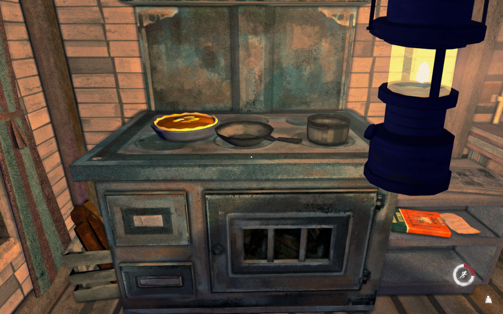
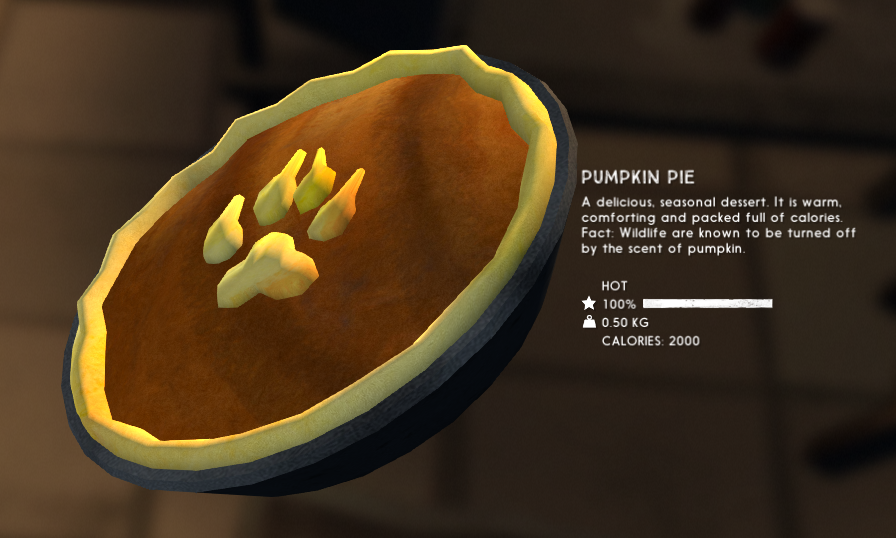
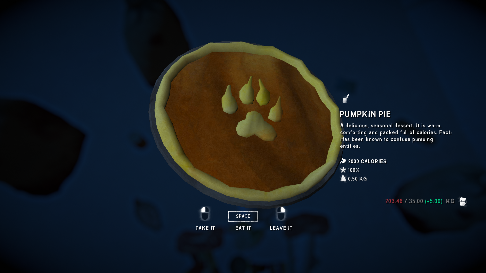

# Pumpkin Pie

**Categories:** Food And Drink, Pages with update history · **Source:** [Fandom](https://thelongdark.fandom.com/wiki/Pumpkin_Pie)

**Contents**

- [Overview](#overview)
- [Warmth effect](#warmth-effect)
- [Wildlife deterring effect](#wildlife-deterring-effect)
- [4DON](#4don)
- [Escape the Darkwalker](#escape-the-darkwalker)
- [Spawns](#spawns)
- [Gallery](#gallery)
- [Update history](#update-history)

**Pumpkin Pie**

[Pumpkin Pie icon](../assets/Pumpkin_Pie_icon.png)

**Release:** [30 October 2016](./The%20Long%20Dark%20%E2%80%94%20Early%20Access%20Changelog.md#0.373)

**Wintermute:** No

**Properties**

**Item type:** [Food And Drink](./Food%20And%20Drink.md)

**Stackable:** No

**Examine:** A delicious, seasonal desert. It is warm, comforting and packed full of calories. Fact: Wildlife are known to be turned off by the scent of pumpkin.

**Values**

**Calories:** 2000 kcal

**Hydration:** -5%

**Weight:** 0.50 kg (1.1 lbs)

**Advanced data**

**Item key:** GAMEPLAY\_PumpkinPie

> “**A delicious, seasonal desert. It is warm, comforting and packed full of calories. Fact: Wildlife are known to be turned off by the scent of pumpkin.**”
>
> — 4DON description

> **A delicious, seasonal desert. It is warm, comforting and packed full of calories. Fact: Has been known to confuse pursuing entities.**
>
>
> — Escape the Darkwalker description

**Pumpkin Pie** is a seasonal [food](./Food%20And%20Drink.md) item available only during the Halloween events [4 Days of Night Event](./4%20Days%20of%20Night%20Event.md) and the [Escape the Darkwalker](./Escape%20the%20Darkwalker.md) (2020 event version). It is currently unable to be accessed (even in the current version of Escape the Darkwalker Challenge) and is considered [Cut/Discontinued Content](./Cut%20%E2%80%94%20Discontinued%20Content.md).

The Pumpkin Pie is still found in the game files in [Wintermute](./Wintermute.md), but cannot be accessed through normal means.

<!-- #Overview -->
​

<!-- #overview -->
## Overview

Consuming a Pumpkin Pie grants up to 2000 [calories](./Hunger.md) for 0.50 kg of weight, making it even more efficient than the rare [MRE](./Military-Grade%20MRE.md) (1750 calories). Pumpkin Pies additionally grant a [Wildlife Repelling Effect](./Afflictions.md), frightening nearby [Demon Wolves](./Wolf.md), as well as constantly being "hot" so its consumption can warm the survivor.

If found during the [Escape the Darkwalker](./Escape%20the%20Darkwalker.md) event, the Darkwalker will refuse to pursue the player for a time when the Pie is consumed.

<!-- #warmth_effect -->
​

<!-- #Warmth_effect -->
​

<!-- #Warmth_Effect -->
​

<!-- #warmth-effect -->
## Warmth effect

It has a constant [Hot](./Warming%20Up.md) attribute, which grants [Warmth](./Warmth.md) even when eating small amounts of the pie. This allows a survivor to keep warm for extended periods of time, preventing [Hypothermia](./Hypothermia.md) by keeping Warmth above zero. The amount of warmth gained is proportional to the amount of pie eaten (and calories consumed).

An intact pie can restore the [Warmth](./Warmth.md) of the survivor from freezing (0%) to full (100%) once.

<!-- #don -->
​

<!-- #4DON -->
​

<!-- #4don -->
### 4DON

The "Wildlife Repelling Effect" Benefit is granted to the survivor upon consuming a Pumpkin Pie, which causes nearby Demon Wolves to flee upon detecting them. This effect is similar to that of Pilgrim game mode.

If the effect is obtained while a Wolf is charging the survivor, there is no effect for that Wolf, resulting in a [Struggle](./Struggle.md).

<!-- #escape_the_darkwalker -->
​

<!-- #Escape_the_Darkwalker -->
​

<!-- #Escape_the_darkwalker -->
​

<!-- #Escape_The_Darkwalker -->
​

<!-- #escape-the-darkwalker -->
### Escape the Darkwalker

If consumed while the Darkwalker is chasing the player, the entity will stay away from them for some time, similar to using a [Spray Paint - Glyph](./Spray%20Paint%20-%20Glyph.md) to create a Ward/standing near a Green Fire.

<!-- #Spawns -->
​

<!-- #spawns -->
## Spawns

Pumpkin Pies spawn inside major structures such as the [Camp Office](./Camp%20Office.md). Their spawns are not guaranteed, but multiple pies can spawn in the same Region. Pies found usually spawn atop stoves.

- [Camp Office](./Camp%20Office.md)
- [Trapper's Homestead](./Trapper%27s%20Homestead.md)
- [Forestry Lookout](./Forestry%20Lookout.md)
- [Quonset Garage](./Quonset%20Garage.md)
- [Pleasant Valley Farmstead](./Pleasant%20Valley%20Farmstead.md)
- [Signal Hill](./Signal%20Hill.md)
- [Fishing Hut](./Fishing%20Hut.md)

<!-- #Gallery -->
​

<!-- #gallery -->
## Gallery

_A pumpkin pie on the stove in the [Pleasant Valley Farmstead](./Pleasant%20Valley%20Farmstead.md)_

<!-- #update_history -->
​

<!-- #Update_history -->
​

<!-- #Update_History -->
​

<!-- #update-history -->
## Update history

- UPDATE **30 October 2016 ([Update](./The%20Long%20Dark%20%E2%80%94%20Early%20Access%20Changelog.md#0.373)):**
  - Added to game.
