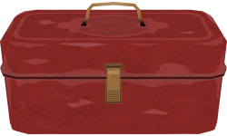
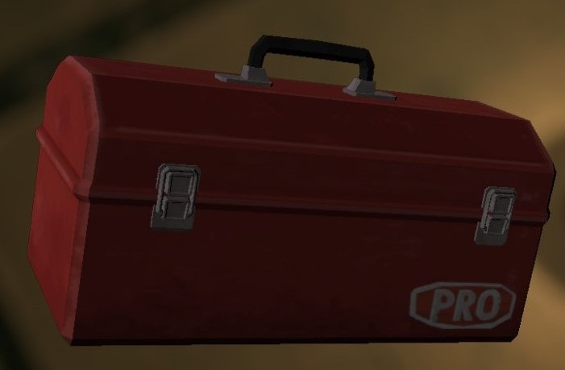

# Quality Tools

**Categories:** Pages with update history, Story items, Tools · **Source:** [Fandom](https://thelongdark.fandom.com/wiki/Quality_Tools)

**Quality Tools**

**General**

**Item Type:** Tool

**Statistics**

**Weight:** 0.75 kg(1.65 lbs)

**Harvest:** 3 × [Scrap Metal](./Scrap%20Metal.md) 1 hour

**Repair:** 1 × [Scrap Metal](./Scrap%20Metal.md) 20% Condition 2 hours

> “**Good quality tools for crafting and repair.**”
>
> — In-game description

**Quality Tools** are a Tool item used for crafting items and repairing equipment.

## Overview

Quality tools weigh 0.75 kilograms. Quality tools can repair an item 100% faster (halving the repair time) than without any tools. They also increase the chance of a successful repair by 20%. In addition to repairing more quickly and more reliably, quality tools also weigh less than simple tools. However, quality tools are more rare.

Quality tools also reduce the time required to craft [Simple Arrows](./Simple%20Arrow.md) by 50%, even if the tools are not required for the crafting itself.

The item always comes in 100% condition if found. Use degrades the condition of the tools. Ruined tools at 0% condition can no longer be used or repaired with Quality Tools, but instead at a [Milling Machine](./Milling%20Machine.md). The item can be repaired using itself, It take 2 hours to repair tools and the success rate depends on your [repair survival skill](./Repair.md).

As an upgraded version of Simple Tools, Quality Tools can repair the same set of items as the latter:

- [Cooking Pot](./Cooking%20Pot.md)
- [Cooking Skillet](./Cooking%20Skillet.md)
- [Flashlight](./Flashlight.md)
- [Hacksaw](./Hacksaw.md)
- [Heavy Hammer](./Heavy%20Hammer.md)
- [Miner's Flashlight](./Miner%27s%20Flashlight.md)
- Quality Tools
- [Spelunker's Lantern](./Spelunker%27s%20Lantern.md)
- [Storm Lantern](./Storm%20Lantern.md)

Quality Tools can also be used to decrease the [Crafting](./Crafting.md) times of the following tools:

- [Hook](./Hook.md)
- [Fishing Lure (Revolver Shell Casing)](./Fishing%20Lure%20%28Revolver%20Shell%20Casing%29.md)
- [Fishing Lure (Wire Bundle)](./Fishing%20Lure%20%28Wire%20Bundle%29.md)
- [Fishing Lure (Acorns)](./Fishing%20Lure%20%28Acorns%29.md)
- [Simple Fishing Lure](./Simple%20Fishing%20Lure.md)
- [Snare](./Snare.md)
- [Simple Arrow](./Simple%20Arrow.md)
- [Improvised Crampons](./Improvised%20Crampons.md)
- [Fishing Tip-Up](./Fishing%20Tip-Up.md)

Quality Tools are needed to craft the following item

- [Bear Hide Rug](./Bear%20Hide%20Rug.md)

## Gallery

## Game History

\* unknown date

  - Added to game.
- UPDATE **2 December 2024 ([Update](./The%20Long%20Dark%20%E2%80%94%20Changelog.md#2.33)):**
  - Item received a new model
