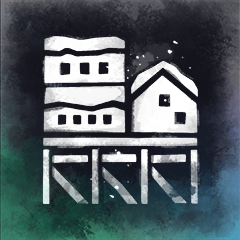

# Quarantine

**Quarantine**

| Property | Details |
| --- | --- |
|  |  / *Quarantine\_icon.png* |
| Description | Explore Perseverance Mills. |

**Quarantine** is a hidden [achievement](./The%20Long%20Dark%20%E2%80%94%20Achievements.md) in *[Wintermute](./Wintermute.md)* [Episode 5: The Light At The End Of All Things](./Episode%205%20-%20The%20Light%20At%20The%20End%20Of%20All%20Things.md) of *[The Long Dark](./The%20Long%20Dark.md)*.

## Guide

This is an unmissable hidden achievement granted after completing the main story mission [Perseverance](./Perseverance.md). After exploring the town and gathering all notes and clues, the mission will complete and the achievement will unlock.

## Game History

\* UPDATE **31 March 2026 ([Update](./The%20Long%20Dark%20%E2%80%94%20Changelog.md#2.52)):**

- 
  - Added to game.

**Lua execution error in Module:Navbox function navbox**
