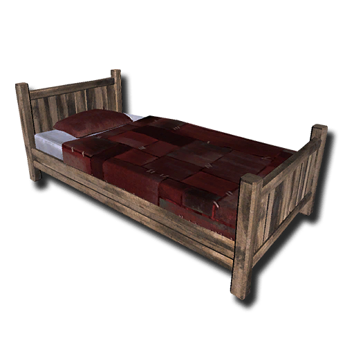

# Quilted Bed

<table class="infobox">
<caption>Quilted Bed</caption>
<colgroup>
<col style="width: 50%" />
<col style="width: 50%" />
</colgroup>
<tbody>
<tr>
<td colspan="2"><figure>

<figcaption>Quilted_Bed_icon.png</figcaption>
</figure></td>
</tr>
<tr>
<td>
Release
</td>
<td>
<a href="./The%20Long%20Dark%20%E2%80%94%20Changelog.md#2.33" class="wikilink" title="TFTFT Part 6 Broken Silence">TFTFT Part 6 Broken Silence</a>
</td>
</tr>
<tr>
<td colspan="2" class="section">
<strong>Values</strong>
</td>
</tr>
<tr>
<td>
Weight
</td>
<td>
10.00 kg (22 lbs)
</td>
</tr>
<tr>
<td colspan="2" class="section">
<strong>Actions</strong>
</td>
</tr>
<tr>
<td>
Backpack
</td>
<td>
Drop, Place
</td>
</tr>
</tbody>
</table>

The **Quilted Bed** is a <a href="./Decorations.md" class="wikilink" title="Decorations">Decorations</a> and <a href="./Bed.md" class="wikilink" title="Bed">Bed</a> item that can be <a href="./Crafting.md" class="wikilink" title="Crafted">Crafted</a> as part of the <a href="./Safehouse%20Customization.md" class="wikilink" title="Safehouse Customization">Safehouse Customization</a> feature.

## Overview

A makeshift wooden bed with bedsheets made from sewn together pieces of cloth, a Quilted Bed can be crafted at a <a href="./Furniture%20Workbench.md" class="wikilink" title="Furniture Workbench">Furniture Workbench</a>, but requires <a href="./Woodworking%20Tools.md" class="wikilink" title="Woodworking Tools">Woodworking Tools</a>.

This bed can be <a href="./Sleep.md" class="wikilink" title="Slept">Slept</a> in and gives a <a href="./Warmth.md" class="wikilink" title="Warmth">Warmth</a> bonus of +6 °C (+10.8 °F).

- This is warmer than most beds found across the Island, with the only other warmer beds being a Full bed found in some houses (+ 8 °C ( +14.4 °F ) and the <a href="./Bear%20Hide%20Bed.md" class="wikilink" title="Bear Hide Bed">Bear Hide Bed</a> (+10 °C (+18 °F).
- The tradeoff is that it is slightly more material/time consuming to build compared to a <a href="./Rustic%20Bed.md" class="wikilink" title="Rustic Bed">Rustic Bed</a>.

Progress for Crafting this item will be stored in the Furniture Workbench's container inventory, rather than the player's inventory. Once crafted, the item can be automatically placed in the Safehouse. Canceling this prompt will force the item back into the Furniture Workbench's container inventory. The bed can only be placed on a wide, clear space on the floor when in Customization Mode.

Despite having a Backpack carry weight value, the bed cannot be picked up and placed back into the player's inventory once crafted, and so it cannot be carried from one base to another. The only option is to move or destroy it (destroying the bed will yield no resources, so consider the material cost/time investment before creating this item).

## Crafting

<table class="infobox">
<caption>Quilted Bed</caption>
<tbody>
<tr>
<td colspan="2">
-
</td>
</tr>
<tr>
<td colspan="2">
-
</td>
</tr>
<tr>
<td colspan="2">
1200 minutes (20 hour 0 minutes)
</td>
</tr>
<tr>
<td colspan="2" class="section">
<strong>Requirements</strong>
</td>
</tr>
<tr>
<td>
Facility
</td>
<td>
<strong>Template:iconlink</strong>
</td>
</tr>
<tr>
<td>
Tool
</td>
<td>
<strong>Template:iconlink</strong>
</td>
</tr>
<tr>
<td colspan="2" class="section">
<strong>Materials</strong>
</td>
</tr>
<tr>
<td colspan="2" class="section">
<strong>Template:iconlink plain</strong>
</td>
</tr>
<tr>
<td>
Item
</td>
<td>
<a href="./Fir%20Firewood.md" class="wikilink" title="Fir Firewood">Fir Firewood</a>
</td>
</tr>
<tr>
<td>
Quantity
</td>
<td>
12
</td>
</tr>
<tr>
<td colspan="2" class="section">
<strong>Template:iconlink plain</strong>
</td>
</tr>
<tr>
<td colspan="2">
<a href="./Cloth.md" class="wikilink" title="Cloth">Cloth</a>
</td>
</tr>
<tr>
<td colspan="2">
10
</td>
</tr>
<tr>
<td colspan="2" class="section">
<strong>Template:iconlink plain</strong>
</td>
</tr>
<tr>
<td colspan="2">
<a href="./Cured%20Gut.md" class="wikilink" title="Cured Gut">Cured Gut</a>
</td>
</tr>
<tr>
<td colspan="2">
6
</td>
</tr>
<tr>
<td colspan="2" class="section">
<strong>Template:iconlink plain</strong>
</td>
</tr>
<tr>
<td colspan="2">
<a href="./Ptarmigan%20Down.md" class="wikilink" title="Ptarmigan Down">Ptarmigan Down</a>
</td>
</tr>
<tr>
<td colspan="2">
16
</td>
</tr>
</tbody>
</table>

## Update History

**Template:update history** **Lua execution error in Module:Navbox function navbox** <a href="ru:%D0%9A%D1%80%D0%BE%D0%B2%D0%B0%D1%82%D1%8C_%D1%81%D0%BE_%D1%81%D1%82%D0%B5%D0%B3%D0%B0%D0%BD%D1%8B%D0%BC_%D0%BE%D0%B4%D0%B5%D1%8F%D0%BB%D0%BE%D0%BC" class="wikilink" title="ru:Кровать со стеганым одеялом">ru:Кровать со стеганым одеялом</a>

