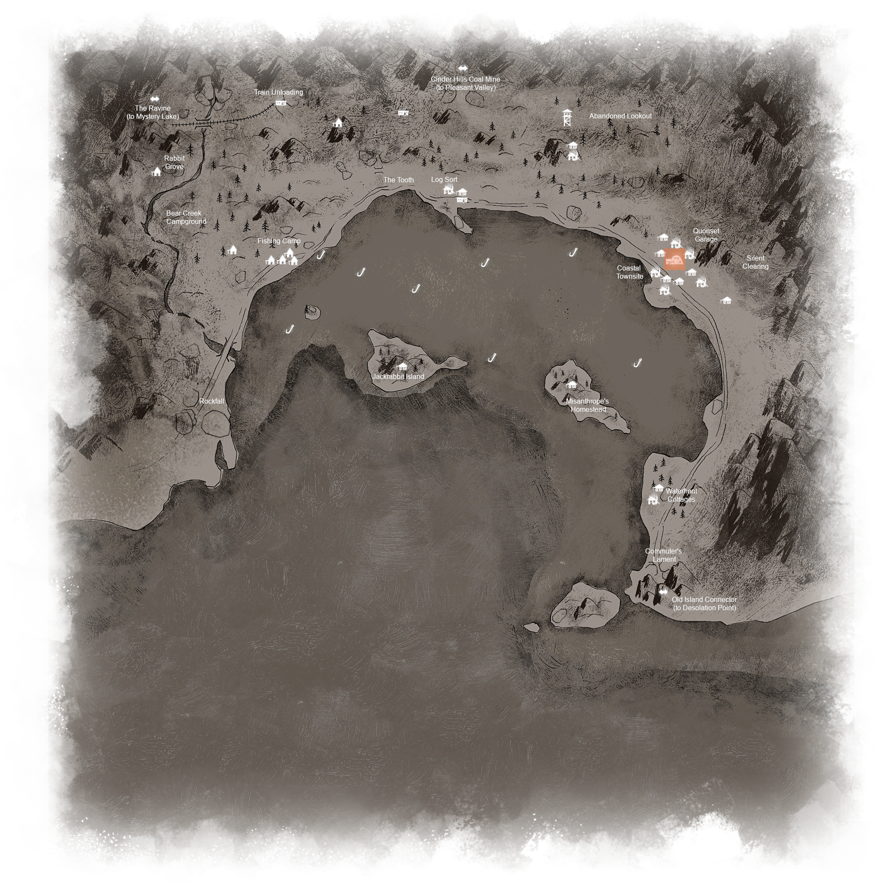

# Quonset Garage

<table class="infobox">
<caption>Quonset Garage</caption>
<colgroup>
<col style="width: 33%" />
<col style="width: 33%" />
<col style="width: 33%" />
</colgroup>
<tbody>
<tr>
<td colspan="2">
[[File:

<table class="gallery">
<colgroup>
<col style="width: 100%" />
</colgroup>
<tbody>
<tr>
<td><figure>
[Missing image: Garage_2019.jpg]
<figcaption>Garage_2019.jpg</figcaption>
</figure></td>
</tr>
</tbody>
</table></td>
<td>
250px]]
</td>
</tr>
<tr>
<td colspan="2">
<strong>Location</strong>
</td>
<td></td>
</tr>
<tr>
<td colspan="2"><figure>

<figcaption>Quonset_Garage_map.png</figcaption>
</figure></td>
<td></td>
</tr>
<tr>
<td>
Region
</td>
<td>
<a href="./Coastal%20Highway.md" class="wikilink" title="Coastal Highway">Coastal Highway</a>|-
</td>
<td>
Location
</td>
</tr>
<tr>
<td>
Description
</td>
<td>
A small automotive garage and store
</td>
<td></td>
</tr>
<tr>
<td colspan="2">
<strong>General</strong>
</td>
<td></td>
</tr>
<tr>
<td>
Type
</td>
<td>
IndustrialStore|-
</td>
<td>
Firebox
</td>
</tr>
<tr>
<td><figure>

<figcaption>bed_icon.png</figcaption>
</figure></td>
<td>
Has a bed
</td>
<td></td>
</tr>
<tr>
<td><figure>

<figcaption>workbench_icon_green.png</figcaption>
</figure></td>
<td>
Has a workbench|-
</td>
<td></td>
</tr>
</tbody>
</table>

