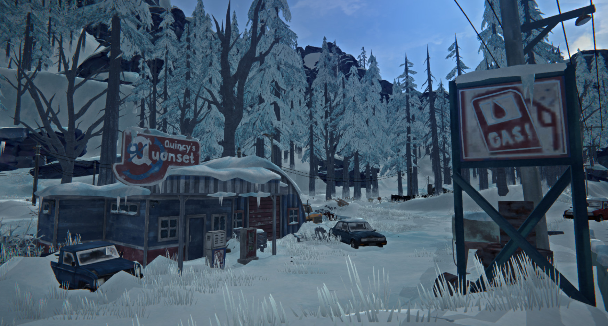
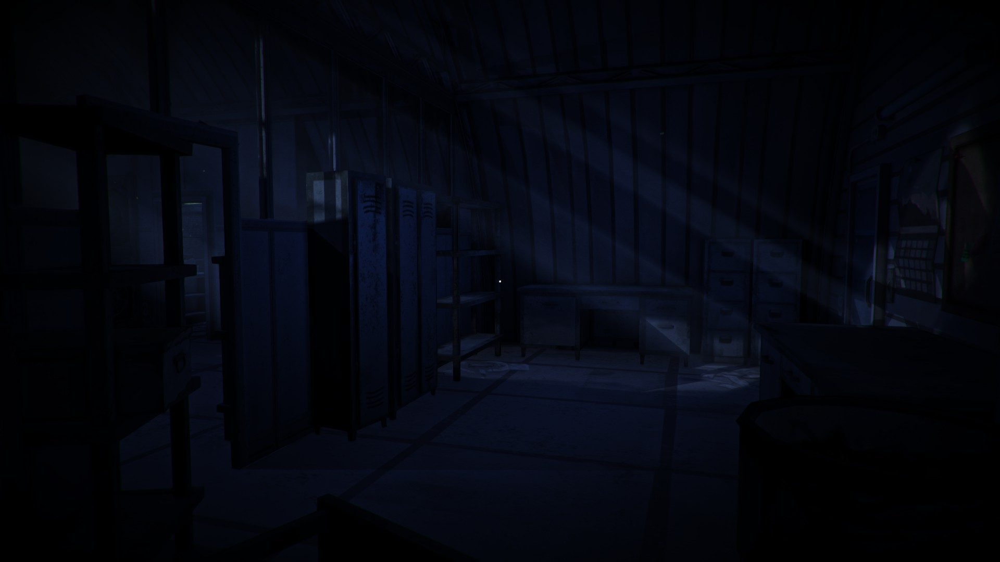
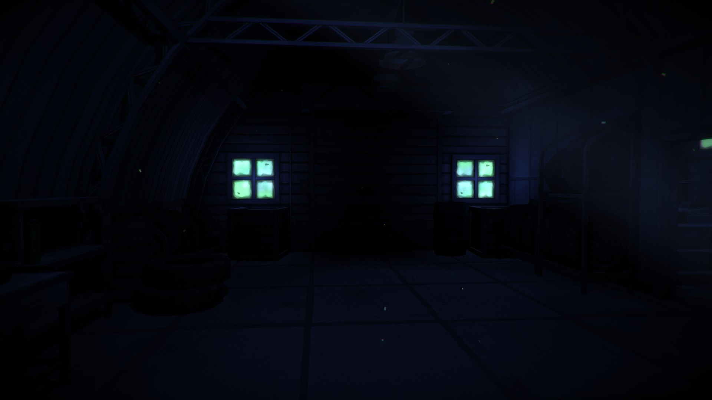
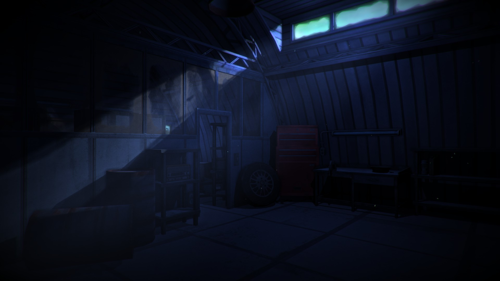
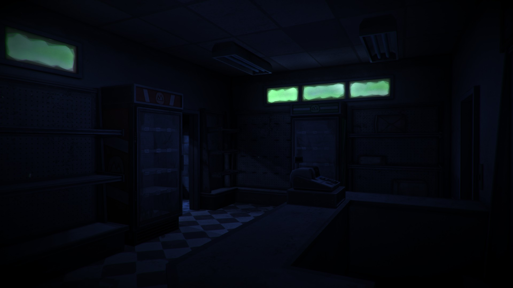
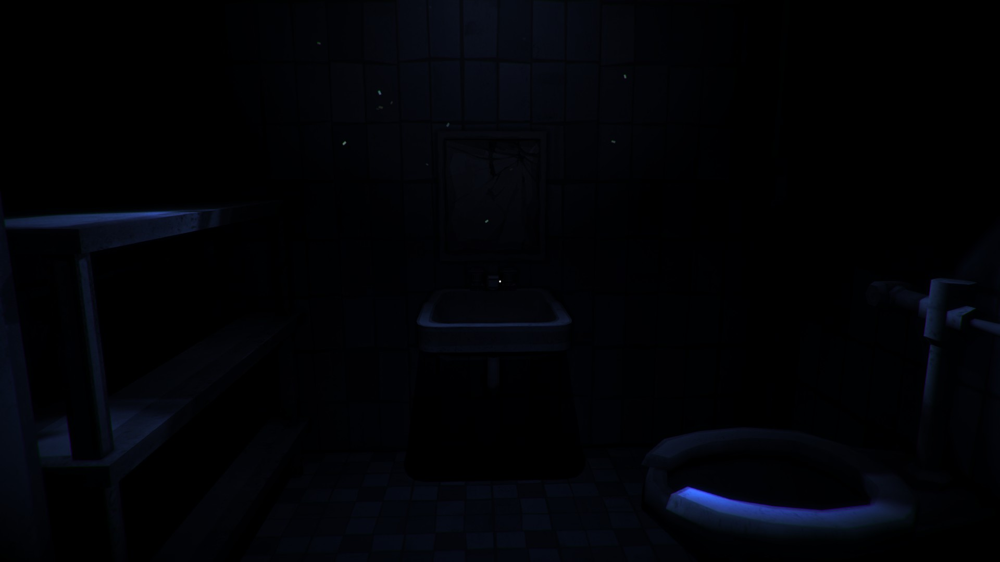
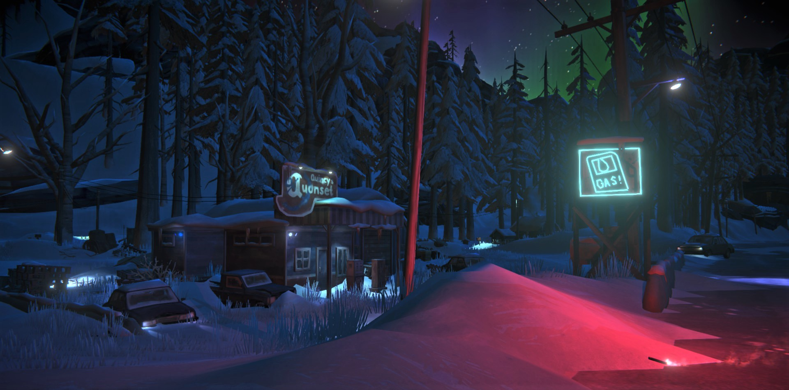
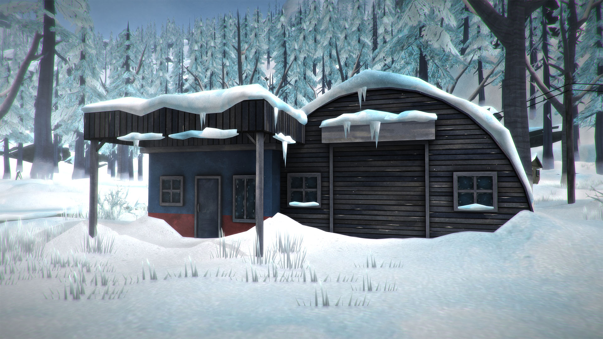

# Quonset Garage

**Categories:** Indoor locations, Industrial locations, Locations, Locations in Coastal Highway, Locations with a workbench, Store locations · **Source:** [Fandom](https://thelongdark.fandom.com/wiki/Quonset_Garage)

**Contents**

- [Overview](#overview)
- [Safehouse](#safehouse)
- [Possible supplies](#possible-supplies)
- [Trivia](#trivia)
- [Gallery](#gallery)

**Quonset Garage**

\[\[File:

250px\]\]

**Location**

Region

[Coastal Highway](./Coastal%20Highway.md)|-

Location

Description

A small automotive garage and store

**General**

Type

IndustrialStore|-

Firebox

Has a bed

Has a workbench|-

## Overview

Quonset Garage is located along the main highway in Coastal Highway. It is one of the best candidates for a safe house in Coastal Highway. Inside there are two crafting benches, 1 fire barrel, and a bed. Lots of storage is available in the garage including 5 lockers (2 in a bathroom, 3 in a room with a bed) and various desks and toolboxes. Notable loots include soda cans and energy bars in the shop area, providing a day or so of food. A toilet provides a fair amount of potable water. A basin can be found on one of the workbenches, but it has a chance of holding [non-potable water](./Water%20%28Unsafe%29.md). Often, many tools will spawn inside, usually hidden in a corner. You may find a [Firestriker](./Firestriker.md) or [Magnifying Lens](./Magnifying%20Lens.md) hidden behind wooden crates. Just a few meters from the main entrance is one of the [Radios](./Trader.md#Radio_Locations) necessary to contact the Trader (if enabled).

A [Basin](./Basin.md) can be found on a [Work Bench](./Work%20Bench.md), the only one of its kind in the game. A [Polaroid](./Polaroids.md) can also be found inside sometimes.

As the garage has two [workbenches](./Work%20Bench.md) and only one can be used at a time, it is often a good idea to [disassemble one](./Safehouse%20Customization.md) and use its [vise](./Workbench%20Vice.md) to build a new workbench in a location that doesn't have one, especially if you plan on turning said location into a [Safehouse](./Safehouse.md).

## Safehouse

The garage has many advantages as a safe house. Inside you will find ample storage space, a fire barrel, two workbenches, and a bed. Its centralized location means many houses are within a quick walk's distance, and provide a good source of cloth, food, and firewood. It should be noted that outside the garage bears, wolves, and moose can sometimes patrol so caution is advised when exiting the building. In Stalker difficulty, this can be a real danger as most of the time a wolf will attack you on sight. If you do not kill some wolves, you will eventually find yourself locked inside the garage with three to four wolves surrounding the building. Once you kill all the wolves in the area, however, the garage is a good safe house as they won't spawn until a few days have gone.

## Possible supplies

- [Prybar](./Prybar.md)
- Food (especially soda)
- [Water (Potable)](./Water%20%28Potable%29.md)
- [Jerry can](./Jerry%20Can.md)
- [Rifle Ammunition](./Rifle%20Ammunition.md) and [Revolver Ammunition](./Revolver%20Ammunition.md)
- [Revolver](./Revolver.md)
- [Bedroll](./Bedroll.md)
- Basic Tools
- [Storm Lantern](./Storm%20Lantern.md)
- Crafting materials
- [Leather](./Cured%20Leather.md)
- [Cloth](./Cloth.md)
- Clothing items
- [Hatchet](./Hatchet.md)
- [Hunting Rifle](./Hunting%20Rifle.md)
- [Firestriker](./Firestriker.md)
- [Flares](./Flare.md)
- [Wood Matches](./Wood%20Matches.md)
- [Cardboard Matches](./Cardboard%20Matches.md)
- Wood
- [Heavy Hammer](./Heavy%20Hammer.md)
- [Hacksaw](./Hacksaw.md)
- [Quality Tools](./Quality%20Tools.md)
- [Whetstone](./Whetstone.md)

## Trivia

- The garage is a starting location for [Whiteout](./Whiteout.md) [Challenge](./Challenge.md).
- During an aurora, the lights on the sign are the only example of a neon sign on the whole island.
- The garage intially didn't have gas pumps outside when first added to the game. Eventually, two were added. Later, one of the gas pumps was changed to an electric charging station.

## Gallery

[es:Taller quonset](https://es.wikipedia.org/wiki/Taller_quonset) [ru:Гараж](https://ru.wikipedia.org/wiki/%D0%93%D0%B0%D1%80%D0%B0%D0%B6)
