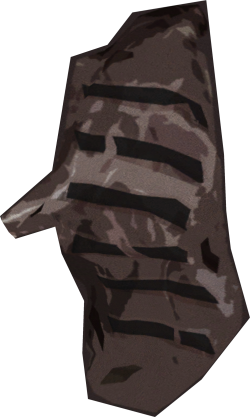

# Rabbit \(Cooked\)

**Categories:** Food And Drink, Pages with update history · **Source:** [Fandom](https://thelongdark.fandom.com/wiki/Rabbit_%28Cooked%29)

**Contents**

- [Overview](#overview)
- [Recipe](#recipe)
- [Gallery](#gallery)
- [Update history](#update-history)

**Rabbit (Cooked)**

**Release:** [30 October 2014](./The%20Long%20Dark%20%E2%80%94%20Changelog.md#0.152)

**Wintermute:** No

**Properties**

**Item type:** [Food And Drink](./Food%20And%20Drink.md)

**Stackable:** No

**Examine:** Cooked flesh from a rabbit.

**Values**

**Calories:** 450 kcal

**Hydration:** -5%

**Weight:** 1.00 kg (2.2 lbs)

**Advanced data**

**Item key:** GAMEPLAY\_RabbitCooked

_For the raw version, see [Rabbit (Raw)](./Rabbit%20%28Raw%29.md)._

**Rabbit Meat (Cooked)** is a cooked food item in _The Long Dark_.

## Overview

Cooked Rabbit Meat is obtained by using a lit [Fire](./Fire.md) and improves the [Cooking](./Cooking.md) skill. Cooking increases its condition by 50%, makes it decay 4 times slower than raw meat, and adds a reduced chance of [Food Poisoning](./Food%20Poisoning.md) over raw meat.

Using a [Cooking Pot](./Cooking%20Pot.md) reduces cooking time by 25%. Cooked food on an active fire for too long will burn it, destroying the item and damaging a Cooking Pot if used.

## Recipe

**Rabbit (Cooked)**

**Requirements**

**Item:** [Rabbit (Raw)](./Rabbit%20%28Raw%29.md)

**Quantity:** 1.00 kg

## Gallery

## Update history

- UPDATE **30 October 2014 ([Update](./The%20Long%20Dark%20%E2%80%94%20Early%20Access%20Changelog.md#0.152)):**
  - Added to game.
