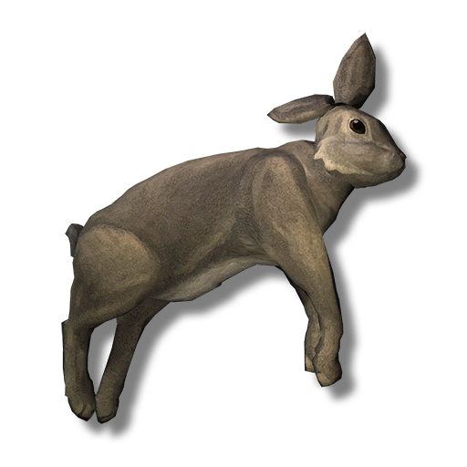
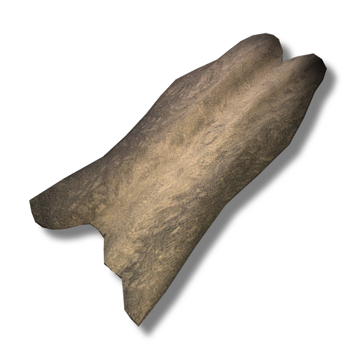

# Rabbit Carcass

<table class="infobox">
<caption>Rabbit Carcass</caption>
<colgroup>
<col style="width: 50%" />
<col style="width: 50%" />
</colgroup>
<tbody>
<tr>
<td colspan="2"><figure>

<figcaption>Rabbit_Carcass_icon.png</figcaption>
</figure></td>
</tr>
<tr>
<td>
Release
</td>
<td>
<a href="./The%20Long%20Dark%20%E2%80%94%20Changelog.md#0.423" class="wikilink" title="8 June 2017">8 June 2017</a>
</td>
</tr>
<tr>
<td>
Renewable
</td>
<td>
Yes
</td>
</tr>
<tr>
<td colspan="2" class="section">
<strong>Properties</strong>
</td>
</tr>
<tr>
<td>
Item type
</td>
<td>
<a href="./Food%20And%20Drink.md" class="wikilink" title="Food And Drink">Food And Drink</a>|-
</td>
</tr>
<tr>
<td>
Stackable
</td>
<td>
No
</td>
</tr>
<tr>
<td>
Examine
</td>
<td>
Unharvested Rabbit carcass. Harvest for usable meat.
</td>
</tr>
<tr>
<td colspan="2" class="section">
<strong>Values</strong>
</td>
</tr>
<tr>
<td>
Weight
</td>
<td>
3.00 kg (6.6 lbs)
</td>
</tr>
<tr>
<td colspan="2" class="section">
<strong>Decay Rate</strong>
</td>
</tr>
<tr>
<td>
Inside
</td>
<td>
10.0% per day
</td>
</tr>
<tr>
<td>
Outside
</td>
<td>
10.0% per day
</td>
</tr>
</tbody>
</table>

## Overview

**Rabbit Carcass** is a carcass obtained from hunting <a href="./Rabbit.md" class="wikilink" title="Rabbits">Rabbits</a>.

Rabbit carcasses can be harvested to obtain raw Rabbit Meat, Rabbit Pelts, and Fresh Gut.

When harvesting, 50% of the weight of the Rabbit carcass is converted into raw rabbit meat.

## Drops

<table>
<colgroup>
<col style="width: 25%" />
<col style="width: 25%" />
<col style="width: 25%" />
<col style="width: 25%" />
</colgroup>
<thead>
<tr>
<th></th>
<th>
Item
</th>
<th>
Quantity
</th>
<th>
Rarity
</th>
</tr>
</thead>
<tbody>
<tr>
<td><figure>

<figcaption>Rabbit_(Raw)_icon.png</figcaption>
</figure></td>
<td>
<a href="./Rabbit%20%28Raw%29.md" class="wikilink" title="Rabbit (Raw)">Rabbit (Raw)</a>
</td>
<td>
1 - 2
</td>
<td>
Always
</td>
</tr>
<tr>
<td><figure>

<figcaption>Fresh_Rabbit_Pelt_icon.png</figcaption>
</figure></td>
<td>
<a href="./Fresh%20Rabbit%20Pelt.md" class="wikilink" title="Fresh Rabbit Pelt">Fresh Rabbit Pelt</a>
</td>
<td>
1
</td>
<td>
Always
</td>
</tr>
<tr>
<td><figure>
[Missing image: Gut_icon.png]
<figcaption>Gut_icon.png</figcaption>
</figure></td>
<td>
<a href="./Fresh%20Gut.md" class="wikilink" title="Fresh Gut">Fresh Gut</a>
</td>
<td>
1
</td>
<td>
Always
</td>
</tr>
</tbody>
</table>

## Update history

- UPDATE **8 June 2017 (<a href="./The%20Long%20Dark%20%E2%80%94%20Early%20Access%20Changelog.md#0.423" class="wikilink" title="Update">Update</a>):**
  - Added to game.

**Lua execution error in Module:Navbox function navbox** <a href="ru:%D0%A2%D1%83%D1%88%D0%B0_%D0%BA%D1%80%D0%BE%D0%BB%D0%B8%D0%BA%D0%B0" class="wikilink" title="ru:Туша кролика">ru:Туша кролика</a>

