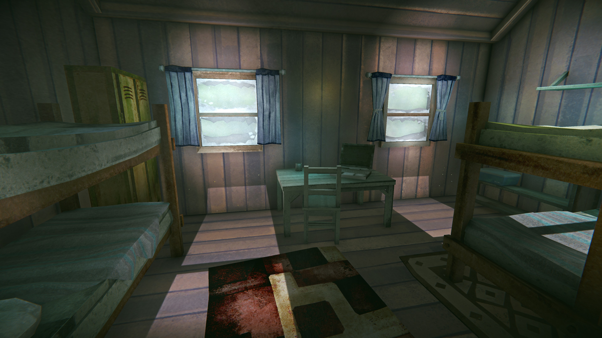
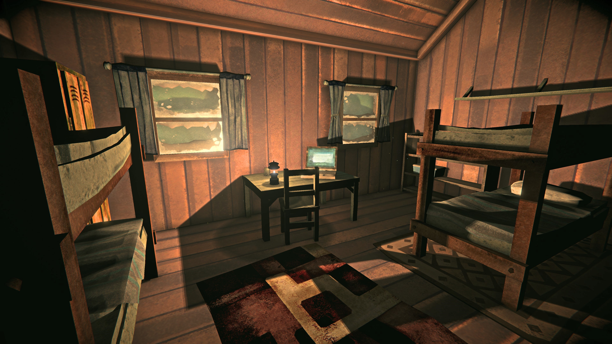

# Rabbit Grove

**Categories:** Indoor locations, Locations, Locations in Coastal Highway · **Source:** [Fandom](https://thelongdark.fandom.com/wiki/Rabbit_Grove)

**Rabbit Grove**

**Location**

Region

[Coastal Highway](./Coastal%20Highway.md)

Location

Across the creek from [Bear Creek Campground](./Bear%20Creek%20Campground.md)

**General**

Type

Has a bed

Has an interior

**Rabbit Grove** is a location in [Coastal Highway](./Coastal%20Highway.md).

## Overview

Rabbit Grove lies just northwest of [Bear Creek Campground](./Bear%20Creek%20Campground.md), on the opposite side of the creek.

Rabbit Grove, as the name suggests, is populated with [rabbits](./Rabbit.md) in and around the area.

[Reishi mushrooms](./Reishi%20Mushroom.md) and [rose hips](./Rose%20Hip.md) can be harvested nearby. A cabin rests above the creek on a hill close by.

_Aurora night PC (It has a [Buffer Memories](./Buffer%20Memories.md) of the Fishing Cabin)_
