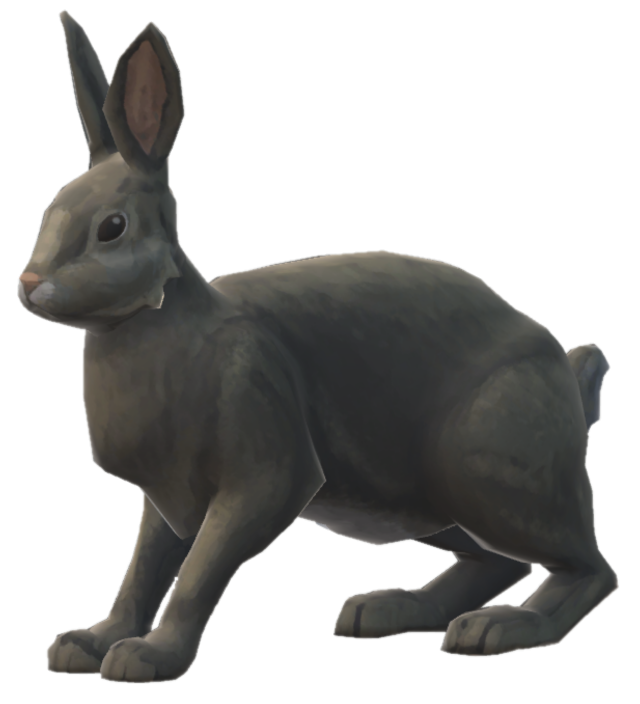

# Rabbit

**Contents**

- [Overview](#Overview)
- [Drops](#Drops)
- [Behaviour](#Behaviour)
- [Rabbit Grove](#Rabbit_Grove)
- [Food for Wolves](#Food_for_Wolves)
- [Wildlife Interaction](#Wildlife_Interaction)
- [Hunting](#Hunting)
- [Strategies](#Strategies)
- [Trivia](#Trivia)
- [Gallery](#Gallery)
- [Update history](#Update_history)

<table class="infobox">
<caption>Rabbit</caption>
<colgroup>
<col style="width: 50%" />
<col style="width: 50%" />
</colgroup>
<tbody>
<tr>
<td colspan="2"><figure>

<figcaption>Rabbit.png</figcaption>
</figure></td>
</tr>
<tr>
<td colspan="2" class="section">
<strong>Basic Information</strong>
</td>
</tr>
<tr>
<td>
Release
</td>
<td>
<a href="./The%20Long%20Dark%20%E2%80%94%20Changelog.md#0.152" class="wikilink" title="30 October 2014">30 October 2014</a>
</td>
</tr>
<tr>
<td>
Role
</td>
<td>
Prey
</td>
</tr>
<tr>
<td colspan="2" class="section">
<strong>Physical Information</strong>
</td>
</tr>
<tr>
<td>
Color
</td>
<td>
Brown
</td>
</tr>
<tr>
<td>
Size
</td>
<td>
Small
</td>
</tr>
<tr>
<td>
Eyes
</td>
<td>
Black
</td>
</tr>
</tbody>
</table>

**Template:quote2** **Rabbits** are small animals found scattered throughout the wilderness, either alone or in groups of two to four. They can be found in all main regions as well as in some transition zones.

## Overview

These skittish animals are easily spotted due to their greyish-brown color and nearly constant movement. They are abundant in all regions and may be caught in <a href="./Snare.md" class="wikilink" title="snares">snares</a>.

Their meat is the same weight as raw venison despite providing just over half the calories per kilogram, making it one of the worst calories per kilogram ratios in the game (though it can be a relatively sustainable food source). Rabbits provide 0.75 to 1.5 kg of <a href="./Rabbit%20%28Raw%29.md" class="wikilink" title="meat">meat</a>, one <a href="./Fresh%20Rabbit%20Pelt.md" class="wikilink" title="pelt">pelt</a>, and one <a href="./Fresh%20Gut.md" class="wikilink" title="gut">gut</a> when harvested. Their pelts may be crafted into warm <a href="./Rabbitskin%20Mitts.md" class="wikilink" title="Rabbitskin Mitts">Rabbitskin Mitts</a> or <a href="./Rabbitskin%20Hat.md" class="wikilink" title="Rabbitskin Hat">Rabbitskin Hat</a> at a work bench. <a href="./Wolf.md" class="wikilink" title="Wolves">Wolves</a> frequently hunt rabbits.

## Drops

When killed, a <a href="./Rabbit%20Carcass.md" class="wikilink" title="Rabbit Carcass">Rabbit Carcass</a> can be butchered on the spot or carried whole, similar to a <a href="./Ptarmigan%20Carcass.md" class="wikilink" title="Ptarmigan Carcass">Ptarmigan Carcass</a>.

<table>
<colgroup>
<col style="width: 25%" />
<col style="width: 25%" />
<col style="width: 25%" />
<col style="width: 25%" />
</colgroup>
<thead>
<tr>
<th></th>
<th>
Item
</th>
<th>
Quantity
</th>
<th>
Rarity
</th>
</tr>
</thead>
<tbody>
<tr>
<td><figure>

<figcaption>Rabbit_(Raw)_icon.png</figcaption>
</figure></td>
<td>
<a href="./Rabbit%20%28Raw%29.md" class="wikilink" title="Rabbit (Raw)">Rabbit (Raw)</a>
</td>
<td>
1 - 2
</td>
<td>
Always<a href="#fn1" class="footnote-ref" id="fnref1" role="doc-noteref">1</a>
</td>
</tr>
<tr>
<td><figure>

<figcaption>Fresh_Rabbit_Pelt_icon.png</figcaption>
</figure></td>
<td>
<a href="./Fresh%20Rabbit%20Pelt.md" class="wikilink" title="Fresh Rabbit Pelt">Fresh Rabbit Pelt</a>
</td>
<td>
1
</td>
<td>
Always
</td>
</tr>
<tr>
<td><figure>
[Missing image: Gut_icon.png]
<figcaption>Gut_icon.png</figcaption>
</figure></td>
<td>
<a href="./Fresh%20Gut.md" class="wikilink" title="Fresh Gut">Fresh Gut</a>
</td>
<td>
1
</td>
<td>
Always
</td>
</tr>
<tr>
<td></td>
<td></td>
<td></td>
<td></td>
</tr>
</tbody>
</table>
<section id="footnotes" class="footnotes footnotes-end-of-document" role="doc-endnotes">

<ol>
<li id="fn1">If carcass is harvested<a href="#fnref1" class="footnote-back" role="doc-backlink">↩︎</a></li>
</ol>
</section>

## Behaviour

Rabbits have two behaviours: roaming and fleeing. A Rabbit's natural behavior is to simply wander aimlessly about in the wilderness in fixed locations called Rabbit Groves. While roaming, they will occasionally stop and listen for predators while occasionally cleaning their ears, or sprint away if they detect a threat. Rabbits that run away from their Rabbit Grove will always wander back to it after a short time.

Rabbits are completely silent aside from their very faint footsteps, simply running away if they detect a thrown Stone, Firearm report, or the player when they get too close. They do however let out various a cries under certain circumstances. They will cry in pain if they are stunned by a thrown Stone, or will give out a death cry if killed by a projectile, or by a Wolf. They also let a high-pitched screech of fear when a wolf/bear gets close to them, and will instantly run away to safety, often much farther from their designated Rabbit Grove than if the player startles them.

### Rabbit Grove

Rabbit Groves are fixed spawn locations for Rabbits and display their own special icon on the <a href="./Map.md" class="wikilink" title="Map">Map</a> once surveyed with <a href="./Charcoal.md" class="wikilink" title="Charcoal">Charcoal</a>. Snares placed here will always yield a Rabbit Carcass if given enough time and checked regularly. Rabbits roam around Rabbit Groves in groups of 1-4, except during Blizzards and Auroras. Rabbits can occasionally be found in areas not labeled with a Rabbit Grove, and Snares will not work here.

### Food for Wolves

If a <a href="./Wolf.md" class="wikilink" title="Wolf">Wolf</a>/<a href="./Timberwolf.md" class="wikilink" title="Timberwolf">Timberwolf</a>/<a href="./Poisoned%20Wolf.md" class="wikilink" title="Poisoned Wolf">Poisoned Wolf</a> detects a Rabbit, it will pursue the rabbit for a time before eventually outrunning it, killing, and then eating it. Once a wolf has killed a rabbit, it will rapidly consume the carcass, depleting its resources. When the wolf has fully depleted the rabbit's resources, it will wander off. Before this point, a wolf may be frightened from the carcass [through typical means](https://thelongdark.fandom.com/wiki/Wolf#Interaction), and the rabbit carcass may be retrieved.

Timberwolves still part of a wolf pack that kill a rabbit and spot the player will instantly engage the player, leaving the carcass behind.

## Wildlife Interaction

Rabbits have minimal interaction with other animals, besides being eaten by wolves and being scared off by the player.

- Other Rabbits will generally stay close to one another, but will run away if another Rabbit is startled/attacked. They can both squeal in terror if scared.
- <a href="./Wolf.md" class="wikilink" title="Wolf">Wolf</a>, <a href="./Timberwolf.md" class="wikilink" title="Timberwolf">Timberwolf</a>, <a href="./Poisoned%20Wolf.md" class="wikilink" title="Poisoned Wolf">Poisoned Wolf</a> will stalk and eat a Rabbit if they get the chance. Rabbits always let out a high pitched squeal and run away from a Wolf.
- <a href="./Bear.md" class="wikilink" title="Bear">Bear</a>, <a href="./Moose.md" class="wikilink" title="Moose">Moose</a>, and <a href="./Cougar.md" class="wikilink" title="Cougar">Cougar</a>, will not attack a Rabbit, but Rabbits still run away squealing in terror when close to one.
- <a href="./Deer.md" class="wikilink" title="Deer">Deer</a> will ignore Rabbits, and vice versa. If a Deer is startled, Rabbits silently run away from the area.
- <a href="./Ptarmigan.md" class="wikilink" title="Ptarmigan">Ptarmigan</a> will ignore a Rabbit, and vice versa for the most part. If a Rabbit is startled by another animal and runs past a Ptarmigan, the Ptarmigan will run and fly away.
- <a href="./Escape%20the%20Darkwalker.md" class="wikilink" title="Darkwalker">Darkwalker</a>: Rabbits will run and squeal in fear if the Darkwalker gets too close to them. <a href="./Toxic%20Fog.md" class="wikilink" title="Toxic Fog">Toxic Fog</a> will eventually kill all animals if it builds up enough.
- The Player: Rabbits quietly run away from the player without squealing. If a rabbit is stunned by a thrown <a href="./Stone.md" class="wikilink" title="Stone">Stone</a>, the player can quickly pick up the rabbit and must choose to either kill it by breaking its neck or to release it
  - If the player kills the rabbit, they will struggle in fear as their neck is broken.
  - If they are released, the survivor will pat the confused Rabbit on the head before placing it on the ground. The Rabbit will then run away before returning to their designated area.
  - Rabbits will also be caught in and killed by snares set by the player in rabbit-dense areas, as long as the snare has not been destroyed by predators or poor weather conditions, in which they just spawn dead.

## Hunting

\[Missing image: Caught_Rabbit.png\] A dead rabbit, caught in a snare. Due to their small size and quick movement, precision is required to <a href="./Hunting.md" class="wikilink" title="hunt">hunt</a> rabbits. A single hit with a <a href="./Simple%20Arrow.md" class="wikilink" title="Simple Arrow">Simple Arrow</a>, <a href="./Fire%20Hardened%20Arrow.md" class="wikilink" title="Fire Hardened Arrow">Fire Hardened Arrow</a>, <a href="./Rifle%20Ammunition.md" class="wikilink" title="Rifle Ammunition">Rifle Ammunition</a> round, or <a href="./Revolver%20Ammunition.md" class="wikilink" title="Revolver Ammunition">Revolver Ammunition</a> round will instantly kill a rabbit, whereas a <a href="./Stone.md" class="wikilink" title="Stone">Stone</a> will stun it for 5 seconds. Once stunned, the Rabbit can be collected to either release the animal or kill it; killing the rabbit will provide its harvestable carcass as an item in the inventory.

<a href="./Trapping.md" class="wikilink" title="Trapping">Trapping</a> with crafted <a href="./Snare.md" class="wikilink" title="snares">snares</a> is a passive way to hunt rabbits. To use a snare, it must be placed (not merely dropped) inside of a Rabbit Grove. Rabbits may still be captured by a placed snare in a grove, even if no rabbits are currently spawned. Deployed snares in a grove may catch a rabbit, fail to catch, or even become ruined. Rabbit carcasses caught by snares will decay over time, disappearing when they reach 0% condition.

### Strategies

- Rabbits are easily and efficiently caught with traps. See: <a href="./Trapping.md" class="wikilink" title="Trapping">Trapping</a>.
- Using the <a href="./Stone.md" class="wikilink" title="stone">stones</a> scattered around the area is an immediate and effective way of hunting rabbits. Throwing a stone and hitting a rabbit will briefly stun it, allowing a chance to catch and kill the rabbit. If not caught 5 seconds after being stunned, the rabbit will recover and flee. Stones follow an arcing trajectory, which begins just above the survivor's thumb in aim mode.
- Crouching or approaching from behind is effective at closing the distance on a rabbit. However, they cannot be picked up this way, and must be stunned first.
- Shooting rabbits with firearms or Simple Arrows is possible but not recommended, as they are small and skittish targets. Even if a round lands, it will have spent a bullet or ~25% condition on an arrow. These are finite, precious resources, whereas stones are plentiful and durable. An alternative method is to use <a href="./Fire%20Hardened%20Arrow.md" class="wikilink" title="Fire Hardened Arrows">Fire Hardened Arrows</a> since they are designed to be expendable but easily replaceable, and can be fired from father distances than stones.
- Rabbits can be herded toward <a href="./Wolf.md" class="wikilink" title="wolves">wolves</a>, who will quickly kill them. Once a wolf kills the rabbit, the wolf can be frightened from its kill, allowing the carcass to be retrieved. Thrown stones, torches, or flares are effective at scaring off wolves.
- Rabbits and Deer can be flushed by intentionally scaring them in a direction, which can be used to distract wolves (e.g. bypassing a wolf blocking the way, or checking to see if a wolf is in an area).
- When sprinting, the survivor runs faster than a rabbit (provided the survivor is not over-encumbered).

## Trivia

- Rabbits appear to be based off the [Cottontailed Rabbit](https://en.wikipedia.org/wiki/Cottontail_rabbit) (***Lepus sylvaticus***), a species of Lagamorphia found throughout North and Central America.

## Gallery

<table class="gallery">
<colgroup>
<col style="width: 50%" />
<col style="width: 50%" />
</colgroup>
<tbody>
<tr>
<td><figure>
[Missing image: Rabbit.jpg]
<figcaption>Old model of rabbit</figcaption>
</figure></td>
<td><figure>
[Missing image: Steam_Rabbit_Badge.png]
<figcaption>Steam Badge</figcaption>
</figure></td>
</tr>
</tbody>
</table>

## Update history

- HOTFIX **10 December 2020 (<a href="./The%20Long%20Dark%20%E2%80%94%20Changelog.md#1.90" class="wikilink" title="Update">Update</a>):**
  - \[Enviro\] Rabbits will no longer climb on the broken fishing hut, in the Main Menu.

<!-- -->

- HOTFIX **22 January 2020 (<a href="./The%20Long%20Dark%20%E2%80%94%20Changelog.md#1.72" class="wikilink" title="Update">Update</a>):**
  - \[General\] Fixed a crash that could occur if a Stag or Rabbit was removed from the world, while being chased by a Predator.

<!-- -->

- HOTFIX **27 May 2019 (<a href="./The%20Long%20Dark%20%E2%80%94%20Changelog.md#1.52" class="wikilink" title="Update">Update</a>):**
  - \[All\] Fixed rare issue that would cause players to become stuck if grabbing a Rabbit while holding a gear item from their Backpack.

<!-- -->

- UPDATE **17 December 2018 (<a href="./The%20Long%20Dark%20%E2%80%94%20Changelog.md#1.41" class="wikilink" title="Update">Update</a>):**
  - \[All\] Improved aiming mechanics for thrown Stones, to make Rabbit Hunting a bit easier.
  - \[All\] Fixed condition that could result in the the player becoming stuck when picking up a stunned Rabbit

<!-- -->

- UPDATE **14 June 2018 (<a href="./The%20Long%20Dark%20%E2%80%94%20Changelog.md#1.33" class="wikilink" title="Update">Update</a>):**
  - \[All\] Disabled Radial Menu while holding a stunned Rabbit.

<!-- -->

- HOTFIX **2 August 2017 (<a href="./The%20Long%20Dark%20%E2%80%94%20Changelog.md#1.01" class="wikilink" title="Update">Update</a>):**
  - Fixed locked controls when throwing a stone and picking up a rabbit at the same time

<!-- -->

- UPDATE **2 August 2017 (<a href="./The%20Long%20Dark%20%E2%80%94%20Early%20Access%20Changelog.md#0.321" class="wikilink" title="Update">Update</a>):**
  - Fixed issue with being able to place snares too close to geometry, causing the snared rabbit to be inaccessible

<!-- -->

- HOTFIX **16 October 2015 (<a href="./The%20Long%20Dark%20%E2%80%94%20Early%20Access%20Changelog.md#0.280" class="wikilink" title="Update">Update</a>):**
  - Fixed issue with being able to instantly catch Rabbits in a Snare.

<!-- -->

- HOTFIX **27 May 2015 (<a href="./The%20Long%20Dark%20%E2%80%94%20Early%20Access%20Changelog.md#0.236" class="wikilink" title="Update">Update</a>):**
  - Fixed a bug with tripped rabbit snares refreshing to empty each day.

<!-- -->

- HOTFIX **7 April 2015 (<a href="./The%20Long%20Dark%20%E2%80%94%20Early%20Access%20Changelog.md#0.217" class="wikilink" title="Update">Update</a>):**
  - Fixed problem with snares not catching rabbits as expected.

<!-- -->

- UPDATE **27 November 2014 (<a href="./The%20Long%20Dark%20%E2%80%94%20Early%20Access%20Changelog.md#0.163" class="wikilink" title="Update">Update</a>):**
  - Snares that catch Rabbits can now be re-used.

<!-- -->

- HOTFIX **31 October 2014 (<a href="./The%20Long%20Dark%20%E2%80%94%20Early%20Access%20Changelog.md#0.154" class="wikilink" title="Update">Update</a>):**
  - Fixed issue where Rabbits would follow the player. (Bug or feature?)

<!-- -->

- UPDATE **30 October 2014 (<a href="./The%20Long%20Dark%20%E2%80%94%20Early%20Access%20Changelog.md#0.152" class="wikilink" title="Update">Update</a>):**
  - All wildlife spawns are now more dynamic, and will change over the course of a game. Wolves, Deer, and Rabbits all refresh on different intervals, reflecting their relative mobility and travel/migration patterns.
  - You can now craft Snares at the Workbench. If placed in the world wherever you see Rabbits, there is a chance you will capture a Rabbit every 12 hours.
  - There are now Rabbits in the game.

**Lua execution error in Module:Navbox function navbox** <a href="es:Conejo" class="wikilink" title="es:Conejo">es:Conejo</a> <a href="ru:%D0%9A%D1%80%D0%BE%D0%BB%D0%B8%D0%BA" class="wikilink" title="ru:Кролик">ru:Кролик</a>

## Notes

