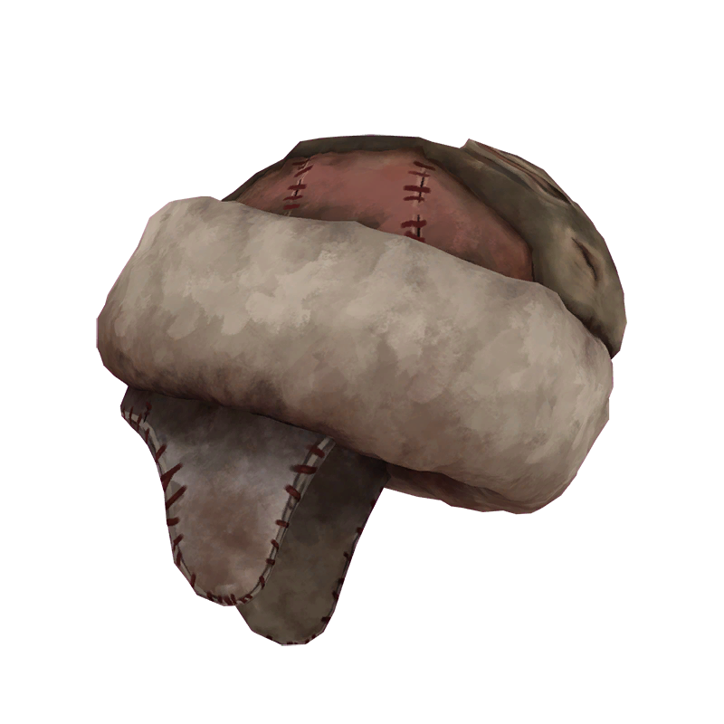
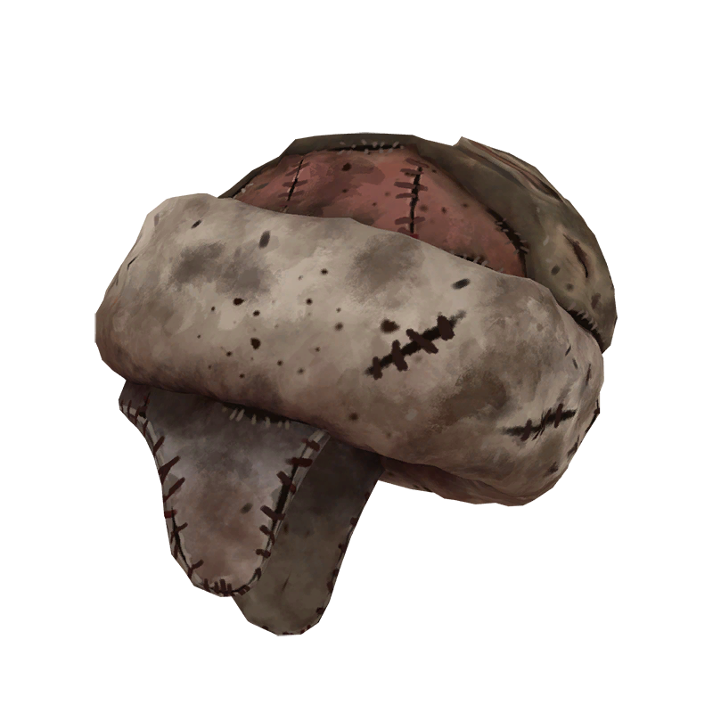

# Rabbitskin Hat

**Categories:** Clothing, Craftable clothing, Pages with update history, Story items · **Source:** [Fandom](https://thelongdark.fandom.com/wiki/Rabbitskin_Hat)

**Contents**

- [Overview](#overview)
- [Locations](#locations)
- [Crafting](#crafting)
- [Gallery](#gallery)
- [Update history](#update-history)

**Rabbitskin Hat**

[Rabbitskin Hat icon](../assets/Rabbitskin_Hat_icon.png)

**General**

**Item Type:** Clothing

**Statistics**

**Weight:** [Weight icon](../assets/Weight_icon.png)0.35 kg(0.77 lbs)

**Warmth bonus:** [Temp icon](../assets/Temp_icon.png)2.0 °C(3.6 °F)

**Windproof bonus:** [Windproofness icon](../assets/Windproofness_icon.png)1.5 °C(2.7 °F)

**Waterproof bonus:** [Waterproofness icon](../assets/Waterproofness_icon.png)30%

**Protection:** [Protection icon](../assets/Protection_icon.png)4%

**Mobility:** [Mobility icon](../assets/Mobility_icon.png)0%

**Harvest:** 1 × [Cured Rabbit Pelt](./Cured%20Rabbit%20Pelt.md) 10 minutes

**Repair:** 1 × [Cured Rabbit Pelt](./Cured%20Rabbit%20Pelt.md), 1 × [Cured Gut](./Cured%20Gut.md) 30 minutes 50% condition

> “**A warm hat made from rabbit fur.**”
>
> — In-game description

The **Rabbitskin Hat** is a type of craftable headgear in _[The Long Dark](./The%20Long%20Dark.md)_.

## Overview

The Rabbitskin hat is crafted using [Cured Rabbit Pelt](./Cured%20Rabbit%20Pelt.md).

Only 1 Rabbitskin Hat can be worn at a time, specifically in the outer head slot.

It is the third warmest outer hat (tied with the [Wool Toque](./Wool%20Toque.md), [Balaclava](./Balaclava.md), and [Technical Balaclava](./Technical%20Balaclava.md)) with the [Cougar Hide Wrap](./Cougar%20Hide%20Wrap.md) being the warmest and the [Wolfskin Hat](./Wolfskin%20Hat.md) being the second warmest, but both are slightly heavier.

Being one of the heaviest headgear also makes it the third lowest weight-to-warmth ratio, behind [Cotton scarf](./Cotton%20Scarf.md) and even [Baseball cap](./Baseball%20Cap.md). However, the outer hat slot (left) is only one of six clothing slots which affects [windproofing](./Clothing.md). Although it beats the [Wool Toque](./Wool%20Toque.md) in stats, the Rabbitskin Hat is harder to repair, but also renewable.

## Locations

Has a chance to spawn in a [Hidden Cache](./Hidden%20Cache.md) located under the collapsed [Mule Bridge](./Mule%20Bridge.md) in the [Blackrock](./Blackrock.md) region, and possibly in other Hidden Caches in the region.

Has a chance to spawn in [Barn (Molly's)](./Barn%20%28Molly%27s%29.md) in [Pleasant Valley](./Pleasant%20Valley.md), up in the hidden loft, even on Interloper difficulty.

Has a chance to spawn in a cache in the [Ice Caves](./Ice%20Cave.md) of [Hushed River Valley](./Hushed%20River%20Valley.md), including on Interloper.

## Crafting

**Rabbitskin Hat**

340 minutes (5 hour 40 minutes)

[Cured Gut](./Cured%20Gut.md)

1

**Requirements**

**Item:** [Cured Rabbit Pelt](./Cured%20Rabbit%20Pelt.md)

**Quantity:** 3

## Gallery

## Update history

- UPDATE **17 December 2018 ([Update](./The%20Long%20Dark%20%E2%80%94%20Changelog%20%E2%80%94%20Archive%201.md#1.41)):**
  - Added to game
