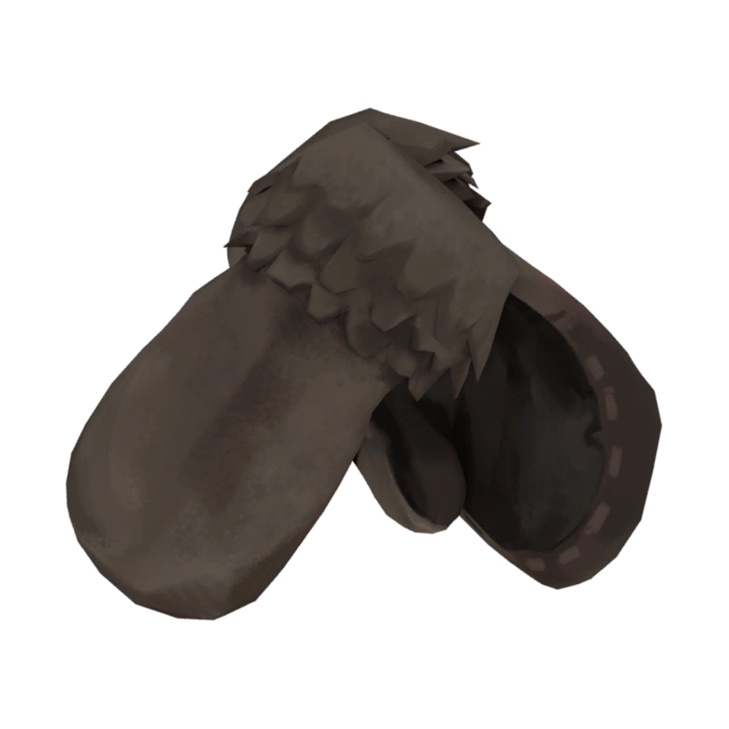
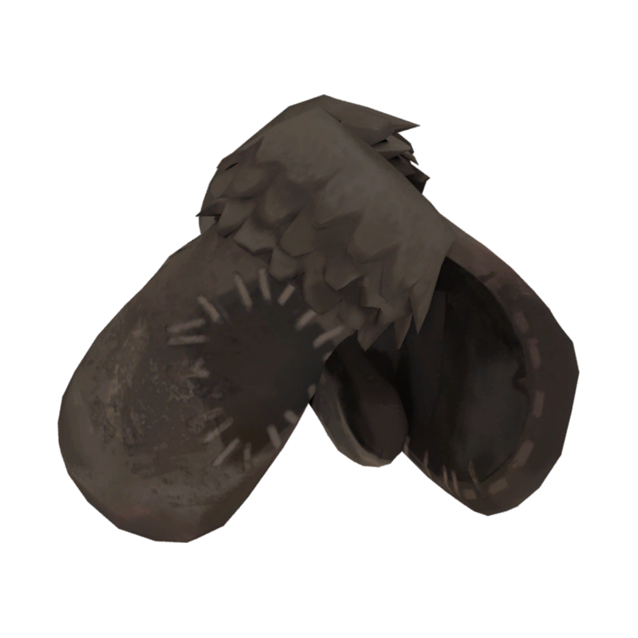

# Rabbitskin Mitts

**Categories:** Clothing, Craftable clothing, Pages with update history, Story items · **Source:** [Fandom](https://thelongdark.fandom.com/wiki/Rabbitskin_Mitts)

**Contents**

- [Overview](#overview)
- [Location](#location)
- [Crafting](#crafting)
- [Gallery](#gallery)
- [Update history](#update-history)

**Rabbitskin Mitts**

| Property | Details |
| --- | --- |
|  | [Rabbitskin Mitts icon](../assets/Rabbitskin_Mitts_icon.png) |
| **General** |  |
| Item Type | Clothing |
| Wintermute | Yes |
| Clothing Slot | Hands |
| **Statistics** |  |
| Weight | [Weight icon](../assets/Weight_icon.png)1.00 kg(2.2 lbs) |
| Warmth bonus | [Temp icon](../assets/Temp_icon.png)2.0 °C(3.6 °F) |
| Windproof bonus | [Windproofness icon](../assets/Windproofness_icon.png)2.0 °C(3.6 °F) |
| Waterproof bonus | [Waterproofness icon](../assets/Waterproofness_icon.png)50% |
| Protection | [Protection icon](../assets/Protection_icon.png)3% |
| Mobility | [Mobility icon](../assets/Mobility_icon.png)-5% |
| Harvest | 1 × [Cured Rabbit Pelt](./Cured%20Rabbit%20Pelt.md) / 10 minutes |
| Repair | 1 × [Cured Rabbit Pelt](./Cured%20Rabbit%20Pelt.md), / 1 × [Cured Gut](./Cured%20Gut.md) / 30 minutes / 30% condition |

> “**Handcrafted mitts. They may make you clumsy, but they're very warm. Kind of like wearing a rabbit on your hands.**”
>
> — In-game description

**Rabbitskin Mitts** are a type of craftable gloves in _[The Long Dark](./The%20Long%20Dark.md)_.

## Overview

Rabbitskin Mitts are very warm and windproof crafted gloves. They can be manufactured by killing rabbits, by using thrown [stones](./Stone.md) to stun them, or [snares](./Snare.md) to capture them the next day.

They are significantly warmer and more durable than most other gloves, only competed with by the [Gauntlets](./Gauntlets.md), which provide similar warmth-to-weight, with higher protection and better mobility. However, mitts are more durable, waterproof, and can be repaired more sustainably.

In [Wintermute](./Wintermute.md), their blueprint is unlocked by snaring a rabbit in [The Basics of Survival](./The%20Basics%20of%20Survival.md) quest.

## Location

As of the [TFTFT part 4 update](./Tales%20from%20the%20Far%20Territory.md), a pair of Rabbitskin mittens may spawn in the control room in the [Concentrator](./Concentrator.md), near the [Miner's Flashlight](./Miner%27s%20Flashlight.md).

## Crafting

**Rabbitskin Mitts**

480 minutes (8 hour 0 minutes)

[Cured Gut](./Cured%20Gut.md)

2

**Requirements**

**Item:** [Cured Rabbit Pelt](./Cured%20Rabbit%20Pelt.md)

**Quantity:** 4

## Gallery

## Update history

- UPDATE **17 December 2014 ([Update](./The%20Long%20Dark%20%E2%80%94%20Early%20Access%20Changelog.md#0.181)):**
  - Added to game
