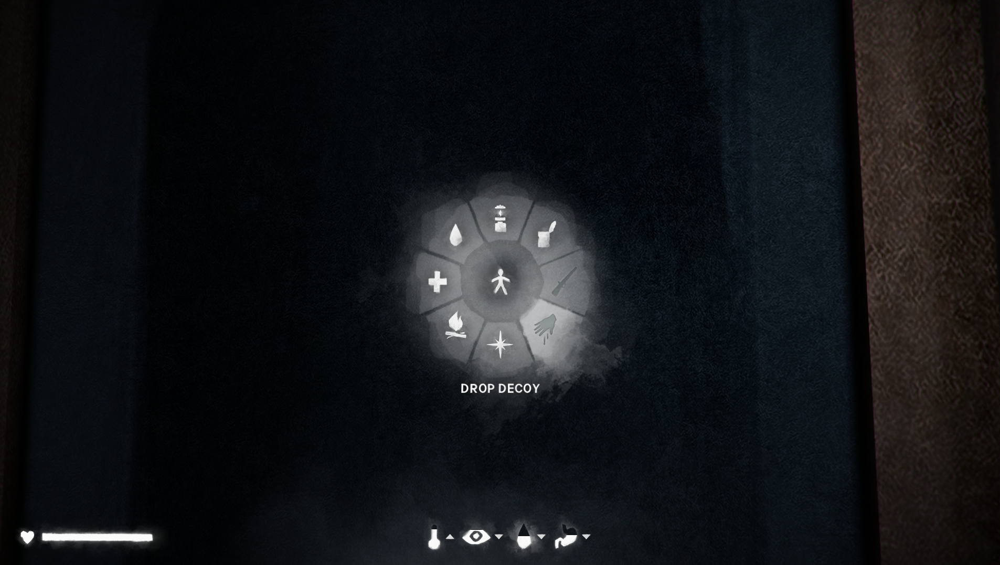

# Radial Menu

**Contents**

- [Overview](#Overview)
- [Hot Keys](#Hot_Keys)
- [Light Sources](#Light_Sources)
- [Weapons](#Weapons)
- [Drop Decoys](#Drop_Decoys)
- [Navigation](#Navigation)
- [Campcraft](#Campcraft)

<figure class="thumb">

</figure>

## Overview

The **Radial Menu** is a feature added in the Tireless Menace Update and was redesigned in the Faithful Cartographer update. Its function is to be a quick, alternative way to select items in your inventory, without having to open the Backpack and manually search for them. With the standard keyboard bindings on PC, the Radial Menu is opened by holding *SPACE*. Most items that cannot be used to interact with the game world will not appear in the Radial Menu.

From the top, then rotating clockwise, the menu is sorted into the following categories:

- Light Sources
- Food
- Weapons
- Drop Decoys
- Navigation
- Campcraft
- First Aid
- Drinks
- Open Status Menu (center option)

If a player has too many Weapons, Light Sources, Food, Drinks, and First Aid items, they can sometimes not appear in the wheel menus, as there is only room for 8 items at a time. They can be manually added to the menus by opening the Backpack, clicking on the item, and selecting "Add to Radial." Any item selected in the Radial Menu that can be taken from the Backpack can either be consumed, equipped, or placed in the game world.

## Hot Keys

By default, the PC keys 1, 2, 3, and 4 can be used to bypass having to manually select items from the Radial Menu.

- 1 cycles through held Light Sources
- 2 cycles through held Weapons
- 3 drops 1 piece of cooked or raw meat/1 <a href="./Fresh%20Gut.md" class="wikilink" title="Fresh Gut">Fresh Gut</a> in the player's inventory onto the ground (<a href="./Scent.md#Baiting%2FDecoys" class="wikilink" title="Drop Decoys">Drop Decoys</a>)
- 4 creates a Campfire
- F accesses the Status menu
- M accesses the Map

## Light Sources

The Light Sources wheel provides quick access to the following items:

- <a href="./Cardboard%20Matches.md" class="wikilink" title="Cardboard Matches">Cardboard Matches</a>
- <a href="./Flare.md" class="wikilink" title="Flare">Flare</a>
- <a href="./Flashlight.md" class="wikilink" title="Flashlight">Flashlight</a>
- <a href="./Marine%20Flare.md" class="wikilink" title="Marine Flare">Marine Flare</a>
- <a href="./Miner%27s%20Flashlight.md" class="wikilink" title="Miner&#39;s Flashlight">Miner's Flashlight</a>
- <a href="./Spelunker%27s%20Lantern.md" class="wikilink" title="Spelunker&#39;s Lantern">Spelunker's Lantern</a>
- <a href="./Storm%20Lantern.md" class="wikilink" title="Storm Lantern">Storm Lantern</a>
- <a href="./Torch.md" class="wikilink" title="Torch">Torch</a>
- <a href="./Wood%20Matches.md" class="wikilink" title="Wood Matches">Wood Matches</a>

Generally, Light Sources in the player's inventory selected with the 1 key will cycle in the following order: Miner's Flashlight, Flashlight, Flare, Marine Flare, Storm Lantern, Spelunker's Lantern, Torch, Matches.

## Weapons

The Weapon wheel provides quick access to the following items:

- <a href="./Bear%20Spear.md" class="wikilink" title="Bear Spear">Bear Spear</a>
- <a href="./Distress%20Pistol.md" class="wikilink" title="Distress Pistol">Distress Pistol</a>
- <a href="./Revolver.md" class="wikilink" title="Revolver">Revolver</a> (<a href="./Forester%27s%20Revolver.md" class="wikilink" title="Forester&#39;s Revolver">Forester's Revolver</a>, <a href="./Hunter%27s%20Revolver.md" class="wikilink" title="Hunter&#39;s Revolver">Hunter's Revolver</a>, <a href="./Warden%27s%20Revolver.md" class="wikilink" title="Warden&#39;s Revolver">Warden's Revolver</a>)
- <a href="./Hunting%20Rifle.md" class="wikilink" title="Hunting Rifle">Hunting Rifle</a> (<a href="./Vaughn%27s%20Rifle.md" class="wikilink" title="Vaughn&#39;s Rifle">Vaughn's Rifle</a>, <a href="./Curator%27s%20Rifle.md" class="wikilink" title="Curator&#39;s Rifle">Curator's Rifle</a>, <a href="./Barb%27s%20Rifle.md" class="wikilink" title="Barb&#39;s Rifle">Barb's Rifle</a>)
- <a href="./Survival%20Bow.md" class="wikilink" title="Survival Bow">Survival Bow</a> (<a href="./Woodwright%27s%20Bow.md" class="wikilink" title="Woodwright&#39;s Bow">Woodwright's Bow</a>, <a href="./Sport%20Bow.md" class="wikilink" title="Sport Bow">Sport Bow</a>)
- <a href="./Noisemaker.md" class="wikilink" title="Noisemaker">Noisemaker</a>
- <a href="./Stone.md" class="wikilink" title="Stone">Stone</a>

Generally, weapons in the player's inventory selected with the 2 key will cycle in the following order: Hunter's Revolver, Revolver, Warden's Revolver, Forester's Revolver, Barb's Rifle, Vaughn's Rifle, Curator's Rifle, Hunting Rifle, Survival Bow, Sport Bow, Woodwright's Bow, Distress Pistol, Stone, Noisemaker.

## Drop Decoys

Drop Decoys will access any raw or cooked meat in the player's inventory and allows them to instantly drop these items on the ground for the purposes of <a href="./Scent.md#Baiting%2FDecoys" class="wikilink" title="Baiting">Baiting</a>.

## Navigation

The Navigation wheel provides quick access to the following items:

- <a href="./Map.md" class="wikilink" title="Map">Map</a>
- <a href="./Camera.md" class="wikilink" title="Camera">Camera</a>
- Pass Time
- <a href="./Rock%20Cache.md" class="wikilink" title="Rock Cache">Rock Cache</a>
- <a href="./Charcoal.md" class="wikilink" title="Charcoal">Charcoal</a>
- <a href="./Spray%20Paint.md" class="wikilink" title="Spray Paint">Spray Paint</a>
- <a href="./Spray%20Paint%20-%20Glyph.md" class="wikilink" title="Spray Paint - Glyph">Spray Paint - Glyph</a>
- <a href="./Handheld%20Shortwave%20Radio.md" class="wikilink" title="Handheld Shortwave Radio">Handheld Shortwave Radio</a>

## Campcraft

The Campcraft wheel provides quick access to the following items:

- <a href="./Campfire.md" class="wikilink" title="Campfire">Campfire</a>
- <a href="./Cooking%20Pot.md" class="wikilink" title="Cooking Pot">Cooking Pot</a>
- <a href="./Recycled%20Can.md" class="wikilink" title="Recycled Can">Recycled Can</a>
- <a href="./Snow%20Shelter.md" class="wikilink" title="Snow Shelter">Snow Shelter</a>
- Free-Form Ice Holes (for <a href="./Ice%20Fishing.md" class="wikilink" title="Ice Fishing">Ice Fishing</a>)
- <a href="./Bedroll.md" class="wikilink" title="Bedroll">Bedroll</a>
- <a href="./Bear%20Skin%20Bedroll.md" class="wikilink" title="Bear Skin Bedroll">Bear Skin Bedroll</a>
- <a href="./Improvised%20Down%20Bedroll.md" class="wikilink" title="Improvised Down Bedroll">Improvised Down Bedroll</a>
- <a href="./Snare.md" class="wikilink" title="Snare">Snare</a>
- <a href="./Fishing%20Tip-Up.md" class="wikilink" title="Fishing Tip-Up">Fishing Tip-Up</a>

**Lua execution error in Module:Navbox function navbox**

