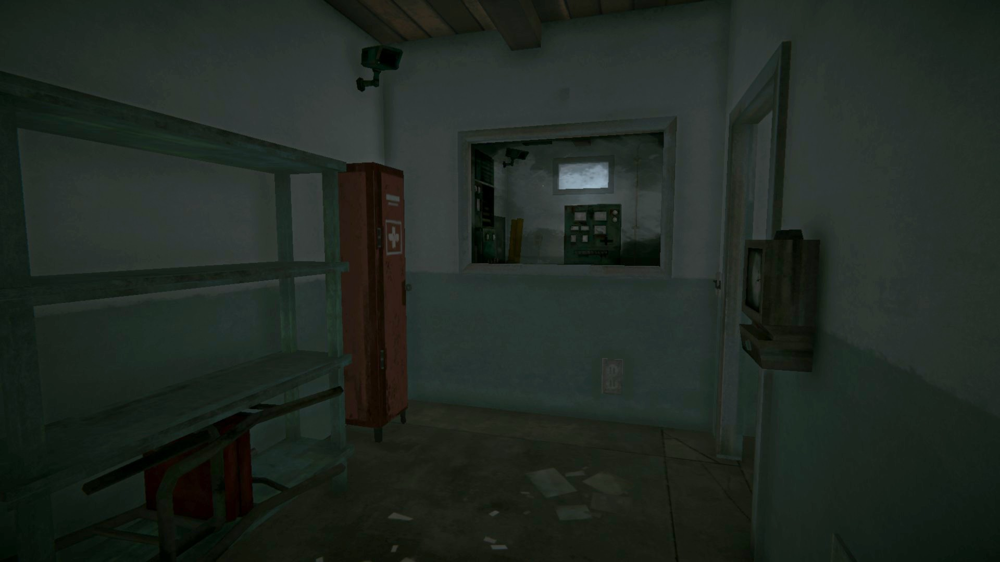
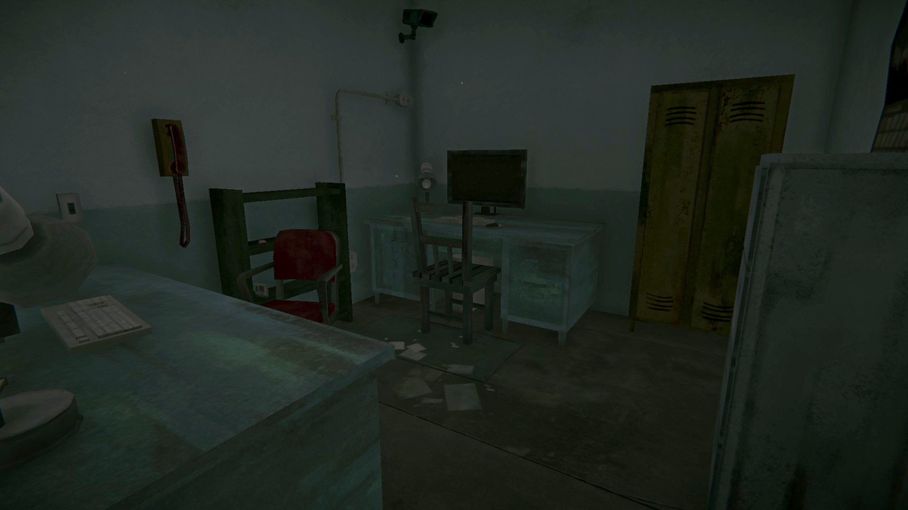

# Radio Control Hut

**Categories:** Indoor locations, Industrial locations, Locations, Locations in Bleak Inlet · **Source:** [Fandom](https://thelongdark.fandom.com/wiki/Radio_Control_Hut)

**Radio Control Hut**

[RadioControlHutOutside](../assets/RadioControlHutOutside.jpg)

**Location**

[RadioControlHutMap](../assets/RadioControlHutMap.jpg)

**Region:** [Bleak Inlet](./Bleak%20Inlet.md)

**General**

**Type:** Industrial

[Bed icon](../assets/Bed_icon.png)

[Workbench icon green](../assets/Workbench_icon_green.png)

Has an interior **Radio Control Hut** is a location found in [Bleak Inlet](./Bleak%20Inlet.md) on the [Echo One Radio Tower](./Echo%20One%20Radio%20Tower.md) plateau. It can easily be found by looking for the large red-and-white transmitter standing next to it and makes it one of the easiest landmarks to identify in the region.

## Location features

The Radio Control Hut can only be accessed at first by going through the [Ravine](./The%20Ravine.md). Once the location has been reached once, a rope can be deployed at the [Pensive Lookout](./Pensive%20Lookout.md) standing on the same plateau. This makes the location accessible from the Bleak Inlet region itself. The mountaineering rope that the player deploys is the only way to go from Bleak Inlet to the plateau in general, and Radio Control Hut in general, making it a risky destination if the Survivor isn't in the best condition.

The Radio Control Hut is arguably the most remote location in the region, being not only in a place that has a single point of entry upon first arriving in the region, but also standing at the very end of the plateau area. To reach the Radio Control Hut, the Survivor needs to pass the Lookout, which is patrolled by a pack of [Timberwolves](./Timberwolf.md), then walk by a parking lot (that contains both a [Memento](./Mementos.md) as well as some more wolves) then cross a wooden bridge high above the inlet to finally reach the Control Hut itself.

The Radio Control Hut is a standard location when it comes to loot, containing only a handful of items even on the lowest of difficulties. Some notable features includes a [Medical Locker](./Medical%20Locker.md), a rare find, as well as all three types of [Camera](./Camera.md) FastFilm. On one of the desks in the first room, the player will be able to get the [Communication Report](./Communication%20Report.md) collectible, a memo that contains the access keycode to the [Workshop](./Workshop.md) at the [Cannery](./Last%20Resort%20Cannery.md). Picking up the memo will automatically save the keycode and input it when the player reaches the Workshop.

While the Radio Control Hut can technically be considered a safehouse, it is by far the worst choice a player could make. The Control Hut should be viewed as nothing more than a one-night pit stop to regain Condition and Stamina and ensure a safe climb down the Lookout deployed rope. It has no crafting area, no protected fire (neither fireplace nor firepit), no bed of any kind and is located in the single most remote area of the map. It contains:

- Metal Chairs
- Locker (x2)
- [Medical Locker](./Medical%20Locker.md)
- Desk (x2)
- [Filing cabinets](./File%20Cabinet.md)

## Gallery

