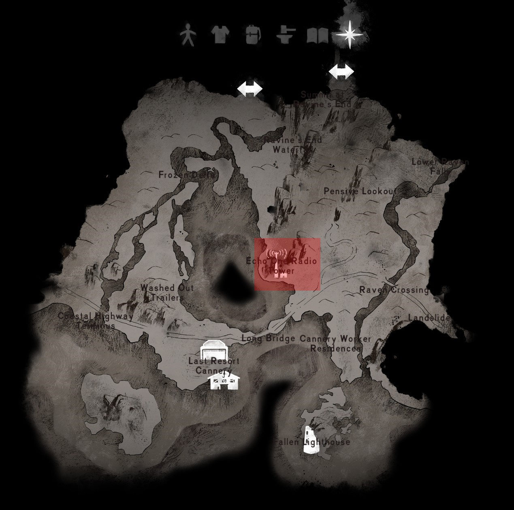
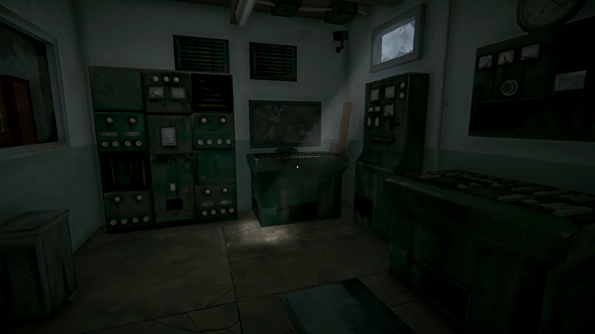
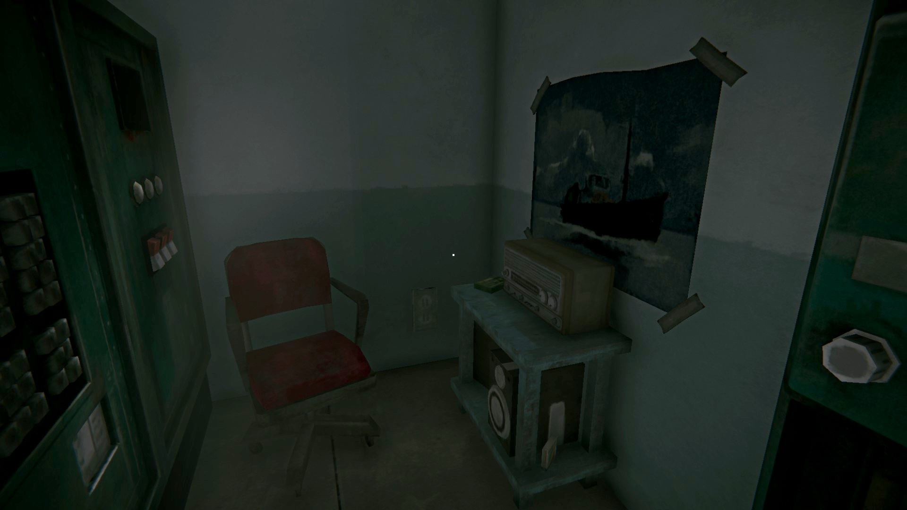
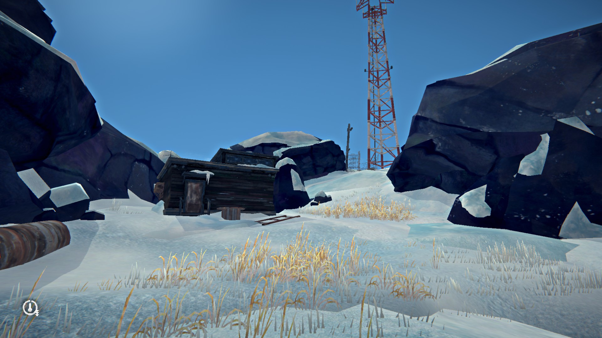

# Radio Control Hut

**Categories:** Indoor locations, Industrial locations, Locations, Locations in Bleak Inlet · **Source:** [Fandom](https://thelongdark.fandom.com/wiki/Radio_Control_Hut)

**Radio Control Hut**

_RadioControlHutOutside.jpg_

**Location**

_RadioControlHutMap.jpg_

**Region:** [Bleak Inlet](./Bleak%20Inlet.md)\|-

**General**

**Type:** Industrial\|-

_bed\_icon.png_

_workbench\_icon\_green.png_

_A rare Medical Locker._

_The Communication Report is lying on the keyboard on one of the desks._

_The control room of the hut._

_A small nook to listen to the radio._

_A view from the outside showing the Echo One Radio Tower standing behind the Control Hut._

_Radio\_hut\_(4).jpg_
