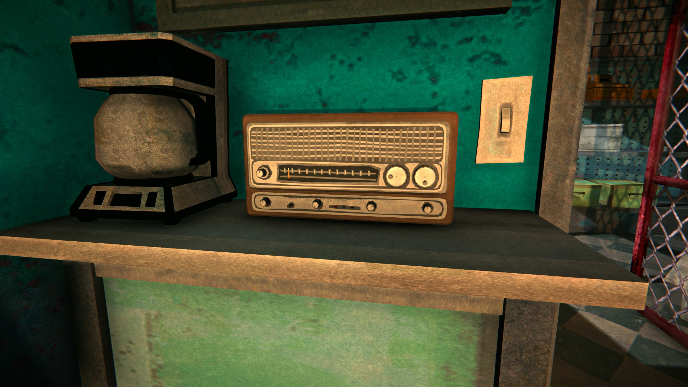
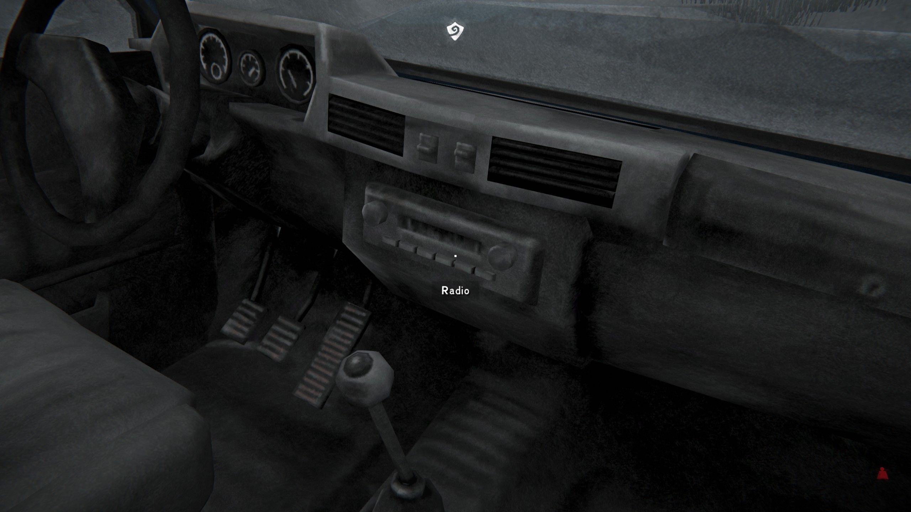
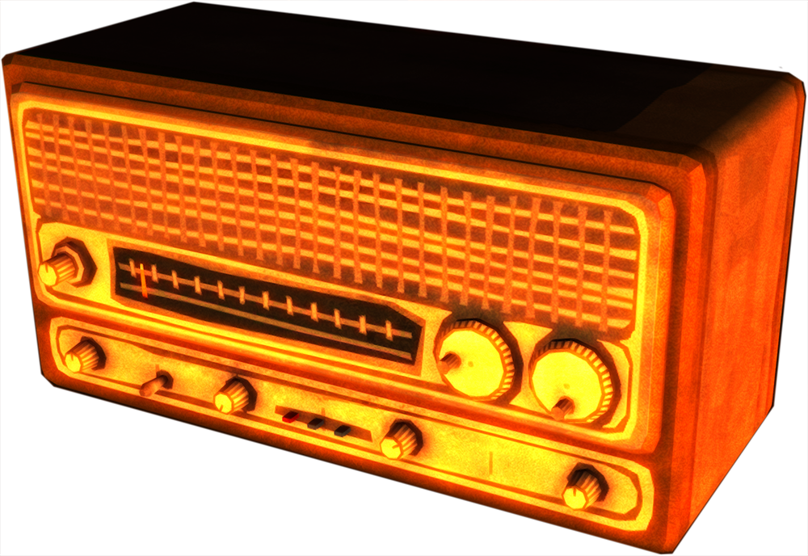

# Radio

**Categories:** Interactable Objects · **Source:** [Fandom](https://thelongdark.fandom.com/wiki/Radio)

**Contents**

- [Locations](#locations)
- [Lower Great Bear](#lower-great-bear)
- [Far Territory](#far-territory)
- [Trivia](#trivia)

**Radio**

|

Story item

Yes

A **Radio** is an interactable electronic device that can be found in many locations across the Island.

- A small, portable radio is often found in many homes
- A [Car](./Car.md) or [Truck](./Truck.md) will have one next to the dashboard.

Both can be interacted with, but will do nothing unless an [Aurora](./Aurora.md) is active, in which case piano music will begin playing unless the radio is turned off or until the Aurora ends.

A special yellow radio with an antenna and microphone will appear if the [Trader](./Trader.md) is enabled, and is used to communicate with him.

## Locations

Aside from vehicles, the following locations contain a radio:

### Lower Great Bear

- [Milton Credit Union](./Milton%20Credit%20Union.md)
- [Milton House (Grey Mother's)](./Milton%20House%20%28Grey%20Mother%27s%29.md)
- [Milton Park (Park office)](./Milton%20Park.md)
- [Paradise Meadows Farm](./Paradise%20Meadows%20Farm.md)
- [Orca Gas Station](./Orca%20Gas%20Station.md)
- [Trapper's Homestead](./Trapper%27s%20Homestead.md)
- [Camp Office](./Camp%20Office.md)
- [Carter Hydro Dam](./Carter%20Hydro%20Dam.md)
- [Signal Hill](./Signal%20Hill.md)
- [Pleasant Valley Farmstead](./Pleasant%20Valley%20Farmstead.md)
- [Pleasant Valley Outbuildings](./Pleasant%20Valley%20Outbuildings.md)
- [Thomson's Crossing](./Thomson%27s%20Crossing.md) ([Crossroads House](./Crossroads%20House.md))
- [Quonset Garage](./Quonset%20Garage.md)
- [Jackrabbit Island](./Jackrabbit%20Island.md)
- [Misanthrope's Homestead](./Misanthrope%27s%20Homestead.md)
- [Coastal House](./Coastal%20House.md) (Currently unconfirmed, which if any of the unnamed coastal houses has one)

## Trivia
