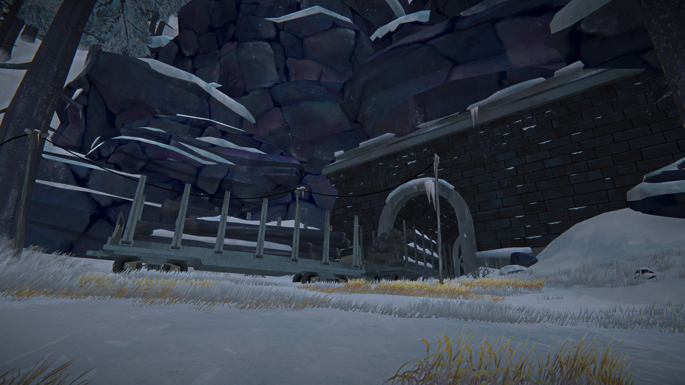
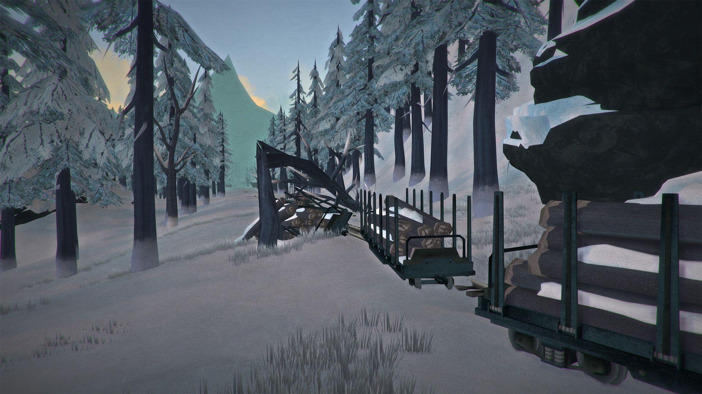
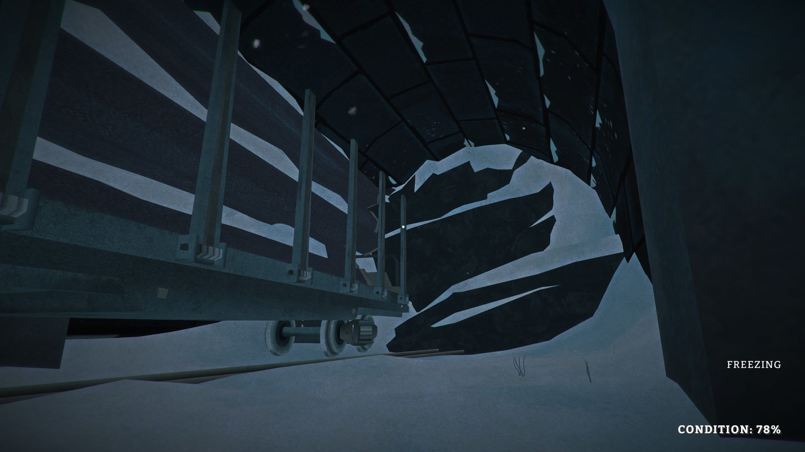

# Rail Tunnel

**Categories:** Landmarks, Locations, Locations in Mystery Lake, Outdoor locations, Sheltered locations · **Source:** [Fandom](https://thelongdark.fandom.com/wiki/Rail_Tunnel)

**Rail Tunnel**

**Location**

**Region:** [Mystery Lake](./Mystery%20Lake%20%28region%29.md)

**General**

**Type:** Landmark

## Overview

Rail Tunnel consists of a titular railway tunnel leading to [Forlorn Muskeg](./Forlorn%20Muskeg.md) and several log wagons. There may be some loot nearby to scavenge inside of containers scattered around the carriages. Some [Rose Hip](./Rose%20Hip.md) bushes are near the tunnel and sometimes a [First Aid Kit](./First%20Aid%20Kit.md) spawns in the snow near the bushes. Usually a single piece of [Cedar Firewood](./Cedar%20Firewood.md) is on the floor inside the tunnel.

The inside of the tunnel provides some shelter from the wind.

## Trivia

The Rail Tunnel was originally a collapsed tunnel called "Tunnel Collapse" in the 2014 pre alpha version of _The Long Dark_, before Forlorn Muskeg was introduced.

## Gallery

