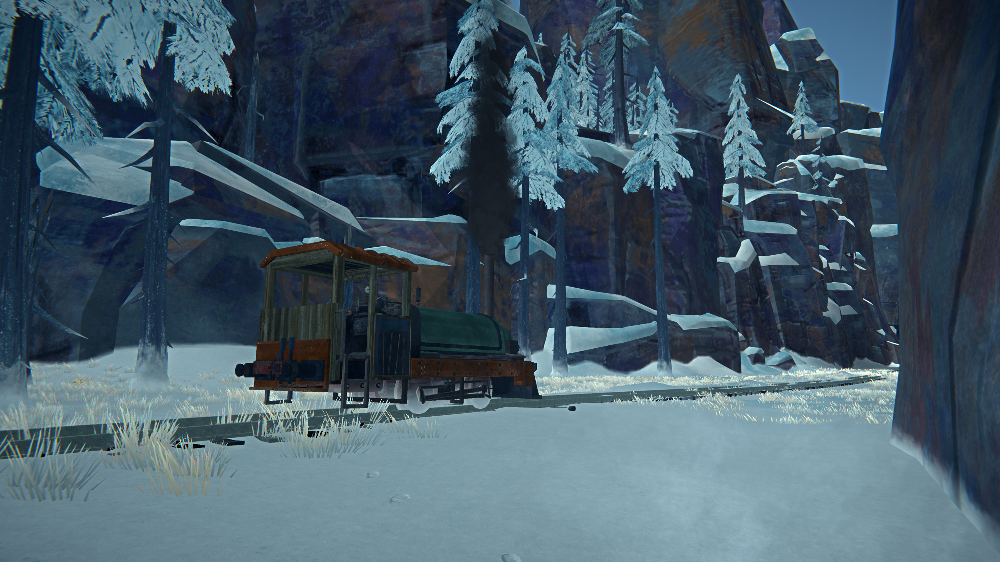
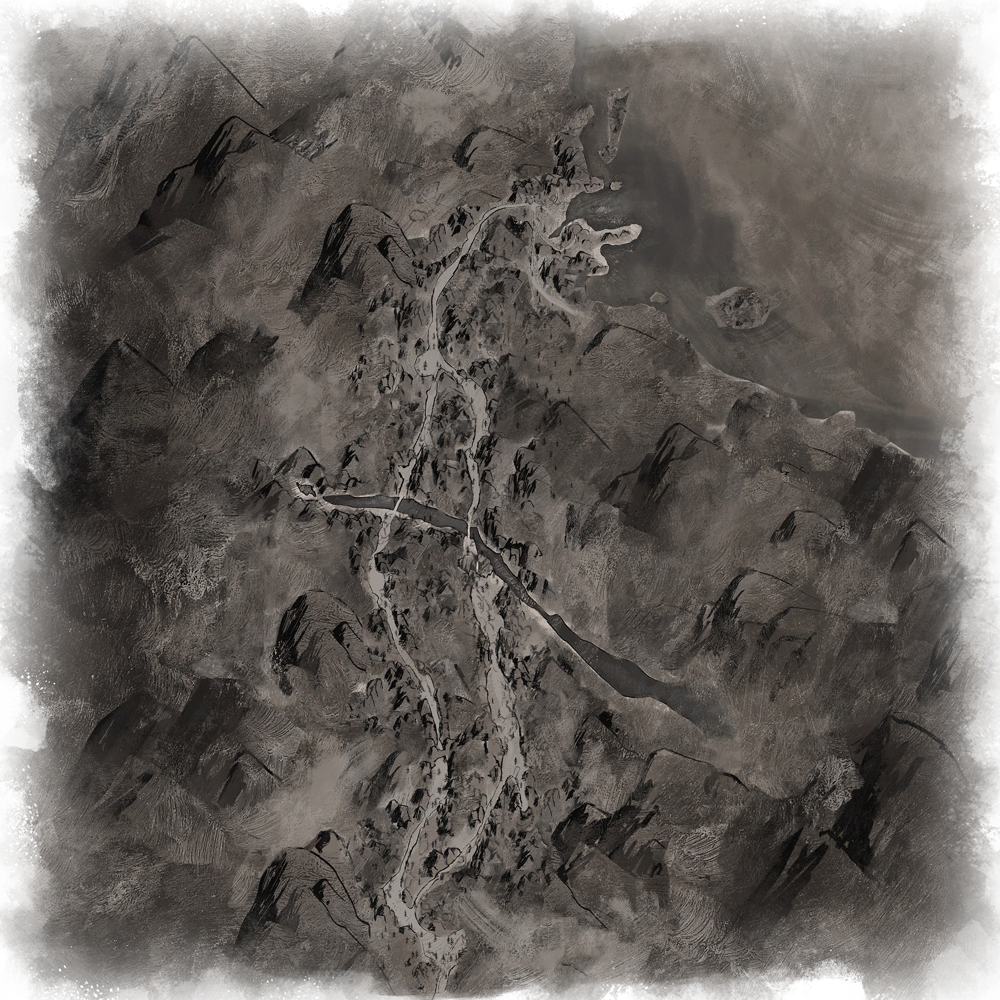

# Railway

**Contents**

- [Overview](#Overview)
- [Locations](#Locations)
- [Train Maintenance Yard](#Train_Maintenance_Yard)
- [Train Maintenance Shed](#Train_Maintenance_Shed)
- [Switching Yard 1](#Switching_Yard_1)
- [Tunnel 1](#Tunnel_1)
- [Bridge 1](#Bridge_1)
- [Collapsed Tunnel](#Collapsed_Tunnel)
- [Railyard](#Railyard)
- [Wye Track & Depot](#Wye_Track_%26_Depot)
- [SAR Station](#SAR_Station)
- [Bridge 2](#Bridge_2)
- [Switching Yard 2](#Switching_Yard_2)
- [Derelict Siding](#Derelict_Siding)
- [Trivia](#Trivia)

<table>
<colgroup>
<col style="width: 33%" />
<col style="width: 33%" />
<col style="width: 33%" />
</colgroup>
<tbody>
<tr>
<td width="40px"><figure>

<figcaption>2120907963_TLD-Wintermute-v2.png.de8a285930f6a8f5ad9cf5878754cf5b.png</figcaption>
</figure></td>
<td>
<strong>Wintermute-Exclusive content.</strong> 

This content only appears in <a href="./Wintermute.md" class="wikilink" title="Wintermute">Wintermute</a>.

</td>
<td>
|}

<table class="infobox">
<caption>Railway</caption>
<colgroup>
<col style="width: 50%" />
<col style="width: 50%" />
</colgroup>
<tbody>
<tr>
<td colspan="2"><figure>

<figcaption>Steam_Loco_idle_1.png</figcaption>
</figure></td>
</tr>
<tr>
<td colspan="2" class="section">
<strong>Location on <a href="./Great%20Bear%20Island.md" class="wikilink" title="Great Bear Island">Great Bear Island</a></strong>
</td>
</tr>
<tr>
<td colspan="2"><figure>

<figcaption>No_picture.png</figcaption>
</figure></td>
</tr>
<tr>
<td colspan="2"><figure>

<figcaption>Railway_In-Game_Map.png</figcaption>
</figure></td>
</tr>
<tr>
<td colspan="2" class="section">
<strong>Details</strong>
</td>
</tr>
<tr>
<td>
Description
</td>
<td>
A section of isolated railway running from a southern maintenance yard near Perseverance Mills all the way to a SAR station on the northern coast.
</td>
</tr>
<tr>
<td>
Connecting Regions
</td>
<td>
<a href="./Perseverance%20Mills.md" class="wikilink" title="Perseverance Mills">Perseverance Mills</a> (unused)
</td>
</tr>
<tr>
<td>
Characters
</td>
<td>
<a href="./Heller.md" class="wikilink" title="Heller">Heller</a> <a href="./Astrid%20Greenwood.md" class="wikilink" title="Astrid Greenwood">Astrid Greenwood</a>
</td>
</tr>
<tr>
<td>
Date Added
</td>
<td>
31 March 2026
</td>
</tr>
</tbody>
</table>

The <strong>Railway</strong> (or <strong>Railway Region</strong>) is one of the regions added to <a href="./Wintermute.md" class="wikilink" title="Wintermute">Wintermute</a> in <a href="./Episode%205%20-%20The%20Light%20At%20The%20End%20Of%20All%20Things.md" class="wikilink" title="Episode 5">Episode 5</a>. It does not have a connection to any other region directly, though it can be inferred it is accessed through the inaccessible Perseverance Mill located in <a href="./Perseverance%20Mills.md" class="wikilink" title="Perseverance Mills">Perseverance Mills</a>. It is said to be north of <a href="./Desperation%20Bay.md" class="wikilink" title="Desperation Bay">Desperation Bay</a>, along the coastline, possibly making it the northern most region currently in Wintermute.

<h2 id="Overview">Overview</h2>

The region consists of a set of massive ravines and valleys, which a portion of the <a href="./Trans-Island%20Railway%20Line.md" class="wikilink" title="Trans-Island Railway Line">Trans-Island Railway Line</a> cuts through. The line connects a Maintenance Shed on the southern edge to the SAR Station at the northern edge. Between the maintenance depot and the SAR station, the line splits into two branches at the Rail Junction. Along the branches there are two sidings and two yards, where some shunting and switching is required, alongside a duo of bridges over a fast-flowing river. The line terminates at the SAR station to the north, which features the Wye Track to turn the engine around. The region has an abundance of <a href="./Coal.md" class="wikilink" title="coal">coal</a>, both in <a href="./Coal%20Bin.md" class="wikilink" title="coal bins">coal bins</a> and in caves, which is necessary to fuel the <a href="./Steam%20Train.md" class="wikilink" title="Steam Train">Steam Train</a>. Many of the railyards feature one to four <a href="./Wolf.md" class="wikilink" title="wolves">wolves</a>, which can be temporarily scared away using the locomotive's whistle.

It is impossible to travel the length of the region without the use of the Steam Locomotive, as the tracks are blocked by fences in several places, requiring you to bash them open with the Steam Locomotive.

<h2 id="Locations">Locations</h2>
<h4 id="Train_Maintenance_Yard">Train Maintenance Yard</h4>

The main yard you spawn at, implied to be past the small yard within the Mill at <a href="./Perseverance%20Mills.md" class="wikilink" title="Perseverance Mills">Perseverance Mills</a>. Previously accessed by a small road, possibly linked to the road at the Depot. A trailer can be found at the northern edge, alongside a lot of old industrial equipment scattered around.

<h4 id="Train_Maintenance_Shed">Train Maintenance Shed</h4>

A two story shed with space for one railcar inside, currently occupied by a flatbed. A small break room, locker room with attached bathroom, office space, workshop, and store room can be found inside, along with the main area for repairs. The <a href="./Steam%20Train.md" class="wikilink" title="Throttle">Throttle</a> can be found on the first floor workshop, and the <a href="./Piece%20of%20Paper%20%282%29.md" class="wikilink" title="Piece of Paper">Piece of Paper</a> with an <a href="./Emergency%20Kit.md" class="wikilink" title="Emegrency Kit">Emegrency Kit</a> in the second floor office.

<h4 id="Switching_Yard_1">Switching Yard 1</h4>

First set of switches encountered. A small platform with a coal bin can be found on the leftmost track, and corpse next to a campfire can be found near a small cave on the left side.

<h4 id="Tunnel_1">Tunnel 1</h4>

A tunnel passed through. A large pile of snow blocks the entrance, requiring you to speed up and bash through it.

<h4 id="Bridge_1">Bridge 1</h4>

A small wooden bridge crossing the region's river, with a gate blocking the southern side.

<h4 id="Collapsed_Tunnel">Collapsed Tunnel</h4>

A collapsed tunnel segment, heading deeper into Great Bear Island. The interior of the tunnel can be accessed, with a broken wall revealing a cave you can travel through for extra coal. Simply push the flatbed car off of the switching track before reversing, swapping the direction from Left to Right, and then proceeding down the main line.

<h4 id="Railyard">Railyard</h4>

A large Yard and Junction in the line, featuring a Coal Filling station, a small covered garage, and an abandoned Trailer. The <a href="./Truck.md" class="wikilink" title="truck">truck</a> parked at the garage can be entered, with a <a href="./Prybar.md" class="wikilink" title="Prybar">Prybar</a> and <a href="./Noisemaker.md" class="wikilink" title="Noisemakers">Noisemakers</a> spawning on a table. You pass through here two times, once heading to the SAR Station, and the other returning to the shed.

<h4 id="Wye_Track_&amp;_Depot">Wye Track &amp; Depot</h4>

The line terminates in this region, which formerly was home to a Depot, Parking Lot, and a tunnel which has collapsed. A road formerly led through the region, though it's become impassable due to avalanches on each end.

<h4 id="SAR_Station">SAR Station</h4>

Situated on a hill above the Depot and Wye track, The <a href="./Trauma%20Kit.md" class="wikilink" title="Trauma Kit">Trauma Kit</a> can be found in the <a href="./Helicopter.md" class="wikilink" title="Medical Helicopter">Medical Helicopter</a> left on the helipad, with the Bloodied Note beside it.

<h4 id="Bridge_2">Bridge 2</h4>

A second small wooden bridge crossing the region's river, used on the return trip. Both ends are blocked by fencing.

<h4 id="Switching_Yard_2">Switching Yard 2</h4>

A switching yard for a large, torched warehouse.

<h4 id="Derelict_Siding">Derelict Siding</h4>

A strangely long siding you must avoid by stopping. Wolves spawn nearby.

<h2 id="Trivia">Trivia</h2>
<ul>
<li>There is an unused transition between the Railway and Perseverance Mills behind the chain-link fence. This leads behind the sawmill, and is accessible by <a href="./Mountain%20Goating.md" class="wikilink" title="Mountain Goating">Mountain Goating</a> along the cliff walls. It is theorized that, in earlier versions, it was intended for Heller and Astrid to physically walk from Perserverance Mills to the Railway.</li>
<li>Some locations, much like the rest of Episode 5, reuse assets from <a href="./Tales%20from%20the%20Far%20Territory.md" class="wikilink" title="Tales from the Far Territory">Tales from the Far Territory</a>, such as the coal tower from <a href="./Transfer%20Pass.md" class="wikilink" title="Transfer Pass">Transfer Pass</a> at the Rail Junction, and the Helicopter from <a href="./Final%20Approach.md" class="wikilink" title="Final Approach">Final Approach</a> at the SAR Station.</li>
<li>Corpses can be found at many points, including the Train Maintenance Yard, the Depot, and the SAR Station.</li>
<li></li>
</ul>

<strong>Lua execution error in Module:Navbox function navbox</strong>
</td>
</tr>
</tbody>
</table>

