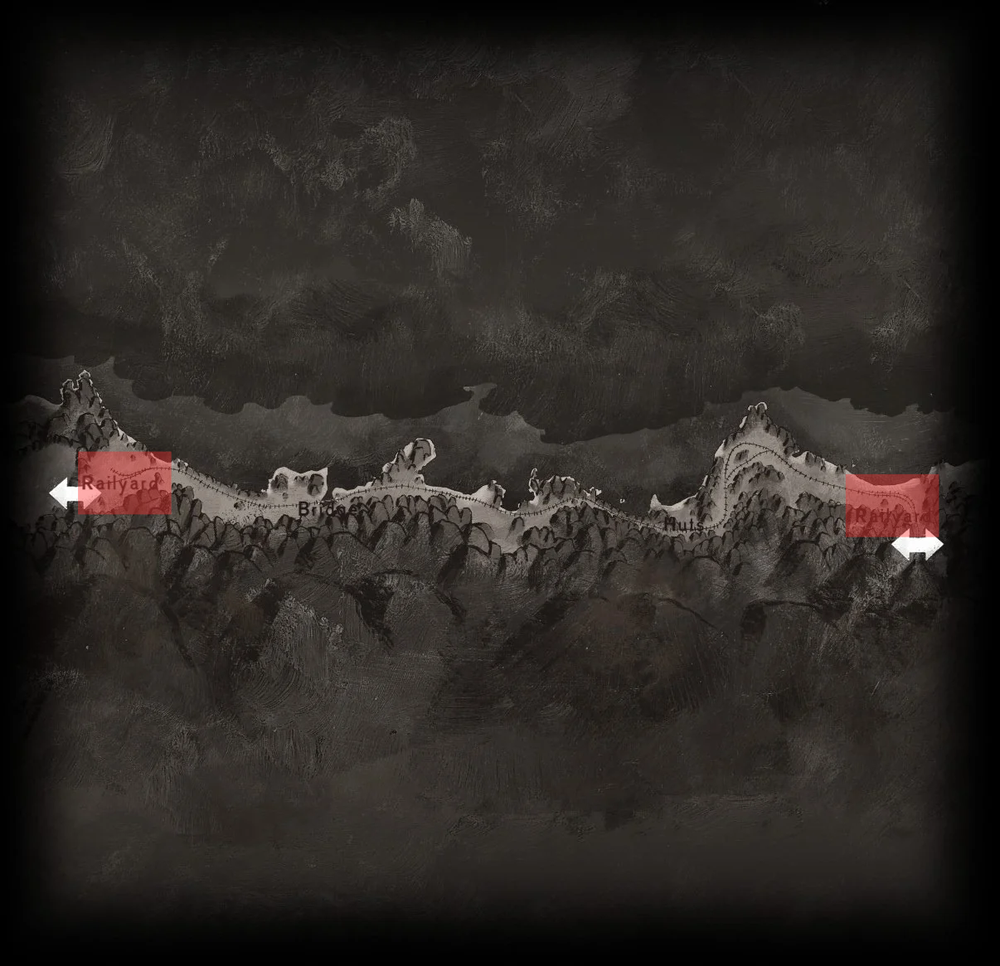

# Railyard \(Track Section 1\)

**Categories:** DLC Content, Locations, Locations in Anna Island -- Track Section 1, Outdoor locations · **Source:** [Fandom](https://thelongdark.fandom.com/wiki/Railyard_%28Track_Section_1%29)

_Seal\_icon.png_

**DLC-Exclusive content.** / This content requires the [Iron Road](./Iron%20Road.md) addon to be installed before it can be seen or used in regular gameplay.

 / **Railyard (Track Section 1)** /  / _No\_picture.png_ / **Location** /  / _Railyard\_Track\_Section\_1\_Location.png_ / **Region:** [Anna Island -- Track Section 1](./Anna%20Island%20--%20Track%20Section%201.md)\\|- / **Description:** 2 railyards / **General** / Has no shelter\ **Railyard** is a set of 2 locations in [Anna Island -- Track Section 1](./Anna%20Island%20--%20Track%20Section%201.md).

## Overview

### Eastern Railyard

Transitions to [Anna Island -- Track Section 2](./Anna%20Island%20--%20Track%20Section%202.md)

### Western Railyard
