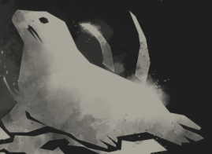

# Railyard \(Track Section 1\)

<table>
<colgroup>
<col style="width: 33%" />
<col style="width: 33%" />
<col style="width: 33%" />
</colgroup>
<tbody>
<tr>
<td width="40px"><figure>

<figcaption>Seal_icon.png</figcaption>
</figure></td>
<td>
<strong>DLC-Exclusive content.</strong> 

This content requires the <a href="./Iron%20Road.md" class="wikilink" title="Iron Road">Iron Road</a> addon to be installed before it can be seen or used in regular gameplay.

</td>
<td>
|}

<table class="infobox">
<caption>Railyard (Track Section 1)</caption>
<colgroup>
<col style="width: 50%" />
<col style="width: 50%" />
</colgroup>
<tbody>
<tr>
<td colspan="2"><figure>

<figcaption>No_picture.png</figcaption>
</figure></td>
</tr>
<tr>
<td colspan="2" class="section">
<strong>Location</strong>
</td>
</tr>
<tr>
<td colspan="2"><figure>
[Missing image: Railyard_Track_Section_1_Location.png]
<figcaption>Railyard_Track_Section_1_Location.png</figcaption>
</figure></td>
</tr>
<tr>
<td>
Region
</td>
<td>
<a href="./Anna%20Island%20--%20Track%20Section%201.md" class="wikilink" title="Anna Island -- Track Section 1">Anna Island -- Track Section 1</a>|-
</td>
</tr>
<tr>
<td>
Description
</td>
<td>
2 railyards
</td>
</tr>
<tr>
<td colspan="2" class="section">
<strong>General</strong>
</td>
</tr>
<tr>
<td></td>
<td>
Has no shelter|} <strong>Railyard</strong> is a set of 2 locations in <a href="./Anna%20Island%20--%20Track%20Section%201.md" class="wikilink" title="Anna Island -- Track Section 1">Anna Island -- Track Section 1</a>.

<h2 id="Overview">Overview</h2>
<h3 id="Eastern_Railyard">Eastern Railyard</h3>

Transitions to <a href="./Anna%20Island%20--%20Track%20Section%202.md" class="wikilink" title="Anna Island -- Track Section 2">Anna Island -- Track Section 2</a>

<h3 id="Western_Railyard">Western Railyard</h3>

Transitions to <a href="./Port%20Remnant.md" class="wikilink" title="Port Remnant">Port Remnant</a><strong>Lua execution error in Module:Navbox function navbox</strong>
</td>
</tr>
</tbody>
</table></td>
</tr>
</tbody>
</table>

