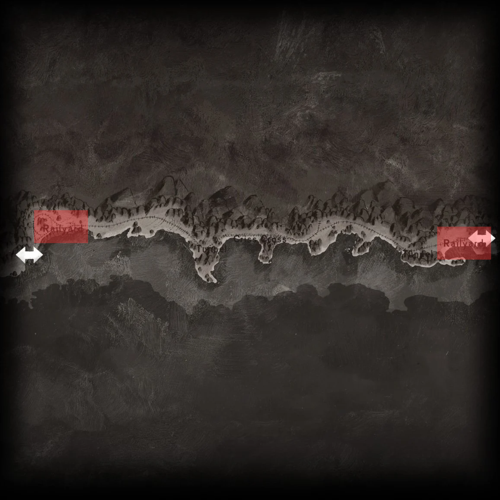

# Railyard \(Track Section 2\)

| Column 1 | Column 2 | Column 3 |
| --- | --- | --- |
|  / *Seal\_icon.png* | **DLC-Exclusive content.** / This content requires the [Iron Road](./Iron%20Road.md) addon to be installed before it can be seen or used in regular gameplay. | \|} / **Railyard** / \| Property \| Details \| / \| --- \| --- \| / \| \[\[File: / \\|  / *West* \\|  / *East* \\| / \\| --- \\| --- \\| \| 250px\]\] \| / \|  / *West* \|  / *East* \| / \| **Location** \|  \| / \|  / *Railyard\_Track\_2\_Location.png* \|  \| / \| Region \| [Anna Island -- Track Section 2](./Anna%20Island%20--%20Track%20Section%202.md)\\|- / Location \| / \| Description \| 2 railways in the region \| / \| **General** \|  \| / \|  \| Has no shelter\\|} **Railyard** is a set of 2 locations in [Anna Island -- Track Section 2](./Anna%20Island%20--%20Track%20Section%202.md). / ## Overview / ### Railyard West / The western Railyard houses the second [Repair Depot](./Repair%20Depot.md) on the island, as well as the unique [McLeod Ultra-Efficiency Whale Oil Heater](./McLeod%20Ultra-Efficiency%20Whale%20Oil%20Heater.md). The Railyard tends to be patrolled by [Wolves](./Wolf.md). A small upper area filled with pipes can be explored, and the pipe ridden areas tend to have bits of [Scrap Metal](./Scrap%20Metal.md) lying around. / A [Water Tower](./Water%20Tower.md) can be found at this railyard. / ### Railyard East / Close to the transition to [Anna Island -- Track Section 3](./Anna%20Island%20--%20Track%20Section%203.md). There is a [Firewood Bin](./Firewood%20Bin.md) near one of the flatbed cars, as well as some Scrap Metal around. A flatbed car needs to be rammed out of the way onto 2 side tracks when first entering this region. / **Lua execution error in Module:Navbox function navbox** \| |
| \[\[File: / \|  / *West* \|  / *East* \| / \| --- \| --- \| | 250px\]\] |  |
|  / *West* |  / *East* |  |
| **Location** |  |  |
|  / *Railyard\_Track\_2\_Location.png* |  |  |
| Region | [Anna Island -- Track Section 2](./Anna%20Island%20--%20Track%20Section%202.md)\|- | Location |
| Description | 2 railways in the region |  |
| **General** |  |  |
|  | Has no shelter\|} **Railyard** is a set of 2 locations in [Anna Island -- Track Section 2](./Anna%20Island%20--%20Track%20Section%202.md). / ## Overview / ### Railyard West / The western Railyard houses the second [Repair Depot](./Repair%20Depot.md) on the island, as well as the unique [McLeod Ultra-Efficiency Whale Oil Heater](./McLeod%20Ultra-Efficiency%20Whale%20Oil%20Heater.md). The Railyard tends to be patrolled by [Wolves](./Wolf.md). A small upper area filled with pipes can be explored, and the pipe ridden areas tend to have bits of [Scrap Metal](./Scrap%20Metal.md) lying around. / A [Water Tower](./Water%20Tower.md) can be found at this railyard. / ### Railyard East / Close to the transition to [Anna Island -- Track Section 3](./Anna%20Island%20--%20Track%20Section%203.md). There is a [Firewood Bin](./Firewood%20Bin.md) near one of the flatbed cars, as well as some Scrap Metal around. A flatbed car needs to be rammed out of the way onto 2 side tracks when first entering this region. / **Lua execution error in Module:Navbox function navbox** |  |
