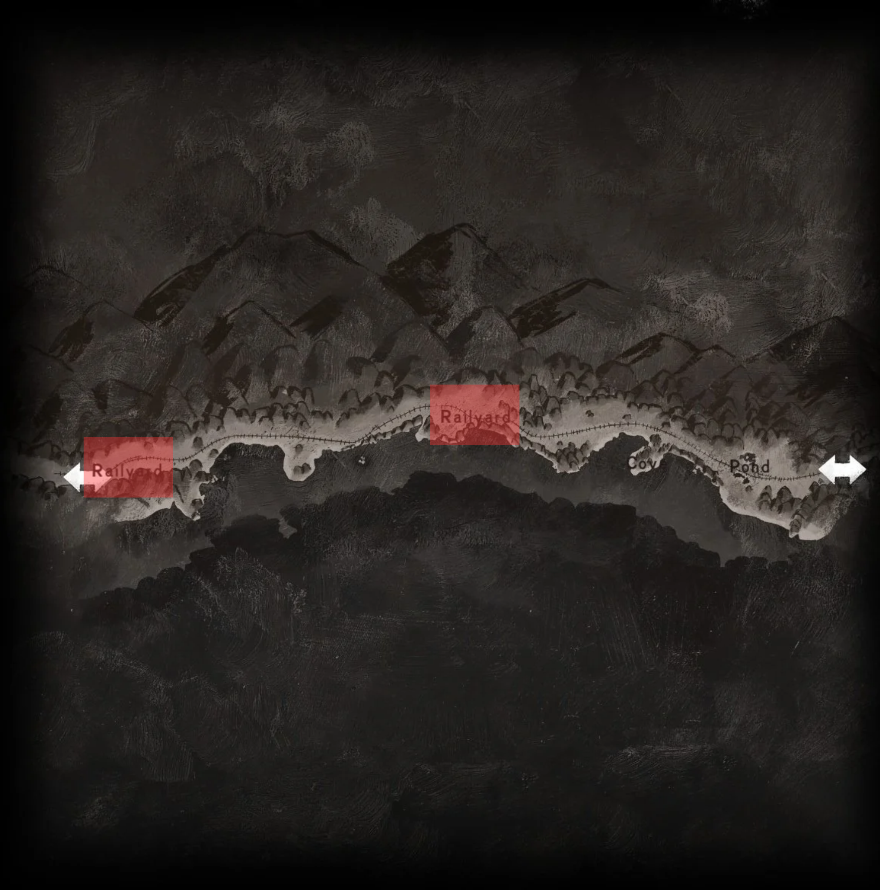

# Railyard \(Track Section 3\)

| Column 1 | Column 2 | Column 3 |
| --- | --- | --- |
|  / *Seal\_icon.png* | **DLC-Exclusive content.** / This content requires the [Iron Road](./Iron%20Road.md) addon to be installed before it can be seen or used in regular gameplay. | \|} / **Railyard** / \| Property \| Details \| / \| --- \| --- \| / \|  \|  / *No\_picture.png* \| / \| **Location** \|  \| / \|  \|  / *Railyard\_Track\_3\_Location.png* \| / \| Region \| [Anna Island -- Track Section 3](./Anna%20Island%20--%20Track%20Section%203.md)\\|- \| / \| Description \| A railyard \| / \| **General** \|  \| / \|  \| Has no shelter\\|} **Railyard** is a set of 2 locations in [Anna Island -- Track Section 3](./Anna%20Island%20--%20Track%20Section%203.md). / ## Overview / **Stub:****This article is a stub. You can help by \[//dummy.host/index.php?title=Railyard+%28Track+Section+3%29&amp;action=edit expanding it\].** / **Lua execution error in Module:Navbox function navbox** \| |
|  / *No\_picture.png* |  |  |
| **Location** |  |  |
|  / *Railyard\_Track\_3\_Location.png* |  |  |
| Region | [Anna Island -- Track Section 3](./Anna%20Island%20--%20Track%20Section%203.md)\|- |  |
| Description | A railyard |  |
| **General** |  |  |
|  | Has no shelter\|} **Railyard** is a set of 2 locations in [Anna Island -- Track Section 3](./Anna%20Island%20--%20Track%20Section%203.md). / ## Overview / **Stub:****This article is a stub. You can help by \[//dummy.host/index.php?title=Railyard+%28Track+Section+3%29&amp;action=edit expanding it\].** / **Lua execution error in Module:Navbox function navbox** |  |
