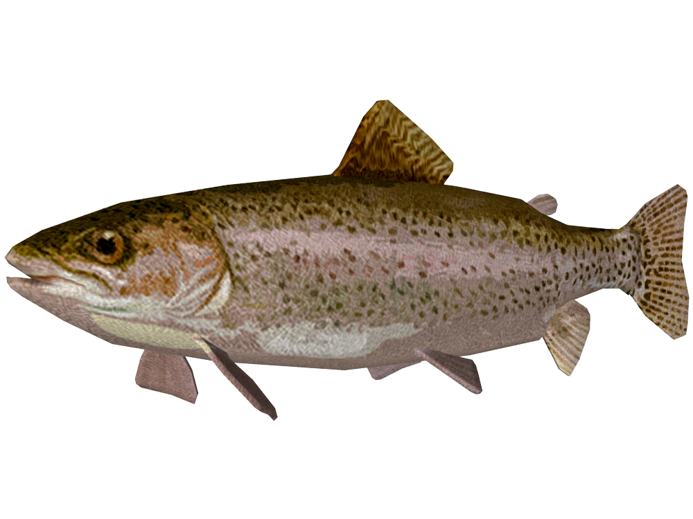

# Rainbow Trout \(Raw\)

**Contents**

- [Overview](#overview)
- [Recipe](#recipe)
- [Products](#products)
- [Gallery](#gallery)
- [Update history](#update-history)

**Rainbow Trout (Raw)**

| Property | Details |
| --- | --- |
| \[\[File: / \|  / *Raw* \|  / *Opened* \| / \| --- \| --- \| | 250px\]\] |
|  / *Raw* |  / *Opened* |
| Release | [27 November 2014](./The%20Long%20Dark%20%E2%80%94%20Changelog.md#0.163) |
| Wintermute | No |
| Renewable | Yes |
| **Properties** |  |
| Item type | [Food And Drink](./Food%20And%20Drink.md)\|- / Examine |
| **Values** |  |
| Calories | 575 kcal |
| Hydration | 0% |
| [Vitamin C](./Scurvy.md) | Moderate (20%) |
| Weight | 2.3 kg (5.06 lbs) |
| Oil/Weight | 0,025 |

**Rainbow Trout (Raw)** is a food item in *The Long Dark*.

## Overview

Rainbow Trout are small saltwater fish found commonly under the ice off the coast. They can be caught by [Ice Fishing](./Ice%20Fishing.md) using [Fishing Tackle](./Fishing%20Tackle.md). They can also rarely be found in caches or freezers in inland regions like Ash Canyon and Blackrock. Rainbow Trout can be between 0.5 and 2.3 kg raw.

At 0% condition food disappears if inside of a container, but not outside of containers or in the player's inventory.

## Recipe

Cooking trout takes 10 minutes by using a lit [fire](./Fire.md). Cooking increases its condition by 50%, decays 4 times slower than raw fish, and has a reduced chance of [Food Poisoning](./Food%20Poisoning.md) over raw fish and decreases its weight by 35%. Cooked trout's energy density is 385 calories per kilogram. Cooking fish also yields a small amount of [Lantern Fuel](./Lantern%20Fuel.md).

Cooking trout improves the [cooking skill](./Skills.md#Cooking). Using a [Cooking Pot](./Cooking%20Pot.md) reduces cooking time by 25%. Cooked food on an active fire for too long will burn (twice its 'Ready' cooking time), destroying the item and damaging a Cooking Pot if used.

## Products

## Gallery

| Column 1 |
| --- |
|  / *Old model.* |

## Update history

- UPDATE **27 November 2014 ([Update](./The%20Long%20Dark%20%E2%80%94%20Early%20Access%20Changelog.md#0.163)):**
  - Added to game.

**Lua execution error in Module:Navbox function navbox** **Lua execution error in Module:Navbox function navbox** [ru:Радужная форель (сырая)](ru:%D0%A0%D0%B0%D0%B4%D1%83%D0%B6%D0%BD%D0%B0%D1%8F_%D1%84%D0%BE%D1%80%D0%B5%D0%BB%D1%8C_%28%D1%81%D1%8B%D1%80%D0%B0%D1%8F%29)
